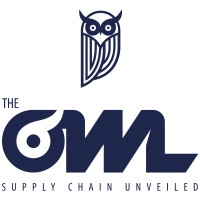

## **UNK Latam y The Owl Solutions anuncian alianza estratégica para impulsar la eficiencia y sostenibilidad de la cadena alimentaria en Chile y México**

**Santiago de Chile / Ciudad de México**

La empresa chilena **UNK Latam** y **The Owl Solutions**, compañía tecnológica de **capitales chilenos con sede operativa en Canadá**, anunciaron una **alianza comercial estratégica** para operar conjuntamente en **Chile y México**, con el objetivo de optimizar la trazabilidad, la eficiencia y la sostenibilidad en la cadena alimentaria regional.

La colaboración integra la **experiencia de UNK Latam** en soluciones de monitoreo de temperatura, trazabilidad y automatización de la cadena de frío, con la **plataforma analítica avanzada de The Owl Solutions**, especializada en gestión del desempeño y visibilidad de la cadena de suministro.

* * *

### **Una Alianza para Transformar la Cadena Alimentaria**

La sinergia entre ambas compañías busca ofrecer a productores, distribuidores y retailers una solución integral que permita **reducir pérdidas alimentarias, mejorar la eficiencia operativa y asegurar el cumplimiento normativo sanitario**.

_“Esta alianza representa un paso clave para fortalecer la seguridad alimentaria y la sostenibilidad en la región. Integrar tecnologías de trazabilidad y análisis de datos permitirá a las empresas tomar decisiones más informadas y responsables”_, señaló [**Jaime Torres Concha**, Director General de UNK Latam.](https://www.linkedin.com/in/jtorresconcha/)

_“The Owl Solutions nació con la visión de transformar las cadenas de suministro a través del poder de los datos. Asociarnos con UNK Latam nos permite acercar esa visión al mercado latinoamericano, impulsando una industria más eficiente, digital y sustentable”_, comentó [**Angelo Gordillo Avila**, Country Manager de The Owl Solutions para México.](https://www.linkedin.com/in/angelo-gordillo-avila-569b50359/)

La alianza permitirá **ofrecer soluciones conjuntas** tanto a empresas chilenas como mexicanas, potenciando la cooperación tecnológica entre ambos países y fomentando **operaciones más sostenibles y transparentes**.

* * *

### **Impacto Regional**

Con esta iniciativa, ambas organizaciones apuntan a **fortalecer el ecosistema tecnológico latinoamericano** y contribuir al cumplimiento de los **Objetivos de Desarrollo Sostenible** relacionados con **consumo responsable, hambre cero y acción climática**.

La implementación conjunta iniciará en sectores estratégicos de **retail, alimentos procesados, distribución y logística**, donde la visibilidad de datos y el control de temperatura son factores críticos para la eficiencia operativa y la sustentabilidad.

* * *

### **Acerca de UNK Latam**

**UNK Latam** es una empresa chilena especializada en el desarrollo de soluciones tecnológicas para la **cadena de frío y trazabilidad alimentaria**. Con presencia en todo Chile y proyección hacia México, su enfoque se centra en garantizar la **seguridad alimentaria, la eficiencia logística y la reducción de desperdicios** a través del uso de sensores inteligentes, software y análisis de datos.

**👉 [www.unklatam.com](https://unklatam.com/)**

* * *

### **Acerca de The Owl Solutions**

**The Owl Solutions**, empresa de **capital chileno** con base operativa en **Waterloo, Canadá**, desarrolla una plataforma SaaS que permite a las organizaciones **medir, monitorear y mejorar el desempeño de su cadena de suministro**. Su tecnología ofrece **analítica avanzada, visibilidad integral y herramientas predictivas** que impulsan la eficiencia y la sostenibilidad en las operaciones.

**👉 [www.theowlsolutions.com](https://theowlsolutions.com/)**

* * *
