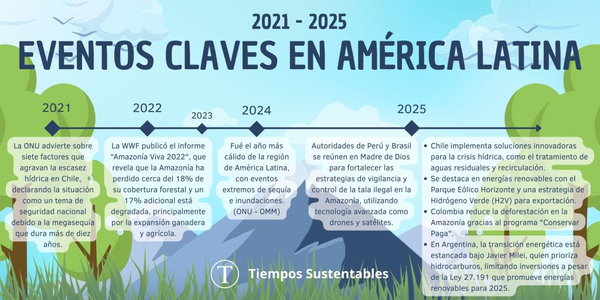
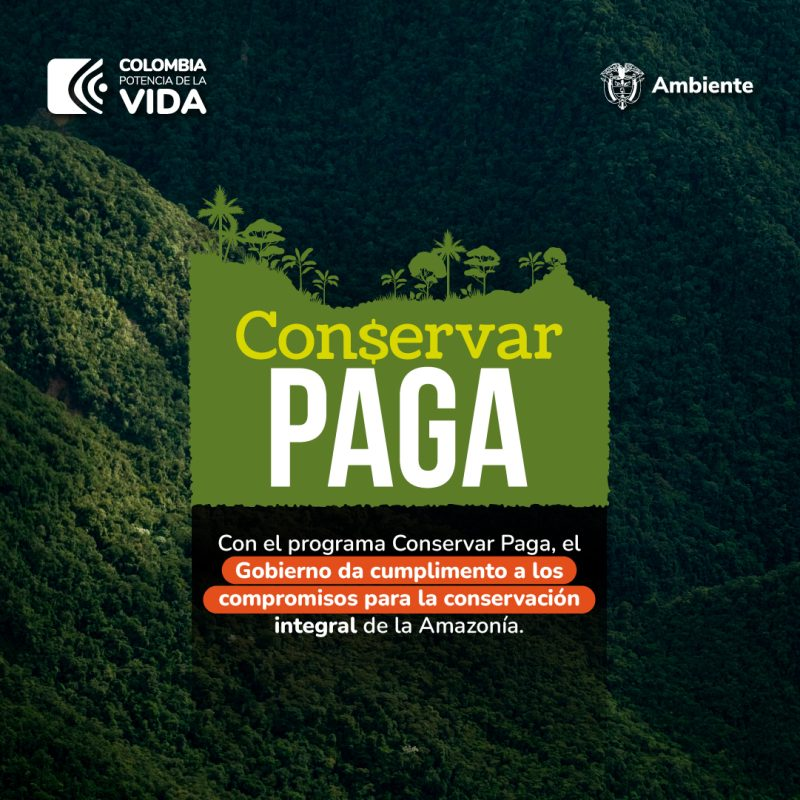
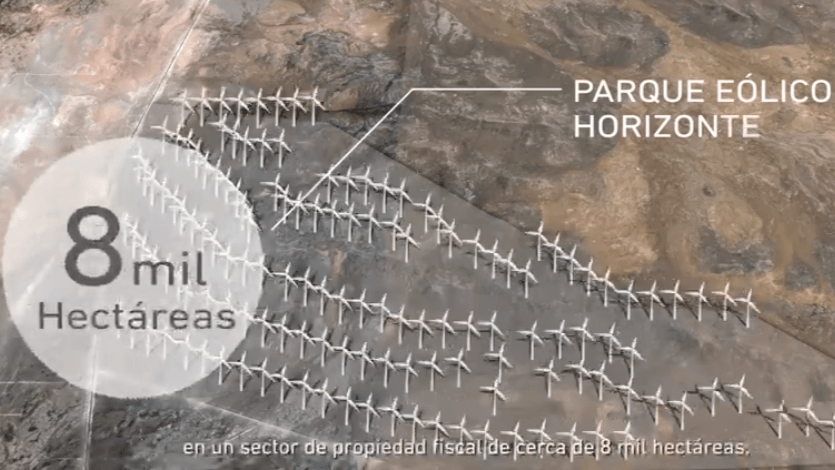

América Latina se encuentra en una encrucijada climática. Mientras el último informe de la ONU y la Organización Meteorológica Mundial (OMM) de marzo de 2025 declara a 2024 como el año más cálido de la región, con eventos extremos de sequía e inundaciones, algunos países lideran la respuesta con políticas audaces. Este reportaje explora las problemáticas más complejas, como la crisis hídrica en Chile y la deforestación en la Amazonía, pero también destaca logros clave, como la transición energética y analiza el contraste político entre países como Chile y Argentina.

<figure>

<figcaption>

América Latina: Clima, Agua y Energía (2021-2025)

</figcaption>

</figure>

### 1\. Chile: La batalla contra la sed y las soluciones desde la innovación

La megasequía, que ya se extiende por más de una década, ha convertido a la escasez hídrica en un tema de seguridad nacional para Chile. Un informe de la ONU de 2021 ya advertía de los siete factores que agudizan el problema, desde el **cambio climático** y las presiones productivas hasta la infraestructura y el marco legal. Sin embargo, la respuesta actual apunta a la innovación tecnológica como una salida viable.

La desalinización se ha convertido en una solución de emergencia, especialmente para el sector minero, pero su alto costo y consumo energético limitan su escalabilidad.

Expertos en sostenibilidad, como los de la **Fundación Chile (FCh)**, señalan que el futuro pasa por otras vías. Su informe _Escenarios Hídricos 2030_ propone soluciones con un alto potencial de crecimiento, como la **re-circulación de agua y el tratamiento y re-uso de aguas residuales**.

Según FCh, la implementación de estas medidas podría aportar miles de millones de metros cúbicos de agua al año.

### 2\. La Amazonía: Del colapso a la esperanza de la cooperación regional

La deforestación, impulsada principalmente por la expansión de la ganadería y la agricultura, ha sido una de las mayores amenazas para el "pulmón del planeta". Un informe de **WWF** de 2022 documentó que la Amazonía ya ha perdido cerca del **18% de su cobertura forestal** y un 17% más está degradada. Sin embargo, las noticias recientes sugieren un cambio de rumbo gracias a políticas públicas efectivas y a la cooperación.

**Colombia** ha logrado un hito histórico al reducir drásticamente su tasa de deforestación. El **Ministerio de Ambiente de Colombia** atribuye este éxito al fortalecimiento del programa **"Conservar Paga"**, que entrega incentivos económicos a las comunidades locales para que actúen como guardianes del bosque.

Paralelamente, la colaboración entre **Perú** y **Brasil** se intensifica. En febrero de 2025, autoridades de ambos países se reunieron en Madre de Dios para reforzar las estrategias de vigilancia y control de la tala ilegal. El uso de **tecnología de vanguardia**, como drones y satélites, ha sido clave para monitorear en tiempo real la selva, permitiendo una acción más rápida y coordinada.

### 3\. Transición energética: El contraste entre un líder y un observador

La transición energética es un pilar fundamental de la sostenibilidad, y América Latina se posiciona como un actor clave, liderado por **Brasil, Chile y México**. No obstante, las políticas internas marcan grandes diferencias.

**Chile** se consolida como un líder regional en energías renovables. El país no solo alberga el **Parque Eólico Horizonte**, el segundo más grande de la región, sino que también ha impulsado una agresiva estrategia para el desarrollo del **Hidrógeno Verde (H2V)**.

El **Ministerio de Energía** chileno ha establecido un plan de acción que incluye incentivos tributarios y la formación de capital humano en la Región de Magallanes, proyectando a Chile como un futuro exportador de este combustible limpio.

En contraste, la transición energética en **Argentina** se encuentra en un limbo político. Un análisis de **Climate Tracker Latam** indica que, bajo la administración actual de Javier Milei, el Estado ha adoptado un rol "ausente", dejando el desarrollo del sector en manos del mercado y priorizando la explotación de hidrocarburos como el yacimiento de Vaca Muerta. A pesar de que la **Ley 27.191** establece metas de 20% de energía renovable para 2025, la falta de un plan estatal claro frena la inversión y el avance en un momento crítico.

* * *

### Conclusión

La coyuntura ambiental en América Latina es un mosaico de desafíos y oportunidades. Los datos son claros: la región está en la primera línea de los impactos del cambio climático. Sin embargo, el reportaje muestra que las soluciones existen y están siendo implementadas. Los esfuerzos de Chile en la innovación hídrica y energética, y la cooperación binacional para proteger la Amazonía, demuestran que las políticas públicas y la voluntad política son los motores del cambio.

* * *

### Referencias y Citas

- **Fundación Chile (FCh):** "Escenarios Hídricos 2030, cinco medidas para abordar la crisis del agua en la reactivación sostenible". [https://fch.cl/noticias/cinco-medidas-para-abordar-la-crisis-del-agua-en-la-reactivacion-sostenible/](https://fch.cl/noticias/cinco-medidas-para-abordar-la-crisis-del-agua-en-la-reactivacion-sostenible/)

- **Organización de las Naciones Unidas (ONU):** "Escasez hídrica en Chile, desafíos pendientes" (2021). [https://chile.un.org/es/105929-escasez-h%C3%ADdrica-en-chile-desaf%C3%ADos-pendientes](https://chile.un.org/es/105929-escasez-h%C3%ADdrica-en-chile-desaf%C3%ADos-pendientes)

- **Ministerio de Ambiente de Colombia:** Comunicado de prensa sobre la "reducción histórica de la deforestación en la Amazonía colombiana" (2025). [https://www.minambiente.gov.co/reduccion-historica-de-la-deforestacion-en-la-amazonia-colombiana/](https://www.minambiente.gov.co/reduccion-historica-de-la-deforestacion-en-la-amazonia-colombiana/)

- **Inforegión (Perú):** "Autoridades y expertos de Perú y Brasil refuerzan estrategias contra delitos forestales" (febrero 2025). [https://inforegion.pe/autoridades-y-expertos-de-peru-y-brasil-refuerzan-estrategias-contra-delitos-forestales/](https://inforegion.pe/autoridades-y-expertos-de-peru-y-brasil-refuerzan-estrategias-contra-delitos-forestales/)

- **World Wide Fund for Nature (WWF):** Informe "Amazonía Viva 2022". [https://www.worldwildlife.org/descubre-wwf/historias/amazonia-en-crisis-la-perdida-de-bosques-amenaza-a-la-region-y-al-planeta](https://www.worldwildlife.org/descubre-wwf/historias/amazonia-en-crisis-la-perdida-de-bosques-amenaza-a-la-region-y-al-planeta)

- **Climate Tracker Latam:** Artículo "Transición energética en Argentina: en manos del mercado y con un Estado ausente" (2025). [https://climatetrackerlatam.org/historias/transicion-energetica-en-argentina-en-manos-del-mercado-y-con-un-estado-ausente/](https://climatetrackerlatam.org/historias/transicion-energetica-en-argentina-en-manos-del-mercado-y-con-un-estado-ausente/)

- **Ministerio de Energía de Chile:** Información y reportes sobre el Plan de Acción de Hidrógeno Verde (H2V). [https://energia.gob.cl/](https://energia.gob.cl/)
