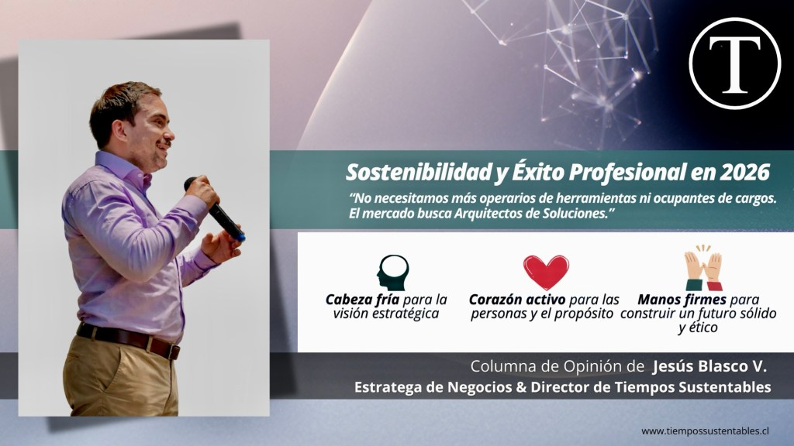
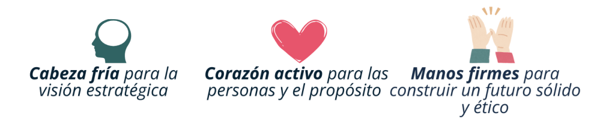

Durante los últimos años, he analizado el mercado laboral desde ángulos que parecen opuestos, pero que convergen en un mismo diagnóstico. Desde la masividad en **Laborum** y la táctica comercial en **Verisure**, hasta la visión sistémica en la **ONU**, el desarrollo empresarial en **Multiply** y la dirección de alianzas en **Emprediem**, he confirmado una verdad incómoda: **La empleabilidad ha dejado de ser una cuestión de "marketing personal" para convertirse en una obra de ingeniería humana.**

<figure>

<figcaption>

Imagen de cabecera de la columna sobre Sostenibilidad y Éxito Profesional en 2026, con el estratega de negocios Jesús Blasco V.

</figcaption>

</figure>

Sé que para muchos —Gerentes de Talento, consultores de RR.HH. y profesionales buscando su lugar— la presión por "encajar" o encontrar la pieza perfecta es agotadora. Hemos caído en la trampa del maquillaje cosmético: optimizar el algoritmo de LinkedIn, sobrecargar el CV de adjetivos y pulir la fachada, mientras la estructura interna se siente frágil. Es momento de dejar de decorar la superficie y empezar a trabajar en la **obra gruesa**.

Para que una carrera —o una organización— alcance el éxito real y sea resiliente en este 2026, debemos migrar hacia una **"Arquitectura de Valor"** basada en tres pilares:

## 1\. El Propósito: Cimiento que Sostiene la Rentabilidad (P&L)

A quienes buscan talento: Sé que la urgencia tienta a buscar "manos que ejecuten". Pero los invito a buscar **corazones alineados**. Un profesional que no entiende cómo su rol cuida el entorno o impacta en la sociedad es un activo que pierde valor cada día. La sostenibilidad no es un "extra" ético; es el lenguaje moderno del riesgo y la eficiencia.

## 2\. Métricas de Impacto: Mentalidad Data-Driven

La sostenibilidad es, en el fondo, gestión de la verdad. No podemos mejorar lo que no nos atrevemos a medir.

- **Al profesional en transición:** No te limites a contar tu historia; muestra tu impacto. El mercado no busca ocupantes de cargos, busca **arquitectos de soluciones** que transformen métricas frías en decisiones que den vida al negocio.

- **A las consultoras de Outplacement:** Acompañen al candidato a descubrir su valor sistémico. Menos adjetivos, más evidencia de crecimiento real.

## 3\. El Sistema Operativo: Inteligencia Humana Aumentada

Estamos delegando el procesamiento a la IA, y es brillante para la eficiencia. Pero el criterio ético, el pensamiento crítico y la empatía son las capacidades que sostienen el sistema cuando la tecnología llega a su límite.

¿Qué infraestructura de pensamiento estamos dejando para las próximas décadas? No necesitamos operarios de herramientas; necesitamos arquitectos de soluciones que usen la tecnología para amplificar su juicio humano, no para reemplazarlo. En un mundo automatizado, la ética es nuestra mayor ventaja competitiva.

> **Mi Tesis de Valor:** "Cabeza fría para la visión estratégica (el plano), corazón activo para inspirar a las personas (la energía) y manos firmes para la ejecución (la obra)."
> 
> 

A los líderes y a quienes buscan nuevas oportunidades: No vendan promesas, presenten **arquitecturas de solución**. El futuro del trabajo no se espera, se diseña con manos firmes y cabeza fría.

La pregunta final es: **¿Estás construyendo un activo de alto rendimiento para el planeta o solo estás decorando una oficina vacía?**

Es momento de la arquitectura de valor. Es tiempo de sostenibilidad real.

![Jesus Blasco Valencia.

Como estratega de negocios con más de 13 años de experiencia en entornos B2B, B2C y B2G, convierto contextos complejos en crecimiento rentable y sostenible, integrando estrategia comercial, análisis financiero y marcos de sostenibilidad ESG.

Algunos resultados que respaldan mi enfoque:
- Crecimiento anual superior al 20% y mejora de márgenes mediante planificación basada en flujos de caja y sinergias entre empresas (Gerente General, Multiply Group). 
- Reducción del 53% en churn-rate y 121% de cumplimiento en upselling vs presupuesto histórico (Subgerente de Desarrollo Comercial, Verisure). 
- Facilitación de 1.889MM USD en oportunidades comerciales para empresas B y 300MM CLP en ventas para 60 emprendedores de Primeros Pueblos en alianza con CMPC (Director de Alianzas y Vinculación, EmpreDiem). 
- Elaboración del diagnóstico nacional de consumo de HFC y diseño de la estrategia comunicacional 2024–2045 para Chile (Consultor Nacional, ONU).

Hoy busco roles de Dirección de Desarrollo de Negocios, Estrategia Comercial, Revenue & Growth o Sostenibilidad/ESG en organizaciones que quieran escalar con propósito, alineando resultados financieros, impacto social y responsabilidad ambiental.](images/jesus-blasco-v.jpg)

**Jesús Blasco Valencia**

_Estratega de Negocios | Director de Tiempos Sustentables_

[https://www.linkedin.com/in/jesusblasco/](https://www.linkedin.com/in/jesusblasco/)

* * *

## Participa en esta importante conversación sobre liderazgo, rentabilidad y sostenibilidad en [Linkedin](https://www.linkedin.com/in/jesusblasco/).

<iframe src="https://www.linkedin.com/embed/feed/update/urn:li:share:7436152100880994304" height="1300" width="100%" frameborder="0" allowfullscreen title="Publicación integrada"></iframe>

* * *

