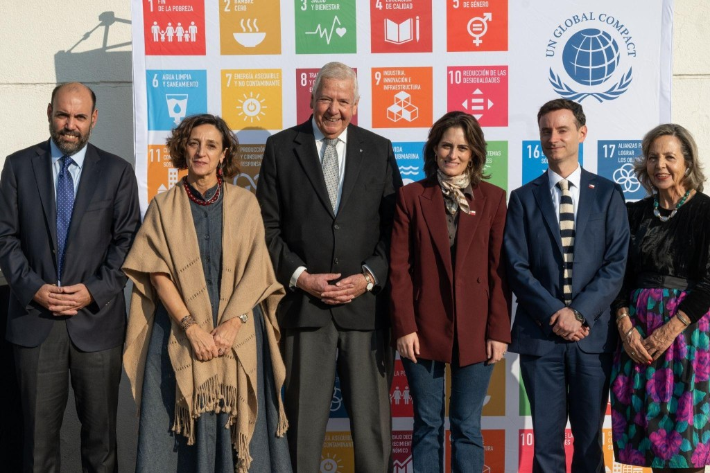

**En un mundo definido por la incertidumbre geopolítica, Red Pacto Global Chile convoca a su Asamblea Anual 2026. Este encuentro posiciona a la sostenibilidad no solo como un imperativo ético, sino como el eje estratégico para la competitividad del sector privado.**

_Por el Equipo Editorial de Tiempos Sustentables – Media Partner Oficial_

> ## 💡 Puntos Clave del Evento
> 
> - **Objetivo:** Alinear las estrategias empresariales en Chile con los Objetivos de Desarrollo Sostenible (ODS) y la Agenda 2030.
> 
> - **Participantes:** Líderes de más de 220 empresas, autoridades de Gobierno y representantes de la ONU.
> 
> - **Hito central:** Lanzamiento de la nueva _Estrategia 2026–2030_ de la red.
> 
> - **Cobertura:** Tiempos Sustentables participa como Media Partner Oficial.

La complejidad del panorama global actual exige una respuesta corporativa que trascienda lo convencional. Bajo esta premisa, la **Asamblea Anual de Socios 2026 de Red Pacto Global Chile** se consolida como el espacio de pensamiento estratégico en sostenibilidad (ESG) más relevante del año para las empresas del país.

## ACTUALIZACIÓN AL 21 DE ABRIL DE 2026

### **Asamblea Anual de Socios de Pacto Global Chile:** **Líderes de todos los sectores marcan el rumbo de la sostenibilidad empresarial en el país**

_Santiago, 21 de abril de 2026. -_ En un escenario global marcado por la incertidumbre y los cambios acelerados, la sostenibilidad se consolidó como una hoja de ruta concreta para la acción empresarial. Así quedó demostrado en la **Asamblea Anual de Socios 2026** de Pacto Global Chile, que reunió a líderes del sector público, privado y del sistema de las Naciones Unidas bajo el lema _“Sostenibilidad en tiempos de cambio: el horizonte de las empresas”_.

El encuentro, realizado el pasado 21 de abril en Santiago, se convirtió en un espacio de articulación y liderazgo, donde se abordaron los desafíos actuales y se delinearon acciones concretas para avanzar en el cumplimiento de los **Objetivos de Desarrollo Sostenible**. 

<figure>

<figcaption>

Asamblea Anual de Socios de Pacto Global Chile:  
Ignacio Guerrero, vicerrector de Vinculación con el Medio y Alumni de la Universidad Andrés Bello; María José Torres, coordinadora residente del Sistema de las Naciones Unidas en Chile; Hermann von Mühlenbrock, gerente general de Aceros AZA y presidente de Pacto Global Chile; María Jesús Wulf Le May, ministra de Desarrollo Social y Familia; Gabriel Ugarte, subsecretario de Evaluación Social; y Margarita Ducci, directora ejecutiva de Pacto Global Chile.

</figcaption>

</figure>

La jornada fue inaugurada por la ministra de Desarrollo Social y Familia, **María Jesús Wulf Le May**, quien destacó el valor de la colaboración. “Hoy, quiero hacerles llegar a ustedes cuáles son nuestras prioridades, cuál es el foco que va a tener el Ministerio de Desarrollo Social y Familia, compartirlo con las empresas, con la sociedad civil y con la academia, porque sabemos que hay muchas urgencias, en especial la pobreza, y que sólo en conjunto podemos resolverlas. Los grandes desafíos de Chile no se resuelven desde un sólo sector”, afirmó durante el evento.

Desde el mundo empresarial, el presidente de la red y gerente general de Aceros AZA, **Hermann von Mühlenbroc**k, reforzó el llamado a la acción, destacando que “el rol de las empresas es aportar al país, la sostenibilidad se ha instalado como una condición del negocio. Esta Asamblea refleja que las empresas en Chile están dando un paso adelante, integrando estos desafíos en su estrategia y avanzando con decisión hacia resultados concretos”.

Por su parte, la coordinadora residente del Sistema de las Naciones Unidas en Chile, **María José Torres**, subrayó la importancia del sector privado para avanzar en la Agenda de Desarrollo, afirmando que _“el compromiso empresarial es fundamental para acelerar y promover un desarrollo más inclusivo en Chile. Los aceleradores de los ODS permiten traducir estos compromisos en acciones concretas, especialmente en la generación de empleo decente y en la mejora de las condiciones de vida de las personas. Instancias como esta confirman que los avances son posibles cuando existe colaboración entre el mundo público, el privado, la academia y la sociedad civil”_.

Uno de los hitos centrales de la jornada fue la presentación de la **Estrategia 2026–2030** de **Pacto Global Chile**, a cargo de su directora ejecutiva, **Margarita Ducci**. “Estamos impulsando una nueva etapa, donde la sostenibilidad se traduce en acción y resultados. Chile necesita crecer y generar empleo, pero hoy la diferencia no está solo en cuánto crecemos, sino en cómo lo hacemos. Las empresas enfrentan decisiones cada vez más complejas, con mayores exigencias y expectativas. En ese contexto, la sostenibilidad ya no es un complemento, es el camino para competir, adaptarse y perdurar en la gestión”, subrayó.

### **Presentación Memoria 2025**

Durante la Asamblea también se dieron a conocer los principales resultados de la **Memoria Anual 2025**, que evidencian el impacto creciente de la red en el país. Entre los avances destacados se encuentran la realización de más de **180 actividades**, en el marco de l**os Grupos de Empresas Líderes por los ODS**; los **Programas Aceleradores** como SDG Ambition, Target Gender Equality y Climate Ambition Accelerator; los **Programas de Aprendizaje Entre Pares**, y el fortalecimiento de espacios de **diálogo de alto nivel** con líderes empresariales.

Asimismo, se consolidó la presencia territorial con la expansión de los **Consejos Regionales**, se fortaleció la formación a través de la plataforma **Academy** con más de 600 cursos disponibles, y se impulsó la visibilidad de la sostenibilidad empresarial a través de la **Plataforma CONECTA y sus Reconocimientos Empresariales**, además de lograr más 600 apariciones en medios de comunicación y consolidar múltiples alianzas estratégicas.

* * *

La jornada incluyó además la charla **_“La sostenibilidad en un escenario geopolítico turbulento”_**, dictada por **Luis Felipe Vergara**, director de Postgrado y Educación Continua de la Facultad de Economía y Negocios de la Universidad Andrés Bello, quien abordó los desafíos globales que impactan la toma de decisiones empresariales, invitando a fortalecer la capacidad de adaptación desde una mirada estratégica, “en un escenario geopolítico cada vez más incierto, la sostenibilidad se convierte en una herramienta estratégica para la toma de decisiones de corto, mediano y largo plazo. Las empresas que logren anticiparse, adaptarse y gestionar estos riesgos desde una mirada sostenible serán las que lideren el futuro”, destacó.

* * *

### **Reconocimientos Empresas Socias**

En un momento especialmente significativo, se reconoció a empresas socias con más de 10 años de compromiso con la sostenibilidad, destacando su rol pionero en la promoción de una gestión empresarial responsable en Chile.

Se reconoció a las empresas: BancoEstado, CCU, Masisa, Enel Chile, Sigdo Koppers, Statkraft, BCI, Grupo Falabella, Sodimac, Falabella Retail, Entel, Claro VTR, Banco Santander, Collahuasi, Cencosud, Grupo CAP, FoodCorp, Achs, Aceros AZA, Laboratorios Bagó, Siemens, Teck, Constructora El Sauce, Arauco, IST, Grupo LATAM, Sodexo, Banco Itaú, Viña Concha y Toro, Coca-Cola Andina y Molymet, junto con un reconocimiento especial a la Universidad Andrés Bello como entidad anfitriona de la red en Chile.

El evento contó con el apoyo de los media partners: **Diario El Mercurio, Diario Sustentable, ESGHoy, Sustenomics, Tiempos Sustentables y Woman Times** por la cooperación en la difusión y cobertura comunicacional del evento.

Con más de 200 empresas socias en el país y una red global presente de más de 25 mil organizaciones en 160 países, Pacto Global Chile reafirmó, a través de esta Asamblea, su compromiso de seguir articulando al sector privado para avanzar hacia un desarrollo sostenible, inclusivo y de largo plazo.

**Más información en [www.pactoglobal.cl](https://PACTOGLOBAL.CL)**

* * *

## El valor de la alianza público-privada para el desarrollo sostenible

La resiliencia de una nación depende de la capacidad de sus instituciones para colaborar. Por ello, la jornada contará con la participación de la **Ministra de Desarrollo Social y Familia, María Jesús Wulf Le May**, quien abordará la urgencia de profundizar las alianzas público-privadas para generar un impacto social medible.

Esta visión será complementada por los análisis de **Hermann von Mühlenbrock** (Presidente de Red Pacto Global Chile y Gerente General de Aceros AZA) y **María José Torres** (Coordinadora Residente del Sistema de las Naciones Unidas en Chile). Ambos delinearán el rol fundamental del sector empresarial en la construcción de una economía inclusiva, capaz de soportar las crisis venideras.

### Geopolítica y la nueva Estrategia 2026-2030

En un momento de fragmentación global, comprender cómo los factores macroeconómicos y externos afectan la operación local es vital para cualquier directorio. Por esto, la exposición central estará a cargo de **Luis Felipe Vergara**, Director de Postgrado de la FEN-UNAB, con la charla magistral: _“La sostenibilidad en un escenario geopolítico turbulento”_.

Asimismo, la Directora Ejecutiva de la Red, **Margarita Ducci**, presentará la Memoria Anual 2025 y lanzará oficialmente la **Estrategia 2026–2030**. Esta hoja de ruta será la guía de acción colectiva para acelerar el cumplimiento de la Agenda 2030 en Chile.

* * *

### 📅 Agenda Oficial: Asamblea Anual 2026

_Conforme al cronograma de [Pacto Global Chile](https://www.pactoglobal.cl//mailing/2026/AGENDA-ASAMBLEA.pdf)._

1. **Apertura y Bienvenida:** Saludo a las autoridades y a las nuevas empresas socias.

3. **Palabras Inaugurales:** Intervención de María Jesús Wulf Le May, Ministra de Desarrollo Social y Familia.

5. **Visión Estratégica Multisectorial:** Perspectivas de Hermann von Mühlenbrock (Pacto Global Chile) y María José Torres (ONU Chile).

7. **Charla Magistral (Keynote):** _“La sostenibilidad en un escenario geopolítico turbulento”_ por Luis Felipe Vergara.

9. **Hitos de Gestión:** Presentación de la Memoria 2025 y lanzamiento de la Estrategia 2026–2030 (Margarita Ducci).

11. **Ceremonia de Reconocimientos:** Homenaje a empresas con más de 10 años de participación activa y compromiso ininterrumpido.

* * *

## 📌 Preguntas Frecuentes (FAQ)

**¿Qué es la Asamblea Anual de Socios de Pacto Global Chile?** Es el encuentro corporativo anual más importante de la red local de Naciones Unidas en Chile. Reúne a más de 220 empresas socias, Gobierno y líderes de la ONU para delinear los desafíos y estrategias en materia de sostenibilidad empresarial, derechos humanos, medio ambiente y anticorrupción.

**¿Cuál es la nueva Estrategia 2026-2030 de Pacto Global?** Es la hoja de ruta que será presentada por la Directora Ejecutiva, Margarita Ducci, durante la asamblea. Su objetivo es establecer las prioridades y líneas de acción para que el sector privado acelere el cumplimiento de los ODS en la recta final hacia el año 2030.

**¿Cómo puede una empresa unirse a Pacto Global Chile?** Las organizaciones interesadas en alinear sus operaciones con los Diez Principios de las Naciones Unidas pueden visitar el sitio oficial **www.pactoglobal.cl** o escribir directamente al correo **socios@pactoglobal.cl**.

* * *

_Desde **Tiempos Sustentables**, reafirmamos nuestra misión de documentar las decisiones que impulsan la economía verde e inclusiva. Como Media Partner Oficial, estaremos cubriendo todos los detalles y resoluciones de este encuentro vital para el futuro del país._

* * *

 

