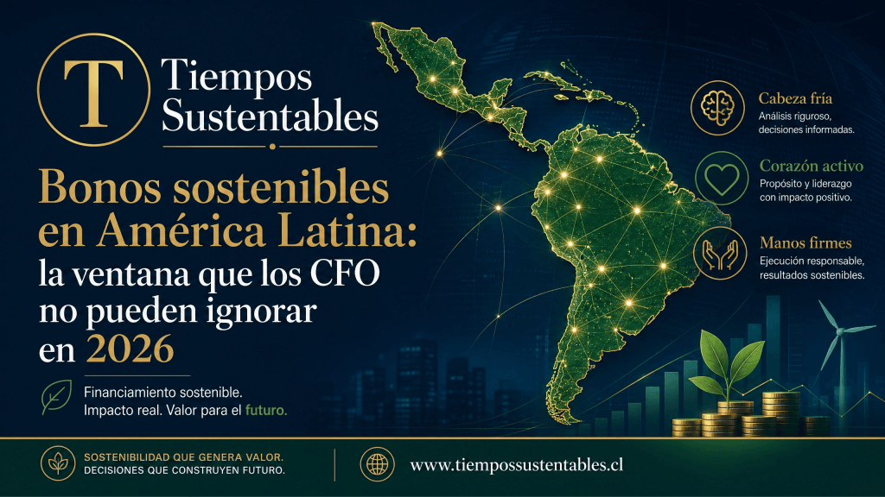
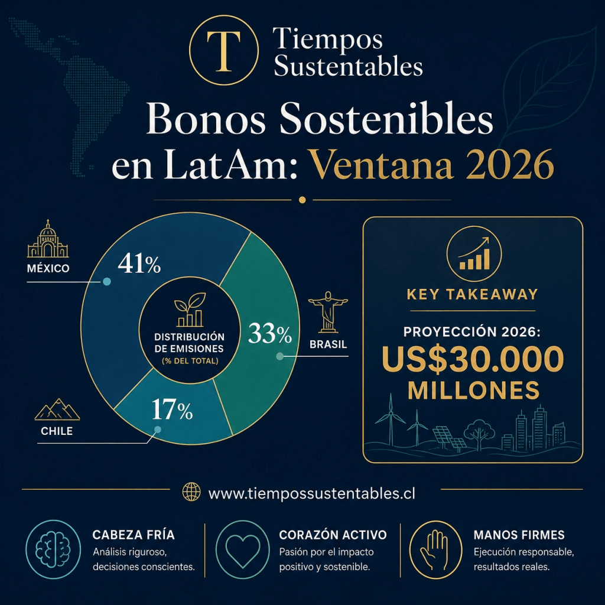

Tras una contracción en 2025, el mercado de bonos sostenibles en América Latina proyecta un crecimiento significativo para 2026, liderado por México, Brasil y Chile. Esta recuperación ofrece una ventana estratégica para que las empresas financien su transición climática y social con costos de capital competitivos y mayor transparencia.

Los líderes financieros deben integrar estándares internacionales y taxonomías verdes para mitigar riesgos ESG y evitar cuestionamientos por falta de veracidad. La adopción de normativas contables globales y la identificación de proyectos elegibles resultan fundamentales para mantener el acceso a inversionistas institucionales y asegurar la resiliencia corporativa regional.

## ¿Qué es un bono sostenible?

Tras una caída del 42% en 2025, S&P Global Ratings proyecta entre US$25.000 y US$30.000 millones en bonos sostenibles en América Latina para 2026, con México, Brasil y Chile concentrando la mayor parte de las emisiones.

Los CFO que no activen hoy su estrategia de acceso a este mercado corren el riesgo de quedar excluidos de la nueva curva ESG de financiamiento, enfrentando costos de capital más altos y menor atractivo para inversionistas institucionales con mandatos de inversión responsable.

Este artículo explica qué son los bonos sostenibles, por qué se contrajeron en 2025, cuál es el perfil de emisores que lideran el rebote en 2026, qué pasos concretos debe dar el directorio para estructurar una primera emisión y cuál es la ventana estratégica disponible antes de que el mercado alcance saturación.

* * *

En 2025, la emisión de bonos sostenibles en América Latina cayó un 42 % interanual hasta los US$24.000 millones, mientras la emisión global de deuda sostenible retrocedió 19 %. Sin embargo, S&P Global Ratings proyecta que la región podría recuperar tracción en 2026 y alcanzar entre US$25.000 y US$30.000 millones en nuevas emisiones, apoyada por tasas de interés que dejan de subir y diferenciales de crédito más estrechos. Para los líderes financieros de Latinoamérica y el Caribe, esta combinación de corrección y rebote configura una ventana estratégica que no se puede ignorar si quieren financiar transición climática, inclusión y resiliencia con un costo de capital competitivo.

México es un buen ejemplo de este giro: el 14 de mayo de 2026, la Secretaría de Hacienda y Crédito Público colocó 35.000 millones de pesos (unos US$2.031 millones) en instrumentos de deuda sostenible Bondes G y Bono S, alineados a los Objetivos de Desarrollo Sostenible, con vencimientos de entre 2 y 10 años. La operación registró una demanda de 91.664 millones de pesos, equivalente a 2,6 veces el monto adjudicado, lo que confirma un apetito sólido de inversionistas por instrumentos etiquetados cuando la narrativa de uso de fondos y las métricas ESG son creíbles. Esta nueva subasta se suma a colocaciones previas de 2025, consolidando una curva de rendimiento sostenible que funcionará como referencia para emisiones corporativas mexicanas y regionales ([detalle de la colocación](https://es-us.noticias.yahoo.com/m%C3%A9xico-coloca-bonos-sostenibles-bondes-014446059.html)).

Mientras tanto, el saldo vivo de deuda sostenible en América Latina ya alcanzaba los US$228.000 millones a fines de 2025, con casi la mitad en manos de soberanos y el resto repartido entre bancos, empresas y multilaterales. México, Brasil y Chile concentraron cerca del 91 % de las emisiones de 2025 (41%, 33% y 17% respectivamente), mientras que Colombia, Argentina, Perú y República Dominicana se distribuyeron el 9% restante. La lectura es clara: el mapa no es homogéneo y los líderes de Centroamérica y el Caribe operan todavía en un mercado naciente, aunque con un potencial significativo ligado a vulnerabilidad climática y necesidad de infraestructura resiliente.

## Bonos sostenibles en América Latina: por qué 2026 es un año bisagra

Para entender la importancia estratégica de 2026, conviene mirar tres capas: la dinámica del mercado, la presión regulatoria y la evolución de los estándares globales. En la capa de mercado, las proyecciones de S&P se apoyan en un entorno de tasas más estables, diferenciales de crédito comprimidos y una demanda persistente por activos ligados a clima y naturaleza, siguiendo tendencias globales donde el mercado de deuda sostenible se aproxima al billón de dólares anual.

En la capa regulatoria, varios países de la región están avanzando en marcos de finanzas sostenibles y taxonomías verdes, mientras que Chile, por ejemplo, actualiza su Marco de Bonos Sostenibles para incorporar nuevas categorías elegibles como proyectos de construcción en madera sustentable. Y en la capa de estándares, la asociación entre la IFRS Foundation y el BID para acelerar la adopción de las normas ISSB (IFRS S1 y S2) en América Latina adelanta un futuro cercano donde la información climática y de sostenibilidad se integrará formalmente a los estados financieros.

En Tiempos Sustentables ya hemos venido observando este giro desde la óptica de inversión con propósito, banca ética y nuevos vehículos de impacto en artículos como [“Finanzas del Futuro: El Auge de la Inversión con Propósito en Chile y América Latina”](https://tiempossustentables.cl/2025/08/20/finanzas-del-futuro/), donde analizamos cómo el capital busca proyectos con propósito claro y métricas de impacto robustas. La diferencia es que ahora el debate deja de ser “si” habrá finanzas sostenibles, para pasar a “quién” podrá seguir financiando su negocio en condiciones competitivas en un entorno con escrutinio creciente sobre greenwashing, riesgo climático y gobernanza tributaria, temas que también abordamos en la [“Guía Práctica para la Sostenibilidad Tributaria 2025”](https://tiempossustentables.cl/2025/04/15/guia-practica-para-la-sostenibilidad-tributaria-2025/).

## Cómo afecta el mercado de bonos sostenibles al riesgo ESG corporativo

Para los CFO y comités de riesgo, los bonos sostenibles ya no son solo una “opción reputacional”, sino una herramienta directa de gestión de riesgo ESG. El acceso o exclusión de este mercado empieza a influir en el costo de capital, la relación con bancos y aseguradoras, y la capacidad de financiar CAPEX de transición en energía, agua, logística y edificación.

El auge de los instrumentos etiquetados también aumenta el escrutinio: reguladores, inversionistas y sociedad civil esperan que los recursos vayan efectivamente a proyectos verdes o sociales, con indicadores verificables y reportes anuales de asignación e impacto. Los emisores que incurran en greenwashing o “etiquetado cosmético” enfrentarán un doble castigo: mayores riesgos reputacionales y una prima de riesgo adicional en futuras emisiones.

## Qué deben hacer los CFO ante el mercado de bonos sostenibles en LAC

Para los líderes empresariales de la región, la pregunta ya no es si el mercado de bonos sostenibles despegará, sino cómo posicionarse para emitir, cofinanciar o participar en estas estructuras en los próximos 12–36 meses.

En el corto plazo, la primera tarea es interna: identificar qué parte del CAPEX y OPEX actual puede alinearse con categorías de taxonomías verdes y sociales, desde energía renovable y eficiencia energética hasta agua, transporte limpio, educación o salud. Esa cartografía se conecta con discusiones sobre gobernanza fiscal y transparencia en el uso de recursos, donde la trazabilidad del presupuesto es central para credibilidad ESG y coherencia tributaria.

En paralelo, el área financiera debe empezar a hablar el lenguaje ISSB: IFRS S1 y S2 implican integrar riesgos climáticos y de sostenibilidad en proyecciones, escenarios, valoraciones de activos y discusiones de apetito de riesgo. Los directorios que sigan mirando las etiquetas ESG como una moda corren el riesgo de ver cómo su costo de capital se encarece frente a competidores que pueden demostrar, con datos, cómo sus bonos sostenibles financian activos resilientes y estrategias alineadas con políticas públicas y ODS.

## Centroamérica y el Caribe: mercado naciente, riesgo climático extremo

El mercado de bonos sostenibles en Centroamérica y el Caribe sigue en una etapa inicial, con primeros emisores como Sistema Fedecrédito en El Salvador y la República de Honduras en 2024. La región enfrenta desafíos evidentes: marcos regulatorios incipientes, falta de taxonomías nacionales consolidadas y un pipeline de proyectos aún limitado.

Sin embargo, también concentra algunos de los países más vulnerables a eventos extremos y a la subida del nivel del mar, lo que hace particularmente relevante el desarrollo de instrumentos como los bonos resilientes al clima, con cláusulas que permiten diferir pagos tras desastres naturales. En términos de mapa competitivo, los emisores que logren estructurar proyectos creíbles de adaptación y resiliencia tendrán un argumento fuerte para captar capital concesional y de impacto en la próxima década.

<figure>

<figcaption>

Bonos Sostenibles: mapa estratégico de la región (destacando México, Brasil y Chile) y la proyección de crecimiento a US$30B para 2026. 

</figcaption>

</figure>

## Tres preguntas clave que todo directorio debería hacerse sobre bonos sostenibles

1. **¿Cómo afecta la regulación ESG a mi empresa en Chile, México o Brasil?**  
    La respuesta combina la adopción de IFRS S1/S2, la evolución de taxonomías nacionales y las expectativas de inversionistas sobre divulgación de riesgos climáticos y de transición.

3. **¿Qué deben hacer los líderes ante el mercado de bonos sostenibles en LAC?**  
    Definir un inventario de proyectos elegibles, establecer KPIs ESG verificables, revisar gobierno tributario y buscar asesoría especializada para estructurar emisiones o préstamos vinculados a sostenibilidad.

5. **¿Cómo diagnosticar la madurez de sostenibilidad financiera de mi organización?**  
    Combinar autodiagnósticos de gobernanza ESG, revisiones de sostenibilidad tributaria y análisis de brechas frente a estándares ISSB y comparación con referentes sectoriales, algo que Tiempos Sustentables seguirá abordando en su [Especial de Negocios y Finanzas Sostenibles](https://tiempossustentables.cl/tag/especial-negocios-y-finanzas-sostenibles/).
