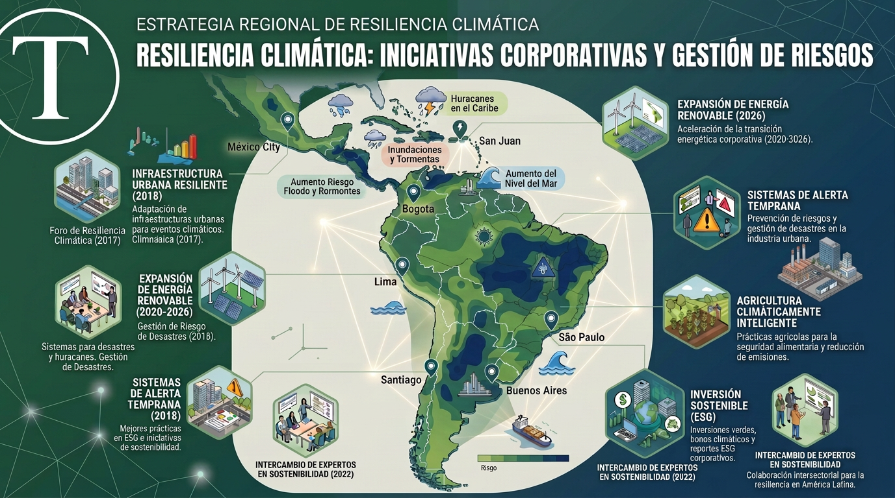

🔴 ACTUALIZACIÓN DE CONTINGENCIA | 21 de agosto de 2026

## Terremoto en Perú de M7.2: La línea divisoria entre amenaza geológica, crisis climática y vulnerabilidad regional

**¿El terremoto en Perú está relacionado con el cambio climático?** No. El sismo de magnitud 7,2 registrado en Ayacucho (epicentro en Coracora) es un evento puramente tectónico derivado de la subducción de la placa de Nazca. Sin embargo, en **Tiempos Sustentables** analizamos cómo comparte con la crisis climática el mismo factor crítico de desastre: la alta vulnerabilidad de la infraestructura y la falta de ordenamiento territorial en América Latina.

Mientras publicábamos esta investigación sobre una década de catástrofes climáticas en América Latina, un sismo de magnitud 7,2 remeció el sur de Perú. Aunque el Instituto Nacional de Defensa Civil (Indeci) confirmó que la profundidad del evento evitó un colapso masivo de vidas, los daños en decenas de viviendas, 16 escuelas y 20 centros de salud en Lucanas y Parinacochas reabren el debate sobre la resiliencia estructural de la región.

Para mantener el rigor científico y periodístico que caracteriza a nuestro medio, precisemos tres claves esenciales:

- **Desmitificación tectónica vs. climática:** Las variaciones de temperatura global, la evaporación oceánica y el calentamiento antropogénico no originan ni influyen en la actividad sísmica. Atribuir eventos geológicos al cambio climático es un error de diagnóstico que resta efectividad a las políticas públicas.
- **La fórmula unificada del riesgo ($Riesgo = Amenaza \\times Exposición \\times Vulnerabilidad$):** Aunque la _amenaza_ sísmica es subterránea y la _amenaza_ climática es atmosférica, la _vulnerabilidad_ es idéntica: autopromoción edilicia sin norma sísmica, ausencia de redes de drenaje, hospitales desprotegidos e inequidad socioeconómica.
- **Resiliencia multiamenaza en la agenda ESG:** El desarrollo sustentable y los marcos de sostenibilidad corporativa no pueden gestionar los riesgos de forma aislada. Una infraestructura "adaptada al clima" que colapse ante un sismo estándar no es sustentable.

Envía actualizaciones y material que consideres relevante directamente a nuestro equipo editorial

* * *

<figure>

<figcaption>

Mapa de América Latina y el Caribe que destaca riesgos climáticos, resiliencia y proyectos sostenibles entre 2016 y 2026.

</figcaption>

</figure>

_Medioambiente y Cambio Climático — Investigación de Tiempos Sustentables_

* * *

La evidencia científica confirma que el cambio climático está intensificando determinados extremos de temperatura, lluvias, sequías y ciclones. Pero no todos los desastres tienen una causa única: la exposición, la vulnerabilidad social, la deforestación y la planificación territorial determinan cuánto daño produce un fenómeno natural.

## Respuesta breve

**¿El cambio climático causó todas las catástrofes de la última década?** No. La ciencia muestra que el calentamiento antropogénico aumenta la probabilidad o la intensidad de algunos extremos, pero un desastre surge de la combinación entre amenaza física, exposición y vulnerabilidad.

## En este reportaje

- Un marco científico simple —amenaza, exposición y vulnerabilidad— para entender por qué un mismo fenómeno natural produce desastres muy distintos según dónde ocurra.

- Eventos de huracanes, inundaciones, deslizamientos, sequías, olas de calor e incendios ocurridos en América Latina y el Caribe.

- Una tabla de verificación que separa lo comprobado de lo simplificado o directamente falso.

- La relación entre medioambiente y desarrollo sustentable, y qué exige la adaptación climática.

- La ficha metodológica y los criterios de lenguaje que Tiempos Sustentables aplicará en su cobertura climática.

## Introducción: el ambiente como base del desarrollo

El medioambiente no es un asunto secundario del desarrollo sustentable. Es la base material que sostiene la economía, la salud, la seguridad alimentaria, el acceso al agua, la infraestructura y la cohesión social.

No existe desarrollo sustentable si se destruyen los ecosistemas que regulan el clima, almacenan agua, protegen las costas, fertilizan los suelos y sostienen la biodiversidad. Tampoco existe resiliencia económica si una inundación puede interrumpir carreteras, puertos, hospitales, escuelas, sistemas eléctricos y cadenas de abastecimiento.

## La fórmula del riesgo

Atribuir cada tragedia directamente al cambio climático es un error frecuente. El calentamiento global modifica las condiciones físicas de fondo, pero no elimina la influencia de El Niño, La Niña, los bloqueos atmosféricos, la circulación oceánica ni las decisiones humanas sobre el territorio.

> **Riesgo = Amenaza × Exposición × Vulnerabilidad**

### Amenaza

Es el fenómeno físico: lluvia extrema, ciclón, sequía, ola de calor, incendio, marejada o deslizamiento. El calentamiento antropogénico puede modificar su probabilidad, intensidad, duración o área de impacto. Cerca de la superficie, la capacidad de saturación del aire aumenta aproximadamente 7% por cada 1 °C de calentamiento.

### Exposición y vulnerabilidad

La exposición es la presencia de personas, viviendas, cultivos, carreteras, hospitales, puertos, industrias y redes de servicios en zonas de amenaza. La vulnerabilidad incluye pobreza, desigualdad, informalidad urbana, deforestación, degradación de suelos, falta de drenaje, infraestructura envejecida, ausencia de planificación y sistemas de alerta insuficientes.

## Radiografía de la última década

### Ciclones tropicales

#### Irma y María (2017)

Irma y María fueron huracanes de categoría 5 que devastaron territorios del Caribe. Irma alcanzó vientos máximos sostenidos cercanos a 298 km/h y María impactó Dominica como categoría 5 antes de golpear Puerto Rico como un huracán de categoría 4 muy intenso.

**Veredicto:** evento e intensidad comprobados. No es correcto afirmar que el calentamiento global fue la única causa.

#### Eta e Iota (2020)

Eta tocó tierra en Nicaragua el 3 de noviembre e Iota llegó a la misma zona el 17 de noviembre como categoría 4. El segundo ciclón encontró cuencas, suelos y comunidades ya afectadas por el primero.

**Veredicto:** catástrofe real y consecutiva. La atribución climática específica de cada tormenta requiere un estudio independiente.

#### Otis (2023)

Otis se intensificó de forma extraordinaria antes de llegar a Acapulco como categoría 5. El Centro Nacional de Huracanes estimó un aumento aproximado de 90 nudos en 21 horas. Temperaturas superficiales del mar cercanas a 30 °C, humedad y baja cizalladura favorecieron el proceso.

**Veredicto:** intensificación rápida comprobada; influencia climática físicamente plausible, pero no equivalente a una atribución exclusiva.

#### Melissa (2025)

Melissa tocó tierra en Jamaica el 28 de octubre de 2025 como categoría 5. Los reportes operativos estimaron vientos máximos sostenidos de aproximadamente 295 km/h cerca del impacto. Las evaluaciones económicas distinguieron daños físicos por US$8.800 millones —aproximadamente 41% del PIB jamaicano de 2024— de una evaluación posterior de daños y pérdidas cercana a US$12.200 millones.

**Veredicto:** evento real, impacto histórico y daños superiores al 40% del PIB según la estimación de daños físicos.

### Inundaciones y deslizamientos

#### Mocoa, Colombia (2017)

Lluvias intensas provocaron desbordamientos y flujos de detritos en los ríos Mocoa, Mulato y Sangoyaco. Las mediciones disponibles registraron cerca de 129–130 mm de lluvia, con más de 100 mm concentrados en pocas horas.

**Veredicto:** amenaza pluviométrica y flujo de detritos comprobados; atribución climática específica no establecida.

#### Petrópolis (2022) y São Sebastião (2023)

Son eventos independientes. En Petrópolis se registraron aproximadamente 258 mm de lluvia en tres horas. En São Sebastião las precipitaciones superaron los 600 mm en aproximadamente 24 horas.

La saturación del suelo aumentó la presión de poros y redujo la resistencia al corte en pendientes pronunciadas. La geometría de las laderas, el tipo de suelo, los cortes de terreno, el drenaje y la cobertura vegetal condicionaron los deslizamientos.

#### Rio Grande do Sul (2024)

Las inundaciones de abril y mayo de 2024 afectaron a más del 90% del estado. El episodio combinó bloqueo atmosférico, sistemas frontales persistentes, aporte de humedad, condiciones asociadas a El Niño, cuencas saturadas y alta exposición urbana.

World Weather Attribution estimó que el cambio climático hizo más de dos veces más probable la lluvia extrema y la intensificó entre 6% y 9%. El Niño también aumentó la probabilidad del patrón meteorológico. La atribución de WWA se refiere a la precipitación y no al desempeño de diques o infraestructura.

**Veredicto:** interacción clara entre variabilidad natural, cambio climático y vulnerabilidad de infraestructura.

#### Perú, Ecuador y México (2025)

Los episodios de lluvias e inundaciones de 2025 deben analizarse individualmente, no como una sola catástrofe regional. Se registraron lluvias intensas, inundaciones, deslizamientos y comunidades aisladas.

### Sequías y olas de calor

#### Megasequía de Chile central

La megasequía se inició en 2010 y tuvo múltiples causas: variabilidad del Pacífico, circulación atmosférica, Oscilación Antártica, cambios en el anticiclón subtropical y calentamiento antropogénico. La crisis hídrica se intensificó por extracción de aguas subterráneas, expansión agrícola, cambio de uso de suelo y presión urbana.

**Veredicto:** megasequía real; atribución climática parcial; déficit hídrico agravado por decisiones de gestión.

#### Cuenca amazónica (2023–2025)

La sequía amazónica de 2023 fue excepcional. El río Negro alcanzó en Manaos niveles mínimos históricos. World Weather Attribution estimó que el cambio climático hizo aproximadamente 30 veces más probable la sequía agrícola de 2023. El Niño contribuyó al déficit de precipitaciones, mientras el calentamiento antropogénico elevó la temperatura y la demanda evaporativa.

**Veredicto:** no fue causada exclusivamente por El Niño; resultó de la combinación de variabilidad natural, océanos anómalamente cálidos y calentamiento antropogénico.

#### Calor extremo (2024–2025)

La Organización Meteorológica Mundial reportó temperaturas superiores a 40–45 °C en distintas zonas de América Latina y mencionó 52,7 °C en Mexicali como récord nacional mexicano.

### Incendios forestales

#### Pantanal y Chiquitanía

Los incendios de 2019–2020 y 2024 fueron reales. La sequía, la reducción de la inundación estacional, el calor, el viento y la biomasa seca favorecieron la propagación. La actividad humana fue un factor importante de ignición en numerosas áreas, pero las causas deben determinarse por país y temporada.

#### Valparaíso (2024)

Calor, sequía y viento permitieron que el fuego alcanzara zonas urbanas. También influyeron la topografía de quebradas, la continuidad de vegetación combustible, la interfaz urbano-rural, los accesos, la evacuación y el mantenimiento de cortafuegos.

La regla 30-30-30 es un umbral operacional de peligro, no una ley física de ignición.

## Mitos y evidencia

| Afirmación | Veredicto | Precisión o corrección |
| --- | --- | --- |
| Irma y María fueron categoría 5 | Verdadero | La temperatura superficial del mar elevada fue favorable, no una causa única. |
| Otis pasó a categoría 5 en 21 horas | Verdadero, con precisión | El NHC estimó un aumento cercano a 90 nudos. |
| Otis fue causado por una capa oceánica sobre 30 °C | Simplificación | Intervinieron temperatura, humedad, cizalladura y contenido de calor oceánico. |
| Melissa fue el primer categoría 5 en impactar Jamaica | Verdadero | Impactó el 28 de octubre de 2025. |
| Melissa produjo daños superiores al 40% del PIB | Verdadero, con precisión | 41% corresponde a daños físicos; la evaluación amplia llegó a 56,7%. |
| Petrópolis y São Sebastião recibieron más de 600 mm | Engañoso | La cifra corresponde a São Sebastião; Petrópolis registró 258 mm en tres horas. |
| WWA confirmó el colapso de los diques | No respaldado por WWA | WWA atribuyó la lluvia extrema; la infraestructura requiere evaluación propia. |
| La sequía amazónica fue solo por El Niño | Falso | El Niño redujo lluvias; el calentamiento amplificó calor y demanda evaporativa. |
| Mexicali alcanzó 52,7 °C | Verdadero | La OMM lo reporta como récord nacional mexicano. |
| La regla 30-30-30 genera incendios | Falso | Es un indicador meteorológico de riesgo. |
| Los monocultivos explican los incendios de Valparaíso | No demostrado | Requiere análisis territorial y pericial. |

## Desarrollo sustentable: de la emergencia a la transformación

América Latina necesita integrar mitigación, adaptación, reducción del riesgo y protección de la naturaleza en sus políticas de desarrollo.

### Mitigación

- Acelerar la transición energética.

- Mejorar la eficiencia energética.

- Reducir la deforestación.

- Transformar el transporte.

- Descarbonizar industrias.

- Reducir emisiones de metano.

- Fortalecer la economía circular.

### Adaptación

- Actualizar mapas de amenaza.

- Proteger humedales, bosques, glaciares y cuencas.

- Mejorar drenajes y obras hidráulicas.

- Diseñar ciudades con infraestructura verde.

- Fortalecer sistemas de alerta temprana.

- Adaptar la agricultura y la gestión hídrica.

- Asegurar hospitales, escuelas y redes críticas.

- Desarrollar planes de evacuación y refugios.

### Justicia climática

Las responsabilidades y los impactos no están distribuidos de manera equitativa. Las comunidades que menos contribuyeron a las emisiones suelen enfrentar mayor exposición a sequías, inundaciones, calor, contaminación y pérdida de medios de vida.

## Voces que explican la urgencia

> _“Earth’s issuing a distress call.”_  
> “La Tierra está enviando una llamada de auxilio.”  
> — António Guterres, Naciones Unidas.

> _“My message is that we will be keeping an eye on you.”_  
> “Mi mensaje es que estaremos vigilándolos.”  
> — Greta Thunberg, Cumbre de Acción Climática de Naciones Unidas, 2019.

> _“The continuation of our civilisations and the natural world upon which we depend, is in your hands.”_  
> “La continuidad de nuestras civilizaciones y del mundo natural del que dependemos está en sus manos.”  
> — David Attenborough.

> _“It’s well within our power to meet this challenge if we act now.”_  
> “Está completamente dentro de nuestras posibilidades enfrentar este desafío si actuamos ahora.”  
> — Stephanie Roe, WWF.

> _“It’s time to put people above the fossil fuel industry and truly act on climate.”_  
> “Es tiempo de poner a las personas por encima de la industria de los combustibles fósiles y actuar realmente frente al clima.”  
> — Greenpeace.

**Nota sobre las traducciones:** las versiones en español son traducciones editoriales. Se conserva el original en inglés junto a la traducción y la fuente institucional.

## Cómo verificamos cada evento

1. **Amenaza física:** fenómeno, fecha, lugar, magnitud y duración.

3. **Datos primarios:** estaciones, radares, satélites, caudales, mapas y registros oficiales.

5. **Periodo de retorno:** estimación estadística y rango de incertidumbre.

7. **Atribución climática:** WWA, IPCC, OMM o investigación académica revisada por pares.

9. **Variabilidad natural:** ENSO, bloqueos atmosféricos y circulación oceánica.

11. **Exposición:** personas, viviendas, infraestructura y actividades económicas.

13. **Vulnerabilidad:** pobreza, uso de suelo, deforestación, urbanización y protección civil.

15. **Daños y pérdidas:** fallecidos, afectados, desplazados, daños físicos y pérdidas económicas.

17. **Nivel de certeza:** alto, medio, bajo o no determinado.

19. **Veredicto:** causado, favorecido, amplificado o no atribuible.

## Cómo hablamos del clima en Tiempos Sustentables

- “El cambio climático hizo más probable…”

- “El calentamiento antropogénico intensificó…”

- “El evento ocurrió en un contexto de…”

- “La vulnerabilidad territorial amplificó los daños…”

- “No existe evidencia suficiente para atribuir…”

## Preguntas frecuentes

### ¿El cambio climático causa todos los desastres naturales?

No. Puede aumentar la probabilidad o intensidad de ciertos extremos, pero el desastre también depende de la exposición, la vulnerabilidad, el uso del suelo y la capacidad de respuesta.

### ¿Qué relación existe entre cambio climático y desarrollo sustentable?

El desarrollo sustentable depende de ecosistemas funcionales, agua disponible, seguridad alimentaria, infraestructura resiliente y reducción de emisiones. La acción climática y la protección ambiental son condiciones del desarrollo.

### ¿Qué ocurrió durante la sequía amazónica de 2023?

El Niño contribuyó a reducir las precipitaciones, mientras el calentamiento antropogénico elevó las temperaturas y la demanda evaporativa. WWA estimó que el cambio climático hizo aproximadamente 30 veces más probable la sequía agrícola analizada.

### ¿Qué ocurrió en Rio Grande do Sul en 2024?

Lluvias extremas produjeron inundaciones históricas que afectaron a más del 90% del estado. El Niño contribuyó al patrón meteorológico y WWA estimó que el cambio climático hizo el evento de lluvias más de dos veces más probable y entre 6% y 9% más intenso.

### ¿La regla 30-30-30 causa incendios?

No. Es un indicador operacional de condiciones meteorológicas peligrosas, no una ley física que determine la ignición.

## Conclusión

La evidencia de 2016–2026 no respalda la idea de que las catástrofes climáticas sean inventadas, ni la afirmación de que el calentamiento global sea el responsable exclusivo de cada tragedia.

El cambio climático está desplazando las condiciones de referencia: aumenta el calor, eleva la demanda evaporativa, calienta los océanos, intensifica determinadas lluvias y agrava algunas sequías. Al mismo tiempo, la deforestación, la mala planificación, la desigualdad, la degradación ambiental y la infraestructura insuficiente convierten esas amenazas en desastres.

El medioambiente es un pilar fundamental del desarrollo sustentable, porque no existe economía resiliente sin ecosistemas funcionales, ni seguridad social sin agua, alimentos, aire limpio y territorios habitables. La adaptación y la protección de la naturaleza no son obstáculos al desarrollo: son sus condiciones de continuidad.

## Fuentes principales

- [IPCC — AR6 Synthesis Report.](https://www.ipcc.ch/report/ar6/syr/longer-report/)

- [Naciones Unidas — ODS 13.](https://sdgs.un.org/goals/goal13)

- [NHC — Hurricane Otis.](https://www.nhc.noaa.gov/data/tcr/EP182023_Otis.pdf)

- [NHC — Hurricane Melissa.](https://www.nhc.noaa.gov/archive/2025/al13/al132025.public.029.shtml)

- [World Weather Attribution — Rio Grande do Sul.](https://www.worldweatherattribution.org/climate-change-made-the-floods-in-southern-brazil-twice-as-likely/)

- [Imperial College London — sequía amazónica.](https://www.imperial.ac.uk/news/251057/climate-change-made-unprecedented-amazon-rainforest/)

- [OMM — eventos extremos y récord de Mexicali.](https://wmo.int/sites/default/files/2026-03/State_of_the_Global_Climate_2025_Extreme_Supplement.pdf)

- [NASA Earth Observatory — incendios de Valparaíso.](https://science.nasa.gov/earth/earth-observatory/inferno-scars-valparaiso-152417/)

_Cómo citar este reportaje: Tiempos Sustentables (2026). “10 años de catástrofes climáticas en América Latina y el Caribe: qué es real y qué no”. Sección Medioambiente y Cambio Climático._
