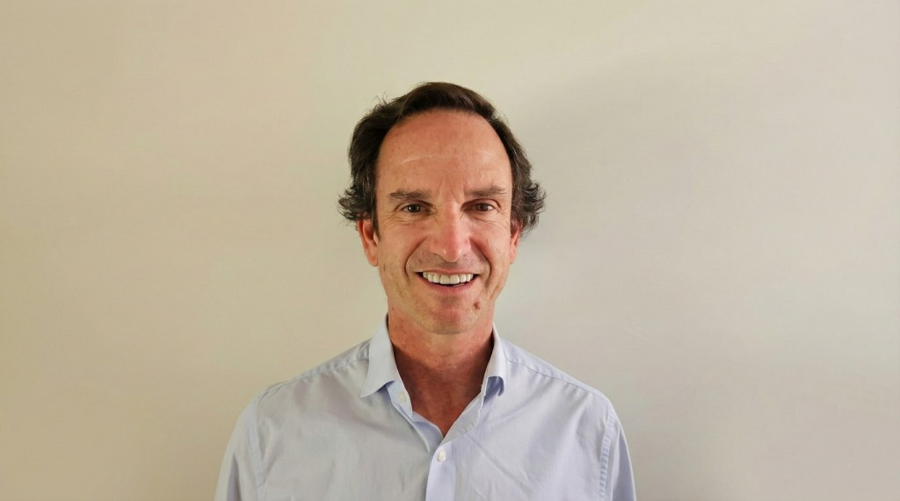
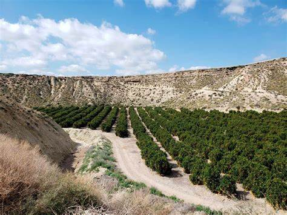
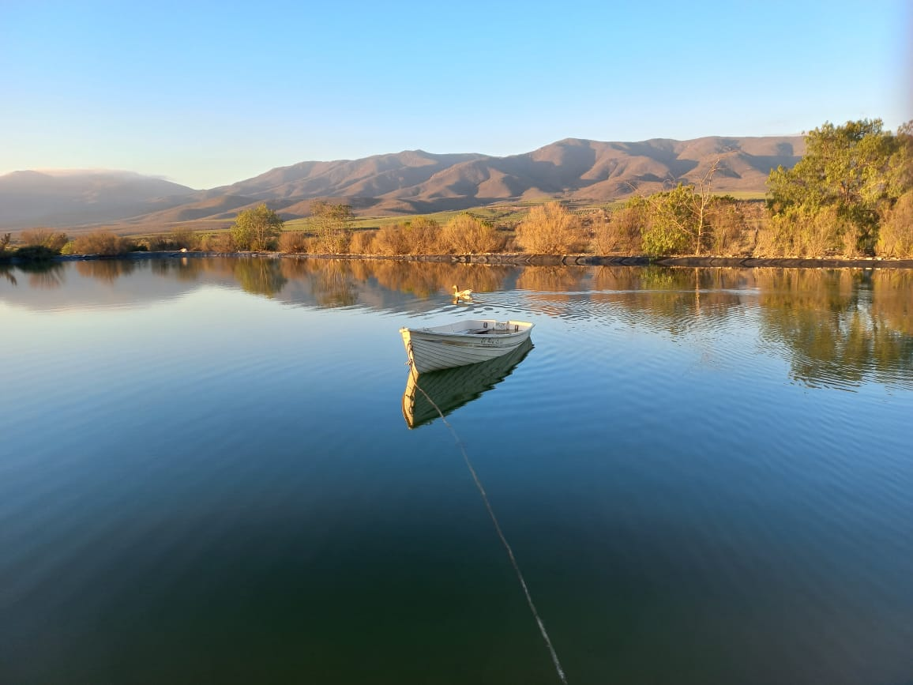
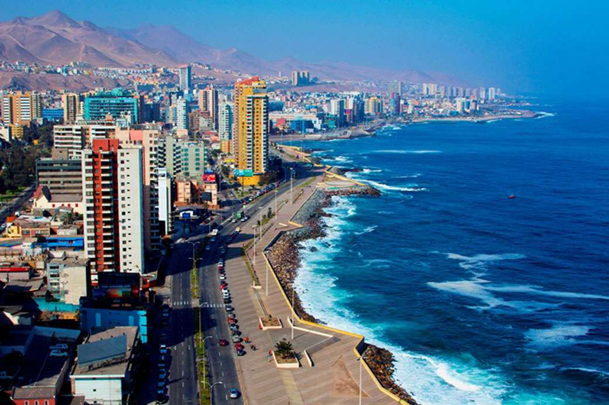

Chile se encuentra en una encrucijada crítica. Mientras la meta de descarbonización exige una celeridad sin precedentes, el país arrastra un "cepo administrativo" que mantiene congelados entre **US$ 7.000 y US$ 10.000 millones** en proyectos. La pregunta que domina la agenda económica de cara a 2026 es: ¿Cómo agilizar la inversión sin retroceder un solo centímetro en protección ambiental?

Para **Felipe Martin Cuadrado**, director ejecutivo de **MAS Recursos Naturales**, la respuesta no es "menos regulación", sino una **"gestión administrativa inteligente"**.

* * *

## El Diagnóstico: Por qué Chile se estancó en la "Permisología"

A pesar de contar con una de las carteras de proyectos más ambiciosas de la región, el sistema chileno padece de una **superposición normativa** que ha convertido la obtención de permisos en un laberinto de años.

> _"El diagnóstico es claro: décadas de superposición normativa han derivado en cientos de trámites dispersos que, lejos de garantizar mayor protección, dilatan decisiones económicas vitales para Chile"_, afirma Martin.

### Los tres grandes bloqueos del 2026:

1. **Consejo de Monumentos Nacionales (CMN):** La falta de digitalización y personal técnico convierte hallazgos arqueológicos menores en paralizaciones de años.

3. **Ley Lafkenche:** Un instrumento de protección del borde costero que, por falencias de gestión administrativa, hoy demora procesos de **desalinización** e **hidrógeno verde** por más de una década.

5. **Incertidumbre Jurídica:** Proyectos con Resoluciones de Calificación Ambiental (RCA) aprobadas que terminan "atrapados" en comités políticos o procesos de judicialización evitables.

* * *

## La Propuesta: De la Ley LMAS a la Capacidad Operativa Real

El 2025 marcó un hito con la **Ley Marco de Autorizaciones Sectoriales (LMAS)**. Sin embargo, Martin Cuadrado advierte que el marco legal es solo la mitad de la batalla.

| **Pilar de Solución** | **Acción Necesaria 2026** | **Impacto en la Inversión** |
| --- | --- | --- |
| **Ventanilla Única** | Implementación real de la plataforma OASI. | Reducción de tiempos de tramitación en un 30%. |
| **Certeza Técnica** | Dotación de especialistas en servicios públicos críticos. | Disminución de la judicialización de proyectos. |
| **Sostenibilidad Activa** | Pertinencia ambiental desde el diseño del proyecto. | Aprobaciones más rápidas y con mayor licencia social. |

**"La ley es el vehículo, pero la gestión y la capacidad operativa son el motor"**, enfatiza Martin. Según el experto, agilizar los plazos es una forma de justicia social, permitiendo que la infraestructura hospitalaria y energética llegue a la ciudadanía cuando se necesita, no 10 años después.

* * *

## 📂 Recursos Exclusivos para Analistas y Prensa

Como medio líder en sostenibilidad, ponemos a disposición el documento original que detalla las trabas administrativas y las propuestas técnicas de MAS Recursos Naturales para destrabar el crecimiento del país.

> ### **Nota de Prensa: Gestión Administrativa e Inversión 2026**
> 
> [Hay que agilizar la gestión administrativa para destrabar la inversión sin sacrificar el medio ambiente](https://tiempossustentables.cl/wp-content/uploads/2025/12/felipe-martin-cuadrado-hay-que-agilizar-la-gestion-administrativa-para-destrabar-la-inversion-sin-sacrificar-el-medio-ambiente.docx)[Descarga](https://tiempossustentables.cl/wp-content/uploads/2025/12/felipe-martin-cuadrado-hay-que-agilizar-la-gestion-administrativa-para-destrabar-la-inversion-sin-sacrificar-el-medio-ambiente.docx)
> 
> **Fuente:** MAS Recursos Naturales
> 
> **Contenido:** _Análisis técnico sobre Ley LMAS, CMN y Ley Lafkenche._

* * *

* * *

## **Claves de la investigación: Todo lo que debes saber sobre la inversión en Chile 2026**

### ¿Cuál es la principal traba para la inversión en Chile según Felipe Martin Cuadrado?

La **burocracia excesiva** y la superposición normativa que generan incertidumbre jurídica y judicialización, frenando inversiones de hasta US$10.000 millones.

### ¿Qué es la Ley Marco de Autorizaciones Sectoriales (LMAS)?

Es una normativa chilena que busca reducir la "permisología" mediante la creación de una ventanilla única (OASI) y el establecimiento de plazos máximos para los permisos sectoriales.

### ¿Se puede agilizar la inversión sin dañar el medio ambiente?

Sí. Felipe Martin Cuadrado sostiene que la **sostenibilidad requiere certezas**, y que una gestión administrativa eficiente y técnicamente sólida permite cumplir los estándares ambientales en plazos racionales.

### ¿Qué sectores se ven más afectados por la permisología en 2026?

Minería, energía limpia (Hidrógeno Verde), desalinización e infraestructura pública (hospitales y vialidad).

* * *
