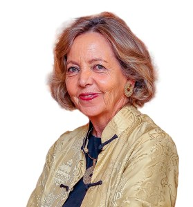

**Exclusivo desde Belém, Brasil.**

La 30ª Conferencia de las Naciones Unidas sobre el Cambio Climático (COP30), celebrada en el corazón de la Amazonía brasileña, marcó un punto de inflexión global: el foco pasó de la ambición a la **ejecución acelerada**. En este escenario crítico, Chile consolidó su liderazgo en la acción climática corporativa gracias a la **Red Pacto Global Chile**, entidad local de la ONU, y su Directora Ejecutiva, **Margarita Ducci**.

La delegación chilena, con una presencia estratégica por tercer año consecutivo en la Zona Azul de la COP, presentó una hoja de ruta concreta: el plan sectorial **'NDC 3.0: Hoja de Ruta Climática para el Sector Privado'**, diseñado para transformar los compromisos nacionales en resultados verificables y asegurar la credibilidad ante los mercados globales.

<figure>

![Infografía 'De la Ambición a la Acción': Hoja de Ruta Climática de Chile NDC 3.0 para la COP30. Ilustra el Plan Concreto que traduce la meta país en acción empresarial, conectando la política climática (NDC 3.0) y la descarbonización corporativa. Destaca 18 medidas de alto impacto, la alianza multisectorial clave (Acción Empresas, CCS, CLG Chile, Pacto Global Chile y Sistema B), y el modelo de colaboración público-privada. El foco está en la adaptación, Soluciones Basadas en la Naturaleza (SbN), la resiliencia hídrica, la descarbonización del transporte y la protección de ecosistemas.](images/www.tiempossustentables.cl_.png)

<figcaption>

Infografía 'De la Ambición a la Acción': Hoja de Ruta Climática de Chile NDC 3.0 para la COP30

</figcaption>

</figure>

## 1\. El Plan de Implementación: NDC 3.0 para la Próxima Década

El logro más sustantivo de la participación chilena fue el lanzamiento oficial de la **'NDC 3.0: Hoja de Ruta Climática para el Sector Privado de Chile 2025-2035'**.

Este documento no es solo una declaración, sino el resultado de la **Alianza Unidos por la Acción Climática**, una poderosa coalición que agrupa a **Acción Empresas, la Cámara de Comercio de Santiago (CCS), CLG Chile, Pacto Global Chile y Sistema B**. Su propósito es claro: cerrar la brecha entre la política climática nacional y la ejecución corporativa.

### Claves de la NDC 3.0

- **Priorización Estratégica:** El plan selecciona y **prioriza 18 medidas** de la Contribución Determinada a Nivel Nacional (NDC) chilena con el mayor potencial de impacto en el sector productivo.

- **Colaboración Público-Privada:** El lanzamiento contó con el respaldo del Subsecretario de Medio Ambiente, Maximiliano Proaño, y fue validado por líderes de empresas clave como **Arauco, Natura, CMPC y Anglo American**, quienes compartieron experiencias de implementación concreta.

## 2\. Gobernanza Global y el Llamado de Margarita Ducci

La Directora Ejecutiva de Pacto Global Chile, **Margarita Ducci**, impulsó una agenda de alto nivel enfocada en la integridad, un requisito indispensable para el acceso al financiamiento sostenible:

_“Hoy más que nunca necesitamos acelerar la acción climática desde el sector empresarial con planes de transición reales, medibles y alineados con el objetivo de 1,5 °C. Nuestro compromiso es seguir articulando esfuerzos para que los compromisos se conviertan en resultados concretos para el país.”_

### Influencia en la Agenda COP

Ducci participó en dos instancias críticas que definen la futura gobernanza corporativa:

- **Co-desarrollo de Políticas:** En un panel internacional, se analizó el rol del sector privado como **codesarrollador e implementador** de las metas NDC hasta 2035, garantizando que las políticas sean ambiciosas, pero también técnica y económicamente factibles.

- **Net Zero y Verificación:** En el lanzamiento del Segundo Informe de UN Task Force on Net Zero Policy, se entregaron recomendaciones cruciales para que los compromisos de cero emisiones netas se traduzcan en reducciones verificables, poniendo énfasis en la **planificación, el financiamiento y la integridad en los mercados de carbono**.

### Foco en Adaptación: Resiliencia Hídrica y SBN

La Alianza también destacó la importancia de la adaptación, organizando un evento dedicado a las **Soluciones Basadas en la Naturaleza (SBN)**. Compañías como **Latam Airlines, Aguas Andinas y Arauco Brasil** compartieron avances en resiliencia hídrica, descarbonización del transporte y protección de ecosistemas, demostrando que la acción climática abarca tanto la mitigación de gases de efecto invernadero como la adaptación.

El modelo chileno de colaboración público-privada, que se materializa en la NDC 3.0, es la clave para la carbono neutralidad al 2050, exigiendo una ejecución transparente y medible de las acciones prioritarias.

* * *

## COMUNICADO OFICIAL ADJUNTO DE LA RED PACTO GLOBAL CHILE

![La imagen muestra el logotipo del Pacto Global Red Chile de las Naciones Unidas. 
Es una iniciativa de sostenibilidad corporativa que llama a las empresas a alinear sus operaciones y estrategias con diez principios universalmente aceptados en áreas de derechos humanos, normas laborales, medio ambiente y lucha contra la corrupción. 
El Pacto Global fue lanzado en 1999 por el Secretario General de la ONU, Kofi Annan, y puesto en marcha oficialmente en julio de 2000. 
La Red Pacto Global Chile es parte de la red de sostenibilidad empresarial más grande del mundo y cuenta con más de 120 empresas socias en el país. 
Trabajan para generar alianzas que contribuyan al cumplimiento de la Agenda 2030 de las Naciones Unidas y sus 17 Objetivos de Desarrollo Sostenible (ODS). ](images/img_2078.jpg)

### De los compromisos a la acción: Pacto Global destaca en la COP30 con llamados a acelerar la acción climática

- _Pacto Global de las Naciones Unidas refuerza el liderazgo de Chile en la agenda climática global durante la 30ª Conferencia de las Naciones Unidas sobre Cambio Climático (COP30) en Brasil, a través de la presentación de iniciativas y herramientas que buscan acelerar la contribución del sector privado a las nuevas metas climáticas del país._

**Belém, Brasil.** Chile tuvo una participación destacada en la COP30 con una agenda activa que combinó la presencia estratégica de la red chilena Pacto Global de la ONU y la labor de la Alianza Unidos por la Acción Climática, consolidando al país como un referente en colaboración público-privada para enfrentar la crisis climática.

Por tercer año consecutivo, Pacto Global de la ONU contó con un pabellón propio en la Zona Azul de la COP, donde líderes empresariales, autoridades y representantes de distintos países debatieron cómo transformar los compromisos climáticos en acciones concretas. En este contexto, **Margarita Ducci, directora ejecutiva de Red Pacto Global Chile**, participó en dos instancias de alto nivel:

La primera abordó el rol del sector privado en el proceso de actualización de las nuevas Contribuciones Determinadas a Nivel Nacional (NDC), reuniendo a representantes de Pacto Global de Australia, México, Ucrania y la sede global, para analizar cómo las empresas pueden actuar como codesarrolladoras e implementadoras de las metas que guiarán la acción climática hasta 2035. La segunda instancia marcó el lanzamiento del Segundo Informe de UN Task Force on Net Zero Policy, que entrega recomendaciones para convertir los compromisos de cero emisiones netas en reducciones verificables, poniendo énfasis en financiamiento, planificación e integridad en los mercados de carbono.

En paralelo, la Alianza Unidos por la Acción Climática —compuesta por Acción Empresas, la Cámara de Comercio de Santiago, CLG Chile, Pacto Global Chile y Sistema B— presentó oficialmente su documento **'NDC 3.0: Hoja de Ruta Climática para el Sector Privado 2025-2035'**. La publicación, que prioriza **18 medidas** de la NDC chilena, fue lanzada en el Pabellón de Chile junto al subsecretario de Medio Ambiente, Maximiliano Proaño, y representantes de empresas como Arauco, Natura, CMPC y Anglo American, quienes compartieron experiencias concretas de implementación. Además, la Alianza realizó un segundo evento dedicado a soluciones basadas en la naturaleza, donde compañías como Latam Airlines, Aguas Andinas y Arauco Brasil expusieron avances en resiliencia hídrica, descarbonización del transporte y protección de ecosistemas.

_“La presencia conjunta de Pacto Global y la Alianza reforzó el mensaje de que Chile avanza con determinación hacia una economía carbono neutral. Hoy más que nunca necesitamos acelerar la acción climática desde el sector empresarial con planes de transición reales, medibles y alineados con el objetivo de 1,5 °C. Nuestro compromiso es seguir articulando esfuerzos para que los compromisos se conviertan en resultados concretos para el país”, **destacó Margarita Ducci**._

* * *

[Comunicado de Prensa de Pacto Global en COP30 - 11.2025](https://tiempossustentables.cl/wp-content/uploads/2025/11/comunicado-de-prensa-pacto-global-cop30-11.2025.docx)[Descarga](https://tiempossustentables.cl/wp-content/uploads/2025/11/comunicado-de-prensa-pacto-global-cop30-11.2025.docx)

* * *

<figure>

<figure>

![Está foto muestra a un grupo diverso de seis delegados en lo que parece ser un panel de discusión o un diálogo estratégico.
• Delegados: Cuatro hombres y dos mujeres están de pie en una fila.
• La mujer en el centro, vestida de blanco y beige claro, es una de las figuras clave de la delegación de Pacto Global Chile,  Margarita Ducci, Directora Ejecutiva, dada su presencia y mención destacada en la cobertura de Pacto Global sobre la COP30.
• Fondo y Contexto: El fondo es de color oscuro y vibrante, con el logo o texto de "UN GLOBAL COMPAC..." (Pacto Global de las Naciones Unidas), visible en el centro. Esto sugiere que el panel está directamente relacionado con las actividades de la Red Pacto Global de las Naciones Unidas a nivel internacional, enfocándose en la agenda climática global y la aceleración de la acción empresarial.
• Ambiente: El vestuario, predominantemente formal (trajes y corbatas en los hombres), sugiere que se trata de un Diálogo de Alto Nivel con la participación de figuras internacionales y líderes de la ONU, lo que reafirma el rol de Pacto Global Chile en la articulación de esfuerzos con el Sistema de Naciones Unidas y el gobierno chileno de cara a la COP30.](images/img_2077.jpg)

<figcaption>

Pacto Global Chile en Belém.

</figcaption>

</figure>

<figure>

![Esta fotografía captura a un grupo de siete delegados posando frente a un fondo que destaca el compromiso climático de Chile y el sector privado.
• Delegados: Seis mujeres y un hombre están de pie, vestidos con ropa casual de negocios o de evento, en un pabellón de conferencias.
• Fondo y Contexto: El centro de la imagen está dominado por un gran cartel que dice "NDC 3.0: Climate Roadmap for the Private Sector of Chile 2025" (NDC 3.0: Hoja de Ruta Climática para el Sector Privado de Chile 2025).  Este panel hace referencia a la Contribución Determinada a Nivel Nacional (NDC) de Chile y subraya el enfoque de la Alianza Unidos por la Acción Climática (que incluye a Pacto Global Chile) para integrar los compromisos empresariales en las metas climáticas nacionales hasta 2035.
• Logotipos: Se aprecian logotipos de organizaciones chilenas e internacionales, incluyendo a Chile (en el contexto de la COP 30), UN Climate Action Alliances, y empresas privadas como aes, AngloAmerican, Teck, y LATAM Airlines, lo que indica la colaboración  público-privada en la acción climática.](images/img_2076.jpg)

<figcaption>

Pacto Global Chile en Belém.

</figcaption>

</figure>

</figure>

* * *

## Señales en COP 30

El escenario global de la COP30 en Belém, como lo destaca **Margarita Ducci**, exige a Chile traducir los debates globales en **acciones concretas y justas**. Mientras el país se alinea con la **Declaración de Belém para la Transición Fuera de los Combustibles Fósiles** , el desafío se centra en asegurar que el **financiamiento climático** para la adaptación sea oportuno y suficiente, especialmente para las comunidades que ya sufren los impactos del cambio climático. Además, Ducci enfatiza la urgencia de combatir la **desinformación climática** y promover la **integridad** y **transparencia** de la información como un estándar ineludible. Para Chile, la transición sostenible es una **inversión estratégica** en resiliencia y competitividad futura, lo que implica convertir las ambiciosas palabras de la COP30 en **compromisos reales, robustos y justos**.

* * *

## COLUMNA DE OPINIÓN DE MARGARITA DUCCI, DIRECTORA EJECUTIVA DE PACTO GLOBAL CHILE, ONU

![La imagen muestra el logotipo del Pacto Global Red Chile de las Naciones Unidas. 
Es una iniciativa de sostenibilidad corporativa que llama a las empresas a alinear sus operaciones y estrategias con diez principios universalmente aceptados en áreas de derechos humanos, normas laborales, medio ambiente y lucha contra la corrupción. 
El Pacto Global fue lanzado en 1999 por el Secretario General de la ONU, Kofi Annan, y puesto en marcha oficialmente en julio de 2000. 
La Red Pacto Global Chile es parte de la red de sostenibilidad empresarial más grande del mundo y cuenta con más de 120 empresas socias en el país. 
Trabajan para generar alianzas que contribuyan al cumplimiento de la Agenda 2030 de las Naciones Unidas y sus 17 Objetivos de Desarrollo Sostenible (ODS). ](images/img_2078.jpg)

### **Señales en COP30**

La COP30 en Belém dejó de ser una aspiración para transformarse en el escenario donde se ponen a prueba nuestras promesas climáticas. Y los últimos días han dejado señales que no podemos ignorar, incluso más, son inquietantes. El primer punto de tensión es evidente; el debate global sigue atrapado en los combustibles fósiles, más aún, cuando varios estados cuya economía depende del petróleo, se han resistido fuertemente. Sin embargo, Chile se ha sumado a una coalición internacional de 24 países que lanzó la “Declaración de Belém para la Transición Fuera de los Combustibles Fósiles”, una señal política sin precedentes dentro de la COP30 ante la ausencia de referencias claras a la eliminación de petróleo, gas y carbón en el último borrador del texto negociado. La transición, por tanto, no es sólo un desafío tecnológico: es un pulso geopolítico. Y Belém se ha convertido en el lugar donde se verá si la ambición puede, por fin, traducirse en decisiones vinculantes.

A esto se suma un nudo que persiste año tras año: la financiación climática. Según diversos reportes internacionales, muchos países en desarrollo reclaman mayor transparencia y compromisos multianuales, especialmente en adaptación. Esa demanda es especialmente relevante para Chile: sabemos que reducir emisiones es indispensable, pero igual de urgente es proteger a quienes ya viven los impactos del cambio climático en su vida cotidiana. Otro elemento que tomó fuerza -quizás inesperada-, es la discusión sobre la integridad de la información climática. En Belém se presentó una declaración para combatir la desinformación y promover estándares robustos para la comunicación del cambio climático. Es un paso esencial. Chile debe mantenerse activo en este frente, porque sin información confiable no hay políticas públicas sostenibles ni ciudadanía empoderada.

La semana también dejó un episodio simbólicamente potente. Un incendio obligó a evacuar uno de los pabellones de negociación. Una interrupción que, más allá de lo impactante, funciona como metáfora inevitable; el fuego no sólo amenaza nuestros ecosistemas, también interrumpe el espacio donde intentamos acordar las decisiones que podrían protegerlos.

Ya de vuelta en Chile, surge una pregunta inevitable: ¿cómo aterrizamos estas dinámicas globales en acciones concretas? Nuestro país tiene capacidad tecnológica, talento y voluntad. Pero debemos enfrentar una ecuación compleja: si apoyamos el llamado global al fin progresivo de los fósiles, también necesitamos que los fondos para adaptación lleguen de manera oportuna, suficiente y predecible. Del mismo modo, debemos reforzar nuestras defensas frente a la desinformación. No basta con hablar de metas técnicas; la información que circula -desde los datos hasta el relato-, puede sostener o desestabilizar las políticas climáticas. La transparencia debe ser un principio y un estándar.

La COP30 no es un evento lejano ni un ejercicio diplomático más. Para Chile, es una oportunidad para alinearse con los países que quieren avanzar de verdad y para demostrar que la transición hacia el desarrollo sostenible no es un costo, es una inversión estratégica en bienestar, resiliencia y competitividad futura. La tarea ahora es simple en su formulación, pero exigente en la práctica: convertir las palabras en compromisos reales, robustos y justos. Sólo así podremos decir que, en Belém, no sólo tomamos nota del desafío, sino que decidimos enfrentarlo con decisión y convicción.

* * *

[Columna de Opinión de Margarita Ducci - COP30 - 11.2025](https://tiempossustentables.cl/wp-content/uploads/2025/11/columna-de-opiniac2b3n-cop-30.docx)[Descarga](https://tiempossustentables.cl/wp-content/uploads/2025/11/columna-de-opiniac2b3n-cop-30.docx)

* * *
