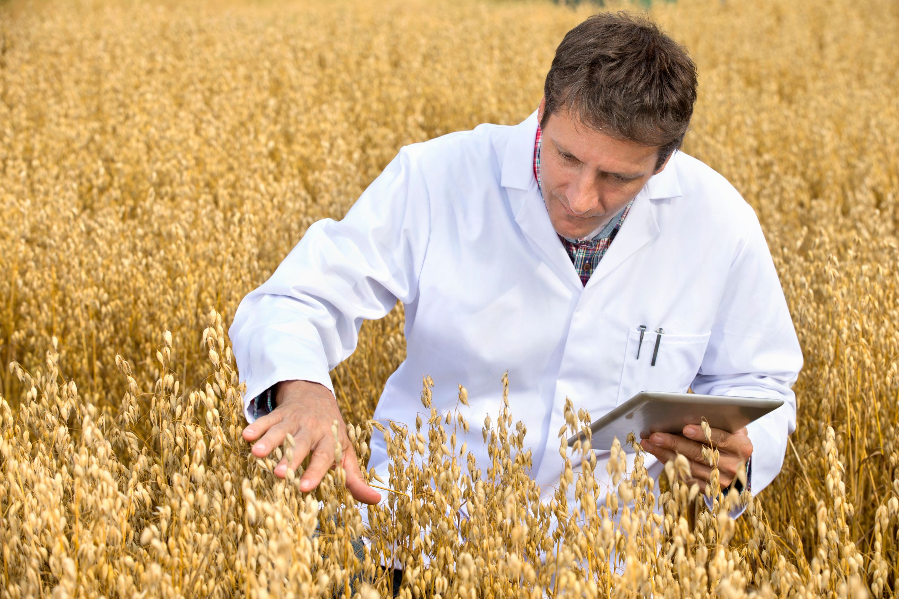
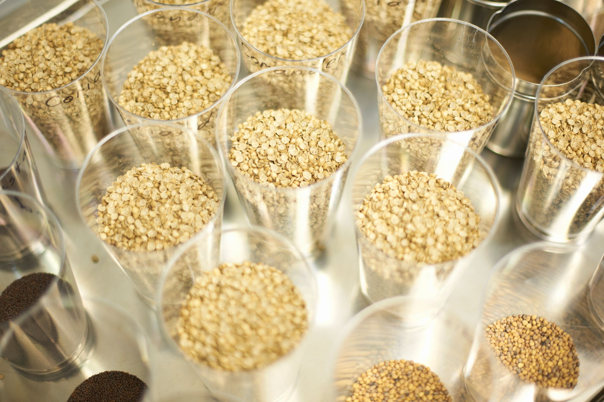
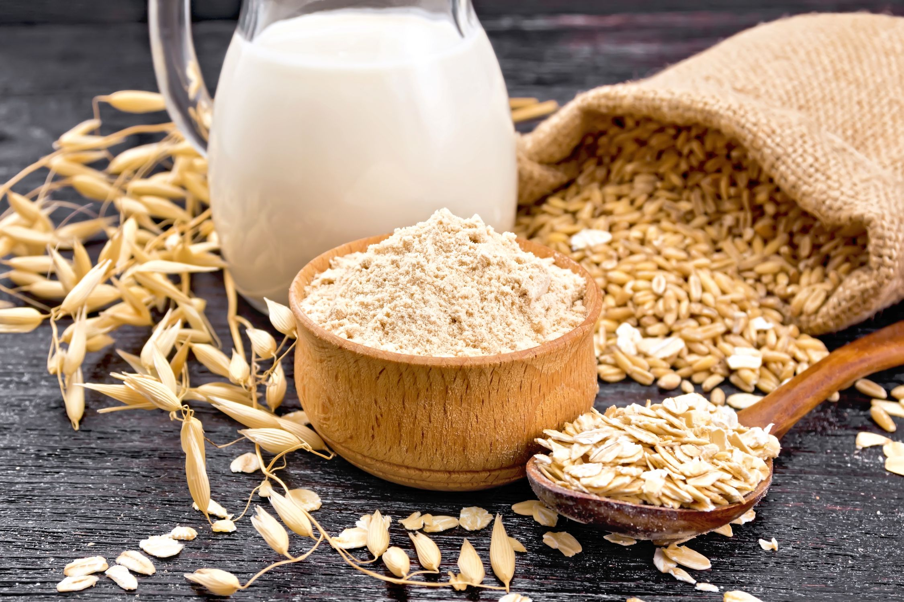

**La biotecnología aplicada en La Araucanía no solo busca resistencia a la sequía; promete transformar este grano en la base de la futura medicina y cosmética natural.**

En un escenario donde la seguridad alimentaria mundial pende de un hilo debido a la crisis climática, Chile ha decidido convertir sus campos en laboratorios de vanguardia. Posicionado actualmente como el **segundo mayor exportador mundial de avena procesada**, el país enfrenta la paradoja de tener una posición de mercado privilegiada amenazada por un clima cada vez más hostil.

La respuesta de la ciencia chilena, liderada por investigadores de **INIA-Carillanca**, es una apuesta agresiva por la innovación genética. El objetivo es claro: rediseñar la arquitectura biológica de la avena para sobrevivir en un mundo con menos agua. Este avance será el eje central de la próxima **International Oat Conference (OAT 2026)**, que reunirá a la élite científica mundial en Chile el próximo noviembre.

### El "Germoplasma": La biblioteca de la supervivencia

Para entender la magnitud del trabajo, hay que mirar bajo el microscopio. El secreto reside en el **germoplasma**, el conjunto de recursos genéticos que define qué es la avena. Mónica Mathias, investigadora en mejoramiento genético de INIA, explica que la diversidad genética es estratégica: permite "adaptar las variedades a distintas condiciones agroclimáticas y reducir la dependencia de insumos externos".

El desafío agronómico actual es crítico: se ha registrado una marcada **disminución del recurso hídrico en primavera** en la zona sur de Chile. Esto no solo seca los cultivos, sino que degrada los suelos y merma el rendimiento. La solución científica consiste en identificar y seleccionar aquellos genes ancestrales o modernos que permitan a la planta ser **eficiente en el uso de agua y nutrientes**, manteniendo su calidad sin requerir cargas masivas de fertilizantes o pesticidas.

### _Speed Breeding_ y Pan-genomas: Acelerando la evolución

La agricultura tradicional tarda décadas en estabilizar una nueva variedad. Chile está rompiendo esa barrera temporal mediante el **"speed breeding"** (cría rápida).

Esta técnica implica:

- **Cultivo de embriones en invernadero:** Acelera el ciclo de vida de la planta para obtener múltiples generaciones en un solo año.

- **Edición Génica y Genómica:** Aunque incipiente en la especie, Chile avanza en el uso de estas herramientas, apoyadas por análisis de **pan-genomas y super-pangenomas**. Estas metodologías permiten "leer" el mapa completo de la evolución de la avena para identificar genes específicos de resistencia.

- **Inteligencia Artificial (IA):** Se proyecta el uso de IA y fenómica para predecir comportamientos de cultivos y realizar una agricultura de precisión quirúrgica.

### De alimento a bio-producto: Cosmética, Medicina y Mercados Premium

La innovación genética no solo busca que la planta sobreviva, sino que valga más. La investigación chilena está impulsando variedades con perfiles nutricionales específicos que abren puertas a industrias de alto valor:

1. **Nutrición Funcional:** Aumento de **betaglucanos** (fibra soluble clave para el corazón), proteínas y lípidos saludables.

3. **Seguridad Alimentaria:** Desarrollo de avenas **bajas en gluten y micotoxinas**, respondiendo a la demanda de consumidores celiacos o sensibles.

5. **Usos Alternativos:** Creación de líneas genéticas diseñadas exclusivamente para la **industria cosmética y la medicina**, aprovechando los compuestos bioactivos del grano para la salud dérmica y tratamientos clínicos.

### OAT 2026: El epicentro de la discusión mundial

Todo este ecosistema de innovación convergerá en la **International Oat Conference (OAT 2026)**. El evento no solo busca mostrar los avances científicos, sino consolidar a Chile como un _hub_ tecnológico agrario, integrando conocimientos sobre el microbioma del suelo y la adaptación al estrés ambiental.

"Chile cuenta con un germoplasma histórico y moderno... esencial para asegurar la competitividad del sector", concluye Mathias. La conferencia será la vitrina definitiva para demostrar que la avena chilena no es solo un _commodity_, sino un producto de alta ingeniería biológica.

* * *

### 📄 Documento Adjunto: Comunicado Oficial

_Para detalles técnicos específicos, vocerías oficiales y contactos de prensa, acceda al comunicado original de la organización OAT 2026 a continuación:_

> [CP - Innovación genética en la avena de Chile VF](https://tiempossustentables.cl/wp-content/uploads/2025/12/cp-innovacion-genetica-en-la-avena-de-chile-vf.docx)[Descarga](https://tiempossustentables.cl/wp-content/uploads/2025/12/cp-innovacion-genetica-en-la-avena-de-chile-vf.docx)

* * *

