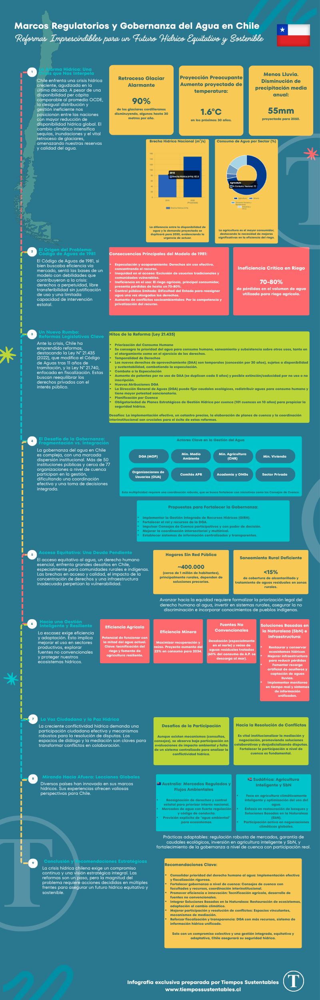

Chile enfrenta una crisis hídrica sin precedentes. Aunque su disponibilidad de agua per cápita es similar a la de los países miembros de la OCDE, su distribución no es equitativa. Esto es un problema. La gestión ineficiente y los efectos del cambio climático también afectan la situación. Estos factores han convertido esta nación en uno de los países con mayor reducción de recursos hídricos en el mundo. La situación exige respuestas urgentes, tanto en adaptación climática como en reformas profundas en la gobernanza del agua.

## **La crisis hídrica en Chile: un panorama desolador**

En Chile, las sequías recurrentes y la pérdida acelerada de glaciares han reducido las reservas de agua natural. Los glaciares han disminuido en un 90% en la cordillera. Esto afecta tanto el consumo humano como la generación de energía hidroeléctrica. El cambio climático afecta esta problemática de manera más grave. Se proyecta un aumento de temperaturas de hasta 4°C en zonas andinas. También hay una disminución significativa en las precipitaciones.

El impacto se refleja en la calidad del agua. Está comprometida por sedimentos, contaminantes y la salinización de acuíferos costeros. Esto es producto del aumento del nivel del mar. La demanda hídrica está concentrada principalmente en la agricultura. Esta actividad utiliza cerca del 87% del total. La minería también contribuye a la demanda. Se proyecta un crecimiento alarmante de la demanda, ampliando la brecha entre la oferta y la demanda.

## **El modelo legal: un marco que ya no sirve**

El Código de Aguas de 1981, vigente hasta la reciente modificación en 2022, estableció un esquema de concesiones perpetuas. También permitió la libre transferibilidad de derechos de agua. Se hizo con la intención de promover eficiencia mediante mecanismos de mercado. Sin embargo, este sistema ha demostrado ser ineficaz y, en muchos casos, contraproducente.

La concentración de derechos en manos de unos pocos, la especulación y el acaparamiento han profundizado los conflictos socioambientales. Además, la inequidad en el acceso, especialmente para comunidades indígenas y rurales, ha exacerbado estos conflictos. Además, la ineficiencia en el uso del agua es un problema serio. Este problema es particularmente grave en la agricultura. La limitada capacidad del Estado para regular y intervenir también ha contribuido a agravar la crisis.

## **Hacia una nueva gobernanza hídrica**

Frente a este escenario, las reformas regulatorias y de gobernanza se vuelven imprescindibles. Es necesario establecer un marco legal que priorice el uso social y ecológico del agua. También debe garantizar el acceso equitativo. Además, promueve el uso eficiente del recurso. La gestión participativa, con mayor control público y transparencia en el registro de derechos, debe ser un pilar fundamental.

Asimismo, se requiere fortalecer las políticas de adaptación al cambio climático. Esto incluye fomentar prácticas agrícolas sostenibles. También se debe invertir en infraestructura hídrica resiliente y promover el uso de tecnologías de tratamiento y reutilización del agua.

## **Conclusión**

La crisis hídrica en Chile no es solo un desafío ambiental. También es un problema social y económico. Requiere respuestas integrales y urgentes. La oportunidad está en reformar un modelo obsoleto. Es crucial adoptar un enfoque de gobernanza basado en la sustentabilidad y el bienestar colectivo. Además, se debe actuar con decisión para asegurar un futuro hídrico justo y sostenible para todos los chilenos.

* * *

_Descarga a continuación el informe y la infografía que hemos preparado para ti._

[Reformas y Gobernanza del Agua\_ (1)](https://tiempossustentables.cl/wp-content/uploads/2025/05/reformas-y-gobernanza-del-agua_-1.pdf)[Descarga](https://tiempossustentables.cl/wp-content/uploads/2025/05/reformas-y-gobernanza-del-agua_-1.pdf)

<figure>

<figcaption>

Infografía preparada por Tiempos Sustentables

</figcaption>

</figure>
