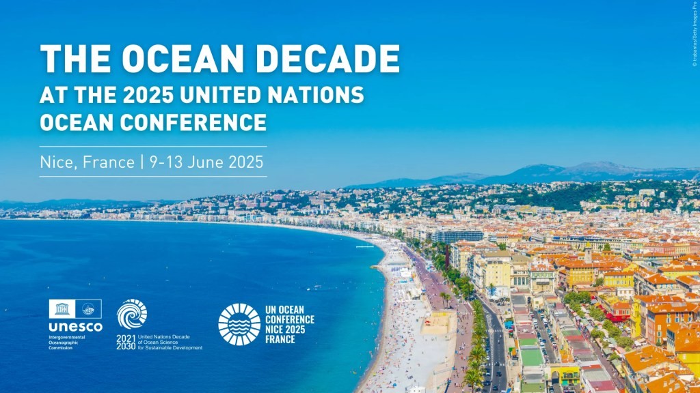
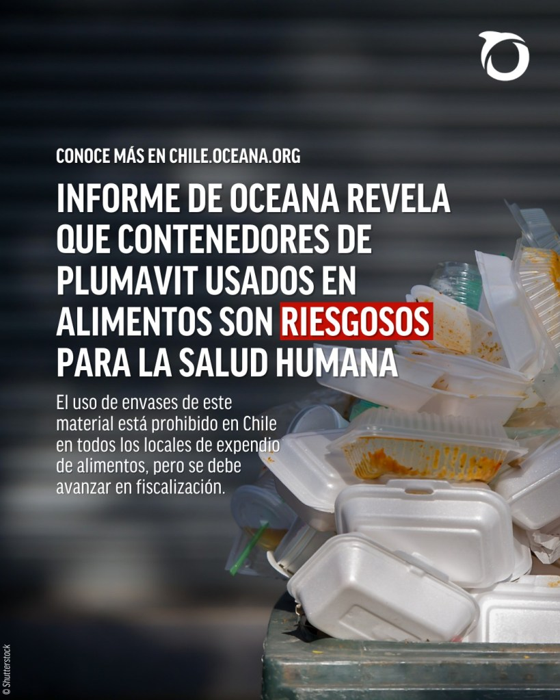
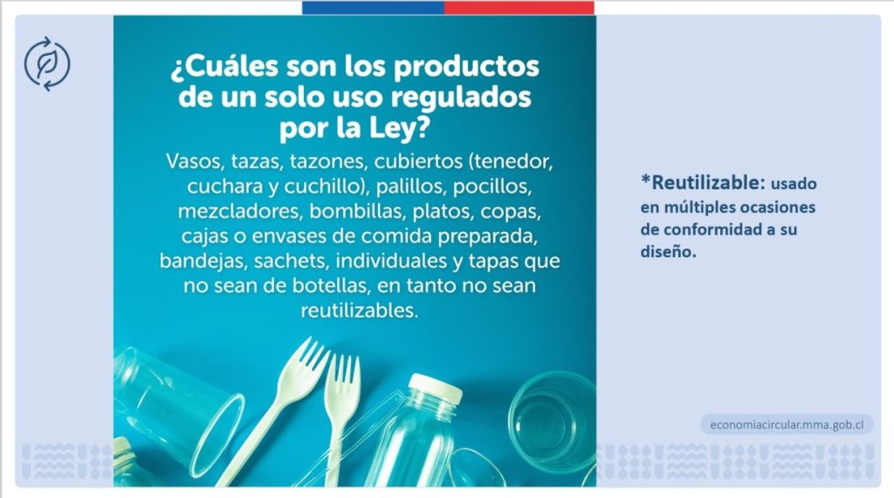
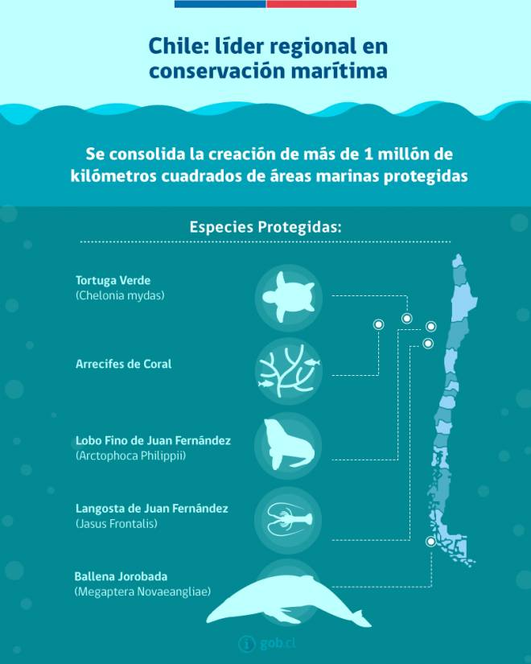

Mientras el mundo fija su mirada en Niza, Francia, para la próxima Conferencia de los Océanos de las Naciones Unidas (UNOC 2025), la voz de Chile resuena con particular fuerza. Este año la consigna es [acabar con la contaminación plástica](https://tiempossustentables.cl/2025/06/05/dia-mundial-del-medio-ambiente-2025-acabar-con-la-contaminacion-plastica/) y con miles de kilómetros de costa, el país ha emprendido una ambiciosa travesía que va desde la lucha ciudadana contra los plásticos de un solo uso hasta la titánica tarea de resguardar los tesoros de biodiversidad que yacen en la Patagonia, Rapa Nui y el archipiélago de Juan Fernández. Esta no es solo una historia de políticas públicas, sino un testimonio de empoderamiento ciudadano que Chile llevará como estandarte al debate oceánico mundial.

### La Marea Plástica y el Peligro Invisible

Tal como advertíamos en el anterior reportaje [Crisis de microplásticos en los océanos](https://tiempossustentables.cl/2025/04/08/crisis-de-microplasticos-en-los-oceanos-impacto-y-soluciones/):  
La omnipresencia del plástico en las costas chilenas es una realidad ineludible. Según datos recientes, el 85% de la contaminación marina corresponde a este material, y en la temporada estival, la cifra de residuos que afectan a playas y océanos asciende a 1,7 millones de toneladas. Pero el problema trasciende la basura visible.

Un informe de la [ONG Oceana](https://chile.oceana.org/) ha puesto la lupa sobre el poliestireno expandido, conocido popularmente como "plumavit", utilizado masivamente en envases de alimentos. Este material, advierten, no solo es un contaminante persistente en los ecosistemas, sino que representa un riesgo para la salud humana al estar asociado con daños al sistema nervioso e incluso ser considerado un posible cancerígeno.

La amenaza se vuelve aún más insidiosa a nivel microscópico. Investigaciones recientes de Greenpeace (marzo de 2025) han revelado la alarmante presencia de microplásticos en alimentos de consumo diario, incluyendo la sal de mesa, el arroz y, de manera preocupante, en la fauna marina que forma parte de la dieta de los chilenos. Un estudio en el sur de Chile encontró altas concentraciones de estas partículas en las aguas de Puerto Montt, evidenciando que el plástico que desechamos vuelve a nosotros de las formas más inesperadas.

### La Ley en Acción: El Desafío del Plástico de un Solo Uso

En este escenario, la Ley 21.368, que prohíbe los plásticos de un solo uso, emerge como una herramienta fundamental. Desde su implementación gradual, que en 2024 ya prohíbe elementos como bombillas, revolvedores y cubiertos plásticos, y obliga a los supermercados a exhibir un 30% de botellas retornables, se esperan reducir cerca de 23.000 toneladas de residuos plásticos anualmente.

En comunas costeras como Rapa Nui, la lucha contra el plástico es un ejemplo de resiliencia comunitaria. La isla, que sufre la llegada de toneladas de basura plástica arrastrada por las corrientes oceánicas, ha fortalecido sus prácticas de reciclaje y ha impulsado un modelo de desarrollo centrado en la sostenibilidad.

Sin embargo, la transición no ha estado exenta de desafíos. Mientras algunas cadenas de comida rápida han presionado para flexibilizar la normativa, datos del Ministerio del Medio Ambiente demuestran que la huella hídrica de lavar loza reutilizable es 22 veces menor que la de producir un plato desechable.

La otra cara de la moneda la viven pequeños empresarios. Para el dueño de una conocida cadena de sushi, la adaptación ha sido compleja: _"En nuestro negocio, cuando subes el precio, baja la cantidad demandada. Me están obligando a contratar más gente y meterle costos al negocio... ¿Dónde meto la vajilla necesaria para atender a 500 personas en un local de 50 metros cuadrados?"_. Este testimonio refleja la necesidad de apoyar a los pequeños comercios en esta transición.

El éxito de la ley depende, en gran medida, del rol activo de la ciudadanía. Denunciar a los locales que no cumplen y preferir a aquellos que han adoptado alternativas sustentables son acciones clave para consolidar este cambio cultural.

### Santuarios de Vida: El Estado de las Áreas Marinas Protegidas

Chile ha dado pasos agigantados en la protección de sus ecosistemas marinos, declarando un 22% de su territorio nacional como área protegida, según el Informe de Estado del Medio Ambiente de 2024. Zonas de incalculable valor como la Patagonia, Rapa Nui y el archipiélago de Juan Fernández son hoy santuarios de vida.

Pero la denominación de "protegida" no siempre se traduce en una conservación efectiva. La pesca ilegal, a menudo por flotas internacionales, y la falta de financiamiento y personal para una vigilancia constante, son amenazas latentes que convierten a algunas de estas áreas en "parques de papel".

Aun así, hay avances notables. En Rapa Nui y Juan Fernández se han logrado progresos en los planes de manejo con participación de las comunidades locales. En la Patagonia, una alianza público-privada busca asegurar la preservación de sus áreas marinas, amenazadas principalmente por la salmonicultura intensiva y los efectos del cambio climático.

**_“La conservación efectiva de nuestras áreas marinas protegidas es el termómetro de nuestro compromiso real con el océano”_**, señala un representante de la ONG local. **_“No basta con firmar decretos, debemos asegurar los recursos y la voluntad política para que la protección sea una realidad palpable”_.**

### Rumbo a Niza 2025: La Voz de Chile en el Escenario Oceánico

La Conferencia de los Océanos de la ONU en Niza no es una cita más en el calendario diplomático. Es la plataforma donde Chile, como líder reconocido en conservación marina, puede y debe proyectar al mundo su experiencia, sus desafíos y sus logros.

Los ejes de la conferencia –movilizar financiamiento para el Objetivo de Desarrollo Sostenible 14 (Vida Submarina), desarrollar una economía azul sostenible y fortalecer la conexión entre ciencia y política– resuenan directamente con los esfuerzos que Chile está realizando. Se espera que el país impulse con fuerza la implementación del Tratado de Protección de la Altamar (BBNJ), un instrumento clave para la gobernanza de los océanos más allá de las fronteras nacionales, donde su rol ha sido históricamente proactivo.

A continuación te dejo la lista de temas de los 10 paneles de acción que se tocarán en la conferencia:

[UNOC3 Ocean Action Panels links](https://tiempossustentables.cl/wp-content/uploads/2025/06/unoc3-ocean-action-panels-links.pdf)[Descarga](https://tiempossustentables.cl/wp-content/uploads/2025/06/unoc3-ocean-action-panels-links.pdf)

La experiencia chilena con su ley de plásticos, los avances y retos en la gestión de sus gigantescas Áreas Marinas Protegidas y el conocimiento científico generado en sus costas son aportes de inmenso valor para la discusión global.

### Llamado a la Acción: El Océano en Nuestras Manos

La protección de los océanos no es una tarea exclusiva de gobiernos o grandes organizaciones. El impacto de la ley de plásticos de un solo uso demuestra que las decisiones individuales, multiplicadas por millones, tienen el poder de transformar nuestra relación con el entorno.

Desde elegir productos reutilizables y preferir comercios responsables, hasta apoyar a las ONGs que trabajan incansablemente en la conservación y fiscalización ciudadana, cada acción cuenta. El camino de Chile hacia la sostenibilidad oceánica está trazado, pero requiere del compromiso de todos sus habitantes para convertirse, verdaderamente, en un guardián del océano. La Conferencia de Niza será el escenario para compartir esta visión con el mundo, pero la verdadera labor se realiza día a día, en cada gesto y en cada decisión.

 

