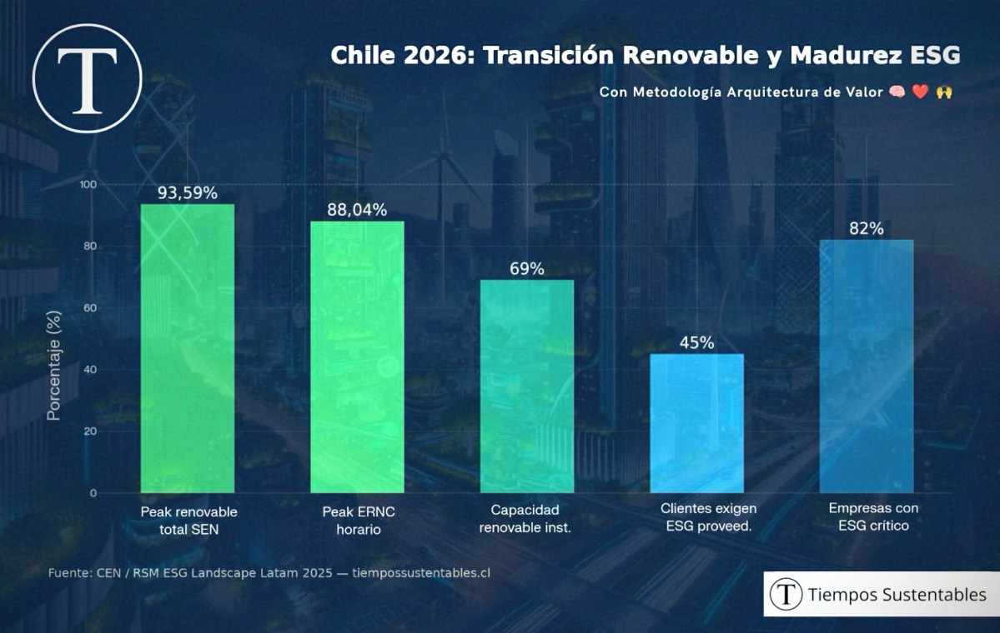

Chile alcanzó un máximo histórico del 93,59% en generación eléctrica renovable durante enero de 2026. Paralelamente, el 82% de las empresas latinoamericanas integra criterios ambientales, sociales y de gobernanza como elementos críticos para su operación, transformando la sostenibilidad en un pilar estratégico y financiero para la competitividad regional.

A pesar de los avances energéticos, el retiro de decretos ambientales genera incertidumbre sobre la protección de la biodiversidad. La consolidación de la transición sostenible requiere equilibrar la expansión de energías limpias con marcos regulatorios estables y una ejecución corporativa que traduzca el propósito en resultados medibles y resiliencia.

<figure>

<figcaption>

Transición renovable ESG Chile 2026: energía renovable + ESG corporativo en un solo gráfico

</figcaption>

</figure>

La participación total de fuentes renovables en el Sistema Eléctrico Nacional alcanzó un máximo horario de **93,59%**, con un pico de energías renovables no convencionales de **88,04%**, según el informe publicado por Reporte Minero basado en datos del Coordinador Eléctrico Nacional.

El dato no es menor. En el desglose tecnológico, la energía solar alcanzó un máximo horario de **8.917,7 MWh**, mientras la eólica llegó a **3.545,4 MWh**, mostrando una complementariedad que ya no funciona como promesa, sino como soporte operativo de la matriz eléctrica nacional.

## **ESG y energías renovables**: de la reputación a la rentabilidad

Al mismo tiempo, la sostenibilidad corporativa en América Latina dejó de medirse solo en términos reputacionales. Un análisis de Tiempos Sustentables basado en la encuesta _ESG Landscape Latam 2025_ de RSM indica que el **82% de las empresas** de la región considera hoy el desempeño ESG como crítico e indispensable para su operación.

La señal es consistente: entre 2024 y 2025 aumentó con fuerza la prioridad otorgada a la gestión de riesgos ESG y al gobierno corporativo, mientras el **45% de los clientes** ya exige información ESG a sus proveedores. En paralelo, S&P Global Ratings proyecta entre **US$25.000 millones y US$30.000 millones** en emisiones de bonos sostenibles para 2026 en América Latina.

## Sostenibilidad estratégica: la Arquitectura de Valor en Chile 2026

Desde nuestra metodología **Arquitectura de Valor**, este escenario confirma que la sostenibilidad ya no puede entenderse como un relato aislado, sino como una capacidad concreta de crear valor durable. Cuando una organización alinea estrategia, propósito y ejecución, la sostenibilidad deja de ser una declaración y se convierte en ventaja competitiva.

Bajo la triada **Cabeza fría, Corazón activo y Manos firmes**, evaluamos si una empresa tiene visión estratégica, coherencia de propósito y disciplina operativa para sostener su promesa en el tiempo. Esa es la diferencia entre una marca valiosa y una marca verdaderamente sostenible.

## Transición renovable y regulación: la otra tensión en Chile

Pero el avance convive con fricciones. En marzo de 2026, el Gobierno retiró **43 decretos ambientales** en trámite ante Contraloría, una decisión que generó críticas de organizaciones socioambientales y científicas por sus posibles efectos sobre biodiversidad, calidad del aire e institucionalidad ambiental.

La lectura de fondo es clara: la transición sostenible en Chile avanza, pero su velocidad dependerá tanto de la expansión de las energías limpias como de reglas estables y de empresas capaces de traducir ESG en resultados financieros, resiliencia y legitimidad social.

* * *

_Fuentes: Reporte Minero / Coordinador Eléctrico Nacional | RSM ESG Landscape Latam 2025 | Tiempos Sustentables | Cooperativa.cl | CIPER Chile_

Si quieres dimensionar el nivel de madurez de tu organización en sostenibilidad, realiza en menos de 5 minutos nuestro auto-diagnóstico en [diagnostico.tiempossustentables.cl](https://diagnostico.tiempossustentables.cl/)

🧠 Cabeza fría para la visión estratégica. ♥️ Corazón activo para el propósito. 🙌 Manos firmes para la ejecución.

