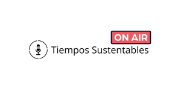

<figure>

<figcaption>

Revisa este artículo en  
[Tiempos Sustentables On-Air](https://tiempossustentables.cl/tiempos-sustentables-on-air/)

</figcaption>

</figure>

El compromiso con la sostenibilidad ya no es solo una opción para las empresas, sino un imperativo estratégico y financiero. Desde Santiago a São Paulo, la región está redefiniendo el valor económico a través de una lente de triple impacto: personas, planeta y prosperidad.

### Panorama Actual: De los desafíos a las oportunidades

América Latina, una región rica en biodiversidad y recursos naturales, enfrenta el doble desafío de impulsar el crecimiento económico y, al mismo tiempo, proteger su patrimonio natural y reducir las desigualdades. "Las economías de América Latina y el Caribe mantienen un bajo crecimiento y se expandirán 2,2% en 2024 y 2,4% en 2025," según un informe de la CEPAL de diciembre de 2024. Este contexto de crecimiento moderado subraya la necesidad de **inversiones estratégicas** que no solo generen rentabilidad, sino que también impulsen el desarrollo sostenible.

A pesar de una caída del 12% en la inversión extranjera directa en América Latina y el Caribe en 2024, según UN News, se observa un notable crecimiento en proyectos 'greenfield', especialmente en **energías renovables y el prometedor sector del hidrógeno verde**. Esto demuestra un cambio de enfoque hacia inversiones de mayor valor añadido y con impacto sostenible. La región se encuentra en un "punto de inflexión", con un enorme potencial en la transición energética, la producción de alimentos y la preservación de la biodiversidad, como señala el Foro Económico Mundial.

### Chile: Pionero en Sostenibilidad Financiera

Chile se ha posicionado como líder regional en la integración de criterios ESG en su mercado. La **Ley Marco de Cambio Climático (Ley 21455)**, que establece la meta de carbono neutralidad para 2050, es un pilar fundamental de esta transformación. A nivel financiero, la **Comisión para el Mercado Financiero (CMF)** ha sido proactiva. Para la segunda mitad de 2024, la CMF implementará un nuevo marco regulatorio para la industria de fondos, centrado en la divulgación de información ESG, un paso crucial hacia una mayor transparencia y alineación con estándares internacionales (CMF Chile, mayo 2024).

El Ministerio de Hacienda de Chile, por su parte, ha desarrollado un marco robusto para la emisión de **bonos soberanos verdes, sociales y sostenibles**, abarcando desde transporte limpio y energías renovables hasta gestión de residuos y apoyo a grupos vulnerables. De hecho, Chile ha sido el mayor emisor soberano de bonos temáticos en la región desde 2020 (S&P Global Ratings, marzo 2025).

### Tendencias de Inversión Sostenible: Un mercado en expansión

El mercado de **bonos verdes, sociales y sostenibles (GSS)** a nivel global se proyecta que superará el billón de dólares en 2025. América Latina contribuyó con USD 54.500 millones en 2024, siendo **Brasil (USD 11 mil millones), Chile (USD 9.1 mil millones) y México (USD 16 mil millones)** los principales emisores (S&P Global Ratings, marzo 2025).

La **inversión de impacto** también está experimentando un auge significativo. En Chile, los activos bajo gestión en fondos de inversión de impacto se han triplicado en los últimos seis años, alcanzando los **USD 442,5 millones para junio de 2024**. Estos fondos respaldan 269 proyectos que abordan desafíos sociales y ambientales, con un fuerte énfasis en la **economía circular, la agricultura sostenible y la educación** (Funds Society, junio 2024).

Sin embargo, el mercado no está exento de desafíos. La caída de los bonos vinculados a la sostenibilidad (SLB) en el primer trimestre de 2025, en parte debido a acusaciones de "greenwashing", subraya la importancia de **marcos regulatorios homogéneos, transparencia y rendición de cuentas** para garantizar la credibilidad y el crecimiento sostenido del sector (SEGIB & GGGI, diciembre 2024).

### Líderes y Sectores en la Transición

En Chile, el **ranking Merco ESG 2024** destaca a **BCI, Mercado Libre y Natura** como las empresas más responsables. **BCI**, reconocido como el banco más sostenible de Chile, se ha comprometido con la iniciativa Net-Zero Banking Alliance (NZBA) y ha ampliado su oferta de productos financieros "verdes" como hipotecas y seguros (Diario Financiero, junio 2025). **Scotiabank** también ha sido distinguido como el "Mejor Banco en Finanzas Sostenibles en Chile" por segundo año consecutivo (Global Finance Awards, mayo 2025).

Diversos sectores económicos están adoptando prácticas sostenibles con fuerza:

- **Minería:** Chile, líder mundial en cobre y un actor clave en litio, avanza hacia una **minería sostenible**. SERNAGEOMIN ha publicado guías para la descarbonización, y empresas como **Antofagasta Minerals y Codelco** están implementando tecnologías de electrificación y automatización para reducir su huella ambiental (SERNAGEOMIN, abril 2025; ABB Chile, abril 2025).

- **Energía:** Chile ha logrado una notable transición, con la **energía eólica y solar superando al carbón** en su matriz energética. La región latinoamericana, que ya produce el 65% de su energía de fuentes renovables, se proyecta como un hub global para la energía limpia, con inversiones significativas esperadas en hidrógeno verde y otras tecnologías (IRENA, mayo 2025; InvestChile, enero 2025).

- **Agricultura:** El **Programa de Transición a la Agricultura Sostenible (TAS) de INDAP** en Chile promueve técnicas como la siembra directa, el compostaje y la agroforestería, esenciales para la resiliencia climática y la seguridad alimentaria (INDAP, mayo 2025).

- **Turismo:** Chile está impulsando una **Estrategia Nacional de Turismo Sostenible 2035** para proteger sus recursos naturales y asegurar que el sector beneficie a las comunidades locales.

### El futuro es sostenible

La convergencia de regulaciones progresistas, una creciente demanda de inversiones con impacto y el liderazgo de empresas y bancos están cimentando un futuro más sostenible para Chile y América Latina. La región está preparada para captar una mayor cuota de la inversión global ESG, aprovechando su vasta riqueza natural y su creciente capacidad para innovar en soluciones verdes.

"La inversión en sostenibilidad no es un costo, sino una inversión en el futuro", concluyó un reciente comunicado de BCI, al anunciar el aumento de su financiamiento para proyectos sostenibles. Este sentimiento encapsula el espíritu de una región que está transformando sus desafíos en oportunidades, forjando un modelo de desarrollo que beneficia tanto a la economía como al planeta.

* * *

¿Qué otros aspectos de la sostenibilidad cree que serán clave para el desarrollo empresarial en Chile en los próximos cinco años?
