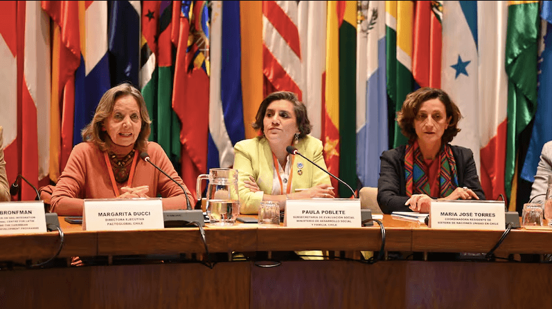
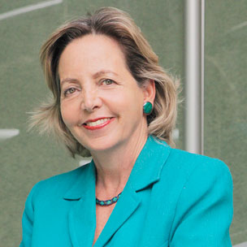

El pasado 3 de abril, el Foro Empresarial para los Objetivos de Desarrollo Sostenible (ODS) en América Latina y el Caribe 2025 se llevó a cabo en la sede de la CEPAL, marcando un hito en la colaboración entre el sector privado y público. Organizado por la Comisión Económica para América Latina y el Caribe (CEPAL) junto a diversos actores clave, este encuentro tuvo como objetivo acelerar la contribución del sector privado al cumplimiento de la Agenda 2030.

Bajo el lema “Acelerando la contribución del sector privado”, el evento reunió a destacadas figuras empresariales, representantes de organismos internacionales, de la sociedad civil y del sector público en el Salón Celso Furtado. Entre los organizadores se encontraban el Sistema de Naciones Unidas en Chile, el Ministerio de Desarrollo Social y Familia, y la Red Pacto Global Chile.

## **Una Conversación Intersectorial para Avanzar en la Agenda 2030**

La apertura del foro estuvo a cargo de **María José Torres**, _coordinadora residente del Sistema de Naciones Unidas en Chile_; **Luis Yáñez**, _secretario de la Comisión de la CEPAL_; **Paula Poblete**, _subsecretaria de Evaluación Social del Ministerio de Desarrollo Social y Familia_; y **Margarita Ducci**, _directora ejecutiva de Pacto Global Chile_. Durante sus intervenciones, se destacó la necesidad de colaboración entre distintos actores sociales para abordar los desafíos prioritarios de la región, incluyendo la desigualdad, el cambio climático, la inclusión social y un desarrollo económico sostenible.

https://youtu.be/UBfqDsGCmuM?si=tXbS2Ci4nABlMtXB

## **Paneles de Alto Nivel Sobre Impacto Territorial, Innovación y Sostenibilidad**

El foro incluyó dos paneles temáticos centrados en la generación de valor empresarial y la sostenibilidad. En el primer panel, se discutió la creación de un ecosistema empresarial próspero, con la participación de líderes de importantes instituciones como **Itacamba Cemento, Nestlé Chile, y ProChile**. Los panelistas intercambiaron experiencias sobre desarrollo local, el fortalecimiento del empleo juvenil, el impulso a la inclusión femenina y la promoción de exportaciones sostenibles, subrayando la importancia de las alianzas público-privadas.

El segundo panel se enfocó en los desafíos de la innovación y el medio ambiente, resaltando la necesidad de implementar tecnologías sostenibles. Destacados representantes de **Aris Mining, Empresas Iansa, Aceros AZA, L’Oréal Chile y Salmón Chile** compartieron sus perspectivas, y se llevó a cabo una dinámica participativa, donde los asistentes identificaron los principales obstáculos y el potencial del sector privado para superarlos.

En un ejercicio de reflexión colectiva, los participantes reiteraron los desafíos que enfrenta América Latina, destacando la urgencia de acelerar el cumplimiento de los ODS mediante la innovación, la colaboración multisectorial y una visión a largo plazo.

## **Un Llamado a la Acción Sostenible**

Margarita Ducci concluyó el foro con un poderoso mensaje: **_“El sector privado no solo tiene el deber, sino también el potencial de ser un catalizador fundamental para lograr una América Latina más equitativa, resiliente y sostenible”._**

En un contexto de incertidumbre, es crucial reafirmar el compromiso por un desarrollo sostenible y continuar avanzando hacia un futuro mejor, a pesar de las dificultades.

Este evento no solo coolabora con la realización de los ODS, sino que también refuerza la idea de que la sostenibilidad es un camino que se recorre juntos, uniendo fuerzas entre los sectores público y privado para enfrentar los desafíos que se presentan frente a nosotros.

## En conclusión

El Foro Empresarial para los ODS en América Latina y el Caribe 2025 dejó en evidencia que **el camino hacia el desarrollo sostenible requiere de alianzas sólidas, liderazgo compartido y una mirada estratégica de largo plazo**. Las voces que se alzaron en la CEPAL coincidieron en que **el sector privado no solo es un actor clave, sino un motor de transformación capaz de generar impacto real en los territorios**. Ahora, el desafío es traducir el diálogo en acción, y las ideas en soluciones concretas.

**_Solo trabajando juntos —empresas, gobiernos, sociedad civil y organismos internacionales— podremos avanzar hacia una región más inclusiva, resiliente y comprometida con el bienestar del planeta y las futuras generaciones._**  

 

 

 

