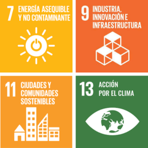

La movilidad eléctrica dejó de ser una promesa para convertirse en un pilar estratégico en la lucha contra el cambio climático. En Chile y Latinoamérica, su desarrollo avanza a paso firme, aunque no sin desafíos. ¿Cómo se conecta este fenómeno con la sostenibilidad, la justicia social y los Objetivos de Desarrollo Sostenible de la Agenda 2030? Este reportaje lo analiza desde una mirada integral.

## Un problema global, una oportunidad regional

El transporte es una de las principales fuentes de emisiones de gases de efecto invernadero a nivel mundial. Frente a este panorama, la electromovilidad se alza como una solución urgente y transformadora. Los vehículos eléctricos (VE), al no emitir gases por el tubo de escape, pueden reducir significativamente la contaminación del aire y el ruido, sobre todo en áreas urbanas.

> "Para enfrentar de manera decisiva el cambio climático, la electromovilidad es fundamental. Estamos dando un salto hacia un sistema de transporte más limpio, eficiente y sostenible." - **Carolina Schmidt**, ex-Ministra de Medio Ambiente de Chile y Presidenta de la Conferencia de las Naciones Unidas sobre el Cambio Climático COP25.

Pero su impacto va más allá. Cuando analizamos el fenómeno bajo el lente ESG (Ambiental, Social y de Gobernanza), descubrimos una profunda interrelación con el desarrollo sostenible.

## ¿Qué dice el análisis ESG?

- **Ambientalmente**, la electromovilidad representa una mejora en la huella de carbono durante su operación, pero también exige una visión crítica sobre la extracción de minerales como litio y cobalto, así como la gestión de las baterías al final de su vida útil.

- **Socialmente**, abre oportunidades en empleo e innovación, pero puede desplazar a trabajadores del sector automotriz tradicional. Además, surgen dilemas éticos vinculados a las condiciones laborales en las minas de materiales críticos.

- En **gobernanza**, el rol del Estado y las regulaciones es vital. Incentivos, normativas claras y una red de carga estandarizada y accesible son claves para masificar la electromovilidad.

## Chile: Líder en buses eléctricos, desafíos en infraestructura

Chile destaca a nivel regional, especialmente Santiago, que cuenta con la mayor flota de buses eléctricos fuera de China. En el sector minero también se perciben avances. Sin embargo, la electromovilidad aún es incipiente en otras regiones del país y en el transporte privado.

La **Estrategia Nacional de Electromovilidad** fija metas ambiciosas, como que al 2035 solo se vendan vehículos livianos y medianos cero emisiones. Pero aún persisten brechas: altos costos iniciales, baja densidad de puntos de carga y desinformación del consumidor.

> "Este es un proyecto que trasciende gobiernos y nos permite posicionarnos como un referente global en sostenibilidad. Hoy tenemos más de 2.500 buses eléctricos en Santiago, y esperamos superar los 3.500 al final de este periodo de gobierno." - **Juan Carlos Muñoz**, Ministro de Transportes y Telecomunicaciones de Chile.

## Oportunidades de triple impacto

- **Ambientales**: ciudades menos contaminadas, menores emisiones y reducción del ruido.

- **Sociales**: empleo en nuevas industrias, mejor salud pública y oportunidades de reconversión laboral.

- **Económicas**: menor dependencia de combustibles fósiles, desarrollo de industrias locales y atracción de inversión extranjera.

> "La electromovilidad emerge como un componente clave en los ODS al permitir la integración de fuentes renovables con una baja huella de carbono y duplicar la eficiencia energética en comparación con la movilidad basada en la combustión interna, al tiempo que reduce las emisiones de partículas y gases de efecto invernadero." - **ADELAT** (Asociación de Empresas de Distribución de Energía Eléctrica de América Latina).

En paralelo, el auge de fabricantes chinos en la región ha democratizado el acceso a vehículos eléctricos, lo que podría acelerar la transición si se acompaña de políticas públicas sólidas.

## Electromovilidad y los ODS: una conexión directa

La movilidad eléctrica contribuye directamente a los ODS:

- **ODS 7:** impulsa el uso de energías limpias.

- **ODS 9:** promueve innovación e infraestructura sostenible.

- **ODS 11:** mejora la calidad de vida en las ciudades.

- **ODS 13:** combate el cambio climático.

## ¿Y ahora qué?

Para consolidar su impacto, la electromovilidad necesita más que voluntad. Se requieren alianzas entre gobiernos, empresas y ciudadanía. Es clave acelerar la inversión en infraestructura, fomentar el reciclaje de baterías, educar al consumidor y asegurar una transición justa para los trabajadores.

La movilidad del futuro está en marcha. Y si se hace bien, nos llevará a un destino más limpio, justo y sostenible.

