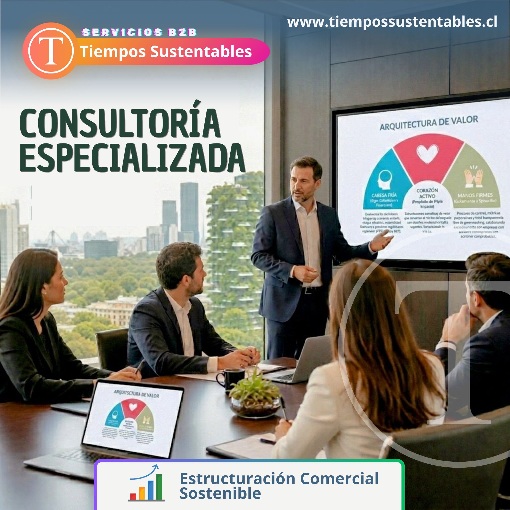
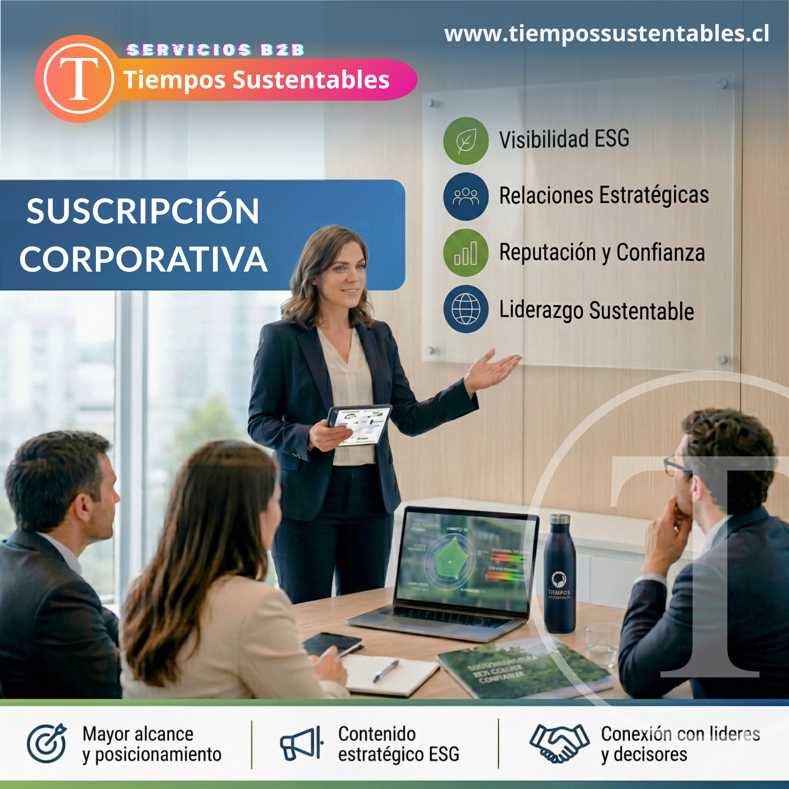
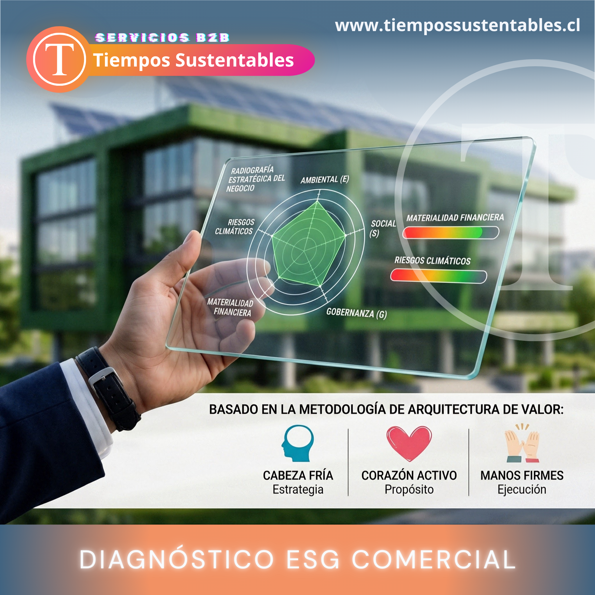

Traducir la sostenibilidad en posicionamiento de mercado consiste en convertir las iniciativas ESG de una entidad en notoriedad, prestigio y posibilidades comerciales reales. Actualmente, las compañías que informan adecuadamente sobre su huella sostenible no solo elevan su imagen: también potencian su propuesta de valor, su factor diferencial y sus nexos con clientes, socios e inversionistas.

No obstante, suele haber una desconexión habitual entre las acciones de una entidad y su capacidad para transmitirlas. Diversas compañías llevan a cabo proyectos de gran mérito, aunque carecen de un relato coherente, un plan de difusión o una perspectiva de ventas que les permita convertir dicho esfuerzo en notoriedad, credibilidad y rentabilidad.

## Ahí es donde una propuesta B2B especializada puede hacer brillar el futuro.

El punto de partida es comprender que informar sobre sostenibilidad no implica incrementar el volumen de mensajes, sino desarrollar un discurso honesto, único y alineado con la visión institucional. Al estructurar adecuadamente esa narrativa, la capacidad de la entidad para interactuar con clientes, socios, prensa y la sociedad se potencia de manera notable.

La segunda etapa consiste en emplear recursos que agilicen la evaluación del estado actual. Un análisis preliminar contribuye a detectar carencias en el posicionamiento, la narrativa, la propuesta y el enfoque comercial. En un periodo inferior a 5 minutos, una entidad puede lograr una visión inicial que fundamente la jerarquización de decisiones y la planificación de las siguientes medidas.

La tercera etapa consiste en materializar esa claridad en una propuesta específica. No basta con afirmar que una organización es sostenible; es preciso demostrar cómo ese factor distintivo genera valor para su público. Esto requiere integrar contenido, consultoría y soporte estratégico para transformar el propósito en logros palpables.

## La oferta B2B de Tiempos Sustentables

Tiempos Sustentables surge precisamente para satisfacer esa demanda. Las suscripciones corporativas, los diagnósticos sin costo y las asesorías especializadas constituyen tres vías de entrada para que las entidades refuercen su posicionamiento y logren una comunicación más eficaz, útil y coherente con sus propósitos.

En un escenario donde la credibilidad resulta un recurso cada vez más limitado, las organizaciones que consigan informar eficazmente sobre sus logros sostenibles obtendrán un beneficio competitivo notable. No basta con simplemente relatar sus acciones; la clave reside en hacerlo con juicio, coherencia y una visión orientada al futuro.

* * *

## [**Conoce los Servicios B2B →**](https://tiempossustentables.cl/servicios-b2b/)

- <figure>
    
    
    
    <figcaption>
    
    Servicios B2B - Consultoría Consultoría especializada y estructuración comercial sostenible de Tiempos Sustentables. www.tiempossustentables.cl
    
    </figcaption>
    
    </figure>
    
- <figure>
    
    
    
    <figcaption>
    
    Servicios B2B - Suscripción Suscripción Corporativa de Tiempos Sustentables: visibilidad ESG, relaciones estratégicas, reputación y liderazgo
    
    </figcaption>
    
    </figure>
    
- <figure>
    
    
    
    <figcaption>
    
    Servicios B2B - Diagnóstico Diagnóstico ESG Comercial de Tiempos Sustentables basado en la metodología: Estrategia, Propósito y Ejecución
    
    </figcaption>
    
    </figure>
    

* * *

[Cotiza por WhatsApp](https://api.whatsapp.com/send?phone=56962160192&text=Hola%2C%20necesito%20informaci%C3%B3n%20de%20los%20servicios%20B2B%20de%20Tiempos%20Sustentables.)

* * *

_Por Tiempos Sustentables_
