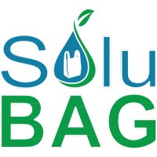
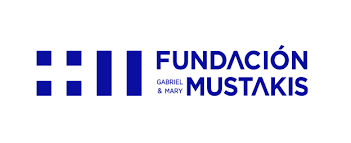
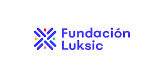
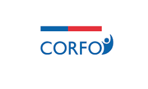

**Grandes capitales chilenos buscan un "doble dividendo": ganancias financieras y un impacto social y ambiental profundo. Chile se posiciona como epicentro de esta revolución silenciosa, pero poderosa.**

El camino hacia un futuro más sostenible en Chile ya no se bifurca entre la generosidad de la filantropía y el frío cálculo de las finanzas tradicionales. Un nuevo paradigma está emergiendo: la **inversión de impacto** y una **filantropía estratégica** colaboran para forjar un país más justo, verde y próspero. El capital se está convirtiendo en un motor imparable para el bien.

* * *

### **El "Doble Dividendo": Cuando Ganar Dinero Significa Cambiar Vidas**

La inversión de impacto es un enfoque de mercado que busca generar un **retorno financiero** junto con un **impacto social y ambiental positivo y medible**. Los inversores, especialmente las nuevas generaciones y los _family offices_ más visionarios, exigen este "doble dividendo" como parte de una evolución natural hacia la inversión responsable.

En Chile, esta tendencia se materializa a través de fondos y vehículos de inversión con criterios específicos. El [**Fondo Doble Impacto** de **Sigma AGF**](https://sigmaagf.cl/dobleimpacto/) canaliza capital hacia proyectos de infraestructura social y educación. Por su parte, el **[Fondo de Inversión FYNSA Migrante](https://www.fynsa.com/newsletter/fondo-fynsa-migrante/)** apoya emprendimientos de la comunidad migrante, demostrando cómo la inclusión social puede ser una inversión rentable.

#### **Ejemplo:**

La startup **[Solubag](https://www.solubagusa.com/)**, que desarrolló una bolsa soluble en agua no contaminante, atrajo capital de riesgo de impacto que no solo buscaba la rentabilidad, sino también generar un impacto ambiental masivo al reducir el uso de plásticos tradicionales.

* * *

### **La Nueva Filantropía: Del Altruismo al Capital Estratégico**

Mientras la inversión de impacto opera bajo la lógica del mercado, la filantropía en Chile también ha evolucionado. Las grandes fundaciones han adoptado un enfoque más estratégico, actuando como "capital catalítico" o de "riesgo" para el bien común.

Estas instituciones buscan generar soluciones sostenibles a problemas complejos. A menudo, sus recursos financian la investigación de vanguardia o incuban proyectos sociales innovadores que el mercado aún no puede asumir. Esta labor como "capital paciente" permite que las grandes ideas tomen vuelo.

#### **Ejemplo:**

**[Fundación Luksic](https://www.fundacionluksic.cl/)** y **[Fundación Mustakis](https://www.fundacionmustakis.org/)** invierten estratégicamente en programas educativos de largo aliento, desarrollo de emprendimientos y proyectos culturales. La **Fundación Luksic**, por ejemplo, ha sido pionera en el desarrollo de Centros de Emprendimiento Social que actúan como incubadoras para proyectos de alto potencial, un modelo que ha sido replicado en otras latitudes.

* * *

### **Chile: Un Ecosistema en Plena Ebullición**

Lo fascinante de la situación chilena es cómo ambos mundos, el de la inversión y el de la donación, se están interconectando. La filantropía, en muchos casos, financia las etapas iniciales de proyectos, creando el terreno fértil para que, una vez demostrada su eficacia y potencial de escalabilidad, la inversión de impacto entre a la cancha. Este "continuo de capital" acelera la sostenibilidad.

Un actor fundamental en este ecosistema es la **[Corporación de Fomento de la Producción (CORFO)](https://corfo.cl/sites/cpp/)**. A través de sus programas de apoyo a startups y sus fondos de inversión estratégica, ha catalizado el crecimiento del sector, siendo un socio clave para inversores que buscan proyectos innovadores con potencial de escalabilidad.

El cambio cultural es palpable. Los grandes patrimonios chilenos, las familias históricas y los nuevos empresarios exitosos, ya no solo piensan en heredar dinero, sino en heredar un legado, un impacto. Están usando todas las herramientas a su disposición: desde la donación directa hasta la inversión en empresas con propósito.

El mensaje es claro: **el dinero no es solo una herramienta para acumular riqueza, sino una poderosa fuerza para construir un futuro mejor. Y en Chile, esa fuerza ya está en movimiento.**

* * *

### **Una Mirada Hacia una Nueva Era de la Filantropía**

La conversación sobre inversión de impacto y filantropía en Chile no puede aislarse de lo que está ocurriendo a nivel internacional. Libros como **[_A New Era of Philanthropy_, de Dimple Abichandani](https://www.dimpleabichandani.com/book)**, ponen en el centro la necesidad de transformar no sólo los mecanismos de financiamiento, sino también la cultura que sostiene al sector: pasar del paternalismo a la corresponsabilidad, de una filantropía de élite a una profundamente conectada con las comunidades.

En esa misma línea, [Rosa Madera](https://www.linkedin.com/in/rosa-madera-nunez), fundadora y CEO de Empatthy, aporta una reflexión desde la experiencia latinoamericana:

_“La filantropía en América Latina tiene la oportunidad de no repetir los errores del norte. Más que proyectos aislados o donaciones que responden al ego del donante, necesitamos una filantropía relacional, ética y comunitaria, que mida el impacto no solo en cifras, sino en vidas transformadas. Esa es nuestra verdadera ‘nueva era’: una filantropía que escucha, que comparte poder y que se alinea con los grandes desafíos de nuestra región.”_

Esta visión, conectada con lo que Dimple Abichandani observa en Estados Unidos, debe resonar con fuerza en la región, donde el ecosistema está en plena ebullición. El reto ahora es consolidar ese continuo de capital que articula filantropía estratégica, inversión de impacto y políticas públicas para acelerar un futuro sostenible y justo.

* * *

### **El Futuro es Ahora: Desafíos y Oportunidades**

Si bien el panorama es alentador, los desafíos persisten. La falta de métricas estandarizadas para medir el impacto, la necesidad de mayor articulación entre los distintos actores y la urgencia de educar a más inversores sobre estas oportunidades son tareas pendientes. Sin embargo, la energía y el compromiso son palpables.

Chile, con su creciente conciencia ambiental y social, su estabilidad económica y su espíritu emprendedor, tiene el potencial de convertirse en un referente regional en la movilización de capital para la sostenibilidad. Desde los fondos de inversión que buscan rentabilidad en la energía limpia, hasta las fundaciones que empoderan comunidades, el mensaje es claro: el dinero no es solo una herramienta para acumular riqueza, sino una poderosa fuerza para construir un futuro mejor. Y en Chile, esa fuerza ya está en movimiento.

* * *

Te invitamos a complementar la lectura con la **Columna de Opinión de Rosa Madera**, Fundadora de Empatthy y directora de la Asociación de  Ética Empresarial  y Organizacional de Chile, [publicada hoy](https://tiempossustentables.cl/2025/09/21/el-futuro-de-las-finanzas-se-escribe-desde-la-innovacion/↗).

* * *

