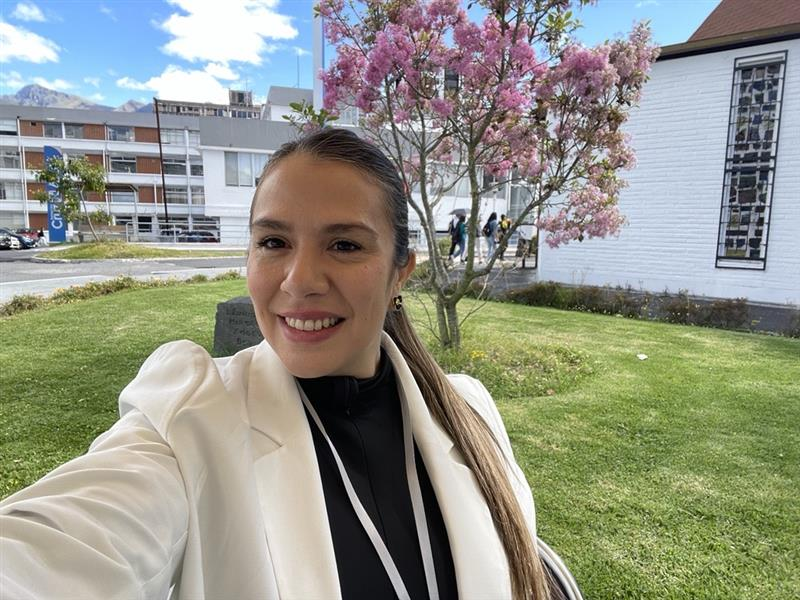

Cada 25 de noviembre, el mundo nos recuerda que ninguna sociedad avanza si tolera la violencia contra las mujeres y niñas. Este año, Naciones Unidas insiste en algo fundamental: las violencias mutan, se adaptan y encuentran nuevos espacios. La violencia digital —acoso, control, amenazas, difusión no consentida de contenidos, suplantación de identidad o manipulación mediante inteligencia artificial— dejó de ser emergente. Hoy es cotidiana y profundamente dañina. Lo que alguna vez fueron plataformas creadas para ampliar libertades, también se han convertido en escenarios donde se reproducen violencias conocidas, pero con nuevas lógicas, alcances y velocidades.

## El llamado de la campaña **ÚNETE** es directo:

Mirar la violencia digital con la misma seriedad que las formas tradicionales. Naciones Unidas recuerda que **una de cada tres mujeres en el mundo ha vivido violencia**, y que los riesgos aumentan para mujeres jóvenes, periodistas, activistas y para quienes enfrentan discriminaciones cruzadas como discapacidad, racialización, identidad de género u orientación sexual. Todo esto ocurre en un contexto donde la regulación tecnológica avanza lento, las plataformas no siempre responden con responsabilidad y los discursos misóginos encuentran eco en comunidades virtuales organizadas.

### En Chile, la **V Encuesta Nacional de Violencia contra las Mujeres 2024** vuelve a iluminar esta urgencia. Entre sus resultados, un dato nos interpela directamente como instituciones de educación:

```
22,8 % de las mujeres ha vivido violencia en un espacio educacional en su vida, y 2,2 % en el último año. Y, por primera vez, la encuesta incorporó la violencia gineco-obstétrica, que afecta al 29,6 % de las mujeres encuestadas.
```

Estas cifras muestran que las violencias cruzan múltiples entornos —educativos, comunitarios, digitales, institucionales y de salud— y requieren sistemas articulados, rutas claras y protección efectiva. Tanto ONU Mujeres como los análisis estatales coinciden en un desafío persistente: la fragmentación institucional. Sin coordinación, sin trazabilidad y sin información consistente, la experiencia de las mujeres sigue siendo desigual y, muchas veces, revictimizante. Avanzar hacia sistemas integrados no es solo deseable: es urgente.

## En este escenario, las instituciones de educación superior tenemos un rol que no es accesorio.

Somos espacios formativos, pero también espacios humanos donde la convivencia importa, donde los vínculos se construyen y donde la responsabilidad institucional debe responder a las necesidades actuales.

En AIEP hemos asumido ese compromiso con rigor y con humanidad. Pasar del marco normativo a la práctica cotidiana ha sido una tarea sostenida, guiada por nuestra **Política Integral para la Prevención, Investigación y Sanción del Acoso Sexual, la Violencia y la Discriminación de Género**, aprobada por Rectoría. Su implementación se articula con la **Unidad de Prevención, Género y Diversidades**, donde entendemos que la prevención no se limita a lo que regula la ley: implica orientar y formar comunidad.

El **Protocolo de Investigación y Sanción**, dependiente de Secretaría General, clarifica etapas, derechos, obligaciones y medidas. A esto se suma la **Guía de Actuación** para prácticas intracurriculares, laborales y campos clínicos, que resguarda a estudiantes fuera de la sede, reconociendo que la protección no puede depender del lugar en que ocurre la actividad formativa.

Nuestros **Lineamientos de Diversidad, Inclusión y Género** sostienen principios transversales y orientan acciones preventivas consistentes. Desde ahí promovemos lenguajes respetuosos, conversaciones difíciles y espacios de reflexión que fortalecen una convivencia consciente.

Durante 2025 profundizamos este trabajo mediante el **Ciclo de Concientización “Prevención de la violencia, la discriminación y el acoso para la convivencia respetuosa”**, compuesto por más de 20 charlas virtuales y presenciales dirigidas a direcciones, escuelas, colaboradores, docentes y estudiantes. Estas instancias —aún en curso— han permitido unir lo normativo con lo pedagógico, pero también con lo humano: reconocer experiencias, ajustar prácticas y reforzar el rol que cada persona cumple en la prevención.

### Nuestros datos institucionales también hablan de quiénes somos:

```
54,55 % de nuestras y nuestros estudiantes son mujeres, la edad promedio es 28 años, y contamos con estudiantes de más de ocho nacionalidades, con presencia destacada de Venezuela, Colombia, Bolivia, Perú y Haití. Esta diversidad exige respuestas sensibles, miradas amplias y políticas que reconozcan trayectorias diversas.
```

Y en este compromiso no estamos solos. AIEP es miembro activo de la **Red Campus Sustentable**, una alianza que agrupa a Instituciones de Educación Superior comprometidas con integrar la sustentabilidad en su formación, su gestión y sus prácticas institucionales. Ser parte de esta red significa avanzar en estándares éticos, sociales y ambientales que fortalecen el enfoque de derechos, la convivencia respetuosa y el desarrollo sostenible. Es asumir que la calidad educativa también se juega en cómo cuidamos nuestras sedes, nuestras relaciones y nuestras comunidades.

## Este 25 de noviembre nos recuerda que la violencia digital no es un fenómeno separado:

```
Es la actualización tecnológica de desigualdades históricas. Cuando lo presencial y lo virtual se entrelazan, las instituciones educativas debemos garantizar que todos nuestros espacios —incluidas nuestras plataformas digitales— sean seguros y respetuosos.
```

Desde Género, Diversidad e Inclusión reafirmamos nuestro compromiso: construir una comunidad donde cada persona pueda aprender y trabajar con dignidad. Una comunidad que entiende que la prevención no es un día ni un hito: es un trabajo cotidiano.  
Porque la violencia contra las mujeres no es tolerable, en ninguna de sus formas ni en ninguno de nuestros espacios.



**Eleany Perera Rivas**

jefa de Género, Diversidad e Inclusión AIEP

<script type="application/ld+json">{ "@context": "https://schema.org", "@type": "Organization", "@id": "https://www.redcampussustentable.cl/#organization", "name": "Red Campus Sustentable", "url": "https://www.redcampussustentable.cl/", "sameAs": [ "https://www.linkedin.com/company/red-campus-sustentable" ], "member": { "@type": "Organization", "@id": "https://tiempossustentables.cl", "name": "Tiempos Sustentables", "url": "https://tiempossustentables.cl/", "description": "Alianza Estratégica" } }</script>
