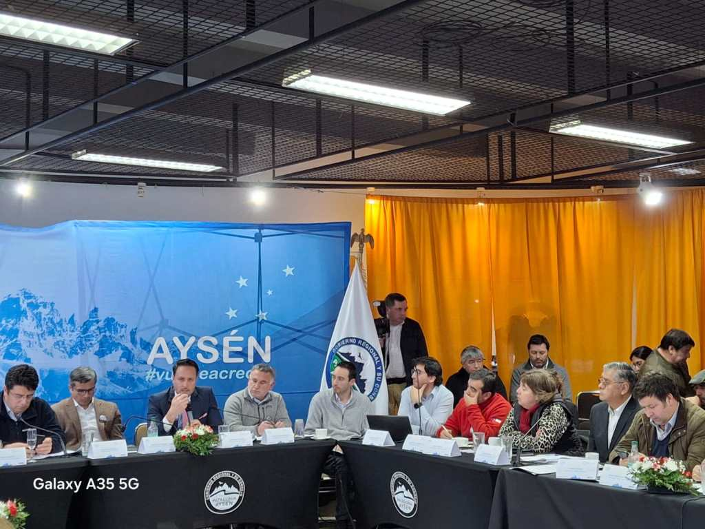
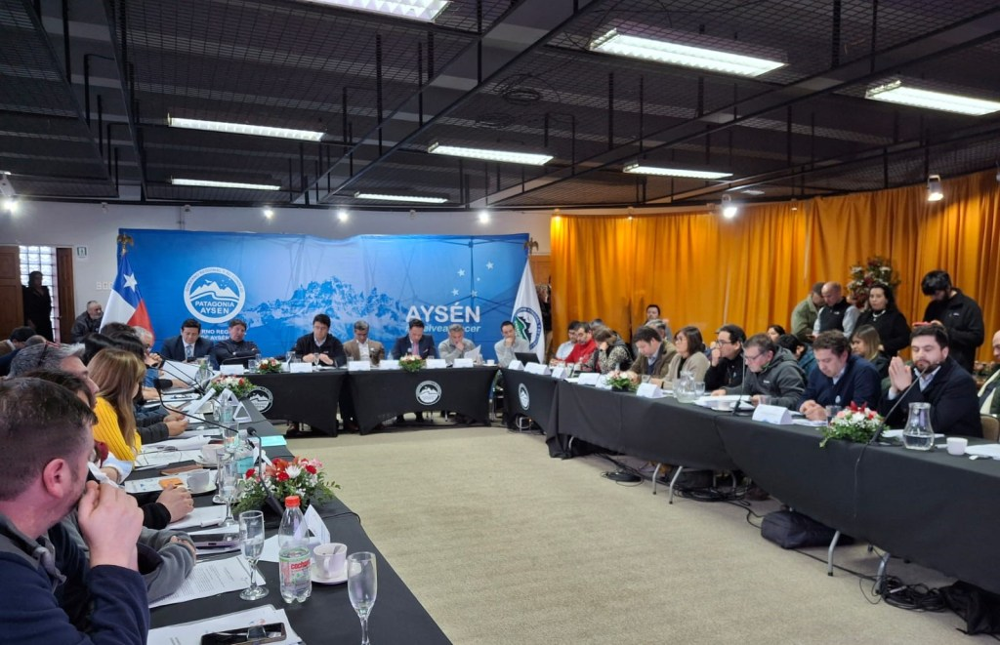

El Consejo del Salmón celebró su directorio en Puerto Aysén, un gesto que subraya la importancia estratégica de la región para el futuro de la industria. Durante la tercera plenaria del Plan Salmón 2050, se delinearon los desafíos y oportunidades para consolidar a Chile como líder mundial en acuicultura sostenible, poniendo la ciencia, la tecnología y el desarrollo social en el centro de la estrategia.

- <figure>
    
    
    
    <figcaption>
    
    Consejo del Salmón viajó a Aysén para seguir impulsando el desarrollo de la industria con el Plan Salmón 2050
    
    </figcaption>
    
    </figure>
    
- <figure>
    
    
    
    <figcaption>
    
    Consejo del Salmón viajó a Aysén para seguir impulsando el desarrollo de la industria con el Plan Salmón 2050
    
    </figcaption>
    
    </figure>
    

## La relevancia de Aysén para la industria

La elección de la Región de Aysén como sede para el directorio y la sesión plenaria del Plan Salmón 2050 no es casual. Con la salmonicultura representando más del 25% de su PIB, la región es un laboratorio natural y un pilar económico vital para la industria. La presencia de los líderes del sector en la zona no solo reafirma su compromiso con la descentralización, sino que también permite un diálogo directo con las comunidades locales y los actores regionales.

Loreto Seguel, presidenta ejecutiva del Consejo del Salmón, destacó esta conexión: “Es relevante que hoy estemos en Aysén mostrando cómo esta industria no solo aporta en el ámbito económico, sino que también refuerza la identidad propia y un fuerte arraigo territorial de los chilenos que viven y trabajan en la zona sur. La región de Aysén es vital para la industria”.

## Plan Salmón 2050: una visión con base científica

El Plan Salmón 2050 es más que una simple iniciativa de crecimiento; es una hoja de ruta que busca equilibrar la producción con la sostenibilidad ambiental y social. La sesión plenaria en Aysén se centró en la exposición de sus ejes estratégicos, que reflejan una visión integral y multidisciplinaria:

- Eje de Producción y Desarrollo: Liderado por Rolf Traeger, este pilar se enfoca en la innovación tecnológica y la aplicación de avances científicos para mejorar la eficiencia y la bioseguridad en los centros de cultivo. La meta es reducir el impacto ambiental y optimizar los procesos productivos.

- Eje de Sostenibilidad: A cargo de Alejandra Bustamante, este punto aborda directamente los desafíos ecológicos de la industria. Incluye la investigación sobre la interacción de la salmonicultura con los ecosistemas marinos y la implementación de mejores prácticas para la gestión de residuos y la salud de los peces.

- Eje de Capital Humano: Ángela Saavedra lidera el esfuerzo para desarrollar una fuerza laboral altamente capacitada, fomentando la investigación y el desarrollo (I+D) en las regiones australes y atrayendo talento especializado en biología, acuicultura y tecnología.

- Eje Político y Jurídico: Con Loreto Seguel y Rodrigo Pinto, respectivamente, se busca generar un marco regulatorio que ofrezca certeza jurídica para las inversiones, al tiempo que se alinea con los estándares internacionales más exigentes de sostenibilidad.

## El futuro de la acuicultura chilena

El Plan Salmón 2050 se presenta como una oportunidad para que Chile no solo mantenga su posición como el segundo mayor exportador de salmón a nivel global, sino que también se proyecte como un referente en prácticas acuícolas responsables. La combinación de gobernanza, ciencia aplicada y compromiso territorial busca construir una industria más resiliente, capaz de enfrentar los desafíos del cambio climático y las demandas de un mercado global cada vez más exigente en términos de sostenibilidad.

La visita del Consejo del Salmón a Aysén es, en esencia, un compromiso de que el futuro de la industria se construirá desde sus propios orígenes, con un enfoque que integra la economía, el medio ambiente y la comunidad en una misma estrategia de desarrollo.
