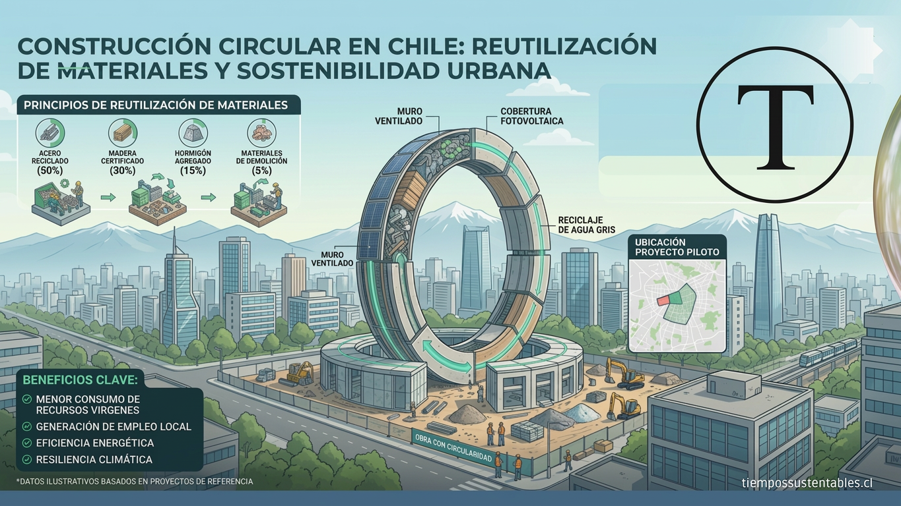
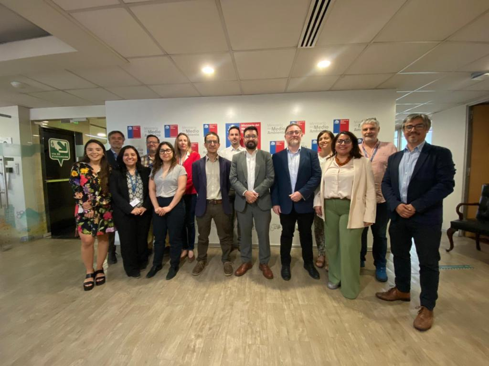

* * *

Chile da un paso estratégico para enfrentar la crisis de residuos y cumplir sus metas climáticas. El Primer Comité Estratégico del proyecto "Transitando hacia una construcción circular y descarbonizada en Chile" articula a los ministerios clave para transformar el sector , que genera más de 20 millones de toneladas de residuos anuales.

* * *

### **El Comité Estratégico: Articulación Pública para la Sostenibilidad**

Durante la primera semana de diciembre, el Ministerio del Medio Ambiente (MMA) fue sede del **Primer Comité Estratégico** de la iniciativa “Transitando hacia una construcción circular y descarbonizada en Chile”. Esta instancia de gobernanza, convocada por la Ministra Maisa Rojas y liderada por el Subsecretario Maximiliano Proaño, es fundamental para asegurar la **coordinación pública** y el alineamiento de criterios.

El Comité, que orientará las directrices estratégicas del proyecto hasta 2029, está oficialmente integrado por representantes designados de los ministerios de:

- Medio Ambiente (MMA)

- Obras Públicas (MOP)

- Vivienda y Urbanismo (MINVU)

- Desarrollo Social y Familia

- Programa de Naciones Unidas para el Medio Ambiente (PNUMA)

- Fundación Chile (FCh), entidad ejecutora del proyecto

#### **Prioridad: Cambios Legislativos y Normativos**

El objetivo principal de esta instancia es ofrecer una visión de mandato público, priorizando los **cambios legislativos, regulatorios y normativos** necesarios para avanzar hacia un modelo de construcción circular, resiliente y regenerativa. Esta co-construcción es clave, considerando que la elaboración de propuestas legislativas y reglamentarias es una de las líneas de trabajo más relevantes del proyecto.

El Subsecretario Proaño destacó que esta colaboración inter-carteras permitirá **acelerar la transición** del sector construcción hacia un modelo bajo en impactos ambientales y adaptable a los efectos del cambio climático.

* * *

### **La Urgencia del Desafío: Residuos y Metas Climáticas**

El sector construcción es un punto crítico en la gestión de residuos y la lucha climática:

- **Residuos Masivos:** En Chile, solo las edificaciones autorizadas generan más de siete millones de toneladas de residuos al año. La estimación total supera los **20 millones de toneladas de residuos de construcción y demolición (RCD) anuales**, superando ampliamente los residuos municipales.

- **Impacto Negativo:** Muchos de estos residuos terminan en vertederos ilegales, afectando la salud, degradando ecosistemas y profundizando desigualdades territoriales. A nivel global, el 35% de los residuos proviene de actividades de construcción y demolición.

Frente a este escenario, avanzar hacia la **construcción circular** no solo es una medida ambiental, sino también económica y social. Incorporar criterios de circularidad se traduce en procesos más eficientes, menos contaminantes y económicamente rentables, además de generar empleo justo y resiliente.

> **Alineamiento Estratégico:** Tomas Saieg, Jefe de la Oficina de Economía Circular de MMA, señala que este enfoque se alinea con la **Hoja de Ruta de Economía Circular en Construcción al 2035**, los planes sectoriales de cambio climático y las metas establecidas en la NDC 2025.

* * *

### **Avances Técnicos en Ejecución para Mercados Circulares**

El programa, financiado por el GEF y coordinado por PNUMA, ha desarrollado avances claves en sus primeros seis meses , consolidando una red de colaboración con más de 30 instituciones y firmando ocho convenios de trabajo. La iniciativa apuesta por intervenciones habilitantes que consoliden **mercados circulares** y prácticas sostenibles, sobre todo desde las compras públicas.

Los avances técnicos destacados durante la jornada, en la que participaron Rubén González (MMA) y Cecilia Vidal (FCh), incluyen:

1. **Testeo Ambiental para RCD:** Inicio de un piloto junto a CTEC para diseñar un dispositivo que asegure el **uso seguro de residuos y subproductos industriales en infraestructura vial**.

3. **Precio Social de RCD:** Desarrollo de metodologías para estimar el **precio social de la generación y manejo de RCD** y sus impactos ambientales, proyecto que será desarrollado por InnovaCiclos.

5. **Estándares para Construcción en Madera:** Elaboración de estándares de circularidad para la industria forestal, maderera y de la construcción en madera, desarrollados por CIM-CENAMAD.

7. **Detección de Ilegalidades:** Desarrollo de un dispositivo de **teledetección de vertederos ilegales y extracción ilegal de áridos**, a cargo de CIPYCS.

9. **Competencias Laborales:** Desarrollo de nueve perfiles de competencias laborales junto a ChileValora.

11. **Estudio de Sobre-especificación:** Investigación contratada a la consultora APORTO para identificar los impactos de la sobre-especificación en el uso de materiales.

* * *

### **Conclusión y Próximos Pasos**

Con este primer Comité, se da un paso decisivo para articular el trabajo interministerial y avanzar hacia una construcción más limpia, eficiente y alineada con los desafíos climáticos del país, señaló el Subsecretario Proaño. La jornada además permitió a los distintos servicios públicos declarar intereses específicos para avanzar con la implementación de la economía circular en el marco de las desafiantes metas de política pública ya comprometidas.

* * *

### **Documentación de Interés**

Para una lectura detallada sobre las directrices y el alcance de esta iniciativa crucial para la sostenibilidad del sector, se adjunta el comunicado oficial de prensa emitido por el Ministerio del Medio Ambiente y Fundación Chile.

> [COMUNICADO COMITÉ ESTRATÉGICO GEF CONSTRUCCIÓN DICIEMBRE 2025 (1)](https://tiempossustentables.cl/wp-content/uploads/2025/12/comunicado-comite-estrategico-gef-construccion-diciembre-2025-1.docx)[Descarga](https://tiempossustentables.cl/wp-content/uploads/2025/12/comunicado-comite-estrategico-gef-construccion-diciembre-2025-1.docx)

<figure>

<figcaption>

Construcción Circular en Chile

</figcaption>

</figure>
