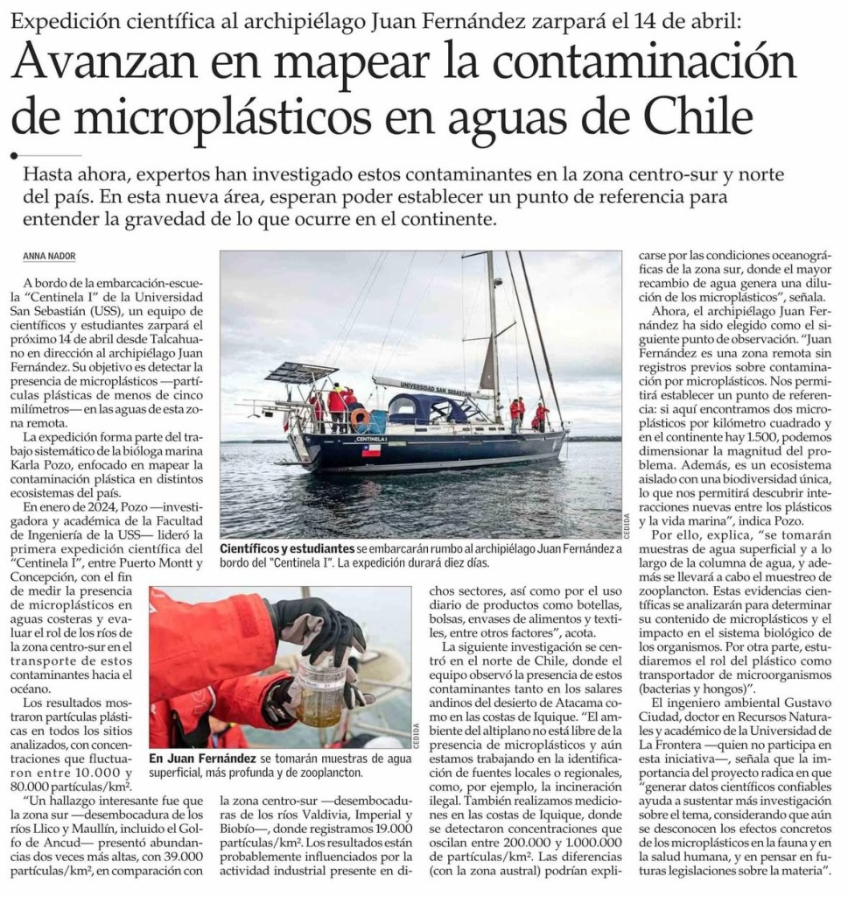

La contaminación por microplásticos en los océanos se ha convertido en una de las principales amenazas ambientales del siglo XXI. Estos residuos —partículas plásticas de menos de cinco milímetros— ya están presentes en prácticamente todos los ecosistemas marinos del planeta, afectando la salud de la fauna, los ciclos biogeoquímicos y, potencialmente, la salud humana.

Un estudio reciente de **The Ocean Cleanup** revela que más de 170 billones de partículas de plástico flotan en los océanos del mundo, cifra que se ha multiplicado por más de cinco desde 2005. Naciones Unidas estima que, de continuar esta tendencia, para 2050 habrá más plástico que peces en los océanos si se mide por peso. La situación es alarmante y exige acciones inmediatas.

## Chile se suma a la investigación científica del Pacífico Sur

Hasta ahora, la mayoría de las investigaciones sobre microplásticos en Chile se han concentrado en la zona centro-sur y norte del país. Sin embargo, un nuevo esfuerzo liderado por la Universidad San Sebastián (USS) busca ampliar este horizonte. Según reportó **El Mercurio** en su edición del 25 de abril de 2025, un equipo científico a bordo de la embarcación escuela Centinela I zarpará hacia el archipiélago Juan Fernández el 14 de abril, en una expedición sin precedentes que busca establecer un punto de referencia para el estudio de microplásticos en esta zona remota del Pacífico.

La iniciativa forma parte del trabajo sistemático de la bióloga marina Karla Pozo, académica de la **Facultad de Ingeniería USS**, quien ha venido investigando la presencia de plásticos en distintas zonas del país. “Juan Fernández es una zona remota sin registros previos sobre contaminación por microplásticos. Nos permitirá establecer una línea base para entender la magnitud real del problema en el continente”, señaló Pozo a El Mercurio.

Se espera que los datos recopilados permitan comparar las concentraciones actuales con otras zonas del mundo. Por ejemplo, estudios internacionales como el publicado en Nature Communications indican que se pueden encontrar hasta 1.000.000 de partículas de microplásticos por kilómetro cuadrado en zonas altamente impactadas por actividad industrial.

## Impacto en la biodiversidad y la cadena alimentaria

Los efectos de los microplásticos no son solo visuales o físicos. Investigaciones publicadas por **Science y National Geographic** han demostrado que estas partículas pueden ser ingeridas por el zooplancton, peces y aves marinas, lo que afecta desde la base de la cadena trófica hasta los grandes depredadores. Algunos compuestos tóxicos adheridos a los microplásticos, como los ftalatos o el bisfenol A, pueden incluso tener efectos endocrinos en organismos vivos.

En palabras de **Pozo**, “_la expedición también busca entender cómo esta contaminación afecta la biodiversidad única del archipiélago, que incluye especies endémicas no presentes en otras partes del mundo_”.

## Empresas bajo la lupa: ¿Qué está haciendo Chile?

En el ámbito empresarial, algunas compañías chilenas han comenzado a tomar medidas frente a esta amenaza. Por ejemplo:

**Comberplast**, empresa de economía circular con sede en Santiago, ha reciclado más de 15.000 toneladas de plásticos para transformarlos en nuevos productos, promoviendo una economía sin residuos. **Agrosuper** se sumó a iniciativas de reducción de plásticos en sus cadenas de distribución, reemplazando envases por opciones biodegradables en algunos segmentos. En el retail, **Unimarc** y **Jumbo** han implementado políticas de reducción de bolsas plásticas y promoción de productos reutilizables, alineándose con la Ley 21.100 que prohíbe la entrega de bolsas plásticas en el comercio chileno.

No obstante, aún queda mucho por hacer. Un informe de **Fundación Chile** publicado en 2024 advierte que el 60% de los residuos plásticos en el país no se recicla ni tiene trazabilidad conocida. Las iniciativas voluntarias son positivas, pero se requieren marcos regulatorios más robustos.

## Hacia una legislación más estricta

**Gustavo Poblete**, académico de la **USS** y miembro del equipo que participará en la expedición al archipiélago, señala que uno de los objetivos es precisamente proveer información científica sólida para nutrir futuras políticas públicas. “_Si no tenemos datos certeros, es muy difícil legislar. Esta investigación puede ayudar a crear normas específicas sobre la contaminación marina por plásticos en Chile_”, afirma.

En Europa, la **Unión Europea** ya ha prohibido plásticos de un solo uso como cotonitos, cubiertos y bombillas, y se discute aplicar tasas a productos de embalaje no reciclables. Chile podría seguir ese camino si cuenta con el respaldo técnico necesario.

## Una oportunidad para liderar desde el sur del mundo

**Chile** tiene una ubicación privilegiada en el Pacífico Sur, con acceso a ecosistemas únicos y una extensa costa que supera los 6.000 kilómetros. Esto no solo implica una gran responsabilidad ambiental, sino también una oportunidad para liderar el estudio y combate de la contaminación marina por plásticos.

Desde **Tiempos Sustentables** seguiremos de cerca esta expedición y sus resultados, conscientes de que el conocimiento científico, combinado con la acción pública y privada, es la única vía para restaurar la salud de nuestros océanos.
