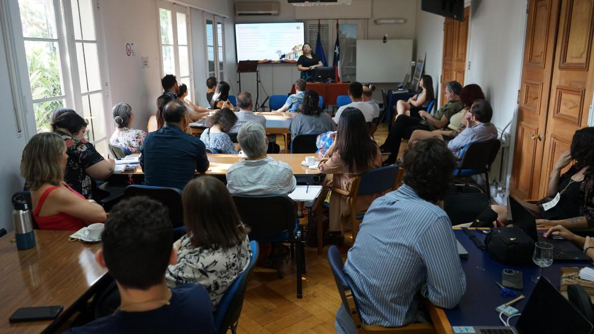
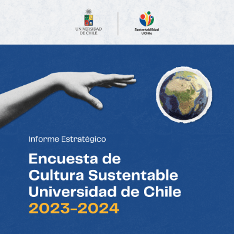

La sostenibilidad ha evolucionado hasta convertirse en un imperativo social y ambiental que trasciende las fronteras académicas. En este sentido, la Universidad de Chile ha llevado a cabo una exhaustiva encuesta de cultura sustentable durante el periodo 2023-2024, con el fin de evaluar la percepción y las prácticas de su comunidad en relación con la sostenibilidad. Este artículo analiza los resultados obtenidos y su importancia para la planificación de objetivos para el periodo 2025-2027, orientando así a la universidad hacia un futuro más sustentable.

**Metodología de la Encuesta**

La encuesta, realizada entre 2023 y 2024, incluyó la participación activa de estudiantes, académicos y personal administrativo de la universidad. Su diseño se centró en medir el grado de conocimiento, actitudes y comportamientos hacia la sostenibilidad dentro de la institución. Se utilizaron preguntas tanto cerradas como abiertas, lo que permitió un análisis tanto cuantitativo como cualitativo. Los resultados de la Encuesta de Percepción de Cultura Sustentable fueron presentados durante la Jornada de Planificación de Sostenibilidad 2025-2027, proporcionando datos esenciales para la futura estrategia de sostenibilidad de la universidad.

<figure>

<figcaption>

Presentación de Encuesta de Percepción de Cultura Sustentable en la Jornada de Planificación de Sustentabilidad 2025 - 2027.

</figcaption>

</figure>

**Resultados Clave**

1. **Grado de Conciencia Ambiental**: Aproximadamente el 75% de los encuestados manifestó tener un buen nivel de conciencia sobre temas ambientales. A pesar de esto, solo el 45% indicó haber participado activamente en iniciativas sustentables organizadas por la universidad.

3. **Prácticas de Sostenibilidad**: Se identificaron prácticas comunes como el reciclaje y la reducción del uso de plásticos; sin embargo, solo un 30% de los participantes reportó tener hábitos diarios de ahorro de energía en sus hogares.

5. **Barreras para la Sostenibilidad**: Entre las barreras a la adopción de prácticas sustentables, se destacaron la falta de tiempo, recursos limitados y la percepción de que las acciones individuales no generan un impacto significativo.

7. **Interés en la Educación Ambiental**: Un 85% de los encuestados expresó un fuerte interés en recibir más educación sobre sostenibilidad, subrayando la necesidad de implementar programas formativos que integren estas temáticas en la currícula académica.

**Recomendaciones**

Los resultados de la encuesta reflejan un notable interés y conciencia sobre la sostenibilidad dentro de la comunidad universitaria, pero también evidencian la necesidad de fomentar acciones concretas. A continuación, se presentan algunas recomendaciones:

- **Fomento de Programas Educativos**: Desarrollar talleres y cursos que aborden cómo integrar prácticas sustentables en la vida diaria. Estos programas pueden ser diseñados en colaboración con expertos en educación ambiental.

- **Incentivos a la Participación**: Crear iniciativas que incentiven a estudiantes y personal a participar en actividades de sostenibilidad, como competiciones de reciclaje o proyectos de conservación.

- **Facilitación de Recursos**: La universidad debe considerar la implementación de más recursos y espacios destinados al reciclaje y al ahorro energético, así como facilitar el acceso a información relevante sobre sostenibilidad.

- **Comunicación de Impacto**: Informar a la comunidad sobre el impacto de las acciones sustentables puede ayudar a contrarrestar la percepción de que las acciones individuales son irrelevantes. Esto podría incluir informes periódicos sobre los logros en sostenibilidad dentro de la universidad.

**Conclusión**

La Encuesta de Cultura Sustentable de la Universidad de Chile revela una comunidad universitaria comprometida con la sostenibilidad, que requiere herramientas y motivación para traducir ese compromiso en acciones tangibles. Invertir en educación y en la creación de una cultura institucional que valore y promueva la sostenibilidad es crucial para enfrentar los desafíos ambientales futuros. La universidad tiene ante sí una oportunidad única para liderar con el ejemplo y convertirse en un referente en sostenibilidad, tanto en el ámbito académico como en la sociedad en general.

* * *

<figure>

<figcaption>

[Descarga los resultados de la encuesta aquí.](<http://uchile.cl/dam/jcr:8b73cc1c-e654-433f-86f1-93d093608608/Encuesta Cultura Sustentable 2023-2024 VF.pdf ↗>)

</figcaption>

</figure>

* * *
