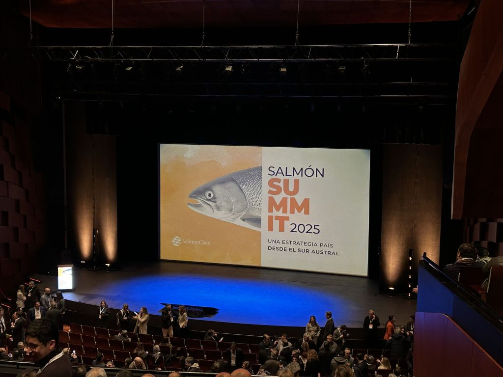
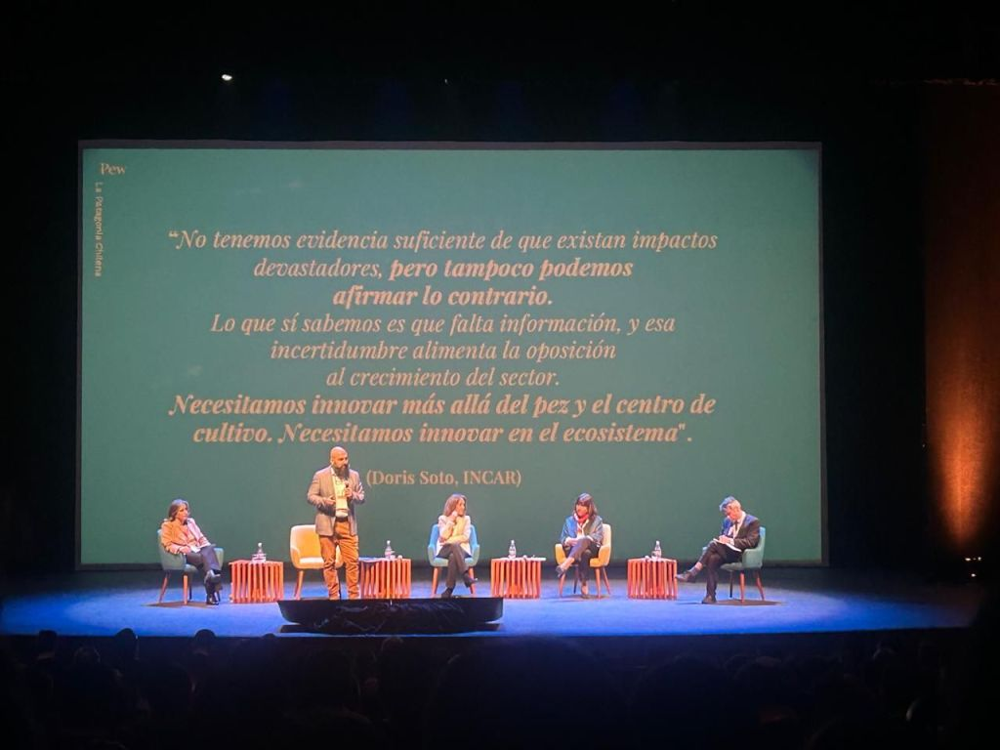
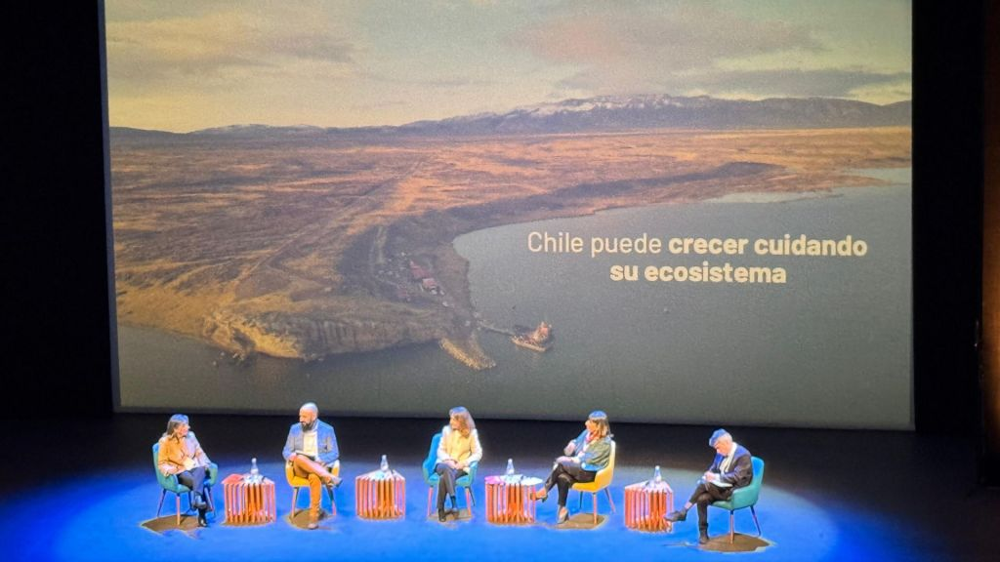
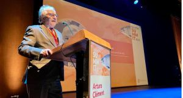
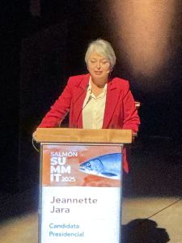
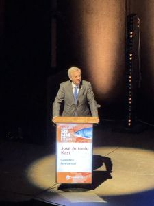
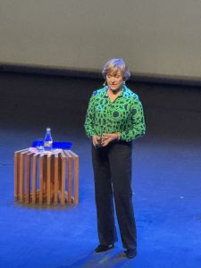

Ayer en Frutillar, se marcó un día significativo para la industria acuícola global. Chile fue anfitrión de su tan esperada **Cumbre del Salmón 2025** en el pintoresco Teatro del Lago. Organizada por **SalmonChile A.G.**, la cumbre de este año mostró el compromiso de la nación. Se enfocó en avanzar en prácticas sostenibles en la salmonicultura. También consolidó su posición como líder mundial en el sector.

El evento fue una piedra angular para las partes interesadas de la industria. Sirvió como una plataforma crítica para un diálogo abierto sobre el futuro de la salmonicultura chilena. Su papel es vital en la economía nacional. También existe el imperativo de propuestas robustas y sostenibles. La cumbre reunió a destacados empresarios. También estuvieron presentes líderes de la industria, representantes de la sociedad civil y miembros de la comunidad. Fomentó un ambiente de colaboración. Esto estaba destinado a navegar los complejos desafíos y oportunidades que enfrenta la acuicultura moderna.

* * *

### Un Enfoque en la Sostenibilidad y la Visión de Futuro

La agenda de la Cumbre del Salmón 2025 se estructuró en torno a módulos temáticos clave diseñados para impulsar la industria:

- **Descentralización y Fomento de la Acuicultura:** Las discusiones se centraron en estrategias para fomentar el crecimiento. También discutieron el desarrollo en las áreas regionales. Se busca asegurar que los beneficios de la salmonicultura se distribuyan ampliamente. Estos beneficios deben integrarse en las economías locales.

- **Consolidación de un Polo de Innovación Global:** Este módulo exploró cómo Chile puede aprovechar los avances tecnológicos y la investigación. Estos avances pueden mejorar la eficiencia y reducir el impacto ambiental. Además, permiten mantener su ventaja competitiva en el mercado internacional.

- **Conciliación entre Desarrollo Económico y Medio Ambiente:** Quizás el tema más crítico. Esta sección profundizó en el equilibrio entre la prosperidad económica y la gestión ambiental. Las conversaciones se centraron en la implementación de las mejores prácticas para la sostenibilidad. Se habló sobre minimizar las huellas ecológicas. Además, se abordó asegurar la salud a largo plazo de los ecosistemas marinos.

> **Arturo Clément, Presidente de SalmonChile**, enfatizó la necesidad de una **"visión de país"** construida **"juntos"**, reconociendo que los desafíos de la industria no pueden resolverse de forma aislada.

* * *

### Participación de Alto Nivel y Conversaciones Francas

La cumbre de este año tuvo un punto destacado. La participación de los **tres principales candidatos presidenciales de Chile** fue clave: Jeannette Jara, José Antonio Kast y Evelyn Matthei. Esto señala la profunda importancia de la industria del salmón para el futuro político y económico de la nación. Su presencia subrayó una comprensión compartida de los desafíos del sector y la necesidad de marcos de políticas de apoyo.

Entre los oradores prominentes se encontraba **Ignacio Briones**, exministro de Hacienda, quien ofreció perspectivas sobre políticas económicas. También participaron figuras internacionales como **Katherine Bryar**, directora de marketing global de BioMar. **Eduardo Wallach**, CEO de Kura, aportó perspectivas globales sobre innovación y tendencias del mercado. Líderes de la industria chilena como **Rosario Navarro**, presidenta de SOFOFA, jugaron un papel en las discusiones. **Susana Jiménez**, vicepresidenta de la CPC, también contribuyó a la rica variedad de ideas.

<figure>

<figcaption>

**Susana Jiménez Schuster**  
Presidenta de la Confederación de la Producción y del Comercio

</figcaption>

</figure>

> “El crecimiento no es un mero número: es bienestar, oportunidades y progreso. Debemos estar orgullosos de esta industria, que ha crecido con fuerza y compromiso con el país.” - [Puedes revisar la participación de Susana Jiménez Schuster, haciendo click en este link.](https://www.linkedin.com/posts/confederaci%C3%B3n-de-la-producci%C3%B3n-y-del-comercio_cpc-activity-7353495940327952384-vABY?utm_source=share&utm_medium=member_desktop&rcm=ACoAAASjn7gBjVilK0IQuBndCJvRSAVjJCvQH34)

En particular, los primeros informes de la cumbre indicaron **"duras críticas del sector empresarial"**. Estas críticas se dirigían a los obstáculos estatales que impiden el crecimiento de la industria. Estas discusiones francas resaltaron preocupaciones sobre la falta de una planificación estatal integral. También indicaron desafíos dentro del sistema de evaluación ambiental. Esto subraya la necesidad urgente de soluciones colaborativas entre los sectores público y privado. La formación de un _**"Grupo de Trabajo contra el Robo de Salmón"**_ se anunció recientemente. Este grupo refleja un enfoque proactivo para abordar los desafíos operativos dentro de la industria.

* * *

### Construyendo sobre un Legado de Progreso

La cumbre de 2025 se basa en el éxito de ediciones anteriores. Esto incluye particularmente la **Cumbre del Salmón 2024**. Se llevó a cabo el 10 de mayo de 2024, también en el Teatro del Lago. Ese evento se centró en **"Avanzando la Salmonicultura Chilena hacia 2050"**. Reunió a un grupo diverso de partes interesadas para discutir el futuro de la industria. También exploraron la necesidad crítica de una estrategia nacional unificada. Esta continuidad demuestra el compromiso continuo de SalmonChile A.G. de fomentar el diálogo y el progreso dentro del sector.

La Cumbre del Salmón 2025 marca un momento crucial, no solo para Chile, sino para el panorama acuícola global. La cumbre fomenta un diálogo transparente. Se centra en soluciones innovadoras y sostenibles. Así, refuerza la dedicación de Chile al crecimiento responsable. También mantiene su ambición de estar a la vanguardia de la producción sostenible de salmón. Los resultados de las discusiones de hoy, sin duda, influirán en la dirección estratégica de la industria. Esto ocurrirá en los años venideros.

* * *

_Infórmate más acá: [https://salmonsummit.cl/](https://salmonsummit.cl/)_

