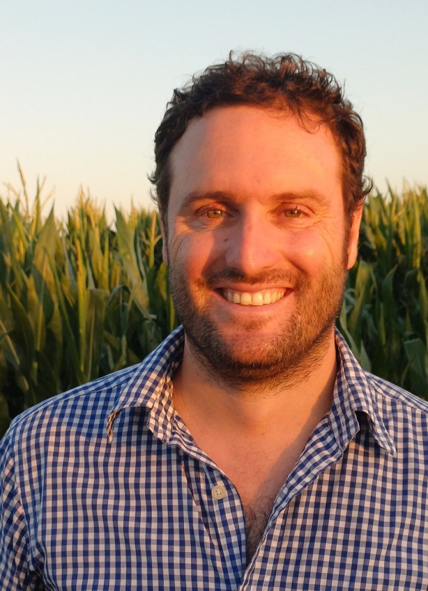

La reciente declaración de la Laguna de Aculeo como Humedal Urbano ha sido celebrada, y con razón, como un triunfo ciudadano y ambiental. Es una señal política potente de protección. Sin embargo, desde una perspectiva técnica e hidrológica, debemos atrevernos a hacer la pregunta incómoda que pocos quieren escuchar en medio de los aplausos: ¿Puede un decreto administrativo llenar una laguna que, físicamente, depende de un acuífero que hoy no estamos monitoreando?

Para responder, no podemos ignorar la historia reciente. El traumático secado de 2018 no fue exclusivamente "culpa de la sequía". El estudio de la Facultad de Ciencias Forestales de la Universidad de Chile fue lapidario al respecto: si bien las precipitaciones cayeron un 38%, el consumo de agua en la cuenca aumentó un 23% en el mismo periodo.

Este desbalance letal fue agravado por un cambio de uso de suelo evidente: menos cultivos tradicionales, pero más frutales y una explosión de parcelas de agrado. La ecuación es simple y dolorosa: menos oferta natural y mucha más demanda humana.

El problema de fondo es la fragilidad física del sistema. Históricamente, Aculeo ha sido una laguna somera, con una profundidad media de apenas 3,4 metros. Esto significa que no posee un gran volumen de reserva propio; es, en realidad, una "ventana" directa al nivel de las aguas subterráneas. Si el acuífero baja por sobreconsumo, la laguna desaparece, tenga o no protección legal en la superficie.

Por eso, proteger el espejo de agua sin controlar la extracción subterránea es proteger a ciegas. La verdadera recuperación de Aculeo exige pasar del decreto a la ingeniería de datos.

La solución pasa por gestionar lo invisible. Debemos mirar experiencias internacionales exitosas, como la implementación de la ley SGMA en California, y aplicar un piloto técnico que se sostenga en tres pilares: un mapeo real del acuífero para entender la conexión hidráulica crítica; un monitoreo estricto de las extracciones (porque no podemos gestionar lo que no medimos); y plataformas de decisión que permitan a la DGA tomar medidas basadas en datos hidrogeológicos actualizados, y no solo en promedios históricos que ya no existen.

La declaración de Humedal Urbano es el primer paso, necesario y valioso. Pero sin una gestión técnica de las aguas subterráneas que llenan o vacían la laguna, corremos el riesgo de que la historia del 2018 se repita, dejándonos con un humedal protegido en el papel, pero seco en la realidad. La solución es técnica y requiere datos.

**Pablo T. Silva Jordán** 

Especialista en Recursos Hídricos

Formation Environmental

* * *
