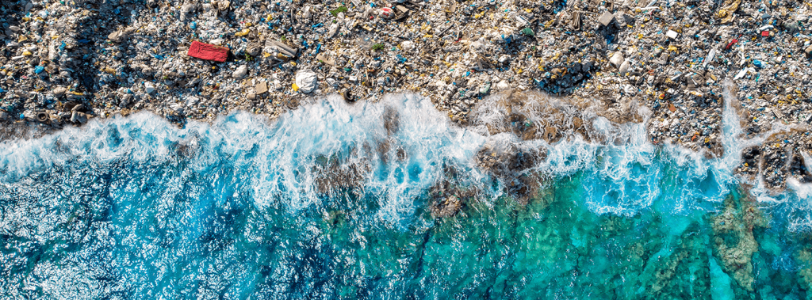

Hoy, 5 de junio, el mundo conmemora una vez más el Día Mundial del Medio Ambiente. Es una fecha crucial para reflexionar sobre nuestra relación con el planeta. También es importante para renovar nuestro compromiso con su protección. Este 2025, la jornada se centrará en la crisis global de los residuos. **El lema es "Acabar con la Contaminación por Plásticos"**. La República de Corea será el país anfitrión de las celebraciones globales. Una llamada a la acción que resuena con especial urgencia en Chile, donde los desafíos ambientales son múltiples y complejos.

El Día Mundial del Medio Ambiente fue establecido por la Asamblea General de las Naciones Unidas en 1972. Esto ocurrió durante la Conferencia de Estocolmo sobre el Medio Humano. Este evento también dio origen al Programa de las Naciones Unidas para el Medio Ambiente (PNUMA). Desde entonces, se ha convertido en la plataforma global más importante para la divulgación ambiental. Desde su primera celebración en 1973, su propósito ha sido inspirar un cambio positivo. Reúne a millones de personas, gobiernos, empresas y organizaciones de la sociedad civil. Todos trabajan juntos en un esfuerzo colectivo por salvaguardar y restaurar nuestro planeta.

### 2025: En la mira la invasión plástica

La elección del tema **"Acabar con la Contaminación por Plásticos"** para 2025 no es casual. La producción de plásticos ha aumentado de manera descontrolada. El desecho de plásticos también ha crecido sin control. Estas acciones se han convertido en una de las amenazas ambientales más visibles y perniciosas de nuestro tiempo. Sus efectos son devastadores para los ecosistemas. Son igualmente destructivos para la biodiversidad y la salud humana. Desde las fosas oceánicas más profundas hasta las cimas de las montañas, estos problemas persisten. Incluso se encuentran en nuestra propia cadena alimentaria a través de los microplásticos.

La campaña de este año, liderada por el PNUMA, busca impulsar una acción colectiva y transformadora a todos los niveles. Se insta a los gobiernos a desarrollar e implementar políticas robustas. Las empresas deben adoptar modelos de producción y consumo más sostenibles. Los ciudadanos deben reconsiderar sus hábitos y exigir un cambio. El objetivo es claro: reducir drásticamente la contaminación plástica y avanzar hacia una economía circular para este material.

### Desafíos ambientales globales y la realidad chilena

Si bien el foco de 2025 está en los plásticos, el Día Mundial del Medio Ambiente es una oportunidad para recordar la interconexión de las crisis ambientales que enfrentamos:

- **Cambio Climático:** Eventos climáticos extremos más frecuentes e intensos.

- **Pérdida de Biodiversidad:** Un declive alarmante de especies a nivel global. El reciente "Informe Planeta Vivo 2024" de WWF es demoledor. Indica una disminución promedio del 73% en las poblaciones de vida silvestre monitoreadas globalmente desde 1970. Hay un impacto particularmente severo en América Latina y el Caribe, donde la reducción alcanza un catastrófico 95%.

- **Contaminación del Aire y del Agua:** Amenazas persistentes a la salud pública y los ecosistemas.

- **Deforestación y Desertificación:** Degradación de suelos vitales para la vida y la seguridad alimentaria.

En **Chile**, estos desafíos globales tienen manifestaciones concretas y urgentes. La **Evaluación del Desempeño Ambiental 2024** de la Superintendencia del Medio Ambiente (SMA) muestra tanto avances como retrocesos. El **Informe del Estado del Medio Ambiente 2024** del Ministerio del Medio Ambiente (MMA) presenta aspectos positivos y negativos. El informe pinta un panorama de luces y sombras. Si bien se reconocen avances en monitoreo de calidad del aire, energías renovables y aumento de áreas protegidas, persisten graves problemas:

- **Crisis Hídrica:** Una sequía prolongada que afecta a gran parte del territorio.

- **Emisiones de Gases de Efecto Invernadero:** A pesar de los compromisos, la necesidad de una transición más rápida es imperativa.

- **Gestión de Residuos:** Un problema crítico, donde la contaminación por plásticos juega un rol protagónico. Chile genera cerca de 23.000 toneladas de residuos plásticos al día, y solo una fracción se recicla.

- **Contaminación Atmosférica:** Especialmente en ciudades del sur y en las denominadas "zonas de sacrificio" como Quintero-Puchuncaví. Greenpeace Chile ha denunciado esto. La organización también ha alertado sobre el desierto de Atacama como vertedero global y la pérdida de playas.

- **Especies Amenazadas:** Un alto número de especies de flora y fauna en categorías de conservación preocupantes.

### La importancia de la conciencia y la acción ciudadana

El Día Mundial del Medio Ambiente juega un papel fundamental en la sensibilización pública. Generar conciencia es el primer paso hacia la acción responsable. La educación ambiental, tanto formal como informal, empodera a los ciudadanos. Les permite tomar decisiones informadas. También promueve la adopción de prácticas más sostenibles en su vida diaria.

Cada gesto cuenta:

- **Reducir, reutilizar y reciclar:** Especialmente los plásticos.

- **Optar por alternativas a los plásticos de un solo uso.**

- **Ahorrar agua y energía.**

- **Elegir transporte sostenible.**

- **Participar en iniciativas de limpieza y reforestación comunitarias.**

- **Informarse y exigir políticas ambientales efectivas.**

<figure>

<figcaption>

La producción de plástico ha aumentado exponencialmente en las últimas décadas y ahora asciende a unos 400 millones de toneladas al año, una cifra que se duplicará en 2040.

</figcaption>

</figure>

Visita el sitio web oficial de la campaña de Naciones Unidas [https://www.worldenvironmentday.global/](https://www.worldenvironmentday.global/)

* * *

### Un llamado a la acción sostenida

Más allá de las celebraciones puntuales, el Día Mundial del Medio Ambiente nos recuerda algo importante. Proteger el planeta es una tarea diaria. Es una tarea continua. La crisis de la contaminación por plásticos es grave. También enfrentamos otros desafíos ambientales que requieren atención. Todos los sectores de la sociedad deben comprometerse de manera sostenida.

Desde **Tiempos Sustentables**, instamos a nuestros lectores a reflexionar sobre su propio impacto. También los alentamos a sumarse activamente a la construcción de un futuro. En este futuro, la salud del planeta y de sus habitantes será la máxima prioridad. El lema de este año es claro. Es hora de **"Acabar con la Contaminación por Plásticos"**. Debemos trabajar juntos por un entorno más limpio y resiliente para las generaciones presentes y futuras. Fuentes

* * *

#### **¿Quieres profundizar en este tema?**

Descubre nuestra página pilar sobre Economía Circular, donde incluimos toda la información actualizada para la región.

[Leer la Guía Estratégica de Economía Circular en LATAM](https://tiempossustentables.cl/economia-circular-chile-latam/)
