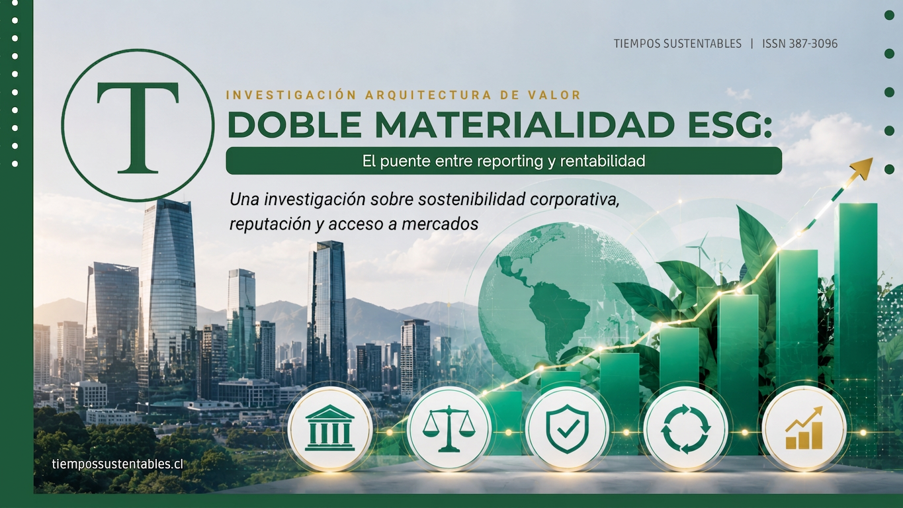

Por **Jesús Patricio Blasco Valencia** | 29 de Julio, 2026 | DOI: [10.17605/OSF.IO/TYRH7](https://doi.org/10.17605/OSF.IO/TYRH7)

<figure>

<figcaption>

Arquitectura de Valor ESG: Conectando gobernanza y crecimiento en LATAM.

</figcaption>

</figure>

## Resumen Rápido para Ejecutivos

En América Latina, las empresas han multiplicado sus reportes de sostenibilidad (GRI, IFRS S1/S2), pero la mayoría no logra traducir esos datos en más ventas, mejor financiamiento o menor riesgo. La clave no es adoptar otro estándar, sino operar la **doble materialidad ESG** (financiera y de impacto) como puente estratégico entre el _reporting_ y la rentabilidad.

Este artículo presenta un modelo de **Arquitectura de Valor ESG en 5 bloques** (Gobernanza, Materialidad, Credibilidad, Capacidades Dinámicas y Ventaja Competitiva). Basado en evidencia reciente en la región, permite a directorios y gerencias pasar de “cumplir con la norma” a “crear valor financiero” en un ciclo ágil de 90 días.

## Lo que dicen los datos (y lo que ven los empresarios)

En las salas de directorio de Santiago, Ciudad de México, Bogotá y São Paulo, el patrón se repite: más reportes y más _claims_, pero nula claridad sobre cómo esto impacta el **P&L (Pérdidas y Ganancias)**. Al mismo tiempo, compradores globales, bancos y fondos de inversión aprietan: exigen ver una gestión ESG con sustancia financiera, no solo un discurso de marketing.

Estudios recientes en la región demuestran que la adopción de la **doble materialidad** en grupos empresariales latinoamericanos está directamente asociada a:

- Mejores prácticas de **gobierno corporativo** y gestión de riesgos.
- Mayor tracción y competitividad en procesos de **internacionalización**.
- Mejor acceso a financiamiento verde, especialmente para **pymes exportadoras**.

**La trampa del "Greenwashing Corporativo":** En algunos países, la adopción de esta doble materialidad ha pasado a ser mayoritaria en pocos años. Sin embargo, surge el fenómeno de los _“adoptantes de etiqueta”_: empresas que dicen aplicarla en el papel, pero son incapaces de vincular sus temas materiales con decisiones de **CAPEX**, presupuestos operativos o métricas financieras reales.

* * *

## Arquitectura de Valor ESG: 5 bloques para crear rentabilidad

El siguiente modelo operacionaliza la metodología _“Cabeza Fría, Corazón Activo y Manos Firmes”_ (basada en la [guía estratégica indexada con DOI](https://doi.org/10.5281/zenodo.20443605)) y la adapta para C-Level en el contexto latinoamericano. Así se transforma la teoría en una herramienta de gestión de alto impacto.

### 1\. Gobernanza (G): La cabeza fría

No se trata de sumar comités burocráticos, sino de que el directorio **use la data ESG para decidir**. La señal de madurez es simple: si el directorio no recibe trimestralmente KPIs ESG cruzados con el impacto financiero, la gobernanza sigue siendo decorativa. Preguntas clave: ¿Hay separación de roles CEO–Chair? ¿Se vinculan los bonos de los altos ejecutivos a metas ESG?

### 2\. Materialidad (M): El corazón activo

La doble materialidad obliga a mirar en dos direcciones simultáneas: **lo financiero** (qué riesgos impactan la caja de la empresa) y **lo de impacto** (qué externalidades genera la empresa al entorno). La prueba pragmática: ¿puedes rastrear un tema material (ej. estrés hídrico) hasta una línea del presupuesto operativo y asignarlo a un responsable con nombre y apellido?

### 3\. Credibilidad del reporting (CR): Manos firmes con datos

La diferencia entre comunicación corporativa y _greenwashing_ es la **verificabilidad auditada** (estándares como IFRS S1/S2, GRI). El nivel óptimo se alcanza cuando un auditor externo (Tercera Parte Independiente) puede validar los indicadores de sostenibilidad y reconciliarlos matemáticamente con los estados financieros consolidados.

### 4\. Capacidades dinámicas (CD): Adaptabilidad en acción

Son los músculos de la empresa. Identificar un riesgo no sirve de nada si la organización es lenta para reaccionar. ¿Cuánto tarda tu empresa en ajustar su modelo de negocio ante un nuevo impuesto al carbono o una exigencia europea de trazabilidad de la cadena de suministro? Si la respuesta supera los 12 meses, existe un déficit estructural de capacidades dinámicas.

### 5\. Ventaja competitiva sostenible (VCS): El veredicto del mercado

La sostenibilidad deja de ser "responsabilidad social" pura cuando se convierte en el centro del negocio. Esto se mide tangibles: **contratos ganados por exigencias ESG**, acceso a líneas de crédito con tasas de interés preferenciales y poder de fijación de precios (_pricing power_) apalancado por una sólida reputación de marca.

* * *

## Ruta de 90 días: Del papel a la cuenta de resultados

Para las empresas que ya publican reportes pero aún no ven el Retorno de Inversión (ROI), este sprint trimestral cambia radicalmente el foco hacia la creación de valor:

1. **Fase 1: Diagnóstico (Días 0–30).** Mapeo rápido de la gobernanza actual, revisión de _claims_ públicos y priorización estricta de 3 a 5 temas materiales con impacto financiero directo (ej. eficiencia energética, gestión de residuos, resiliencia de la cadena de suministro). _Entregable: Tablero de Arquitectura de Valor base._
2. **Fase 2: Diseño de Arquitectura (Días 31–60).** Definición de KPIs cruzados (ESG + Finanzas). Aprobación de dos iniciativas piloto con un ROI claro (ej. logística inversa o recambio tecnológico). _Entregable: Roadmap a 12 meses con CAPEX y responsables asignados._
3. **Fase 3: Ejecución y Mercado (Días 61–90).** Lanzamiento de los pilotos, presentación del primer panel de control ESG al directorio y alineación de la narrativa comercial (web, pitch a bancos y clientes B2B) con los datos del proyecto. _Entregable: Informe trimestral de progreso y plan de escalabilidad._

## El Check-list del Directorio: 5 Preguntas Ineludibles

- **1\. Presupuesto:** ¿Nuestros temas materiales ESG están fondeados estratégicamente en el presupuesto anual?
- **2\. Visibilidad:** ¿El directorio revisa los KPIs ESG con el mismo rigor y frecuencia que el **EBITDA**?
- **3\. Auditoría:** ¿Nuestros compromisos públicos (_claims_) resistirían sin problemas una auditoría externa rigurosa?
- **4\. Agilidad:** ¿Podemos adaptar nuestra cadena de suministro a nuevas regulaciones climáticas en menos de un año?
- **5\. Monetización:** ¿Estamos midiendo financieramente la ventaja de ser sostenibles?

## Conclusión

La sostenibilidad deja de ser un gasto operativo cuando se gobierna bajo una **arquitectura de valor**. Para los líderes corporativos de **América Latina**, el mensaje es urgente: la **doble materialidad ESG** no es más burocracia, es la brújula financiera moderna. Las organizaciones que operen eficazmente bajo este modelo consolidarán su liderazgo, transformando el _reporting_ estático en inversiones altamente rentables y ventajas competitivas reales a largo plazo.

### ¿Quieres aplicar este modelo en tu organización?

📚 **Descarga la [Guía Estratégica de Negocios y Finanzas Sostenibles](https://tiempossustentables.cl/arquitectura-valor/)** (DOI: [10.5281/zenodo.20443605](https://doi.org/10.5281/zenodo.20443605))

📊 Y realiza tu primer diagnóstico con nuestra [herramienta gratuita de autoevaluación ESG](https://diagnostico.tiempossustentables.cl/).

## Referencias Académicas

1. Tobón-González, V. (2025). _La doble materialidad en los reportes de sostenibilidad de los grupos empresariales en América Latina..._ [doi:10.17533/udea.rc.n87a09](https://doi.org/10.17533/udea.rc.n87a09) Copiar DOI
2. Quintero-García, L. T., Gaitán-Riaño, S. C., & Saavedra-Najar, R. A. (2024). _Corporate Governance and Sustainability in Latin America..._ [doi:10.29393/RAN10-20GCLS30020](https://doi.org/10.29393/RAN10-20GCLS30020) Copiar DOI
3. Zenodo (2025). _Sostenibilidad y competitividad internacional..._ [doi:10.5281/zenodo.15570943](https://doi.org/10.5281/zenodo.15570943) Copiar DOI
4. INNOVAR (2025). _Enfoques de materialidad aplicados en Colombia..._ [doi:10.15446/innovar.v35e123099](https://doi.org/10.15446/innovar.v35e123099) Copiar DOI
5. Revista La Junta (2023). _Claves del Gobierno Corporativo y Sostenibilidad..._ [doi:10.53641/junta.v6i1.108](https://doi.org/10.53641/junta.v6i1.108) Copiar DOI
6. Blasco Valencia, J. P. (2026). _Guía Estratégica de Negocios y Finanzas Sostenibles para el Liderazgo Comercial Latinoamericano. La Arquitectura de Valor de Cabeza Fría, Corazón Activo y Manos Firmes._ Tiempos Sustentables. [DOI: 10.5281/zenodo.20443605](https://doi.org/10.5281/zenodo.20443605) Copiar DOI

\[ts\_citacion\]
