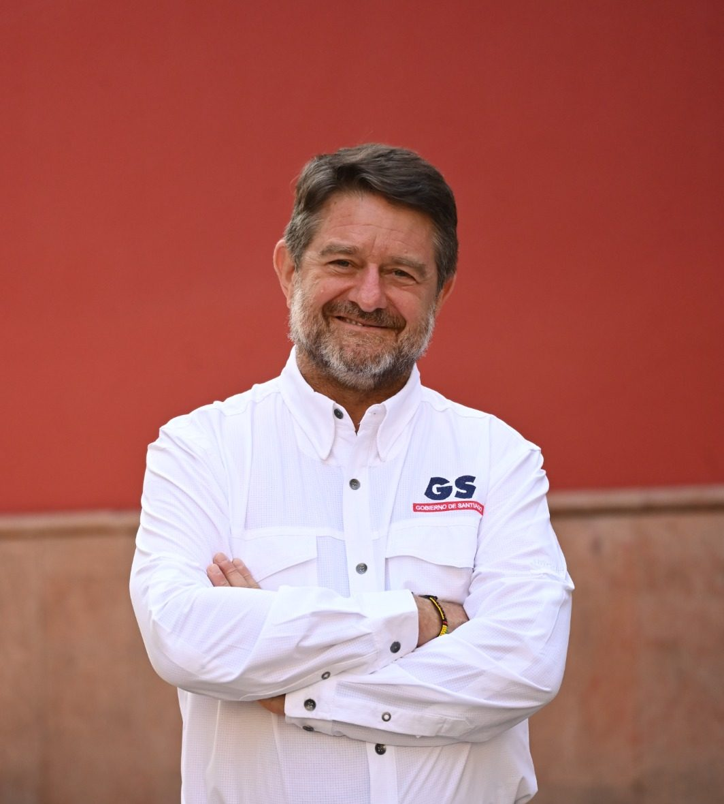

Vivimos una paradoja profunda: nunca habíamos estado tan conectados y, al mismo tiempo, tan desvinculados. Tras la pandemia, la salud mental se ha convertido en una preocupación global. A esto se suman discursos mediáticos que refuerzan el miedo y la inseguridad, y una sobreexposición digital que debilita nuestra capacidad de estar presentes, de vincularnos con otros y con nuestro entorno. La ansiedad, la soledad y la desconexión se han instalado como parte del paisaje cotidiano, afectando seriamente la calidad de vida en nuestras ciudades.

En este contexto desafiante, **el Gobierno Regional Metropolitano de Santiago**, junto a **la agencia de sostenibilidad IUS Latam**, está impulsando una respuesta concreta y transformadora: **el Programa Ecobarrios Santiago**. Esta iniciativa fortalece prácticas territoriales sostenibles en distintos barrios de la región, promoviendo comunidades resilientes que regeneren la vida urbana desde la base: la conexión con la naturaleza, la reconstrucción del tejido social y la recuperación de los espacios públicos.

Los **ecobarrios** no solo abordan la crisis ambiental o urbana. Son también una herramienta poderosa para enfrentar la **crisis de salud mental colectiva**. Al reconectarnos con la tierra, con otros y con un propósito en común, comenzamos a sanar. Desde la ecoansiedad hasta el estrés crónico, pasando por traumas vinculados al cambio climático y la pérdida de identidad cultural, los efectos del deterioro ambiental sobre la salud mental son cada vez más evidentes. La Organización Mundial de la Salud (OMS) ya advierte que las tendencias ambientales actuales representan una amenaza directa al bienestar mental, especialmente entre los jóvenes y comunidades vulnerables. 

Frente a esto, los ecobarrios ofrecen respuestas simples pero significativas: huertos urbanos donde se cultivan alimentos y esperanza; espacios comunitarios donde nacen vínculos a través del voluntariado ambiental; rincones verdes que devuelven dignidad a zonas abandonadas. Estos pequeños logros cotidianos generan bienestar, pertenencia y sentido de propósito compartido.

Pero esta propuesta va más allá del barrio. También nos obliga a revisar nuestras políticas urbanas y planes reguladores. ¿Qué tipo de ciudad estamos construyendo? ¿Qué consecuencias trae seguir promoviendo guetos verticales sin espacios comunes, sin áreas verdes, sin lugares para encontrarnos? Es urgente repensar el modelo de ciudad desde una mirada más humana y sostenible.

Hoy, desde Santiago, tenemos la oportunidad de enviar una señal clara al país: sí **es posible imaginar y construir una nueva ciudad**. Una ciudad que no expulse ni enferme, sino que abrace, cuide y regenere. Para lograrlo, necesitamos colaboración entre ciudadanía, sector público y actores sociales. Y necesitamos convicción.

En ese camino, los **ecobarrios son una de nuestras prioridades**. Porque no solo plantean soluciones ambientales: también devuelven a las personas su capacidad de actuar, participar y transformar. En tiempos de crisis, apostar por la vida en comunidad es también una forma concreta de esperanza.

**Claudio Orrego**

Gobernador de la Región Metropolitana de Santiago

* * *

#### **¿Quieres profundizar en este tema?**

Descubre nuestra página pilar sobre Economía Circular, donde incluimos toda la información actualizada para la región.

[Leer la Guía Estratégica de Economía Circular en LATAM](https://tiempossustentables.cl/economia-circular-chile-latam/)
