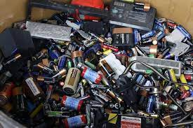
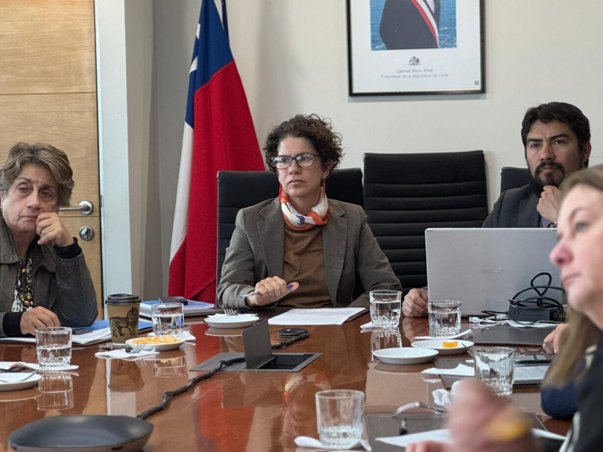
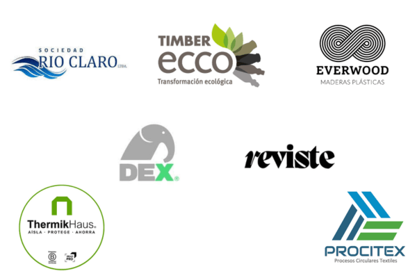

La economía circular en Chile ha cruzado un umbral definitivo, abandonando el terreno de lo aspiracional para consolidarse como un motor tangible de cambio. Una urgencia ineludible, considerando que el país genera cerca de **20 millones de toneladas de residuos sólidos al año**, de los cuales solo se recicla un 22%, cifra impulsada principalmente por la industria. Impulsada por una robusta agenda legislativa y una ola de innovación desde el sector privado, la nación está redefiniendo sus modelos de producción y consumo. El objetivo es claro: minimizar el desperdicio y maximizar el valor de cada recurso.

### **Impulso Legislativo: La Ley REP Fija Metas Claras para los Residuos Electrónicos**

Un pilar fundamental de esta transformación es la Ley de Fomento al Reciclaje (Ley REP), que sigue ganando fuerza. Un hito clave se materializó el ayer **9 de junio de 2025**, cuando el Consejo de Ministros para la Sustentabilidad aprobó un decreto crucial que establece metas obligatorias de recolección y valorización para pilas y aparatos eléctricos y electrónicos (RAEE).

Esta medida es de vital importancia, considerando que los RAEE son uno de los flujos de residuos más peligrosos y de más rápido crecimiento en el mundo. Cada chileno genera en promedio 9.9 kg de basura electrónica al año, una de las tasas más altas de Latinoamérica, pero formalmente se recicla menos del 4%.

Fijar objetivos concretos, se exige responsabilidad a los productores y se incentiva la inversión en la infraestructura necesaria para un reciclaje seguro y eficiente. La Ministra del Medio Ambiente, Maisa Rojas, destacó que esta normativa "no solo previene impactos ambientales, sino que también genera nuevas oportunidades económicas y empleos verdes".

Paralelamente, el Ministerio del Medio Ambiente (MMA) mantiene un diálogo activo con la industria. El taller realizado el 16 de mayo de 2025 con empresas del Acuerdo de Producción Limpia (APL) para el manejo de residuos, demuestra el esfuerzo por alinear las prácticas del sector con una visión de circularidad desde el origen.

### **Prioridad Nacional: La Batalla Contra el Desperdicio de Alimentos**

Otro frente de acción clave es la reducción de la pérdida y desperdicio de alimentos. Se estima que en Chile **se desperdician más de 1.6 millones de toneladas de alimentos al año**, lo que equivale a que cada habitante bota aproximadamente **61 kg** de comida en buen estado.

Con una encuesta nacional dirigida a los hogares, el MMA busca recopilar datos cruciales para diseñar una estrategia nacional efectiva. El impacto de este derroche no solo es una pérdida económica millonaria, sino que también tiene una grave huella ambiental, desde el consumo inútil de agua y tierra hasta las potentes emisiones de metano que generan los residuos orgánicos en vertederos, que representan cerca del **8% de las emisiones de gases de efecto invernadero a nivel global**.

### **Construcción Sostenible: La Vanguardia de la Innovación Circular**

Si un sector está demostrando con hechos el potencial de la economía circular, es el de la construcción. Responsable de generar más de **7 millones de toneladas de residuos anuales (RCD)**, de los cuales se valoriza menos del 25%, hoy emerge como un semillero de innovación. Empresas chilenas están liderando con el ejemplo, transformando este problema en una oportunidad:

- **Áridos Reciclados:** **Río Claro** ya cuenta con autorización sanitaria para convertir escoria de acero y hormigón de demolición en áridos artificiales, capaces de reemplazar hasta el 60% de los áridos vírgenes en la fabricación de nuevo hormigón.

- **Madera Plástica y Mobiliario:** Empresas como **Timberecco** y **Everwood** están revolucionando el mercado con productos fabricados a partir de plástico reciclado. Crean desde mobiliario urbano hasta pérgolas modulares con un material similar a la madera, pero más duradero, resistente a la humedad y libre de mantenimiento.

- **Pisos y Revestimientos:** **Dexfloor** transforma residuos plásticos en innovadores pisos modulares de alta resistencia, mientras que **Reviste** utiliza madera reciclada para crear revestimientos de alta gama, promoviendo un ecosistema de sostenibilidad.

- **Aislación Eficiente:** **Thermikhaus** produce aislantes térmicos de alto estándar a partir de papel y cartón reciclado, y **Procitex** convierte desechos textiles en paneles de aislación térmica y acústica, mejorando la eficiencia energética de las edificaciones.

### **El Rol Clave de los Municipios: Circularidad desde el Territorio**

La transición no sería posible sin el compromiso local. La **"Primera Cumbre Municipal de Economía Circular"**, realizada en Punta Arenas el 20 de mayo de 2025, marcó un hito en la descentralización de estos esfuerzos. Como destacó la Ministra Rojas, fortalecer las capacidades de los municipios es indispensable, ya que son ellos quienes están en la primera línea de la gestión de residuos y el fomento de economías locales sostenibles.

### **Una Sinergia para el Futuro: Política, Industria y Comunidad**

Lo que presenciamos en Chile es una poderosa sinergia. Por un lado, una clara dirección "de arriba hacia abajo" con leyes y metas nacionales como el decreto sobre RAEE. Por otro, una vibrante acción "de abajo hacia arriba" impulsada por la innovación de empresas pioneras y el compromiso de los gobiernos locales.

Esta convergencia es la verdadera clave del éxito. Se estima que una transición decidida hacia la economía circular podría generar más de **180,000 nuevos empleos verdes** en Chile para 2040. La economía circular ha dejado de ser una teoría para convertirse en la hoja de ruta de un Chile más resiliente, competitivo y sostenible. El país no solo está hablando de un futuro mejor; lo está construyendo, residuo a residuo.

* * *

#### **¿Quieres profundizar en este tema?**

Descubre nuestra página pilar sobre Economía Circular, donde incluimos toda la información actualizada para la región.

[Leer la Guía Estratégica de Economía Circular en LATAM](https://tiempossustentables.cl/economia-circular-chile-latam/)
