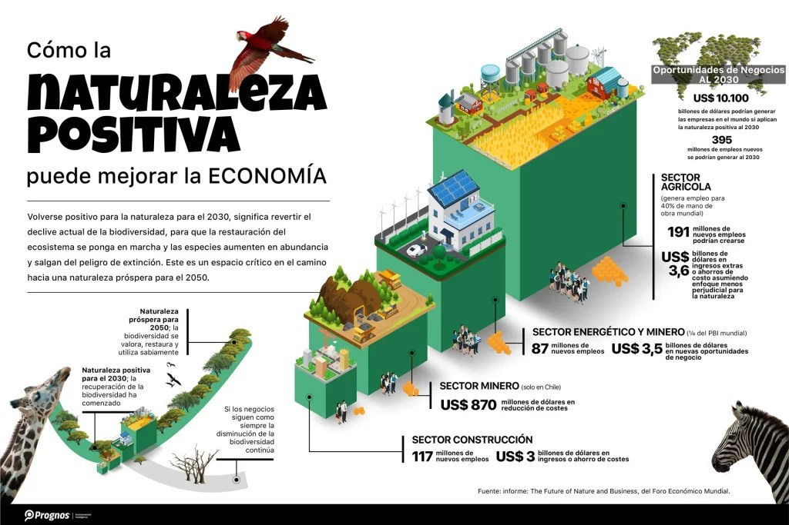

En mayo de 2025, Chile consolida su posición como referente global en sostenibilidad. Avanza en la implementación del **Plan de Acción Empresarial en Biodiversidad**. Esta es una iniciativa pionera en América Latina. Busca integrar la biodiversidad en la gestión empresarial y fomentar una economía positiva para la naturaleza.

## Un modelo de colaboración público-privada

El plan fue lanzado oficialmente el 25 de marzo de 2025. Es el resultado de ocho meses de trabajo conjunto entre el **Ministerio del Medio Ambiente** y **Acción Empresas**. Esta última es la principal red de sostenibilidad empresarial del país. Esta colaboración ha reunido a representantes de seis ministerios. Los ministerios son Medio Ambiente, Agricultura, Economía, Desarrollo Urbano, Hacienda y Energía. También ha reunido a empresas de sectores clave de la economía nacional. Además, se estableció una Mesa de Trabajo Público-Privada que incluye a ONG, academia y otros actores relevantes. Este grupo funciona como un mecanismo de coordinación a largo plazo. Su propósito es asegurar que el plan y sus impactos se revisen hasta más allá de 2030. También se ajustarán a las prioridades cambiantes.

<figure>

<figcaption>

Lanzamiento del Plan de Acción Empresarial en Biodiversidad

</figcaption>

</figure>

_“Estamos frente a un diagnóstico claro. Si no modificamos nuestros patrones de producción y consumo, los problemas ambientales serán cada vez más agudos. Serán más complejos y más costosos”_, afirmó **Maximiliano Proaño, ministro (s) del Medio Ambiente**. “Este Plan de Acción Empresarial entregará lineamientos claros para enfrentar este desafío. Construirá espacios comunes y de comunicación. Avanzaremos conjuntamente en el cuidado de nuestra biodiversidad. Esto demostrará que la conservación se puede hacer de la mano del desarrollo productivo sustentable” .

## Empresas líderes se suman a la fase piloto

En la fase piloto de 2025, empresas como **AES Chile**, **Anglo American Chile**, y **Antofagasta Minerals** han reafirmado su compromiso. También lo han hecho **Bayer**, **CMPC**, **Colbún**, **Copec**, y **Nestlé**. Otras empresas son **Orizon**, **Scotiabank**, **SQM**, y **Syngenta**. Estas empresas están comprometidas con la biodiversidad. Además, nuevas compañías como **Iansa**, **Innergex**, **Statkraft**, **UNACEM** y **VSPT Wine Group** se han incorporado recientemente a la iniciativa. Esto amplía la diversidad de sectores representados.

**Guillermo Olmedo, Subgerente de Medio Ambiente y Valor Social de ARAUCO**, destacó: _“La colaboración público-privada es clave. Es esencial para enfrentar las crisis climática y de biodiversidad. Cuidar y respetar la naturaleza no es solo un imperativo ético. También es un enfoque estratégico para garantizar la sostenibilidad a largo_ plazo” .

## Reconocimiento internacional y proyección futura

El Foro Económico Mundial ha reconocido el Plan de Acción Empresarial en Biodiversidad de Chile. Este se considera un ejemplo global de colaboración. Este plan avanza hacia economías positivas para la naturaleza. Este reconocimiento refuerza la importancia de la acción empresarial colaborativa. Refleja el compromiso del país con el cuidado de la biodiversidad. Se da en un contexto donde los desafíos ambientales requieren soluciones urgentes. Estas soluciones deben ser integrales y de largo plazo.

Chile se prepara para la próxima COP16 de Biodiversidad, que está programada para octubre de este año en Colombia. Chile busca presentar un proyecto sólido. Este proyecto debe marcar un hito en la protección y conservación de la biodiversidad a nivel global. Además, quiere sentar las bases para una colaboración continua y efectiva entre empresas y autoridades.

La **Ministra de Medio Ambiente, Maisa Rojas**, enfatizó: _“Estamos muy orgullosos como país. Vamos a recibir a los 133 países que son parte de BIOFIN. Hoy, el principal desafío es visibilizar la biodiversidad. También es crucial reconocer su papel crítico en el desarrollo económico, la organización social e identidad de nuestros países. Es necesario llevar su comprensión a una dimensión clara y medible. Debe integrarse dentro de las cuentas nacionales y del desarrollo económico sostenible”._

El mundo se acerca rápidamente a 2030. En este contexto, el enfoque colaborativo de Chile en biodiversidad y sostenibilidad empresarial ofrece una hoja de ruta inspiradora. Es un guía para otros países comprometidos con la construcción de economías positivas para la naturaleza.

[Plan-piloto-de-Accion-Empresarial-en-Biodiversidad-Chile](https://tiempossustentables.cl/wp-content/uploads/2025/05/plan-piloto-de-accion-empresarial-en-biodiversidad-chile.pdf)[Descarga](https://tiempossustentables.cl/wp-content/uploads/2025/05/plan-piloto-de-accion-empresarial-en-biodiversidad-chile.pdf)

El año 2025 es un punto de inflexión. Requiere una aceleración decisiva en los esfuerzos globales y nacionales. El objetivo es detener y revertir la alarmante pérdida de naturaleza. En este contexto crítico, la iniciativa de Chile no solo ofrece una luz de esperanza. También proporciona una valiosa guía para otros gobiernos. Estos buscan fortalecer su colaboración con el sector empresarial. Están trazando un camino concreto hacia la construcción de economías positivas para la naturaleza en el horizonte de 2030.

