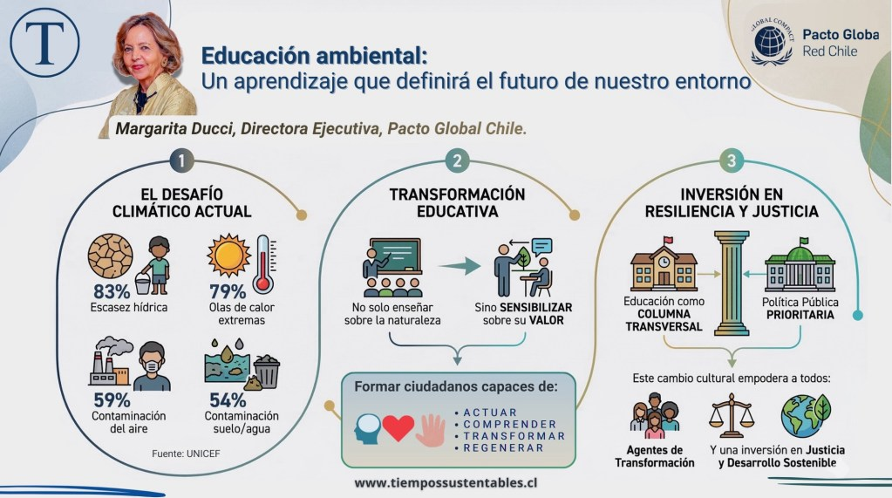

<figure>

<figcaption>

Educación ambiental: un aprendizaje que definirá el futuro de nuestro entorno

</figcaption>

</figure>

_La nueva realidad climática nos llama a repensar lo que hemos construido y lo que queremos construir._

> **💡 Puntos Clave de esta columna:**
> 
> - **Impacto real:** El 83% de los niños, niñas y adolescentes en Chile están expuestos a escasez hídrica, y el 79% a olas de calor extremas (UNICEF).
> 
> - **Cambio de enfoque:** No basta con enseñar sobre la naturaleza; urge formar ciudadanos capaces de actuar, transformar y regenerar ecosistemas.
> 
> - **Desafío público:** Solo el 0,5% del presupuesto nacional para infancia se destina a educación ambiental ; debe convertirse en una política pública prioritaria y transversal.

Ante un escenario donde sequías prolongadas, olas de calor extremas, escasez hídrica y fenómenos ambientales sin precedentes se han convertido en parte de nuestra cotidianidad , el mundo de la educación, y en particular la educación ambiental, se transforma en un objetivo esencial y urgente.

No se trata de enseñar sobre la naturaleza, sino de sensibilizar sobre su valor, y así formar ciudadanos convencidos de la necesidad de ser capaces de actuar, comprender, transformar y regenerar. La crisis climática no es un concepto abstracto. Tiene rostro.

## El impacto de la crisis climática en las nuevas generaciones

Según un estudio de UNICEF, el 83% de los niños, niñas y adolescentes que viven en Chile están expuestos a la escasez hídrica, el 79% a olas de calor extremas, el 59% a contaminación del aire y el 54% a contaminación del suelo y el agua. Estos datos no sólo reflejan la dimensión del desafío, sino que ponen en evidencia cómo la crisis climática afecta los derechos fundamentales de las nuevas generaciones.

Urge entonces generar entre todos un cambio cultural en materia medioambiental donde la protección y el cuidado del entorno sean relevantes desde la primera infancia.

## La educación ambiental como política pública prioritaria

La educación ambiental no puede ser un complemento opcional, sino una columna transversal en todos los niveles educativos y una política pública prioritaria. A nivel curricular, el Ministerio de Educación ha incorporado de manera progresiva contenidos de sostenibilidad y cambio climático, pero la integración aún es desigual y limitada, especialmente cuando solo el 0,5% del presupuesto nacional para infancia se destina a educación ambiental.

Sabemos que sensibilizar, educar y promover acciones, incluso pequeñas, pueden generar conciencia y compromiso desde las aulas, pero también más allá de ellas, en nuestros hogares y comunidades. La educación en línea, las iniciativas de aprendizaje experiencial y las organizaciones ambientales, representan oportunidades para llegar con pertinencia a todos, potenciando su capacidad de acción frente a desafíos locales y globales. Esto, porque lo que sucede en un rincón del mundo, por aislado y distante que sea, inevitablemente nos afectará.

Por ello, las soluciones que surgen en cada región, comunidad escolar o grupo comunitario, son un aporte real para enfrentar amenazas compartidas.

## De la conservación a la regeneración de ecosistemas

La educación ambiental es una herramienta indispensable para que todas las personas reflexionen sobre el trato respetuoso que le debemos a la naturaleza, nuestra biodiversidad y nuestros ecosistemas. No se trata de conservar lo que queda, sino de reconstruir y regenerar lo que hemos perdido.

En Chile, el compromiso ambiental se expresa también en acciones concretas como:

- Esfuerzos por la certificación de establecimientos educativos en sustentabilidad.

- Creación de espacios públicos educativos sobre el ciclo del agua y reciclaje.

- Integración de grupos de empresas que trabajan con sus pares por mejorar su entorno.

El cambio cultural necesario sólo será posible si empoderamos a cada persona como agente de transformación, y que nuestra sociedad en su conjunto reconozca que la educación ambiental es una inversión en resiliencia, justicia y desarrollo sostenible.

El planeta que heredarán las futuras generaciones, y el que hoy construimos, depende en gran parte de ello.

**Margarita Ducci**

Directora Ejecutiva, Pacto Global Chile

 

