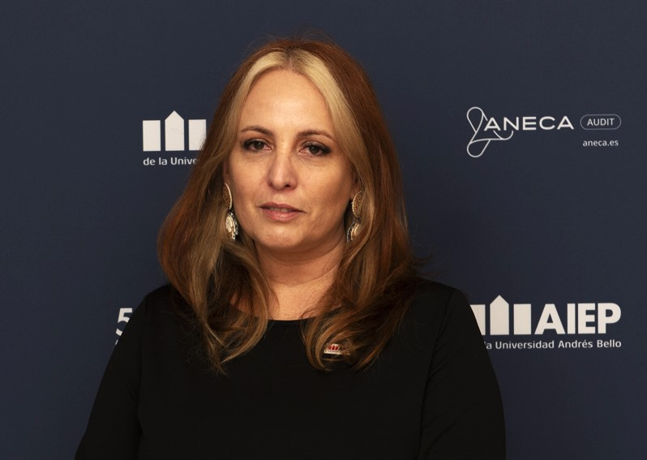

Las instituciones de educación superior tenemos la responsabilidad de desempeñar un papel protagónico en la construcción de un futuro sostenible y no podemos seguir enseñando como si nada pasara. ¿Qué sentido tiene formar profesionales si no están preparados para actuar frente a la crisis climática, la desigualdad y la pérdida de biodiversidad? En el contexto actual, no queda otra opción que alinear nuestra tarea educativa con una visión holística de la sostenibilidad. No se trata solo de transmitir conocimientos técnicos: tenemos la obligación ética de preparar agentes de cambio que no reproduzcan un modelo agotado, sino que lo transformen. Neutralidad en este escenario no es prudencia, es complicidad.

Es fundamental evitar que la sostenibilidad se convierta en una competencia por destacar en rankings o indicadores externos. Cuando se aborda desde una lógica competitiva, se corre el riesgo de trivializar su sentido profundo y reducirlo a una estrategia de posicionamiento institucional. Esta perspectiva refleja una comprensión limitada del desafío, ya que la verdadera sostenibilidad exige un compromiso genuino, coherencia ética y una institucionalización sólida. No se trata de quién lo hace mejor, sino de la capacidad de cada institución para asumir su responsabilidad en la transformación social, ambiental y económica, desde una mirada colaborativa y de largo plazo. 

La sostenibilidad se sostiene en cuatro pilares: humano, social, económico y ambiental. No obstante, persiste una tendencia a reducirla solo a su dimensión ecológica, desestimando aspectos igualmente relevantes. Un estudio realizado en instituciones chilenas reveló que, si bien el 18,8 % de los participantes abordaba la sostenibilidad ambiental, únicamente el 3,1 % consideraba la económica. Por otra parte, la dimensión humana —centrada en mejorar la calidad de vida mediante la educación, la salud y los derechos— sigue siendo marginal. Esta fragmentación constituye un obstáculo para avanzar hacia un desarrollo verdaderamente integral.

Las universidades e institutos técnico-profesionales, como espacios de pensamiento crítico y transformación social, se encuentran ante una oportunidad única para impulsar y liderar este cambio. Resulta imprescindible transversalizar la sostenibilidad en los programas académicos, la vinculación con el medio, la innovación y la investigación, así como en la gestión institucional, con el fin de consolidar una tarea que nos involucra de manera colectiva. Formar profesionales competentes para afrontar los desafíos de la sostenibilidad no se reduce únicamente a conocimientos técnicos: también implica cultivar habilidades, valores y actitudes que promuevan el respeto ambiental, la equidad social y la responsabilidad ética.

Esto exige transformar la experiencia curricular. La sostenibilidad no puede ser un tema aislado ni una asignatura optativa: debe permear a todas las unidades de aprendizaje, cualquiera sea la disciplina. Se trata de desarrollar competencias como el pensamiento sistémico, la resolución de problemas complejos, la creatividad y la toma de decisiones colaborativas. Para ello, se requieren enfoques inter y transdisciplinarios que convoquen a académicos, expertos, comunidades y sectores públicos y privados.

La innovación pedagógica juega aquí un papel central. Metodologías activas y participativas, centradas en el estudiante y conectadas con su entorno, son claves para formar agentes de cambio. Los espacios de aprendizaje flexibles, que fomenten la reflexión, la investigación y la acción, deben convertirse en verdaderos laboratorios de sostenibilidad.

Pero la transformación no se circunscribe únicamente en el aula. La gobernanza institucional también debe reflejar los valores que enseña. Consolidar una cultura organizacional comprometida con el desarrollo sostenible es esencial para dar coherencia al discurso y a la práctica.

En esta misión, el fortalecimiento de las capacidades docentes resulta estratégico. La formación continua, la colaboración entre disciplinas, y el desarrollo de una mirada crítica frente a los desafíos ambientales y sociales, son condiciones indispensables para avanzar en una educación transformadora.

La investigación y la vinculación con la comunidad, orientadas a la resolución de problemas reales y con pertinencia territorial, permiten articular proyectos interdisciplinarios que integran el conocimiento académico y la acción social, empoderando a jóvenes y adultos como agentes de cambio en sus comunidades.

Finalmente, la colaboración en redes académicas, sociales y comunitarias amplifica el impacto de nuestras acciones. Compartir experiencias y buenas prácticas entre instituciones, organizaciones y territorios contribuye a generar aprendizajes colectivos y cambios duraderos.

Las instituciones de educación superior tenemos que elegir: ¿seguiremos haciendo sostenibilidad de papel, reducida a informes y rankings, o asumiremos de una vez el rol que nos corresponde como motores de transformación social, ambiental y económica? La respuesta no admite dilaciones. No basta con enseñar; debemos transformar. No basta con parecer sostenibles; debemos serlo. Solo entonces podremos decir, con coherencia, que estamos cumpliendo nuestra misión con las generaciones que hoy se forman y con las que todavía no tienen voz, pero cargarán con las consecuencias de nuestras decisiones.

_**Marcela Vaccaro R.**_

_Vicerrectora de Vinculación con el Medio y Comunicaciones, AIEP._
