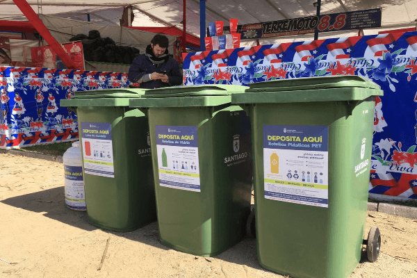
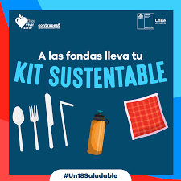

Se acercan las Fiestas Patrias, un tiempo para celebrar la identidad chilena con asados, cueca y reuniones familiares. Sin embargo, ¿sabías que detrás de esta festividad se esconde una realidad con un alto costo ambiental y social? Un nuevo análisis revela la profunda relación entre estas celebraciones y los desafíos de la sostenibilidad en Chile.

* * *

## La Huella del "18": Basura y Contaminación

Las Fiestas Patrias se caracterizan por un aumento drástico en la generación de residuos. El chileno promedio produce 1.5 kilos de basura al día, pero durante estas festividades, esa cifra puede aumentar hasta en un **50%**, llegando a 2.25 kilos por persona diariamente. Algunas estimaciones son aún más alarmantes, señalando que una persona puede generar entre **8 y 10 kilos de basura** al día.

El Ministerio del Medio Ambiente (MMA) ha reportado que las celebraciones pueden generar cerca de **30 mil toneladas adicionales de desechos**, lo que representa un aumento del 30% en comparación con un fin de semana normal. Los plásticos de un solo uso, como platos, vasos y cubiertos, son los principales culpables, ya que se usan por solo unos minutos antes de convertirse en basura.

Pero no es solo la basura. Los asados masivos también tienen un impacto significativo. El uso de parrillas a carbón o leña libera grandes cantidades de partículas finas PM2.5, que tienen un efecto directo en la salud respiratoria. De hecho, un estudio estimó que 50,000 asados en un solo día pueden generar el **8.3% de la contaminación promedio en Santiago**. A esto se suman las emisiones por el transporte terrestre y aéreo, con proyecciones de más de 600,000 viajes en avión durante la festividad.

* * *

## Un Ecosistema de Iniciativas Sostenibles 🌱

A pesar de estos desafíos, Chile está viendo un cambio cultural notable, con un emergente "ecosistema de sostenibilidad" liderado por el gobierno, municipios y la sociedad civil.

- **"Fondas Sustentables"**: El Ministerio del Medio Ambiente (MMA) ha liderado programas como las "Fondas Sustentables" en colaboración con municipios. Por ejemplo, las fondas del Parque O'Higgins han logrado reciclar **5.5 toneladas de residuos**. Además, la implementación de vasos reutilizables en este evento evitó la generación de más de **3,000 kilos de desechos**.

- **Apoyo a la economía local**: El Fondo de Solidaridad e Inversión Social (FOSIS) ha creado la **"Fonda FOSIS"**, una plataforma virtual para apoyar a pequeños emprendedores locales. Esto promueve el consumo consciente y la sostenibilidad social.

- **Conciencia Ciudadana**: Organizaciones como Greenpeace han lanzado guías digitales con consejos para una celebración más ecológica. También han surgido las **"fondas veganas"** que ofrecen menús 100% vegetales, demostrando cómo la tradición puede evolucionar para ser más inclusiva y respetuosa con el medio ambiente.

* * *

## Nuestro Rol en un "18" Más Consciente

La transición hacia unas Fiestas Patrias más sostenibles requiere la participación de todos. Aquí te dejamos algunas recomendaciones para que celebres de forma más responsable:

- **Reduce, Reutiliza, Recicla**: Planifica tus comidas para evitar el desperdicio, lleva tus propios vasos y cubiertos reutilizables a las celebraciones y separa tus residuos en puntos de reciclaje.

- **Transporte Inteligente**: Usa el transporte público o comparte tu auto para reducir las emisiones de CO2.

- **Consumo Consciente**: Considera reducir tu consumo de carne y prefiere los productos de emprendedores locales, apoyando la economía de tu comunidad.

El "18" puede seguir siendo una fiesta de unidad y alegría, pero con un nuevo sentido de responsabilidad. ¡Celebremos nuestras tradiciones en armonía con el planeta!

