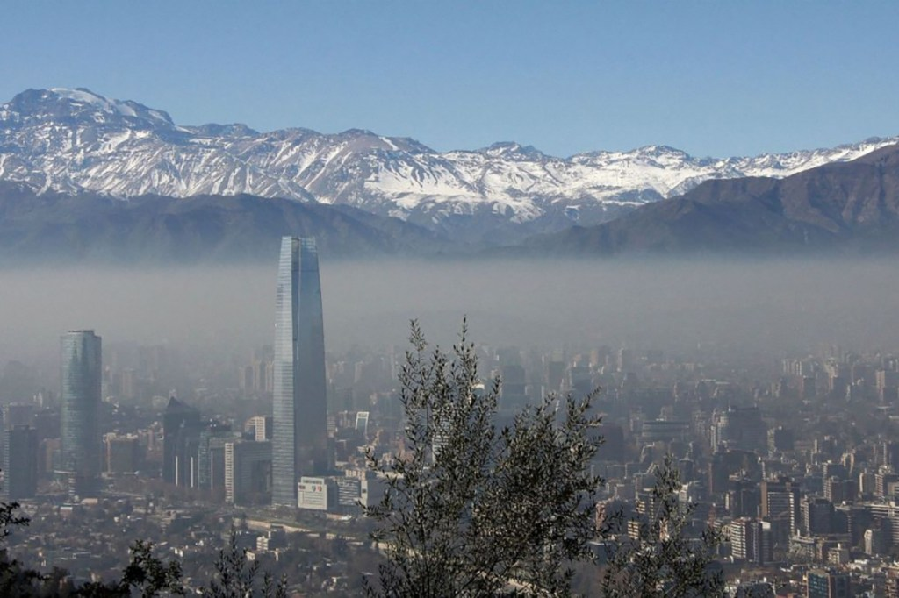
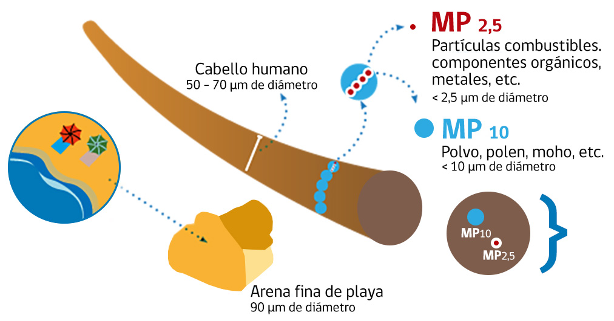
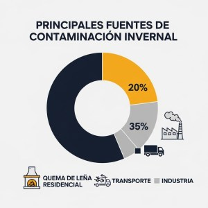
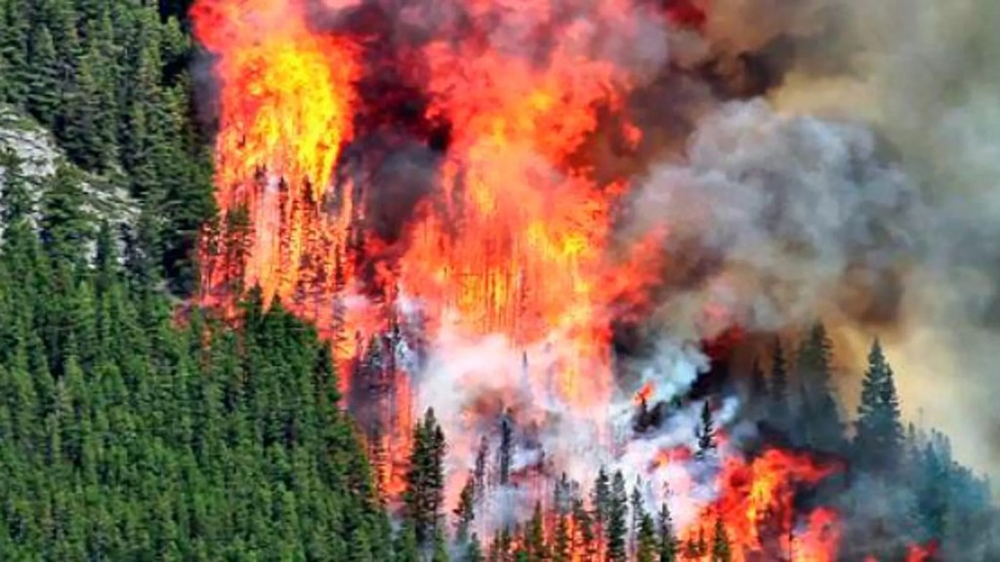
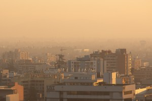

Con la llegada del frío en 2025, la Región Metropolitana enfrenta una nueva crisis de polución. Las cifras son elocuentes: miles de muertes prematuras y un costo para el país de US$5.000 millones anuales. Analizamos la situación, las medidas y los desafíos en la batalla por un aire más puro.

La familiar "nube gris" sobre Santiago no es solo un paisaje invernal; es una emergencia de salud pública con costos devastadores. Mientras la ciudad enfrenta una nueva seguidilla de episodios críticos en el invierno de 2025, las estadísticas revelan la cruda realidad detrás del smog: la contaminación atmosférica causa cerca de **4.800 muertes prematuras cada año en Chile** y le cuesta al país un estimado de **US$5.000 millones anuales**, lo que equivale al 1.6% del PIB nacional.

### **La Cruda Realidad del Invierno 2025: Una Crisis que se Mide en Microgramos y Vidas**

Los primeros días de junio han sido un duro recordatorio de nuestra vulnerabilidad. Ayer, 9 de junio, la Delegación Presidencial Metropolitana ha declarado **Preemergencia Ambiental** por los altos niveles de material particulado fino (MP2,5​), el contaminante más dañino para la salud. Esta medida no es un hecho aislado. Sigue a la primera preemergencia del año, declarada el 8 de junio, y a una secuencia de **siete alertas ambientales consecutivas**.

Entérate del pronóstico de la calidad del aire en las distintas zonas del país directamente en la página del Medio Ambiente [https://airechile.mma.gob.cl/](https://airechile.mma.gob.cl/)

<figure>

<figcaption>

Imagen que representa la relación entre el material particulado fino MP, el cabello humano y un grano de arena.

</figcaption>

</figure>

Este material particulado, tan pequeño que penetra directamente en el torrente sanguíneo, proviene principalmente de tres fuentes en la región: **la quema de leña residencial, el transporte y las emisiones industriales**. Según un inventario de 2023, solo en la Región Metropolitana existen más de **96.000 calefactores a leña**, evidenciando la magnitud del desafío residencial.

### **El Escudo Regulatorio: ¿Cómo se Combate la Contaminación?**

Frente a esta crisis, el **Plan de Prevención y Descontaminación Atmosférica (PPDA)** y su Plan de Gestión de Episodios Críticos (GEC) activan un estricto protocolo. Estas medidas, aunque a veces impopulares, han demostrado ser efectivas en reducir los peores escenarios. A lo largo de los años, el GEC ha logrado disminuir tanto el número como la duración de las preemergencias y emergencias.

Las acciones clave, cuya efectividad depende de una rigurosa fiscalización, son:

- **Prohibición Total de Calefactores a Leña:** Durante los episodios de Alerta, Preemergencia o Emergencia, la prohibición es total. El incumplimiento arriesga multas que pueden ir desde 1 a 70 UTM (entre $65.000 y más de $4.5 millones).

- **Tolerancia Cero a las Quemas Agrícolas:** Práctica que es intensamente vigilada por CONAF y el SAG.

- **Paralización de Fuentes Industriales:** La Superintendencia del Medio Ambiente (SMA) obliga a los "Grandes Establecimientos" a detener sus operaciones. Este 2025, el foco está puesto en la fiscalización, como lo demuestra la orden de paralización a empresas como INDUSTRIAS PROFAL S.A. por no tener sus planes de reducción aprobados.

- **Restricción Vehicular:** Medida clave para controlar las emisiones de un parque automotor que bordea los 2 millones de vehículos en la región.

Encuentra los planes de descontaminación atmosférica por región y beneficios asociados, directamente en el sitio del Ministerio del Medio Ambiente [https://ppda.mma.gob.cl/](https://ppda.mma.gob.cl/)

### **Más Allá de la Norma: El Alto Costo Social y Económico**

El impacto de la contaminación va mucho más allá de la salud. Los costos económicos asociados a las enfermedades respiratorias, las hospitalizaciones y la pérdida de productividad son enormes. Sin embargo, la solución no es simple. La **quema de leña**, por ejemplo, principal fuente de MP2,5​ en invierno, es a menudo la única opción asequible de calefacción para miles de familias.

Esta tensión entre la urgencia sanitaria y la realidad socioeconómica exige políticas públicas que no solo restrinjan, sino que ofrezcan soluciones viables. Programas de recambio de calefactores y subsidios para aislación térmica de viviendas son cruciales para un cambio de fondo, ya que el sector residencial es responsable de cerca del **30% de las reducciones de emisiones** proyectadas en el PPDA.

### **Hacia un Futuro Transparente: Fiscalización y Tecnología como Aliados**

Se percibe un cambio de estrategia. El programa de fiscalización para 2025 apuesta por una **mayor rigurosidad y coordinación intersectorial**. La SMA, CONAF, la Seremi de Salud y Carabineros trabajan de manera conjunta, y la identificación pública de las industrias incumplidoras envía una señal de mayor transparencia y mano dura.

La tecnología también juega un rol protagónico. CONAF ha reforzado su monitoreo con **cámaras de alta resolución y drones**, permitiendo una detección y respuesta más rápida ante focos de quemas ilegales. Este enfoque, que combina fiscalización en terreno con vigilancia tecnológica, marca una evolución necesaria para mejorar el cumplimiento de las normativas.

### **Un Desafío Nacional: Santiago como Espejo del Centro-Sur**

Es fundamental entender que Santiago no está solo en esta lucha. La mala calidad del aire es un desafío nacional, especialmente agudo en las ciudades del centro y sur de Chile, donde la quema de leña es aún más masiva. Ciudades como **Osorno, Temuco y Padre Las Casas** enfrentan problemáticas idénticas, con el MP2,5​ como principal enemigo.

La existencia de Planes Operacionales específicos para estas ciudades demuestra que la contaminación atmosférica es una preocupación nacional. Los beneficios de una descontaminación efectiva, estimados en más de **US$7.900 millones** en un horizonte de 10 años solo para Santiago, justifican con creces la inversión y el esfuerzo coordinado.

A continuación te dejo el Plan Operacional 2025 para la Gestión de Episodios Críticos en el Marco de la Descontaminación Atmosférica de Temuco y Padre Las Casas PDA

[PLAN-OPERACIONAL-GEC-2025-2](https://tiempossustentables.cl/wp-content/uploads/2025/06/plan-operacional-gec-2025-2.pdf)[Descarga](https://tiempossustentables.cl/wp-content/uploads/2025/06/plan-operacional-gec-2025-2.pdf)

El camino hacia cielos limpios es arduo. Sin embargo, las cifras no mienten sobre el costo de la inacción. La combinación de una regulación estricta, una fiscalización efectiva y un apoyo social inteligente es la única ruta posible. La salud de millones y la sostenibilidad económica del país dependen de que el aire que respiramos se convierta, finalmente, en una prioridad nacional.º1

