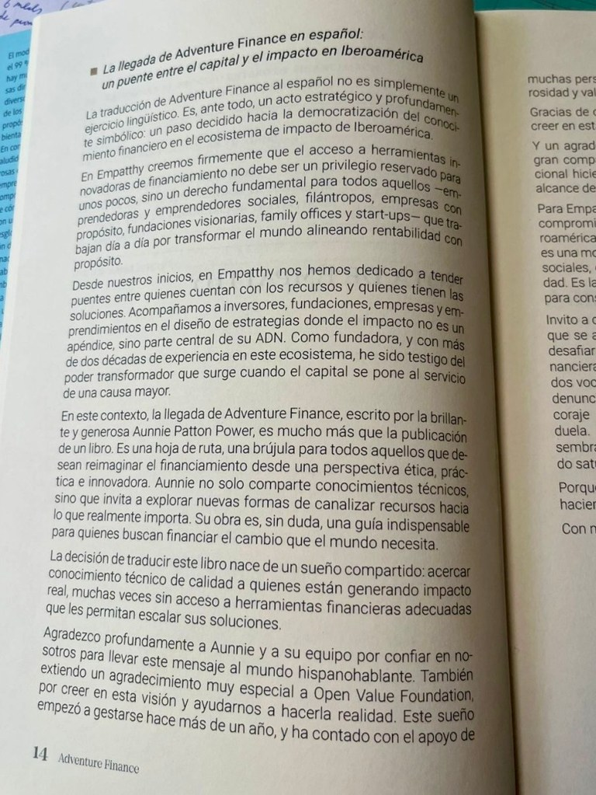
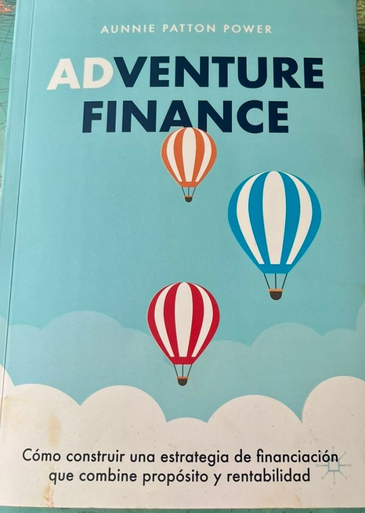
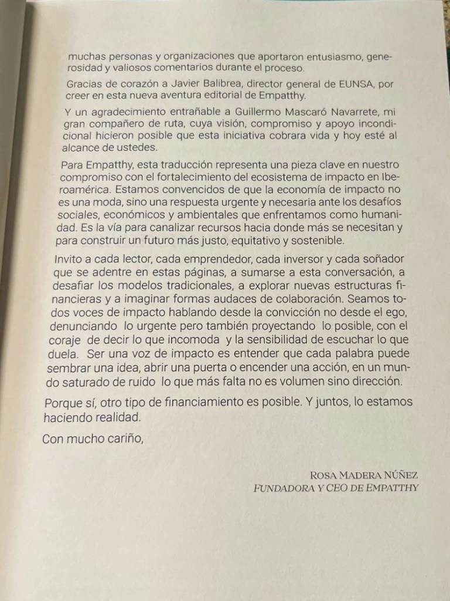
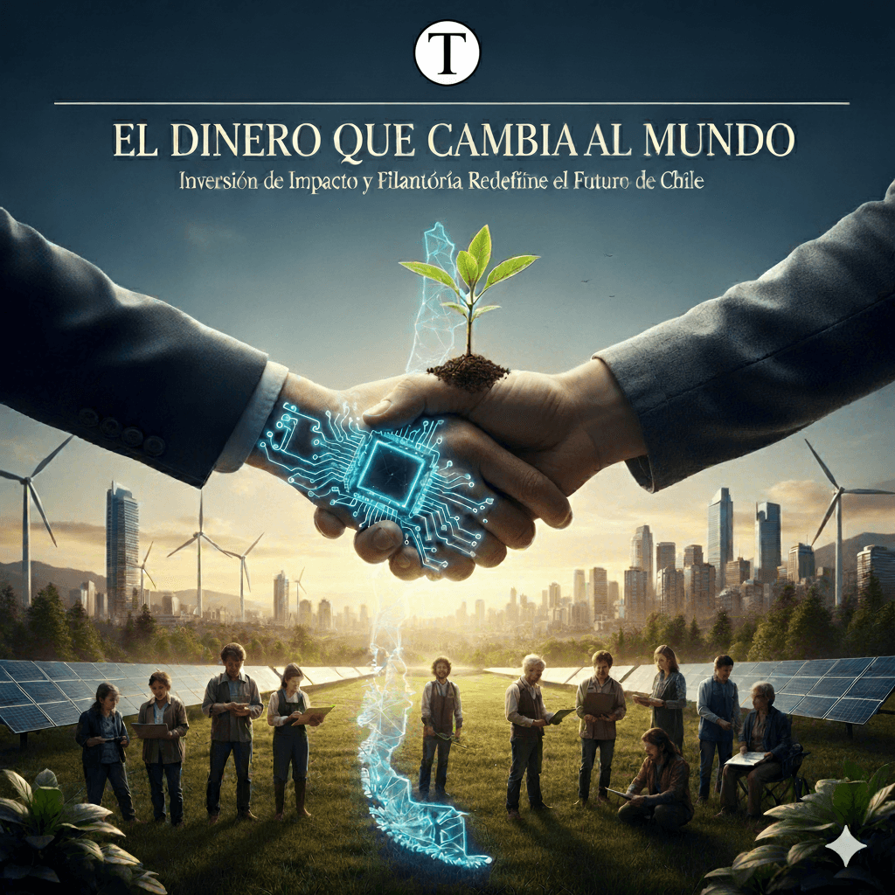

La **Innovative Finance Initiative** **(IFI)**, nace como un esfuerzo colectivo y global para escalar modelos financieros transformadores capaces de enfrentar los desafíos más complejos de nuestro tiempo. Desde América Latina, **Empatthy** se suma con una mirada ética, regenerativa y comunitaria, y con experiencia pionera como la reciente  traducción del libro **Adventure Finance** al español.

Vivimos tiempos donde los problemas que enfrentamos _—crisis climática, inequidad estructural, migraciones masivas, fragilidad democrática—_ son tan complejos que ya no basta con respuestas tradicionales. La filantropía por sí sola no alcanza. Las finanzas convencionales, enfocadas únicamente en maximizar rentabilidad, tampoco. Lo que necesitamos son modelos financieros radicalmente innovadores, capaces de cambiar las reglas del juego.

Con esa convicción nace la **IFI,** una apuesta audaz y colectiva de cinco años que busca escalar lo que ya funciona y descubrir lo que aún falta por crear. La premisa es clara: si queremos que la inversión de impacto esté a la altura de los desafíos, debemos llevar al centro del escenario mecanismos que hasta ahora quedaban en los márgenes.

## **De las conversaciones laterales al centro de la agenda**

En el mundo ya vemos modelos que están marcando la diferencia: donaciones recuperables, , propiedad en manos de trabajadores y comunidades, compensaciones vinculadas al impacto, estrategias de “impact first” o mecanismos financieros innovadores aplicados a la ayuda humanitaria.

Hasta ahora, estas prácticas suelen quedar relegadas a conversaciones paralelas, lejos de los grandes foros. La IFI quiere cambiar eso: _darles visibilidad, conectarlas y convertirlas en motores reales de transformación._

## **Una oportunidad única para América Latina**

Nuestra región conoce bien la fragilidad y la desigualdad, pero también la fuerza de la resiliencia y los tejidos comunitarios. América Latina tiene un acervo riquísimo de innovación social que puede enriquecer esta conversación global.

Por eso, Empatthy se suma con entusiasmo a la Innovative Finance Initiative. Nuestro compromiso es aportar la mirada latinoamericana: una visión que no solo innova por eficiencia, sino por justicia, regeneración y equidad.

Además, hemos contribuido activamente a abrir estas discusiones en la región, Chile, México, Colombia. **Un ejemplo es la traducción al español de Adventure Finance, de Aunnie Patton Power, un libro clave que democratiza el acceso a modelos financieros alternativos y que ya está inspirando a emprendedores sociales, fundaciones y family offices latinoamericanos.**

<figure>

<figcaption>

traducción al español de Adventure Finance, de Aunnie Patton Power

</figcaption>

</figure>

El futuro de las finanzas no está escrito. Y la buena noticia es que podemos escribirlo distinto: desde la solidaridad, la ética y el compromiso con un planeta vivo y sociedades más justas. La Innovative Finance Initiative es un llamado a pasar del margen al centro, de la innovación aislada a la transformación sistémica. Y desde Empatthy queremos ser parte de esa historia: porque creemos que el dinero, cuando se pone al servicio del bien común, puede realmente cambiar el mundo.

**Rosa Madera Núñez**

Fundadora de Empatthy y directora de la Asociación de  Ética Empresarial  y Organizacional de Chile

* * *

Te invitamos a complementar la lectura con el reportaje **_"Cómo Inversión de Impacto y Filantropía Están Redefiniendo el Futuro Sostenible de Chile"_**, [publicada hoy](https://tiempossustentables.cl/2025/09/21/como-inversion-de-impacto-y-filantropia-estan-redefiniendo-el-futuro-sostenible-de-chile/↗).

