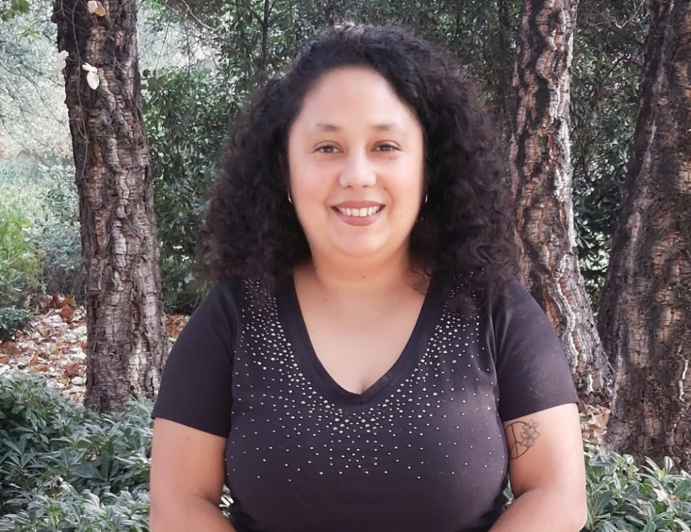

## En estos días se están tomando decisiones claves para el presente y el futuro de la humanidad.

No solo en Chile, con las próximas elecciones presidenciales, sino también a nivel global con la antesala de la COP 30, donde se negocian los pasos que determinarán nuestra capacidad de adaptación y supervivencia en un planeta en crisis.

Pero, ¿cómo nos impacta todo esto en lo cotidiano? ¿Es algo de lo que deberíamos conversar con nuestras familias, amistades y comunidades? Basta mirar nuestra vida diaria: la megasequía ya afecta el acceso al agua, encarece alimentos y cambia la forma en que habitamos. No es un fenómeno lejano; está moldeando nuestras decisiones cotidianas.

A veces sorprende lo distante que muchas personas se sienten de estas discusiones, como si las decisiones sobre la salud climática ocurrieran en un planeta paralelo, o no tuvieran consecuencias directas sobre nuestra vida, nuestra economía y nuestra seguridad.

### Justamente por eso, en momentos tan decisivos, no podemos permanecer impávidos frente a cómo gobernantes, autoridades y dirigentes mundiales acuerdan —o no— avanzar en detener el deterioro acelerado de los sistemas planetarios que sustentan la vida .

Mientras ellos discuten sobre financiamiento climático o la eliminación progresiva de los combustibles fósiles, cada uno de nosotros debe sostener esa misma conversación en su propio entorno y escala.

La narrativa dominante nos ha dicho que la tecnología resolverá la crisis. Pero sabemos que no basta. El nivel de urgencia exige cambios estructurales, culturales y personales que ninguna innovación puede reemplazar por sí sola.

Tampoco podemos olvidar que no todos los países enfrentan los impactos de la misma manera. **Chile, según la Convención Marco de las Naciones Unidas sobre el Cambio Climático (CMNUCC), cumple 7 de los 9 criterios que definen a una nación como particularmente vulnerable**. Es decir, estamos entre los primeros en recibir los impactos y entre los últimos en poder evitarlos si no actuamos ahora.

### En este contexto, la educación adquiere un rol decisivo:

Desde la **Red Campus Sustentable** hemos impulsado la formación en sustentabilidad en las instituciones de educación superior, entendiendo que no habrá transformación posible sin ciudadanos capaces de comprender la crisis, dialogar sobre ella y actuar con responsabilidad. Educar para la sustentabilidad no es un complemento: es una condición indispensable para construir sociedades preparadas y comprometidas con un futuro distinto.

Por eso, el llamado no es a descansar en la acción de otros, sino a asumir un rol activo en la solución: desde los gestos individuales hasta la colaboración en red, como promovemos desde la Red Campus Sustentable.

**_Porque la base de cualquier futuro posible es la colaboración, la empatía y la conexión como especie y como parte de este planeta. La crisis climática no admite espectadores: cada acción suma y cada silencio resta._**

**Patricia Opazo Barraza**

Directora Ejecutiva

[Red Campus Sustentable](https://www.redcampussustentable.cl/)

