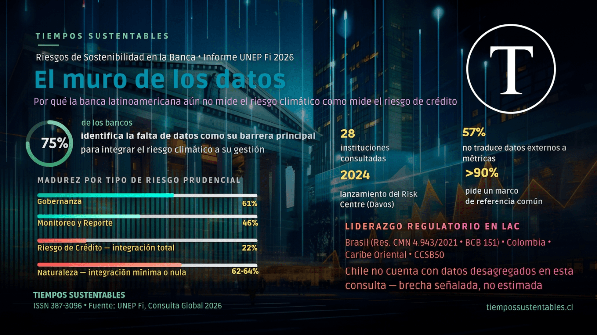

Un informe global de UNEP FI, consultado con 28 instituciones financieras, revela que la gobernanza climática avanza en los directorios, pero se detiene antes de llegar a los modelos de riesgo. Brasil y Colombia lideran la región; el resto observa.

## ℹ️ Resumen Ejecutivo (Lectura en 45 segundos)

- El **Risk Centre de UNEP FI**, creado en 2024, consultó a 28 bancos en 2026 y encontró que la **gobernanza climática alcanza 61% de madurez**, pero el **monitoreo y reporte solo llega a 46%**.
- El **riesgo de crédito** es el más avanzado: **22% de los bancos** ya lo integra totalmente con factores de sostenibilidad.
- El **75% de las instituciones** identifica la falta de datos como su principal barrera operativa.
- Brasil (Resolución CMN 4.943/2021 y Resolución BCB No. 151) y Colombia encabezan la regulación prudencial en América Latina.
- Más del **90% de los bancos consultados** pide un marco de referencia estructurado para pasar del discurso a la ejecución.

<figure>

<figcaption>

La mayoría de los bancos latinoamericanos luchan por integrar eficazmente los datos de riesgo climático en su gestión.

</figcaption>

</figure>

## Por qué esto le importa a Chile y a la banca latinoamericana

Un préstamo hipotecario en una zona con estrés hídrico. Un crédito agrícola en una región con sequía prolongada. Una cartera comercial expuesta a una industria que depende de insumos que el cambio climático está encareciendo.

Ninguno de estos casos es hipotético en Chile. Y según el nuevo informe de la **Iniciativa Financiera del Programa de las Naciones Unidas para el Medio Ambiente (UNEP FI)**, la mayoría de los bancos de la región todavía no cuenta con las herramientas técnicas para medirlos con precisión.

El documento, resultado de una consulta a 28 instituciones financieras durante 2026, no describe un problema de intenciones. Describe un problema de **capacidad operativa**. Los bancos quieren avanzar. Sus sistemas de datos y sus modelos de riesgo todavía no los dejan.

## El fin de la sostenibilidad como gesto voluntario

Durante años, la gestión de riesgos de sostenibilidad se trató como un tema reputacional. Un capítulo en la memoria anual. Una política de responsabilidad social.

Eso terminó.

> "El riesgo de sostenibilidad no es una categoría aislada: es un amplificador transversal que altera la severidad, la distribución y la temporalidad de los riesgos financieros que los reguladores ya conocen."

Así lo plantea UNEP FI, que en 2024 lanzó en Davos su **Risk Centre**, el organismo que consolidó esta visión: la resiliencia financiera y la resiliencia ambiental dejaron de ser asuntos separados.

El **Reporte de Riesgos Globales del Foro Económico Mundial (WEF) 2026** confirma la tendencia. Ubica a los factores ambientales y sociales como amenazas inmediatas para la estabilidad del sistema financiero, no como riesgos a largo plazo que se pueden postergar.

### ¿Qué significa que el riesgo climático sea un "amplificador transversal"?

Significa que el cambio climático no crea un riesgo nuevo y separado. En cambio, agrava los riesgos de crédito, mercado, liquidez y operación que la banca ya gestiona, cambiando cuándo y con qué fuerza pueden ocurrir.

## Radiografía de América Latina: liderazgo desigual

El informe describe a la región como un territorio de **contrastes**, con niveles de madurez que van de lo "naciente" a lo "activo", según el país.

- **Brasil y Colombia** encabezan la región con estándares prudenciales formales. Brasil destaca por la Resolución CMN 4.943/2021 y la Resolución BCB No. 151, que exige reportes detallados ESG.
- El **Caribe Oriental** implementó un Estándar Prudencial sobre Riesgos Climáticos amparado en su Ley Bancaria de 2015.
- En Centroamérica, el **Consejo Centroamericano de Superintendentes (CCSBSO)** trabaja en homogeneizar criterios técnicos.

El informe no incluye datos específicos sobre Chile en esta consulta. Sin embargo, el contexto chileno —cubierto en reportajes anteriores sobre la NCG 519 de la CMF (NIIF S1 y S2)— muestra que el país avanza en la misma dirección que Brasil: de la voluntariedad a la obligatoriedad.

## Los números que exponen la brecha

La consulta de UNEP FI mide qué tan integrado está el riesgo de sostenibilidad en los procesos reales de gestión prudencial.

### ¿Cuál es el estado real de integración en la banca?

La **gobernanza** alcanza un 61% de madurez, pero el **monitoreo y reporte** cae a 46%. El riesgo de crédito lidera con 22% de integración total.

- **Riesgo de crédito:** 22% reporta integración total con factores de sostenibilidad.
- **Riesgo de mercado y liquidez:** El mayor rezago. Las métricas de corto plazo no capturan riesgos estructurales de largo plazo.
- **Gobernanza:** 61% de madurez.
- **Monitoreo y reporte:** 46%, evidenciando que medir sigue siendo más difícil que declarar intenciones.

**Avance por temática de sostenibilidad (Consulta UNEP FI, 2026):**

| Tipo de riesgo | Estado de integración | Observación |
| --- | --- | --- |
| Clima (transición) | Avanzado | Impulsado por metas de descarbonización |
| Clima (físico) | Moderado | Foco en activos colaterales vulnerables geográficamente |
| Naturaleza | Incipiente | Entre 62% y 64% de los bancos tiene integración mínima o nula |
| Contaminación | Emergente | 29% de integración en crédito, por pasivos ambientales directos |
| Social | Cualitativo | Gestionado vía riesgo no financiero, no en modelos prudenciales |

## El "muro de los datos": el obstáculo que nadie resuelve

El obstáculo dominante es la falta de datos confiables y comparables. El **75% de las instituciones** consultadas lo identifica como su barrera principal.

Además, el **57% de los bancos** tiene dificultades extremas para convertir la información de proveedores externos en métricas financieras utilizables dentro de sus modelos de riesgo de crédito.

## Cuando la inacción tiene precio: multas y capital

El **Banco Central Europeo (BCE)** ya sancionó a entidades como ABANCA por incumplir expectativas de gestión de riesgo climático. El **Bank of England (BoE)** evalúa aplicar ajustes de Pilar 2 (exigir más capital) a los bancos con brechas de control.

## Hoja de ruta UNEP FI: Inserción, no aislamiento

UNEP FI propone **insertar la sostenibilidad dentro de los procesos de riesgo existentes** a través de 4 pasos:

1. **Cuantificación mediante KRIs:** Conectar datos de sostenibilidad con límites de crédito.
2. **Capacitación técnica:** Formar a los equipos de segunda línea.
3. **Calibración del apetito de riesgo (RAS):** Definir umbrales de exposición por sector.
4. **Adopción de escenarios NGFS:** Ejecutar _stress-testing_ climático.

## Comparación con la Arquitectura de Valor

El informe de UNEP FI habla el lenguaje del regulador (KRIs, Pilar 2). La **Arquitectura de Valor** (metodología de Tiempos Sustentables) aborda el mismo problema desde la estrategia comercial del directorio.

| Dimensión UNEP FI | Arquitectura de Valor | Lectura comparada |
| --- | --- | --- |
| Gobernanza y RAS | 🧠 **Cabeza Fría** | Ambos marcos coinciden: el riesgo vive en la estructura financiera, no en un comité aislado. |
| Taxonomía y materialidad | 🧠 **Cabeza Fría** + 🙌 **Manos Firmes** | El "muro de datos" (75%) coincide con la "falta de medición rigurosa" detectada en B2B. |
| Acciones de gestión | 🙌 **Manos Firmes** | Traducir el riesgo en incentivos (scoring, bonos), no en declaraciones. |
| Visión interconectada | ❤️ **Corazón Activo** | UNEP FI ve transmisión de riesgo; nosotros vemos creación de valor comercial integrado. |

[Ir a la Metodología Arquitectura de Valor →](https://tiempossustentables.cl/arquitectura-valor/)

## Preguntas frecuentes (FAQ's)

### ¿Qué es el riesgo de sostenibilidad para un banco?

Es un amplificador transversal de los riesgos financieros (crédito, mercado, liquidez), no una categoría separada. Altera la severidad con que estos riesgos se materializan.

### ¿Cuántos bancos participaron en la consulta de UNEP FI 2026?

La consulta global reunió a **28 instituciones financieras** durante 2026, organizada por el Risk Centre de UNEP FI.

### ¿Qué países lideran la regulación de riesgo climático en LatAm?

**Brasil** y **Colombia** encabezan la región con estándares prudenciales formales. El Caribe Oriental y Centroamérica avanzan en fases de armonización.

### ¿Qué porcentaje de bancos necesita un marco estructurado?

Más del **90%** considera esencial un marco para pasar del discurso estratégico a la ejecución técnica.

## 📄 Recursos descargables (Documentos fuente UNEP FI)

Para áreas de riesgo y cumplimiento, ponemos a disposición los documentos originales del Risk Centre de UNEP FI:

### Documento 1 · Marco Conceptual

_Conceptual Framework for Sustainability Risk Integration (2026)._ Define los fundamentos y pilares de integración sistémica.

[Descargar PDF ⬇](https://tiempossustentables.cl/wp-content/uploads/2026/07/conceptual-framework-for-sustainability-risk-integration.pdf)

### Documento 2 · Diagnóstico Regional

_The Landscape of Sustainability Risk Integration (2026)._ Resultados de la consulta a 28 bancos e instituciones financieras.

[Descargar PDF ⬇](https://tiempossustentables.cl/wp-content/uploads/2026/07/the-landscape-of-sustainability-risk-integration.pdf)

## Para seguir profundizando

La brecha de datos que expone este informe no se cierra con decretos, sino con equipos técnicos y directorios dispuestos a exigir trazabilidad. Si tu organización quiere saber en qué etapa se encuentra, realiza nuestro diagnóstico.

[Ir al Diagnóstico Gratuito B2B →](https://diagnostico.tiempossustentables.cl/)

O únete a la conversación en nuestra [Comunidad de WhatsApp](https://chat.whatsapp.com/DgqyAwzj0fhCRMS2e1zkk7).

**Fuentes citadas (Estándar APA):**

United Nations Environment Programme Finance Initiative (UNEP FI). (2026). _Conceptual Framework for Sustainability Risk Integration_. Ginebra, Suiza.

United Nations Environment Programme Finance Initiative (UNEP FI). (2026). _The Landscape of Sustainability Risk Integration_. Ginebra, Suiza.

