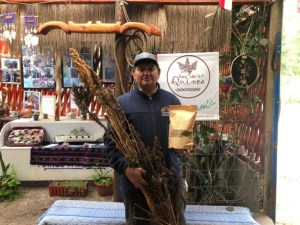

Chile se encuentra en una encrucijada hídrica sin precedentes. Mientras las olas de calor y los incendios forestales arrecian en la zona centro-sur, el modelo tradicional de respuesta ante la escasez —el camión aljibe— muestra signos de agotamiento estructural. Lo que nació como una medida de emergencia transitoria se ha transformado en una dependencia que drena aproximadamente **$135.000 millones anuales** del erario público (**Datos de inversión y crisis hídrica, SENAPRED/Gobiernos Regionales 2023-2024**).

Hoy, una nueva estrategia emerge bajo el concepto de **"Acupuntura Territorial"**, buscando sustituir la gestión reactiva por soluciones tecnológicas permanentes, sostenibles y, sobre todo, autónomas.

## **El Nudo Gordiano: La trampa de la gestión de emergencia**

El principal obstáculo para la modernización no es solo técnico, sino administrativo. Según explica **Carlos Fredes García, especialista en gestión hídrica y Gerente de Desarrollo de Negocios de Oneka Technologies**, existe una rigidez normativa donde organismos de emergencia están facultados para contratar servicios de transporte de agua, pero carecen de atribuciones para construir infraestructura definitiva.

Esta "trampa de la emergencia" obliga a las autoridades a gastar en el servicio de transporte, perpetuando una dependencia que, en términos de huella de carbono, es insostenible: el suministro vía camiones genera **4,3 kg de CO2 por metro cúbico (m3)**, mientras que un sistema de red eficiente lo reduce a un rango de **0,3 a 0,5 kg** (**Estudio de Impacto de Emisiones, Carlos Fredes García**).

## **Acupuntura Territorial: Ciencia aplicada a la geografía chilena**

La estrategia de acupuntura territorial propuesta no es una solución única, sino una respuesta adaptada a la diversidad del mapa chileno. Se divide principalmente en dos ejes de acción:

### **1\. Desalinización Modular y circularidad en la costa**

En zonas costeras, la apuesta es la desalinización modular con un enfoque de "salmuera cero químicos". Este sistema permite que las comunidades rurales y caletas dejen de esperar el camión y comiencen a gestionar su propio recurso. Un ejemplo emblemático de esta transición es la **Junta de Vecinos "22 de Agosto" en la Región de Atacama**, quienes han pasado de la precariedad a una autonomía hídrica real mediante la implementación de estas tecnologías (**Registro de Autonomía Comunitaria, Región de Atacama**).

### **2\. Rehabilitación de acuíferos en el interior**

Para las comunidades alejadas del mar, la solución radica en la recuperación de fuentes degradadas. Muchos pozos hoy están descartados por presencia de metales o material particulado. Aquí, los sistemas modulares de filtración y potabilización transforman recursos inutilizables en agua segura. **Jesús Basáez, agricultor de la zona de Pullally**, relata que tras aplicar desalinización modular a pozos salinizados, logró reducir la mortalidad de sus cultivos de frutilla de un alarmante 40% a solo un 7% (**Reporte de Impacto Agrícola, Caso Pullally**).

<figure>

<figcaption>

**Jesús Basáez, agricultor de la zona de Pullally**

</figcaption>

</figure>

## **El Factor Energético: Soluciones "Off-Grid"**

La sostenibilidad de este nuevo paradigma depende de su capacidad de operar fuera de la red eléctrica convencional. La integración de energía solar y sistemas de almacenamiento permite que las plantas de tratamiento operen de manera autónoma en zonas rurales dispersas. Esto no solo asegura la calidad del agua potable bajo norma, sino que elimina el costo oculto del diésel necesario para el bombeo tradicional (**Análisis de Sostenibilidad Energética, Oneka Technologies**).

Como señala Fredes García, el objetivo es transitar hacia el modelo de **"Agua como Servicio"**, donde la comunidad mantiene la gestión social del recurso, pero cuenta con un respaldo técnico externo que garantiza que la infraestructura no quede obsoleta por falta de mantenimiento o fallas técnicas.

* * *

> **Nota de Prensa:** _Chile avanza hacia una seguridad hídrica basada en resiliencia e infraestructura sostenible_ 
> 
> <figure>
> 
> 
> 
> <figcaption>
> 
> Carlos Rubilar
> 
> </figcaption>
> 
> </figure>
> 
> ## **Chile avanza hacia una seguridad hídrica basada en resiliencia e infraestructura sostenible**
> 
> **El país busca reemplazar la gestión reactiva de camiones aljibe por soluciones permanentes y renovables, reduciendo costos y emisiones, y fortaleciendo la autonomía de las comunidades rurales y costeras.**
> 
> Chile atraviesa un proceso de transformación para fortalecer su seguridad hídrica, transitando de un modelo de gestión de crisis hacia una **estrategia integral** centrada en la resiliencia y la sostenibilidad. Este cambio en la gestión de infraestructura básica para zonas rurales responde, en gran medida, al recrudecimiento de las olas de calor y los incendios forestales en la zona centro-sur del país.
> 
> En este contexto, la optimización del gasto público es fundamental: actualmente, el Estado destina cerca de **$135.000 millones anuales** a la operación de camiones aljibe para atender emergencias. Si bien este sistema ha cumplido un rol histórico, las directrices gubernamentales apuntan hoy a la creación de infraestructura permanente. Esto no solo representa una mejora en la eficiencia financiera, sino también un beneficio ambiental significativo.
> 
> **Carlos Fredes García**, gerente de Desarrollo de Negocios de _Oneka Technologies_, realizó un estudio que cruzó datos de inversión, licitaciones y reportes de crisis hídrica de Senapred y gobiernos regionales entre 2023 y 2024.
> 
> “El modelo del camión aljibe fue diseñado originalmente como una medida transitoria; hoy existe la oportunidad de avanzar hacia una soberanía hídrica donde el agua de red sea la norma. El gasto público debe transformarse en infraestructura sostenible que garantice un acceso digno y seguro al recurso”, afirma Fredes.
> 
> Añade que la verdadera resiliencia no se logra con soluciones externas reactivas, sino **empoderando a las comunidades** con tecnologías que les permitan gestionar su propio recurso, dejando un legado tecnológico que proteja a las zonas más vulnerables.
> 
> ### **Impacto real en las comunidades**
> 
> Desde hace algunos años se registran avances en esta dirección. Es el caso de **Jesús Basáez**, agricultor de Pullally (Región de Valparaíso), quien en 2023 relató cómo la salinización de sus pozos redujo su producción de frutillas de tres hectáreas a apenas 2.000 metros cuadrados. “Las plantas se secaban por el exceso de sal, pero con una planta desalinizadora modular, la mortalidad de los cultivos cayó del 40% al 7%”, explica.
> 
> En la Región de Atacama, la junta de vecinos **“22 de Agosto”** señaló que, tras años de dependencia de fuentes escasas, la instalación de una planta desaladora les permitió acceder a un suministro adecuado en cantidad y calidad.
> 
> ### **Sostenibilidad y "Acupuntura Territorial"**
> 
> El estudio de Fredes también subraya el impacto ambiental: mientras el suministro mediante camiones genera aproximadamente **4,3 kg de CO2 por metro cúbico**, un sistema de red eficiente reduce este impacto a un rango de entre **0,3 y 0,5 kg de CO2**.
> 
> Como respuesta a este desafío, la estrategia para zonas costeras y rurales se apoya en la denominada **“acupuntura territorial”**, que consiste en implementar soluciones autónomas que aprovechen los recursos naturales locales.
> 
> “Una de las alternativas más prometedoras es la desalinización modular impulsada por energías renovables, como la **undimotriz** (proveniente del oleaje) o la integración solar; tecnologías que ya operan con éxito en el litoral chileno, específicamente en Algarrobo”, comenta Fredes. Invertir en estas tecnologías híbridas permitiría minimizar la dependencia de soluciones transitorias y asegurar un suministro protegido frente a futuras emergencias climáticas.
