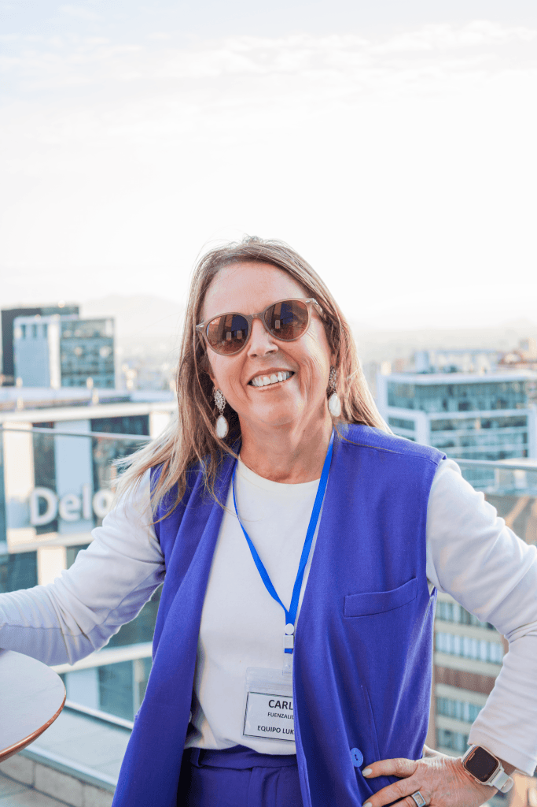

**Lukkap Chile**, reconocida como una **Empresa B** experta en **Outplacement y Coaching**, se posiciona como la filial local de la mayor red internacional de _outplacement_ (CSG), destacando por su enfoque en acompañar las transiciones laborales con un profundo **impacto humano** y **resultados medibles**. Con una sólida trayectoria de más de 13 años en el país, un historial que incluye más de 450 empresas atendidas y la ejecución de más de 4.000 programas individuales, Lukkap se ha consolidado como un actor esencial para abordar la actual **urgencia demográfica** y revalorizar el **Talento Senior en Chile**. Por esta razón, y para profundizar en cómo la experiencia puede transformar el futuro del trabajo, hemos entrevistado en exclusiva a **Carla Fuenzalida**, su Directora Ejecutiva.

* * *

## I. El Desafío Demográfico y la Urgencia de la Economía Plateada

El acelerado envejecimiento de la población chilena ya no es una proyección, sino una realidad urgente. Actualmente, uno de cada cinco chilenos tiene 60 años o más, una cifra que se proyecta a uno de cada tres para 2050 si la tendencia continúa. Este cambio estructural exige redefinir el rol del Talento Senior, no solo como consumidores, sino como un pilar crucial de la **Sostenibilidad Social (S)** en el marco **ESG**.

**Tiempos Sustentables:** El diagnóstico es claro: Chile envejece rápidamente. ¿Ignorar la Economía Plateada representa un "riesgo país" para la sostenibilidad del sistema de pensiones y del mercado laboral?

### Carla Fuenzalida - Diagnóstico Urgente

> "Ignorar la Economía Plateada sí representa un riesgo país, tanto para la sostenibilidad del sistema de pensiones, como para el funcionamiento del mercado laboral."
> 
> "Chile tiene excelentes indicadores de esperanza de vida (más de 81 años) , pero justamente esa buena noticia nos obliga a actuar rápido."
> 
> "Esto significa que la mayoría de las personas deberá autofinanciar 20 años o más de vida después de la jubilación legal, mientras las generaciones jóvenes disminuyen aceleradamente. El efecto es claro: el mercado laboral experimentará un cambio estructural en su composición etaria, con impactos directos en consumo, productividad y en la sostenibilidad del sistema previsional. No anticiparse a este cambio es, literalmente, un riesgo país."

****Tiempos Sustentables**:** Una estadística es muy preocupante: el 70% de los desempleados mayores de 55 años creen que no volverán a trabajar. ¿Qué tan grave es este "sentimiento de obsolescencia" y cuál es el impacto social y psicológico de este desperdicio de talento en la sociedad?

### Carla Fuenzalida - El Impacto del Desperdicio de Talento

> "Dentro de los perfiles profesionales y ejecutivos con los que Lukkap se relaciona, este 70% es una realidad en la percepción de las personas. Ronda en el mercado laboral la frase 'es que después de los 50 es muy difícil que te contraten'."
> 
> "Y como cualquier creencia limitante, tiene un gran impacto social y sicológico ya que nos cuesta mucho ir en contra de lo que creemos es una certeza."
> 
> "Lo que hacemos principalmente en Lukkap es tratar de mostrar que quienes tienen una oferta de valor atractiva para el mercado, seguirán siendo considerados y que tener esta oferta atractiva está dentro de la acción de cada uno. En otras palabras, pasar al ¿Qué puedo hacer yo para tener espacio en el mercado? "

****Tiempos Sustentables**:** ¿Cuáles son los dos mitos más dañinos sobre el talento senior (costos, tecnología, flexibilidad) que frenan su contratación en las empresas chilenas?

### Carla Fuenzalida - El Miedo del Empresariado (Sesgo Inconsciente)

> "En las empresas no se discute el tema en forma estructurada ... Pero cuando les preguntas cuando fue la última vez que entró alguien sobre 60, casi ninguno puede responder afirmativamente."
> 
> "Creemos que el sesgo -que por lo tanto es inconsciente- tiene que ver en primer lugar con la tecnología y la flexibilidad, pero también en muchos casos subyace el concepto de 'ya no tiene hambre'."

* * *

## II. Lukkap y el Valor Estratégico de la Experiencia

****Tiempos Sustentables**:** Lukkap promueve el "Tercer Tiempo Laboral". ¿Qué metodología o proceso innovador utilizan para que el talento post-60 años mantenga su pertinencia laboral y siga siendo un motor productivo?

### Carla Fuenzalida - Redefiniendo la Pertinencia Laboral

> "Lo que hacemos es acompañar a las personas en la definición de su oferta laboral, a continuación, en la búsqueda de los espacios del mercado donde ésta puede tener espacio y luego ajustando hasta llegar a concretar un conjunto de actividades que a la persona le acomoden y le permitan seguir siendo parte del mercado laboral."
> 
> "De hecho, estamos relanzando un Programa Tu Mayor Activo, una iniciativa diseñada especialmente para profesionales sobre los 55 años que buscan proyectar un 'tercer tiempo laboral' con claridad, propósito y nuevas oportunidades en el marco de la economía plateada."
> 
> "El programa acompaña a las personas antes y después de su desvinculación, integrando planificación, identidad, redes, finanzas y caminos alternativos de contribución profesional."

****Tiempos Sustentables**:** En la era de la IA y el cambio constante, ¿qué habilidades blandas o capital de experiencia aporta el talento senior que es irremplazable por otras generaciones o por la tecnología?

### Carla Fuenzalida - El Activo Estratégico

> "Haber vivido una situación, ver cómo se desarrolla, cómo impacta en algunos lugares de las organizaciones y qué teclas deben moverse para lograr resultados deseados no pueden buscarse en IA."
> 
> "Los procesos, las vivencias, los contactos no son reemplazables (al menos todavía no)."

****Tiempos Sustentables**:** ¿Qué datos de éxito tiene Lukkap sobre la reinserción de profesionales senior y a qué tipo de roles o formatos de trabajo (part-time, consultoría) se están orientando con mayor frecuencia?

### Carla Fuenzalida - Medición de Impacto

> "Nosotros acompañamos a las personas, para que pueda maximizar sus oportunidades en el proceso, y lo hacemos hasta que resuelven su situación, por lo cual nuestros datos de éxito son cercanos a 100%."
> 
> "Pero obviamente la materia prima es la persona: su talento, su trayectoria y sus habilidades blandas, sobre eso trabajamos."
> 
> "Se están orientando con mayor frecuencia a roles de _part-time_ y consultoría (basado en la pregunta original que menciona estos formatos como foco).**"**

* * *

## III. Sostenibilidad y el Nuevo Mandato ESG

****Tiempos Sustentables**:** Considerando la importancia de la Sostenibilidad Social (S) , ¿por qué la inclusión activa del Talento Senior es una política más fundamental que la simple filantropía y debe ser un factor de evaluación para inversionistas ESG en Chile?

### Carla Fuenzalida - El Lente ESG

> "En Chile, el envejecimiento acelerado implica que una parte creciente de la fuerza laboral estará sobre los 55 años a corto plazo."
> 
> "Si las empresas no integran a este grupo, pierden experiencia crítica, reducen productividad y trasladan costos al Estado, afectando la estabilidad del sistema de pensiones y del mercado laboral."
> 
> "Para los inversionistas ESG, esta variable es clave:" \* **Mitiga riesgos operacionales:** Disminuye rotación, retiene conocimiento y asegura continuidad operacional. \* **Fortalece gobernanza laboral:** Demuestra gestión activa de diversidad etaria, hoy ausente en la mayoría de las empresas. \* **Impacta resultados financieros:** Las compañías con equipos diversos en edad toman mejores decisiones y tienen mayor resiliencia. \* **Reduce riesgo reputacional y regulatorio:** El mundo avanza hacia estándares de no discriminación por edad.
> 
> "Por eso, la inclusión del Talento Senior debe ser un criterio de evaluación ESG: porque afecta productividad, impacto social real y viabilidad a largo plazo del negocio. Debe ser parte de la estrategia."

****Tiempos Sustentables**:** ¿Qué medidas concretas deben implementar las empresas chilenas para crear un ecosistema laboral intergeneracional sostenible?

### Carla Fuenzalida - Estrategias de Largo Plazo (Acción para CEOs)

> "El mentoring inverso (o hacia ambos lados) es una herramienta interesante, también lo son los esquemas de trabajo flexible, la capacitación en nuevas tecnologías."
> 
> "Pero creo que lo más importante es que las empresas desarrollen estructuras organizacionales donde se incorpore la posibilidad de tener un rol diferente al 'ascendente' y que esté en línea con las competencias de las personas senior."
> 
> "Por ejemplo, desarrollo de proyectos específicos, supervisión de determinados temas, todo lo relacionado a gestión del cambio, entre muchas opciones que pueden ir en forma paralela al organigrama normal, y que le dan continuidad a la carrera."

****Tiempos Sustentables**:** Si la Economía Plateada es el futuro, ¿cuál es el principal desafío regulatorio o cultural que Chile debe resolver en los próximos 5 años para asegurar que este segmento poblacional sea un motor de crecimiento y no una carga social?

### Carla Fuenzalida - La Visión de Futuro

> "De acuerdo a todos los estudios, las personas mayores quieren seguir activas y más de un 70% de ellas, quiere hacerlo por motivos más allá de lo económico, que tienen relación con seguir aportando, sentirse parte, mantenerse vigente."
> 
> "A nivel regulatorio, todos los avances en materia de flexibilidad laboral serán un motor de crecimiento de la fuerza laboral senior (efectivamente se demandan horarios menos extensos y en horarios compatibles con algunas dificultades básicas)."
> 
> "A nivel cultural, se requiere combatir el edadismo por todos los medios, abriendo opciones en las organizaciones, que permitan mostrar el valor de la experiencia y el know how."

* * *

## 📣 Conclusión: La Hoja de Ruta para una Sostenibilidad Inclusiva

El mensaje de Carla Fuenzalida es claro y contundente: la inclusión del Talento Senior no es un acto de filantropía, sino una **necesidad estratégica de negocio** y un pilar clave para la sostenibilidad social (S) del sistema ESG en Chile.

**Para los CEOs y líderes de Sostenibilidad, la acción inmediata es doble:**

1. **Combatir el Edadismo Cultural:** Desarrollar estrategias activas que demuestren el valor de la experiencia y el _know-how_ , reconociendo que la falta de integración afecta la productividad y traslada costos al Estado.

3. **Rediseñar la Estructura Laboral:** Implementar el _mentoring_ inverso y, crucialmente, crear **roles paralelos al organigrama** (como supervisión de proyectos específicos o gestión del cambio ), que permitan la continuidad de la carrera y mitiguen riesgos operacionales, como la pérdida de conocimiento.

El futuro sostenible exige aprovechar la **Economía Plateada** como un motor de crecimiento. Depende de las empresas y el marco regulatorio asegurar que esta población, que desea seguir activa y aportando, encuentre el espacio y la flexibilidad necesarios para impulsar el desarrollo del país.

* * *

**Carla Fuenzalida**

Directora Ejecutiva de Lukkap Chile
