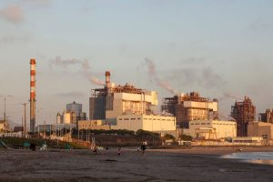
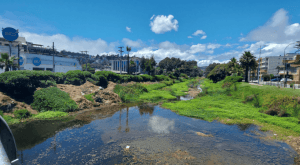
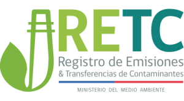

## **Un Reportaje Investigativo sobre la Nueva Gobernanza Ambiental en Chile.**

La historia ambiental de Chile ha sido un relato de contrastes marcados: el ímpetu económico impulsado por la minería, a menudo a expensas de la salud comunitaria y los ecosistemas, frente a una institucionalidad que ha luchado por ponerse al día. Sin embargo, ayer, 14 de agosto de 2025 se perfila como una fecha trascendental, un verdadero punto de inflexión en esta narrativa. Ese día, el Ministerio del Medio Ambiente (MMA) de Chile anunció un conjunto de medidas que, lejos de ser eventos aislados, establecen los pilares de una estrategia de gobernanza ambiental más sólida y coherente.

<figure>

<figcaption>

Fundición de cobre chilena - Codelco y Enami

</figcaption>

</figure>

La aprobación de una **nueva y más estricta norma de emisión para las fundiciones de cobre**, la **declaración del Estero Reñaca como humedal urbano protegido**, y la **actualización del Reglamento del Registro de Emisiones y Transferencias de Contaminantes (RETC)** conforman las tres puntas de un mismo triángulo. Este reportaje investigativo analizará cómo estos instrumentos se entrelazan no solo para abordar problemas específicos, sino para materializar un plan estratégico más ambicioso: la "Transición Socio-Ecológica Justa". Al alinear el desarrollo económico con la protección de la salud pública y la biodiversidad, y fortalecer compromisos internacionales como la Ley Marco de Cambio Climático y el Acuerdo de Escazú, Chile parece estar trazando una nueva hoja de ruta hacia la sostenibilidad.

* * *

### **El Costo del Cobre: El Fin de una Era para la Contaminación Minera**

#### **La Nueva Norma de Emisión y sus Implicaciones**

El Consejo de Ministros para la Sustentabilidad ha dado un paso decisivo con la aprobación de una nueva norma de emisión para las fundiciones de cobre y otras fuentes que emiten arsénico. Anunciada el 14 de agosto de 2025, esta regulación establece exigencias considerablemente más estrictas que las existentes, buscando una **reducción significativa de contaminantes atmosféricos** como el material particulado (MP), el dióxido de azufre (SO2), el arsénico (As) y el mercurio (Hg). Su objetivo primordial es proteger la salud de las personas y el medio ambiente en todo el territorio nacional, marcando un hito en la gestión de la calidad del aire.

Esta nueva normativa, resultado de la revisión del Decreto Supremo N° 28 de 2013, propone **límites de emisión diferenciados y una implementación gradual** tanto para fuentes existentes como nuevas. Fundiciones operativas como Altonorte, Caletones, Chagres, Chuquicamata, Hernán Videla Lira, Potrerillos y Ventanas son las principales sujetas a esta regulación. El MMA destacó que, en su primera etapa, la norma congelará las emisiones actuales y, en algunas fuentes, los límites propuestos representan **reducciones de hasta 29% en SO2 y 41% en As**. Adicionalmente, las fuentes existentes deberán capturar y fijar anualmente al menos el 95% de azufre y arsénico, mientras que las nuevas deberán alcanzar el 99.5% y utilizar las mejores tecnologías disponibles.

La implementación gradual y los límites diferenciados son una **estrategia de política pública pragmática** que encarna la "Transición Socio-Ecológica Justa". Esta aproximación busca evitar un colapso inmediato de la industria minera, que es un pilar fundamental de la economía chilena, a la vez que impone un camino claro y exigente hacia la modernización y la reducción de la contaminación. Este enfoque contrasta con respuestas anteriores, que solían ser reactivas y parciales. La nueva norma se alinea con una tendencia global, como el endurecimiento de requisitos en países como China, sugiriendo que la sostenibilidad es ahora un factor de competitividad y acceso a mercados.

* * *

A continuación, se presenta una comparación de los límites y requisitos clave de la antigua y la nueva normativa:

##### **Tabla 1.1: Comparación de la Norma de Emisión para Fundiciones de Cobre: DS N°28 (2013) vs. Nueva Norma (2025)**

| Contaminante | Norma de 2013 (DS N°28) | Nueva Norma (2025) (fuentes existentes) | Porcentaje de Captura y Fijación | Plazos de Cumplimiento |
| --- | --- | --- | --- | --- |
| **Dióxido de Azufre (SO2)** | Planta de ácido: ≤600 ppm | Reducciones de hasta 29% | ≥95% | 3 o 5 años desde la publicación, dependiendo de la tecnología |
| **Arsénico (As)** | Planta de ácido: ≤1 mg/Nm3 | Reducciones de hasta 41% | ≥95% | 3 o 5 años desde la publicación |
| **Material Particulado (MP)** | Secadores y hornos: ≤50 mg/Nm3 | Límites más estrictos propuestos | N/A | 3 o 5 años desde la publicación |

* * *

#### **El Eco de la Historia: Quintero-Puchuncaví como Caso Emblema**

<figure>

<figcaption>

Zonas de sacrificio. ventanas-puchuncavi.

</figcaption>

</figure>

Para comprender la urgencia y el significado de la nueva norma, es indispensable mirar hacia el pasado. La Bahía de Quintero-Puchuncaví, conocida como una de las "zonas de sacrificio" de Chile, se erige como el caso más emblemático de un fracaso normativo sostenido. La Fundición Ventanas, inaugurada en 1964 sin un sistema de captura de emisiones, cuenta con un historial de más de 50 años de conflictos ambientales, incluyendo denuncias por pérdida de cultivos, protestas ciudadanas y episodios de intoxicación masiva.

El punto de quiebre más reciente ocurrió en 2018, cuando una serie de episodios de contaminación causaron la **intoxicación de cerca de 350 personas**, en su mayoría estudiantes. Estos eventos, sumados a las constantes alertas ambientales, impulsaron la presión de organizaciones como Greenpeace y campañas legales, escalando hasta que, finalmente, se decidió el cierre de la fundición de Codelco Ventanas.

El cierre de la Fundición Ventanas, descrito como un "ejemplo del fracaso de normas y remaches", es el antecedente directo que impulsó la nueva política. La norma de 2025 no es una solución puntual a una crisis específica, sino una **respuesta sistémica a un problema que el Estado no pudo resolver durante décadas** con regulaciones fragmentadas. La nueva regulación busca prevenir la creación de futuras "zonas de sacrificio" al establecer un estándar de cumplimiento que, en retrospectiva, era necesario desde hace mucho tiempo.

* * *

### **Un Ecosistema a Salvo: La Lucha por el Humedal Estero Reñaca y el Rol de la Comunidad**

#### **Un Anuncio de Protección con Nombre y Apellido**

En un acto que contrasta con la historia industrial de sacrificio, el 12 de agosto de 2025, el Ministerio del Medio Ambiente anunció la **declaración oficial del Estero Reñaca como humedal urbano** en la Región de Valparaíso. Este anuncio suma **16.9 hectáreas de superficie protegida**, siendo el humedal urbano número 134 del país y el segundo en Viña del Mar. La Ministra Maisa Rojas lo calificó como un “símbolo de conservación y trabajo colaborativo” y un logro “largamente esperado por la comunidad organizada”.

<figure>

<figcaption>

Estero Reñaca - Humedal chileno

</figcaption>

</figure>

Este evento es un claro ejemplo de la efectividad de la Ley de Humedales Urbanos (Ley 21.202) cuando se combina con el activismo ciudadano. La protección del Estero Reñaca no fue un acto unilateral del gobierno, sino la culminación de un proceso impulsado por la comunidad local y expertos como el geógrafo Esteban Araya, quienes visibilizaron el grave estado de deterioro del ecosistema y la urgente necesidad de protección. La declaración evidencia un cambio en el poder de decisión, donde las comunidades, armadas con herramientas legales, pueden influir directamente en la protección de su patrimonio natural.

#### **La Vitalidad Silenciosa del Humedal: Infraestructura Ecológica para la Ciudad**

La importancia ecológica de los humedales urbanos va mucho más allá de ser un simple refugio para la biodiversidad. El Estero Reñaca, por ejemplo, es un hábitat para especies como la garza grande (_Ardea alba_) y el huairavo (_Nycticorax nycticorax_). Sin embargo, su valor más profundo radica en su función como **"infraestructura ecológica" esencial para las ciudades**.

Los beneficios que proporcionan estos ecosistemas son multifacéticos: ayudan en el **control de inundaciones**, retienen contaminantes, mitigan los efectos del cambio climático y ofrecen espacios para la recreación y el turismo. La Ley de Humedales Urbanos representa un cambio de paradigma en la planificación territorial. Históricamente, estos terrenos eran vistos como baldíos aptos para la construcción, pero ahora, la ley obliga a las municipalidades a reconocer y valorar los servicios ecosistémicos que proveen, por encima del valor inmobiliario. El caso del Estero Reñaca sirve como un modelo a seguir para otras comunidades que buscan la protección de sus espacios naturales.

#### **La Ley 21.202 y el Poder Local: Un Nuevo Marco para la Gestión**

La Ley 21.202 faculta al Ministerio del Medio Ambiente para declarar humedales urbanos "de oficio" o "a solicitud de los municipios". Este proceso requiere la recopilación de información técnica y el cumplimiento de criterios de delimitación como la presencia de vegetación hidrófita o suelos hídricos. La normativa también promueve la creación de Comités de Gobernanza que facilitan una gestión participativa.

La declaración del Estero Reñaca, sumada a la nueva norma para fundiciones, evidencia una estrategia estatal integral. Mientras la normativa minera busca controlar las fuentes de contaminación industrial, la ley de humedales protege los receptores de dicha contaminación. Este enfoque holístico **refuerza la institucionalidad ambiental**, creando un sistema coherente de regulación y conservación que supera la fragmentación y los "parches" del pasado, fortaleciendo así la capacidad del Estado para abordar la "triple crisis" de cambio climático, pérdida de biodiversidad y contaminación.

* * *

### **La Transparencia como Herramienta: El Nuevo RETC y el Legado de Escazú**

#### **Democratizando la Información: La Actualización del Reglamento RETC**

La tercera pieza de este marco de gobernanza es la **actualización del Reglamento del Registro de Emisiones y Transferencias de Contaminantes (RETC)**, aprobada por el Consejo de Ministros el 14 de agosto de 2025. El objetivo es consolidar el RETC como una herramienta integral de información ambiental, alineada con la Ley Marco de Cambio Climático y el Acuerdo de Escazú. Esta modificación busca "democratizar el acceso a la información, mejorar la calidad de los datos, integrar diferentes sistemas y actualizar la normativa" .

Una de las principales innovaciones es la creación de una **"Ventanilla Única"**, un formulario único de reporte para la industria. Esta medida no solo simplifica el proceso de declaración para las empresas, sino que centraliza la información para los fiscalizadores y el público, facilitando su homologación y análisis. Además, el anteproyecto propone una reorganización del reglamento y la incorporación de contaminantes no regulados, mejorando la trazabilidad y la calidad de los datos para la elaboración de políticas públicas y la fiscalización.

#### **Un Marco Legal para la Participación: El Vínculo con Escazú y la Ley Climática**

El nuevo reglamento del RETC es la manifestación concreta del **compromiso de Chile con el Acuerdo de Escazú**. Es importante recordar que Chile inicialmente no suscribió el acuerdo, pero la actual administración lo ratificó, calificando la omisión como un "error" que afectaba la capacidad de abordar la crisis ecológica.

<figure>

<figcaption>

Registro de Emisiones y Transferencias de Contaminantes (RETC)

</figcaption>

</figure>

El RETC es la herramienta fundamental para cumplir con los principios de Escazú: **garantizar el derecho de acceso a la información ambiental**, promover la participación pública en la toma de decisiones y facilitar el acceso a la justicia ambiental. La Ventanilla Única es el mecanismo que permite a la industria declarar sus emisiones de manera estandarizada, proporcionando los datos necesarios para que la Ley de Cambio Climático sea fiscalizable y el Acuerdo de Escazú sea operativo. Esta interdependencia de los instrumentos legales y administrativos evidencia la solidez del nuevo marco de gobernanza, que busca superar los "parches" del pasado y construir una política ambiental coherente y sistemática.

Sin embargo, en el camino hacia esta "democracia ambiental", surge una tensión. Si bien se enfatiza la participación ciudadana, la investigación muestra una aparente contradicción: los comentarios y observaciones de las consultas públicas, tanto para el RETC como para la norma de fundiciones, no están fácilmente accesibles al público. Este vacío en la documentación del proceso participativo plantea interrogantes sobre la profundidad real de la transparencia que se busca construir y sirve como un recordatorio de los desafíos que aún persisten en la implementación de estos nuevos marcos.

* * *

##### **Tabla 3.1: El Impacto del Nuevo RETC en la Gobernanza Ambiental**

| Actor | Beneficios Clave | Conexión con los instrumentos de Gobernanza |
| --- | --- | --- |
| **Ciudadanía** | Acceso fácil a información sobre contaminantes y riesgos para la salud, participación informada. | Cumplimiento del derecho de acceso a la información del Acuerdo de Escazú. |
| **Gobierno** | Mejora de la eficiencia en la captura de datos, normalización de nomenclaturas y fiscalización más efectiva. | Apoyo para la adopción de políticas públicas y el cumplimiento de compromisos internacionales. |
| **Industria** | Simplificación del proceso de reporte a través de la Ventanilla Única, centralización de los certificados de declaración. | Fomento de la reducción de emisiones y adopción de mecanismos de producción limpia. |

* * *

## **Conclusiones: La Nueva Hoja de Ruta de la Sostenibilidad Chilena**

La convergencia de estas tres políticas – la norma de fundiciones, la protección de humedales y la actualización del RETC – no es una coincidencia. Es la materialización de un plan estratégico que busca **fortalecer la institucionalidad ambiental de Chile de manera integral y coherente**. El gobierno ha trazado una nueva hoja de ruta para la sostenibilidad, basada en tres pilares interdependientes: **una regulación más exigente** para las industrias más contaminantes, **la conservación proactiva** de ecosistemas urbanos clave, y **una mayor transparencia** como herramienta para la participación y la fiscalización.

El nuevo marco de gobernanza ambiental demuestra un aprendizaje del pasado. Se ha pasado de una política reactiva y de "parches" a una estrategia proactiva que busca prevenir futuros conflictos. El cierre de la fundición Ventanas fue una dolorosa lección que impulsó la creación de una norma sistémica, mientras que la Ley de Humedales Urbanos empoderó a las comunidades para proteger sus territorios. A su vez, la actualización del RETC es el engranaje que da operatividad y transparencia a todo el sistema, consolidando los derechos de acceso a la información y participación ciudadana consagrados en el Acuerdo de Escazú.

El éxito de esta nueva visión dependerá de su implementación efectiva. El Estado debe garantizar la capacidad de fiscalización, la industria debe asumir el desafío de la modernización como una condición para su competitividad, y la ciudadanía debe consolidar su rol activo en la gobernanza. La "Transición Socio-Ecológica Justa" es, en esencia, un proyecto de largo aliento que apenas comienza a tomar forma, con el potencial de redefinir el desarrollo de Chile, superando el legado de las zonas de sacrificio para construir un futuro más sostenible y equitativo.

* * *

## DOCUMENTOS CITADOS

- **Resolución 6429 EXENTA APRUEBA ANTEPROYECTO DE LA NORMA DE EMISIÓN PARA FUNDICIONES DE COBRE Y FUENTES EMISORAS DE ARSÉNICO, ELABORADO A PARTIR DE LA REVISIÓN DEL DECRETO SUPREMO Nº 28, DE 2013, DEL MINISTERIO DEL MEDIO AMBIENTE, Y LO SOMETE A CONSULTA PÚBLICA - BCN**, [https://www.bcn.cl/leychile/Navegar?idNorma=1208671&idVersion=2024-11-23](https://www.bcn.cl/leychile/Navegar?idNorma=1208671&idVersion=2024-11-23)

- **Ley Chile - Decreto 28 12-DIC-2013 MINISTERIO DEL ... - BCN**, [https://www.bcn.cl/leychile/Navegar?idNorma=1057059](https://www.bcn.cl/leychile/Navegar?idNorma=1057059)

- **Decreto 28, MEDIO (2013) - Santiago - Ley Chile**, [https://nuevo.leychile.cl/servicios/Consulta/Exportar?radioExportar=Normas&exportar\_formato=pdf&nombrearchivo=Decreto-28\_12-DIC-2013&exportar\_con\_notas\_bcn=False&exportar\_con\_notas\_originales=False&exportar\_con\_notas\_al\_pie=False&hddResultadoExportar=1057059.2013-12-12.0.0%23](https://nuevo.leychile.cl/servicios/Consulta/Exportar?radioExportar=Normas&exportar_formato=pdf&nombrearchivo=Decreto-28_12-DIC-2013&exportar_con_notas_bcn=False&exportar_con_notas_originales=False&exportar_con_notas_al_pie=False&hddResultadoExportar=1057059.2013-12-12.0.0%23)

- **Guía para la Protección de Humedales por Gobiernos Locales - Fima**, [https://www.fima.cl/wp-content/uploads/2023/12/guia-municipio-verde-humedales.pdf](https://www.fima.cl/wp-content/uploads/2023/12/guia-municipio-verde-humedales.pdf)

- **Ley Chile - Decreto 1 (02-may-2013) M. del Medio Ambiente - BCN**, [https://www.bcn.cl/leychile/navegar?idNorma=1050536](https://www.bcn.cl/leychile/navegar?idNorma=1050536)

- **Reglamento del Registro de Emisiones y Transferencia de Contaminantes (RETC) “Nuevos objetivos, obligaciones y beneficios”. - Consultoría Ambiental,**

- **El Acuerdo de Escazú - BCN**, [https://obtienearchivo.bcn.cl/obtienearchivo?id=repositorio/10221/29037/1/Acuerdo\_de\_Escazu\_rev\_BH.pdf](https://obtienearchivo.bcn.cl/obtienearchivo?id=repositorio/10221/29037/1/Acuerdo_de_Escazu_rev_BH.pdf)

- **Plan Nacional de Implementación Participativa del Acuerdo de Escazú 2024-2030 - Ministerio del Medio Ambiente**, [https://mma.gob.cl/wp-content/uploads/2024/04/Plan-Nacional-de-implementacion-participativa-del-Acuerdo-de-Escazu-Chile-2024-2030.pdf](https://mma.gob.cl/wp-content/uploads/2024/04/Plan-Nacional-de-implementacion-participativa-del-Acuerdo-de-Escazu-Chile-2024-2030.pdf)

- **Decreto 1 APRUEBA REGLAMENTO DEL REGISTRO DE EMISIONES Y TRANSFERENCIAS DE CONTAMINANTES, RETC - BCN**, [https://www.bcn.cl/leychile/Navegar?idNorma=1050536](https://www.bcn.cl/leychile/Navegar?idNorma=1050536)

## REPORTAJES Y NOTAS CITADAS

- **Ministerio del Medio Ambiente**, [https://mma.gob.cl/consejo-de-ministros-aprueba-nueva-norma-de-emision-para-fundiciones-de-cobre-y-fuentes-emisoras-de-arsenico/](https://mma.gob.cl/consejo-de-ministros-aprueba-nueva-norma-de-emision-para-fundiciones-de-cobre-y-fuentes-emisoras-de-arsenico/)

- **Ministerio del Medio Ambiente**, [https://mma.gob.cl/reconocimos-un-nuevo-humedal-urbano-en-la-region-de-valparaiso-ministra-rojas-anuncia-proteccion-para-estero-renaca/](https://mma.gob.cl/reconocimos-un-nuevo-humedal-urbano-en-la-region-de-valparaiso-ministra-rojas-anuncia-proteccion-para-estero-renaca/)

- **Ministerio del Medio Ambiente**, [https://gefhumedales.mma.gob.cl/preguntas-frecuentes-ley-de-humedales-urbanos/](https://gefhumedales.mma.gob.cl/preguntas-frecuentes-ley-de-humedales-urbanos/)

- **Ministerio del Medio Ambiente**, [https://mma.gob.cl/consejo-de-ministros-aprueba-actualizacion-del-reglamento-del-registro-de-emisiones-y-transferencias-de-contaminantes-retc/](https://mma.gob.cl/consejo-de-ministros-aprueba-actualizacion-del-reglamento-del-registro-de-emisiones-y-transferencias-de-contaminantes-retc/)

- **Ministerio del Medio Ambiente**, [https://mma.gob.cl/medio-ambiente-inicia-consulta-publica-para-modificacion-del-reglamento-del-registro-de-emisiones-y-transferencias-de-contaminantes-retc/](https://mma.gob.cl/medio-ambiente-inicia-consulta-publica-para-modificacion-del-reglamento-del-registro-de-emisiones-y-transferencias-de-contaminantes-retc/)

- **Ministerio del Medio Ambiente**, [https://consultasciudadanas.mma.gob.cl/portal/consulta/72](https://consultasciudadanas.mma.gob.cl/portal/consulta/72)

- **Ministerio del Medio Ambiente**, [https://retc.mma.gob.cl/](https://retc.mma.gob.cl/)

- **Memoria Chilena**, [https://www.memoriachilena.gob.cl/wiki/portadaut\_elimpactoambientaldelamineriaenchile.php](https://www.memoriachilena.gob.cl/wiki/portadaut_elimpactoambientaldelamineriaenchile.php)

- **Mineduc**, [https://emergenciaydesastres.mineduc.cl/alerta-ambiental-quintero-puchuncavi/](https://emergenciaydesastres.mineduc.cl/alerta-ambiental-quintero-puchuncavi/)

- **Defensoría Climática**, [https://www.defensoriaclimatica.cl/pagina/caso-quintero-puchuncavi](https://www.defensoriaclimatica.cl/pagina/caso-quintero-puchuncavi)

- **Codar**, [https://www.codar.cl/index/estero-de-renaca-y-su-condicion-de-humedal/](https://www.codar.cl/index/estero-de-renaca-y-su-condicion-de-humedal/)

- **BCN**, [https://www.bcn.cl/leychile/navegar?idNorma=1183363](https://www.bcn.cl/leychile/navegar?idNorma=1183363)

- **BCN**,[https://www.bcn.cl/historiadelaley/historia-de-la-ley/vista-expandida/8067/](https://www.bcn.cl/historiadelaley/historia-de-la-ley/vista-expandida/8067/)

- **Greenpeace Chile**, [https://www.greenpeace.org/chile/blog/issues/climayenergia/celebramos-el-cierre-de-la-fundicion-ventanas-una-de-las-principales-fuentes-de-contaminacion-de-nuestra-historia/](https://www.greenpeace.org/chile/blog/issues/climayenergia/celebramos-el-cierre-de-la-fundicion-ventanas-una-de-las-principales-fuentes-de-contaminacion-de-nuestra-historia/)

* * *

