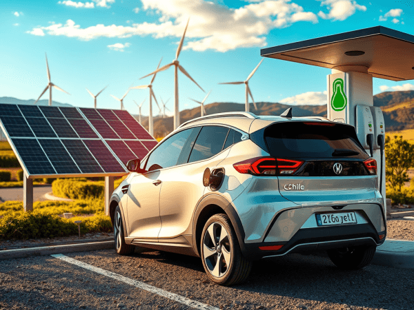
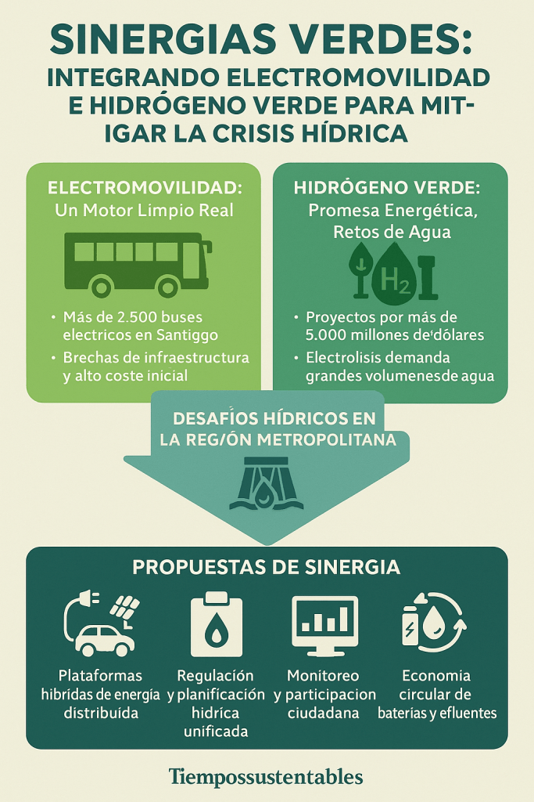

La transición hacia un modelo energético limpio, en Chile, requiere articular dos ejes fundamentales: **_la electromovilidad y el hidrógeno verde_**. Ambos impulsos ofrecen beneficios ambientales y económicos. Sin embargo, la realidad de la mega-sequía en la Región Metropolitana plantea interrogantes sobre su viabilidad conjunta. En este análisis propongo un enfoque integrado que potencia sinergias y minimiza tensiones hídricas, sociales y ecológicas.

## 1\. Electromovilidad: un motor limpio con alcance regional

La movilidad eléctrica se ha consolidado como un pilar estratégico en la lucha contra el cambio climático. Como bien apuntó **Carolina Schmidt**, _“Para enfrentar de manera decisiva el cambio climático, la electromovilidad es fundamental. Estamos dando un salto hacia un sistema de transporte más limpio, eficiente y sostenible.”_ Chile destaca especialmente en transporte público: _“Hoy tenemos más de 2.500 buses eléctricos en Santiago, y esperamos superar los 3.500 al final de este periodo de gobierno”_, afirmó **Juan Carlos Muñoz**, subrayando el liderazgo nacional en flotas cero emisión. [Revisar artículo: "Cómo Chile Lidera la Electromovilidad en Latinoamérica"](https://tiempossustentables.cl/2025/05/13/como-chile-lidera-la-electromovilidad-en-latinoamerica/)

En 2024, el mercado chileno de automóviles eléctricos experimentó un crecimiento significativo. Hubo un aumento del 183% en las ventas respecto al año anterior, alcanzando 4.500 unidades que representan el 6,2% del total de autos vendidos en el país. Este incremento estuvo acompañado de una notable diversificación en la oferta. Se pasó de 30 marcas y 72 modelos en 2023 a 50 marcas y 140 modelos disponibles en 2024. Los precios también disminuyeron. Hay opciones accesibles por debajo de los 19 millones de pesos. Algunas cuestan incluso alrededor de los 12,2 millones de pesos chilenos.

El notable avance en la adopción de vehículos eléctricos en Chile es evidente. Sin embargo, hay desafíos de infraestructura en el despliegue de puntos de recarga. La masificación de vehículos privados conlleva costos iniciales elevados. La infraestructura de carga ha mejorado con la adopción de conectores europeos y la instalación de más de 3.000 puntos de carga públicos y privados. Un tercio de ellos se implementaron en 2024. Para lograr una electromovilidad inclusiva, resulta crucial combinar incentivos estatales. Es importante establecer alianzas público-privadas que impulsen la instalación de cargadores tanto en zonas periurbanas como en rutas interregionales.

## 2\. Hidrógeno verde: promesa energética con retos de agua

En 2024, según **Reuters**, la cartera de proyectos de inversión extranjera en Chile aumentó un 68% interanual, alcanzando los 56.234 millones de dólares. **InvestChile** reportó que hay 474 proyectos en varias etapas de desarrollo. El sector Energía destaca con la mayor inversión. Estados Unidos es el principal país inversor. El crecimiento se debe en gran medida a los proyectos de hidrógeno verde, que totalizaron 25.617 millones de dólares.

El hidrógeno verde representa la próxima frontera de la descarbonización. Según el **European Investment Bank**, _“Chile tiene ambiciosos planes en ámbitos de energías renovables.” Chile también tiene planes de hidrógeno verde.”_ Estos planes están respaldados por más de 75 proyectos. Además, más de 5.000 millones de dólares están comprometidos. El potencial exportador es significativo. La generación de empleo podría alcanzar hasta 94.000 puestos para 2050. Esto convierte esta industria en un pilar de diversificación de la matriz productiva. [Revisar el artículo: "Chile y el hidrógeno verde: oportunidades y desafíos"](https://tiempossustentables.cl/2025/05/14/chile-y-el-hidrogeno-verde-oportunidades-y-desafios/)

No obstante, la electrólisis demanda grandes volúmenes de agua en un país inmerso en mega-sequía. Tal como advierte el **Dr. Pablo García‑Chevesich**, en su Charla de **Congreso Futuro** 2025: _“Chile debe entender que el agua no es infinita ni garantizada. Estamos frente a un cambio estructural del clima, y sin una reforma profunda del Código de Aguas... seguiremos agravando esta crisis”_ [Revisar el artículo: "La crisis hídrica en Santiago y el impacto del hidrógeno verde"](https://tiempossustentables.cl/2025/05/15/la-crisis-hidrica-en-santiago-y-el-impacto-del-hidrogeno-verde/)

Según el **Banco Mundial**, los instrumentos económicos pueden ayudar a fomentar el hidrógeno verde en Chile. Esto podría impulsar la economía del país. Esto resultaría en un incremento del 4% en el PIB. También se generarían 50.000 empleos.

## 3\. Desafíos hídricos en la Región Metropolitana

En Santiago, la mega-sequía lleva más de una década retando la gestión hídrica. Embalses en niveles críticos y retroceso glaciar presionan el suministro urbano y rural. La propuesta de usar agua desalinizada o tratada puede aliviar la demanda. Sin embargo, la generación de salmuera requiere un manejo ambiental regulado rigurosamente. Además, el consumo energético de las plantas necesita regulación estricta.

El **Dr. Marcelo Mena**, en su charla **Congreso Futuro** 2024, recuerda que _“Debemos elegir un modelo de transición. No debemos repetir los errores extractivistas del pasado. La energía del futuro no puede construirse sobre territorios que quedan sin agua.”_ Este es un llamado a la cautela y a la justicia territorial. Señala la necesidad de políticas que equilibren la generación limpia con la preservación de recursos vitales.

## 4\. Propuestas de sinergia para un modelo integrado

- **Plataformas híbridas de energía distribuida**: Combinar estaciones de recarga de vehículos eléctricos con microplanta de electrólisis a pequeña escala. Usar agua reciclada o residual. Incluir paneles solares que compartan infraestructura y gestión de recursos hídricos.

- **Regulación y planificación hídrica unificada**: Incorporar en el nuevo Código de Aguas criterios específicos para proyectos de hidrógeno verde. También, incluir criterios para la electromovilidad. Priorizar zonas con menor estrés hídrico. Establecer cuotas de extracción vinculadas a medidas de recirculación y purificación.

- **Monitoreo y participación ciudadana**: Implementar sistemas en tiempo real para medir consumo de agua y energía. Ambos sectores tendrán acceso público a datos. Habrá mecanismos de consulta vinculante para comunidades afectadas.

- **Economía circular de baterías y efluentes**: Fomentar el reciclaje de baterías de VE. Promover la reutilización de subproductos de desalinizadoras. Esto reduce residuos y cierra ciclos de materiales en un enfoque de triple impacto.

<figure>

<figcaption>

Prototipo de planta de carga híbrida y electrólisis a pequeña escala.

</figcaption>

</figure>

## Conclusión

Chile tiene la oportunidad de consolidar un modelo de desarrollo sostenible de alto impacto. En este modelo, la electromovilidad y el hidrógeno verde no solo conviven. Se refuerzan mutuamente como motores de transformación energética, productiva y social. Para ello, es fundamental evitar que estas industrias compitan por recursos escasos como el agua o el suelo. Esto es crucial en territorios ya afectados por el estrés hídrico y la desigualdad ambiental.

La clave está en diseñar políticas públicas integradas y multisectoriales. Estas deben armonizar los objetivos de descarbonización con criterios de justicia hídrica. También deben considerar la equidad territorial y la participación ciudadana. Estas políticas deben incorporar regulaciones claras sobre uso eficiente del agua. También deben incluir mecanismos de trazabilidad de impacto ambiental. Incentivos a la innovación en tecnologías limpias son necesarios. Además, se deben establecer modelos de gobernanza que den voz a las comunidades en las decisiones estratégicas.

Así, se asegura una transición energética verdaderamente limpia, sin comprometer la disponibilidad de agua ni reproducir lógicas extractivas del pasado. Al mismo tiempo, se fortalecen nuevas economías regionales. Además, se generan empleos verdes de calidad. Se promueve un crecimiento inclusivo alineado con los Objetivos de Desarrollo Sostenible (ODS).

Solo bajo este enfoque sistémico y equitativo, la sostenibilidad dejará de ser una promesa. Se convertirá en una realidad concreta, duradera y justa para las futuras generaciones.
