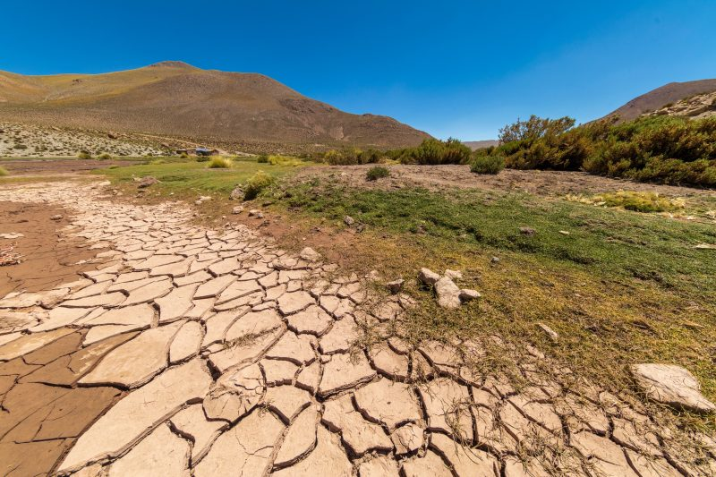
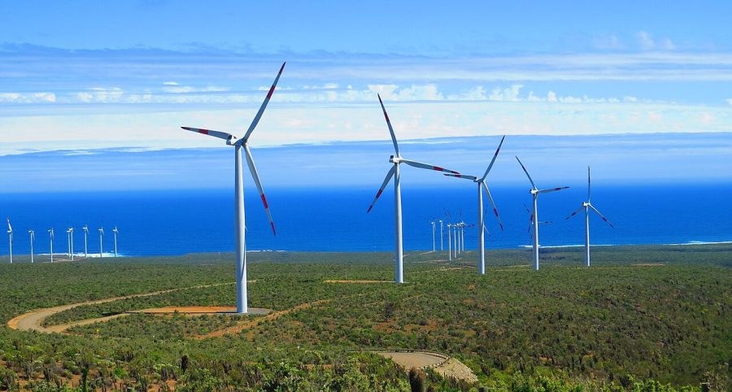

La narrativa global sobre el cambio climático ha evolucionado de ser "un problema futuro" a convertirse en una "emergencia presente". En 2025, esta realidad se percibe con mayor intensidad en Chile y Latinoamérica, regiones que están en la primera línea de la crisis climática. Sequías extremas, eventos meteorológicos sin precedentes y la pérdida acelerada de biodiversidad nos obligan a replantear nuestra relación con el entorno y a acelerar las acciones de mitigación y adaptación. Este reportaje explora el escenario actual, los principales desafíos y las respuestas innovadoras que están surgiendo en nuestra región.

* * *

## El panorama en Chile: Una nación en la primera línea

Chile es uno de los países más vulnerables a los efectos del cambio climático.[1](#81e14205-b838-4464-b293-c27150a7ab8c) La crisis hídrica, en particular, ha puesto en jaque sectores clave como la agricultura, la minería y el suministro de agua para la población. Durante 2025, la situación ha sido especialmente crítica en las zonas centro y sur del país, donde la falta de lluvias y el aumento de temperaturas han agravado la escasez. Sin embargo, frente a esta adversidad, se ha impulsado una ola de innovación que abarca desde tecnologías de desalinización hasta métodos de gestión eficiente y sostenible del agua.

<figure>

<figcaption>

Embalse en situación de escasez de agua en Chile

</figcaption>

</figure>

### Avances en políticas y la Ley de Cambio Climático

Desde la promulgación de la Ley Marco de Cambio Climático, Chile ha establecido objetivos ambiciosos para la **descarbonización** de su economía y para aumentar la **resiliencia** ante eventos climáticos extremos. El sector público ha comenzado la implementación de planes estratégicos que incluyen incentivos para energías renovables y regulaciones más estrictas en industrias contaminantes. No obstante, expertos coinciden en que la colaboración con la sociedad civil y el sector privado es crucial para alcanzar las metas propuestas y consolidar un desarrollo sostenible a largo plazo.

## Latinoamérica y el Acuerdo de Escazú: Un faro de justicia ambiental

Latinoamérica, hogar de una biodiversidad excepcional, enfrenta desafíos profundos que van desde la deforestación acelerada de la Amazonía hasta la contaminación de sus costas y ríos. En este escenario, el **Acuerdo de Escazú** emerge como un tratado pionero que garantiza el acceso a la información ambiental, la participación pública y la justicia en estos asuntos. Este mecanismo se ha convertido en una herramienta fundamental para proteger a los defensores del medio ambiente y para asegurar que las decisiones relacionadas con el entorno sean transparentes y responsables.

### El papel de la COP30 y la voz de la región

Con la **COP30** programada para realizarse en Brasil, Latinoamérica tiene la oportunidad de posicionarse como un actor clave en la diplomacia climática global. Esta cumbre internacional no solo permitirá visibilizar las problemáticas propias de la región, sino también exigir compromisos más ambiciosos y justos por parte de las grandes potencias. Será el momento para que los países latinoamericanos definan un camino hacia un desarrollo sostenible que sea equitativo y respetuoso con la naturaleza.

<figure>

<figcaption>

Parque eolico en Coquimbo, aborda las soluciones y la innovación en energía limpia.

</figcaption>

</figure>

## Innovación y esperanza: Del sector público a la sociedad civil

Ante la crisis climática, la respuesta regional ha sido contundente y variada. Desde startups chilenas que desarrollan soluciones en energía renovable y tecnologías limpias, hasta comunidades indígenas y rurales en Colombia y otros países que trabajan en la revitalización y conservación de sus bosques, la innovación se manifiesta en múltiples formas. Estas iniciativas representan un faro de esperanza y muestran que, a pesar de los graves desafíos, la acción climática es posible y ya está en marcha.

* * *

En conclusión, la **emergencia climática** no es un desafío lejano ni abstracto; es la realidad que define el año 2025 en Chile y Latinoamérica. Aunque los obstáculos son enormes, la voluntad de cambio, el avance en políticas públicas y la movilización de la sociedad civil ofrecen un camino hacia la resiliencia. El futuro de nuestra región depende de la acción colectiva, de la capacidad de transformar esta crisis en una oportunidad para un desarrollo verdaderamente sostenible y justo.

* * *

**Referencias**
