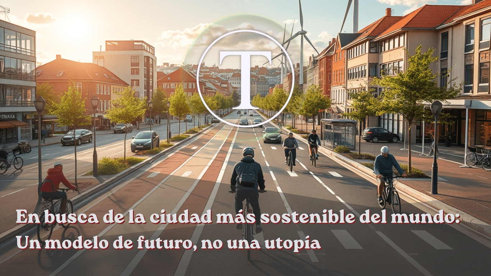
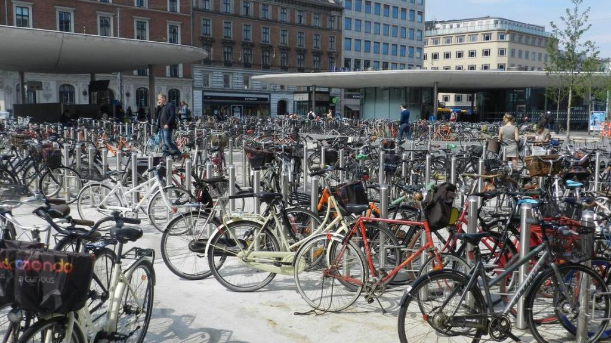
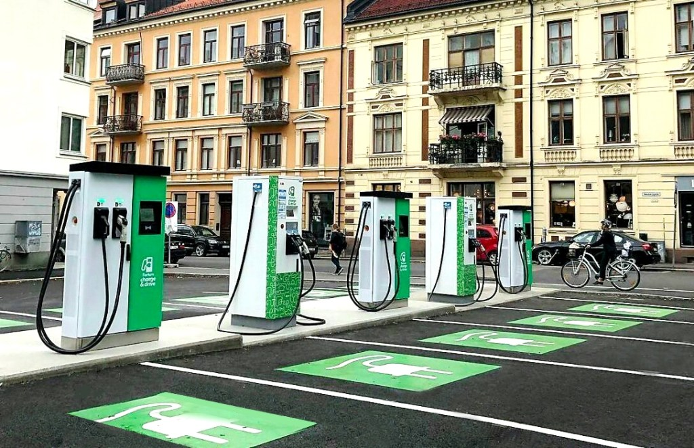
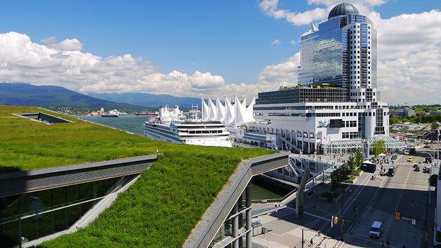
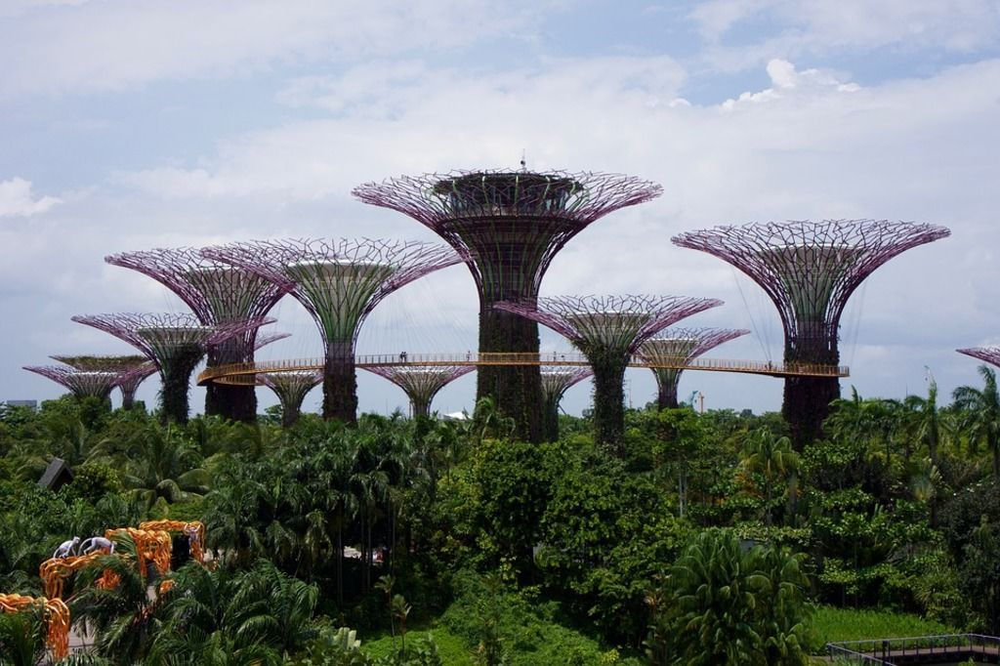

La búsqueda de la ciudad "más sostenible del mundo" es una pregunta compleja que no tiene una única respuesta. La sostenibilidad no es un punto de llegada, sino un proceso en constante evolución que abarca tres pilares fundamentales: el medio ambiente (Planeta), la sociedad (Personas) y la economía (Ganancia). A estos, el **Índice de Ciudades Sostenibles de Arcadis** añade un cuarto pilar: el Progreso, que mide la evolución y la adaptación de una urbe a lo largo del tiempo.

Nuestro reportaje de investigación ha profundizado en los modelos de éxito de las ciudades que lideran consistentemente los principales índices globales, como los de **Arcadis** y la consultora **Siemens**, para desvelar qué las hace tan exitosas y qué desafíos enfrentan en su camino.

[The Arcadis Sustainable Cities Index 2024](https://tiempossustentables.cl/wp-content/uploads/2025/08/the-arcadis-sustainable-cities-index-2024.pdf)[Descarga](https://tiempossustentables.cl/wp-content/uploads/2025/08/the-arcadis-sustainable-cities-index-2024.pdf)

* * *

### Copenhague: El epicentro de la cultura de la bicicleta y la energía limpia

Copenhague es a menudo citada como el epítome de la sostenibilidad urbana. Su ambicioso **Plan Climático CPH 2025** se centraba en cuatro pilares: consumo de energía, producción de energía, movilidad y administración municipal.

- **Movilidad:** La ciudad ha transformado radicalmente su paisaje con una infraestructura que da prioridad a los ciclistas. "Más de la mitad de los residentes de Copenhague se desplazan al trabajo o a la escuela en bicicleta", destaca un informe de la consultora **World Green Building Council**. Sus "supercarriles" para bicicletas y puentes diseñados exclusivamente para ciclistas son la envidia del mundo.

- **Energía:** La capital danesa se ha posicionado como líder en energía limpia. Su sistema de calefacción urbana, impulsado por fuentes renovables como la biomasa y el calor residual, abastece a la mayoría de los hogares. Su meta de ser la primera capital neutral en carbono para 2025 impulsó innovaciones como la planta de conversión de residuos en energía, Copenhill, que incluye una pista de esquí en su techo.

**El Desafío Oculto:** A pesar de sus éxitos, Copenhague no ha escapado de las críticas. La gentrificación, impulsada por nuevos desarrollos urbanos, ha generado desplazamiento en barrios como Sydhavnen, y la ciudad no logró alcanzar su objetivo de neutralidad en carbono para 2025, lo que pone de relieve la dificultad de llevar las ambiciones a la práctica.

* * *

### Oslo: La capital mundial del vehículo eléctrico

Oslo ha adoptado un enfoque diferente, centrado en la electrificación total de su sistema de transporte. La ciudad noruega tiene la mayor proporción de vehículos eléctricos (VE) per cápita del mundo y se ha fijado el objetivo de reducir sus emisiones de gases de efecto invernadero en un 95% para 2030.

- **Incentivos:** El éxito de Oslo se basa en un audaz sistema de incentivos fiscales. Los VE están exentos de impuestos, peajes de congestión y tienen acceso a carriles bus. Este modelo ha sido tan eficaz que ha generado nuevos desafíos. Como señala la revista **InfraJournal**, "la proliferación de VE ha comenzado a generar congestión en los carriles bus y plantea la pregunta sobre la sostenibilidad a largo plazo de estos incentivos".

- **Economía Circular:** Oslo también es pionera en la gestión de residuos, transformando los desechos orgánicos en biogás para sus autobuses urbanos y en fertilizantes para los agricultores locales, cerrando así un círculo virtuoso.

* * *

### Vancouver: El modelo de "ciudad más verde" en América del Norte

Vancouver, en la costa oeste de Canadá, se propuso en 2011 ser la "ciudad más verde" del mundo con un plan de acción de 10 objetivos. Este plan se enfoca en tres áreas clave: carbono, residuos y ecosistemas.

- **Energía y Residuos:** Vancouver se beneficia de una fuente de energía natural casi 100% limpia, la energía hidroeléctrica. La ciudad ha logrado desviar casi el 60% de sus residuos de los vertederos.

- **"Gentrificación verde":** Sin embargo, el éxito de sus políticas de sostenibilidad ha tenido un costo social. Investigaciones académicas han acuñado el término "gentrificación verde" para describir cómo las mejoras medioambientales, como la construcción de parques y la densificación urbana, han aumentado el valor de la propiedad, desplazando a las comunidades de bajos ingresos.

* * *

### Singapur: Un enfoque tecnocrático y planificado

Singapur ofrece un modelo de sostenibilidad único y centralizado. Su **Plan Verde 2030** es una hoja de ruta con metas claras para cada sector, desde la gestión del agua hasta el transporte.

- **Eficiencia:** El país-ciudad ha logrado una gestión del agua de circuito cerrado a través de programas como **NEWater**, que trata las aguas residuales para convertirlas en agua potable de alta calidad. Su densa red de transporte público y su plan para que todos los edificios nuevos sean más verdes para 2030 son ejemplos de su enfoque riguroso y planificado.

**Contraste con Occidente:** A diferencia de las ciudades europeas que priorizan la participación comunitaria, el enfoque de Singapur es más vertical y tecnocrático. Esto permite una implementación rápida de políticas, pero puede carecer de la flexibilidad y la equidad social de otros modelos.

* * *

### Cuadro Comparativo de los Modelos de Sostenibilidad

| Característica | Copenhague (Dinamarca) | Oslo (Noruega) | Vancouver (Canadá) | Singapur |
| --- | --- | --- | --- | --- |
| **Pilar principal** | Movilidad activa y energía limpia | Electrificación del transporte | Plan integral de acción | Gestión de recursos y tecnología |
| **Política clave** | Infraestructura para bicicletas, calefacción urbana | Incentivos para vehículos eléctricos | "Plan de Acción Ciudad más Verde" | "Plan Verde 2030", NEWater |
| **Mayor éxito** | Alta tasa de uso de bicicletas, reducción de emisiones | Mayor proporción de VE per cápita | Energía hidroeléctrica, reducción de residuos | Eficiencia en el uso del agua y el suelo |
| **Principal desafío** | Gentrificación, no logró meta de neutralidad 2025 | Congestión en carriles bus, sostenibilidad de incentivos | Gentrificación verde, alto costo de vida | Falta de participación ciudadana, enfoque vertical |

* * *

### Conclusión

No hay una "mejor" ciudad sostenible en un sentido absoluto. Cada una de ellas es una lección en sí misma, mostrando que la sostenibilidad requiere un compromiso holístico que vaya más allá de lo ambiental. Copenhague nos enseña la importancia de la infraestructura, Oslo la audacia de los incentivos, Vancouver la necesidad de planes de acción integrales y Singapur el poder de la planificación a largo plazo.

En última instancia, el éxito de una ciudad sostenible no se mide solo por sus clasificaciones, sino por su capacidad para equilibrar la prosperidad económica con la equidad social y la salud ambiental. Es un camino de constante adaptación, aprendizaje y mejora.

* * *

_¿En qué lugar sienten que se ubican nuestras ciudades latinoamericanas en estos modelos de desarrollo sostenible?_
