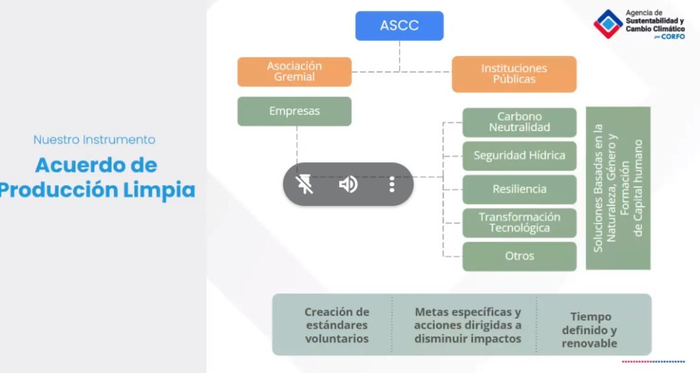
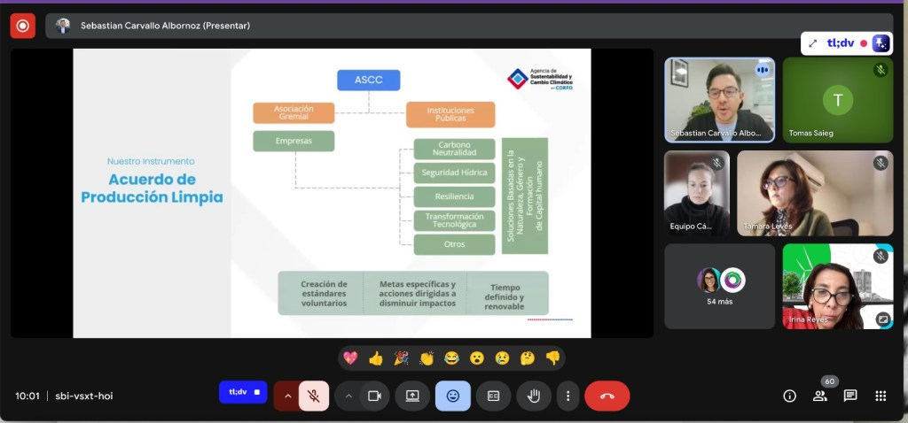
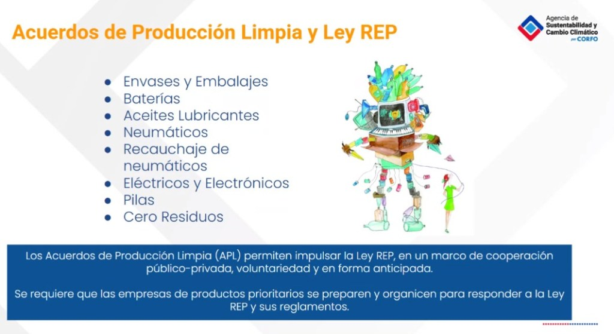

En un esfuerzo por transformar la industria de la moda hacia un modelo más sostenible, se llevó a cabo el conversatorio **"Encuentro Circular: Ley REP y Textiles: Hacia una Moda con Responsabilidad Extendida"**. El evento, organizado por **Diseña Sustentable**, el primer gremio chileno de diseño sostenible, reunió a expertos clave para discutir los desafíos y oportunidades de la Ley de Responsabilidad Extendida del Productor (REP) en el sector textil.

El encuentro virtual, realizado el pasado jueves 12 de junio, tuvo como objetivo principal dar a conocer los avances en la implementación de la economía circular y las políticas públicas en la industria textil nacional. Dirigido a empresarios, emprendedores y a la sociedad civil interesada en el desarrollo sostenible, el evento buscó fomentar un diálogo crucial para la transición del país hacia una economía más verde.

La jornada contó con la participación de destacadas figuras del ámbito público y privado. Entre los invitados se encontraron **Pablo Badenier**, ex Ministro del Medio Ambiente y actual director de País Circular; **Sebastián Carvallo**, Subdirector de Producción Sustentable de la Agencia de Sustentabilidad y Cambio Climático (ASCC); y **Tomás Saieg**, Jefe de la Oficina de Economía Circular del Ministerio del Medio Ambiente. La moderación estuvo a cargo de **Irina Reyes**.

**Tomás Saieg** fue el encargado de abrir la discusión, presentando los resultados de un estudio del Ministerio del Medio Ambiente sobre los residuos textiles en Chile. Su intervención se centró en los desafíos que enfrenta el país para posicionarse como un líder en innovación hacia la economía circular y el desarrollo sustentable, así como en las políticas públicas necesarias para empoderar a los consumidores.

Por su parte, **Sebastián Carvallo** compartió los aprendizajes obtenidos a través del Acuerdo de Producción Limpia (APL) para el sector textil. Carvallo abordó las oportunidades que ofrece el trabajo conjunto de los mercados para la valorización de los residuos textiles y reflexionó sobre el futuro de los mercados de consumo consciente.

**Pablo Badenier** ofreció una evaluación sobre la implementación de la Ley REP en Chile. Desde su experiencia, analizó los aprendizajes clave que el sector textil, recientemente incorporado como producto prioritario, debe considerar para una transición efectiva y justa hacia la circularidad. Además, profundizó en los mayores desafíos que enfrentan las industrias para adoptar un modelo de negocio centrado en la economía circular y transformar sus cadenas productivas.

El evento fue una iniciativa de **Diseña Sustentable**, la asociación gremial pionera que busca agrupar a emprendimientos de producción y consumo de diseño sostenible. La entidad ofrece un espacio para la formación, comercialización e investigación, con el fin de potenciar negocios que minimicen el impacto ambiental y generen crecimiento económico.

Este **"Encuentro Circular"** subraya la creciente importancia de la sostenibilidad en la industria de la moda chilena. La conversación entre actores clave del sector público y privado demuestra un compromiso real por avanzar hacia una economía circular, abriendo nuevas vías para negocios rentables y promoviendo el desarrollo de productos y servicios ecológicos en todo el país.

- 
    
- 
    
- 
    

