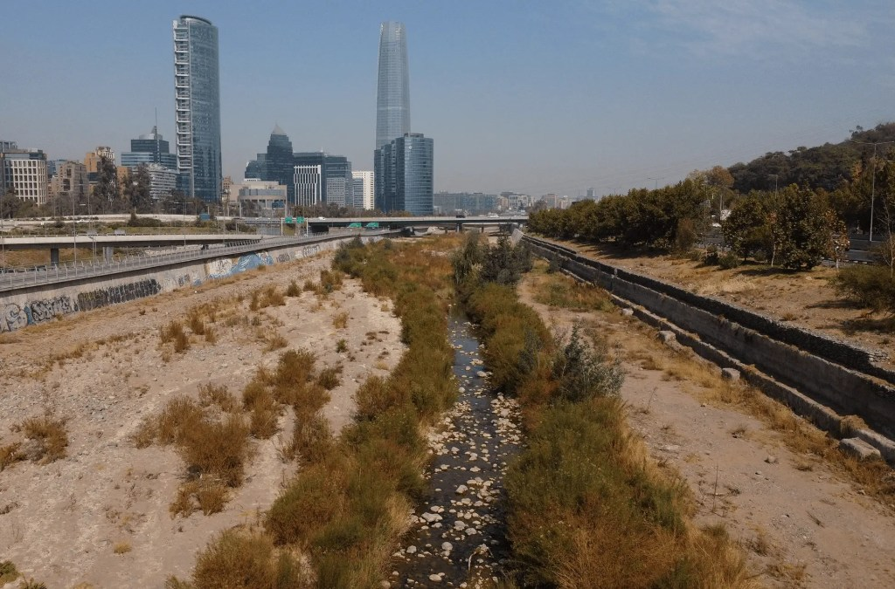
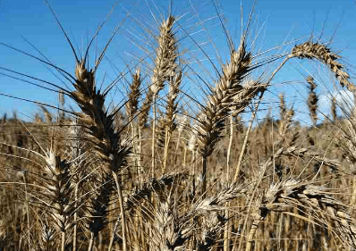

<figure>

<figcaption>

Podcast Escasez de Agua en Santiago

</figcaption>

</figure>

<figure>

<figcaption>

Revisa este artículo en  
[Tiempos Sustentables On-Air](https://tiempossustentables.cl/tiempos-sustentables-on-air/)

</figcaption>

</figure>

Mientras el invierno nos invita a buscar abrigo, Santiago enfrenta una realidad más profunda y persistente. Esta realidad va más allá del frío superficial: la **escasez hídrica**. La Región Metropolitana, epicentro económico y demográfico de Chile, vive un invierno que subraya su vulnerabilidad. Esto se debe a una megasequía que se extiende ya por más de una década. Esta situación tiene profundas implicaciones para su **abastecimiento de agua** y la **agricultura local**.

El frío reduce ligeramente la demanda de agua para riego en la ciudad. Sin embargo, la ausencia de precipitaciones significativas en la alta cordillera sigue siendo la principal preocupación. La acumulación de nieve es vital para la recarga de los sistemas hídricos en primavera y verano. Actualmente, se mantiene en niveles críticos. Se anticipa una temporada estival de estrés hídrico.

* * *

### La Evidencia de una Crisis Hídrica Estructural

La situación de escasez no es una novedad estacional. Es una condición estructural del centro de Chile. Esta situación está confirmada por diversas fuentes oficiales y estudios. Un reciente **Boletín de Sequía de la Dirección Meteorológica de Chile (DMC)**, con datos a mayo de 2024, ya indicaba que el **60.1% del territorio nacional se encontraba afectado por algún grado de sequía**, con un 11.8% en condición de "sequía moderada" y un 0.7% en "sequía extrema" a nivel país.

Para la Región Metropolitana, esta realidad se traduce en una presión constante sobre sus principales fuentes de agua. La **Junta de Vigilancia del Río Maipo Primera Sección (JVRM)** ha señalado la gravedad de la situación en la principal cuenca que abastece a Santiago. Un informe de la JVRM revela que el **Río Maipo es uno de los más afectados por el estrés hídrico a nivel mundial, ubicándose en el noveno puesto** según reportes del World Resources Institute (WRI). Los datos son contundentes: "mientras el promedio de caudal de los últimos 25 años ha sido de 83,8 m3/s, entre el año 2017 y 2022 esa cifra bajó a 47,6 m3/s, es decir, un **56% menos**", como se detalla en su análisis sobre las fuentes de agua y la incertidumbre futura.

Esta disminución drástica en los caudales, sumada a la menor acumulación de nieve, ejerce una fuerte presión sobre las aguas subterráneas, cuya sobreexplotación es insostenible. El **Centro de Ciencia del Clima y la Resiliencia (CR2) de la Universidad de Chile**, en su informe "Seguridad Hídrica en Chile: Caracterización y perspectivas de futuro", ha proyectado una "fuerte disminución de precipitación (cercano a 40%) y caudal (cercano a 55%)" en la zona central, lo que deriva en un estrés hídrico que pone en riesgo las reservas de agua subterránea. Incluso la **Dirección General de Aguas (DGA)** del Ministerio de Obras Públicas ha tenido que declarar **zonas de escasez hídrica** en diversas comunas de la Región Metropolitana, como ha ocurrido en Til Til.

* * *

### El Impacto Oculto en la Agricultura Periurbana

La agricultura que rodea Santiago, vital para la provisión de alimentos frescos y el sustento de miles de familias, es una de las principales víctimas de esta crisis. La restricción en el acceso al agua fuerza a los agricultores a reducir las superficies de cultivo o a invertir en costosos sistemas de riego más eficientes, lo que encarece la producción y amenaza la viabilidad económica de las explotaciones locales. Esto tiene un efecto directo en la **seguridad alimentaria** de la propia capital, haciéndola más dependiente de cadenas de suministro más largas y vulnerables.

* * *

### Hacia una Gestión Hídrica Sostenible y Resiliente

Para "Tiempos Sustentables", la contingencia invernal y el telón de fondo de la sequía nos obligan a acelerar una **gestión hídrica verdaderamente resiliente**. El desafío va más allá de buscar nuevas fuentes y se centra en cómo usamos y valoramos cada gota de agua:

1. **Eficiencia y Concientización:** Impulsar campañas permanentes para el uso consciente del agua en todos los sectores, urbano y agrícola.

3. **Infraestructura Adaptativa:** Invertir en tecnologías de riego avanzado y en infraestructura que permita capturar y almacenar agua de manera eficiente durante los escasos episodios de lluvia, como plantean expertos de la JVRM.

5. **Innovación y Nuevas Fuentes:** Explorar seriamente opciones como el reúso de aguas tratadas o la desalinización, siempre evaluando su sostenibilidad energética y ambiental.

7. **Marco Regulatorio Robusto:** Asegurar una gobernanza del agua que priorice el consumo humano y el mantenimiento de los ecosistemas, con una fiscalización efectiva.

9. **Apoyo a la Agricultura Local:** Fomentar la investigación y transferencia tecnológica para cultivos adaptados a la escasez hídrica y modelos de producción más sostenibles que aseguren la viabilidad de la agricultura periurbana.

El frío de este martes no solo nos recuerda la importancia de abrigarnos, sino la imperiosa necesidad de enfrentar la sequía con una visión a largo plazo, garantizando la disponibilidad de agua y alimentos para las futuras generaciones de Santiago.

* * *
