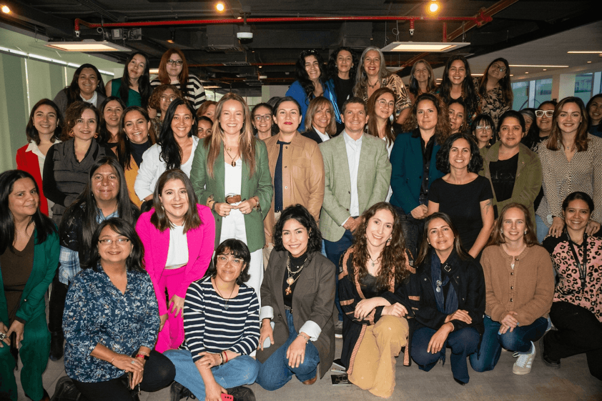

En el ecosistema emprendedor, existe una verdad incómoda: una idea brillante y con profundo propósito social o ambiental no sobrevive si no logra tracción comercial. Esta barrera, que frecuentemente se convierte en el principal obstáculo para los proyectos liderados por mujeres, es el motor detrás de la más reciente y ambiciosa iniciativa de la comunidad **“Mujer Sustentable”**.

Para hacer frente a este desafío, la plataforma fundada por la destacada periodista Catalina Droguett inauguró recientemente su tercer programa formativo del año: **“Escuela Mujer Sustentable: Ventas con Impacto”**. El lanzamiento oficial, realizado el jueves pasado en el espacio BCI Nace en Santiago, marca un hito crucial en la agenda 2026 de la organización y busca abordar de frente el fortalecimiento de las capacidades comerciales de las emprendedoras chilenas.  

## **De la inspiración a la conversión: ¿Por qué enfocarse en las ventas?**

Históricamente, muchos programas de apoyo al emprendimiento femenino se han centrado en la creación de valor, el empoderamiento emocional y el diseño del propósito. Sin embargo, "Ventas con Impacto" da un giro hacia el pragmatismo financiero.  

**Sebastián Rodríguez Undurraga**, socio y gerente general de Emprediem —la Empresa B a cargo de la ejecución del programa—, lo resume con una claridad meridiana: _“En este programa buscamos algo muy concreto: que los emprendimientos sostenibles vendan más para multiplicar su impacto”_.  

Para Rodríguez, el ecosistema debe evolucionar: _“Durante años hemos formado a emprendedoras para contar buenas historias, pero hoy el foco está en transformar ese relato en resultados. Porque cuando un negocio crece económicamente, también crece su impacto social y ambiental”_.  

## **¿Qué ofrece la “Escuela Mujer Sustentable: Ventas con Impacto”?**

Optimizado para quienes buscan herramientas accionables y directas, este programa gratuito no es solo un ciclo de charlas, sino un entrenamiento intensivo. A través de esta iniciativa, las participantes lograrán:  

- **Optimizar procesos de venta:** Acceso a herramientas concretas para cerrar negocios de forma efectiva.  

- **Estructurar estrategias comerciales:** Ordenar el modelo de ingresos para proyectar negocios claros y sostenibles en el tiempo.  

- **Fomentar la escalabilidad:** Preparar la estructura del negocio para un crecimiento sostenido.  

- **Fortalecer la toma de decisiones:** Un proceso de acompañamiento continuo que incrementa la confianza de las líderes en el mercado.  

## **El motor del éxito: La articulación público-privada**

Iniciativas de alto impacto requieren un respaldo institucional robusto. La envergadura de este proyecto se sostiene gracias a un ecosistema de colaboración estratégica.  

El programa se desarrolla bajo el alero del instrumento **Viraliza Formación de Corfo Metropolitano**, una política pública orientada a potenciar las competencias en el ecosistema emprendedor. Además, cuenta con el soporte directo de **Banco BCI**, consolidando un modelo donde el Estado, la banca privada y las organizaciones de impacto (Emprediem y Mujer Sustentable) reman en una misma dirección: generar oportunidades reales para las mujeres.  

## **La Agenda 2026 y el paradigma del "Quíntuple Impacto"**

Este lanzamiento en BCI Nace no es un evento aislado; forma parte de una ambiciosa agenda ampliada para el año 2026, que ya vio nacer hace unas semanas el programa enfocado en áreas **STEM** y que pronto desplegará la **“Escuela Mujer Sustentable Choapa”** para garantizar el alcance territorial de la iniciativa.  

Los resultados de Mujer Sustentable avalan su influencia. Desde su creación hace siete años, la plataforma ha impactado a más de 10 millones de personas, formando a más de 2.000 mujeres a través de 300 encuentros, y consolidando una red activa que supera las 350 mil personas en Chile y Latinoamérica.  

Para **Catalina Droguett**, esta evolución responde a una madurez del concepto de sostenibilidad. _“Mujer Sustentable nace hace siete años desde la convicción de que la sostenibilidad no se construye solo desde lo ambiental, lo social y lo económico, sino incorporando también el desarrollo humano y el empoderamiento financiero de las mujeres”_, puntualiza.  

Hoy, ese empoderamiento financiero tiene un plan de acción concreto. Porque el futuro será sostenible, pero solo si las líderes que lo impulsan tienen las herramientas para vender, crecer y transformar el mercado.

<figure>

<figcaption>

Fotografía grupal con emprendedoras de la Escuela Mujer Sustentable

</figcaption>

</figure>

## **ANEXO: COMUNICADO DE PRENSA OFICIAL**

**_Documento original emitido por la organización para revisión de prensa y archivo._**

[Comunicado de Prensa Oficial: Lanzamiento de la "Escuela Mujer Sustentable Ventas con Impacto" 2026](https://tiempossustentables.cl/wp-content/uploads/2026/05/cp-lanzamiento-escuela-mujer-sustentable-ventas-con-impacto-2026-ok32.docx.pdf)[Descarga](https://tiempossustentables.cl/wp-content/uploads/2026/05/cp-lanzamiento-escuela-mujer-sustentable-ventas-con-impacto-2026-ok32.docx.pdf)

* * *
