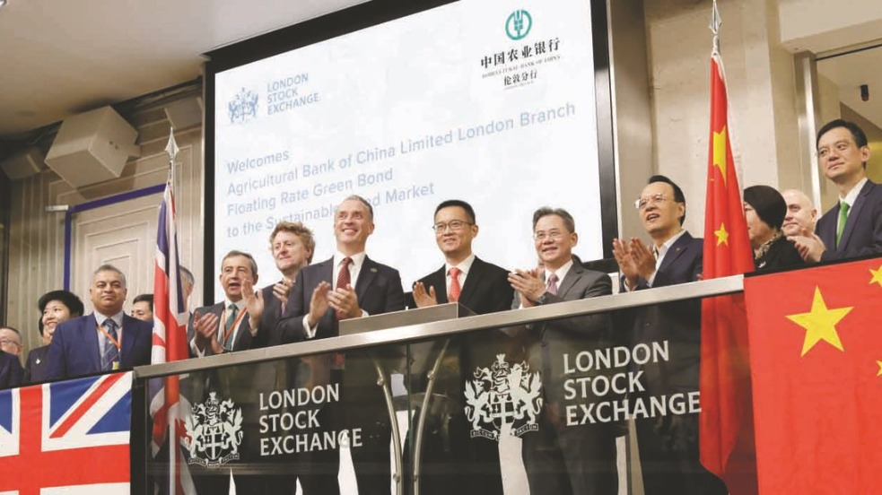

## _Desde Washington hasta Beijing, los principios Ambientales, Sociales y de Gobernanza enfrentan su mayor desafío. Pasan por las trincheras en Ucrania y la devastación en Gaza. ¿Sobrevivirá la sustentabilidad a la era de la inestabilidad?_

El auge de los criterios Ambientales, Sociales y de Gobernanza (ESG, por sus siglas en inglés) prometía una era de capitalismo más consciente, donde la rentabilidad financiera y el bienestar del planeta y sus habitantes irían de la mano. Inversores, consumidores y reguladores impulsaron una ola global hacia la sustentabilidad, con billones de dólares fluyendo hacia empresas comprometidas con este paradigma. Sin embargo, el creciente estruendo de los conflictos geopolíticos y las tensiones entre las grandes potencias están sometiendo estos ideales a una prueba de fuego, revelando una compleja y a menudo contradictoria interacción entre la sustentabilidad y la cruda realidad de la _**Realpolitik**_ _(término alemán que se refiere a la política basada en objetivos prácticos más que en ideales)_

**La promesa de un futuro sostenible, impulsada por el optimismo de los Objetivos de Desarrollo Sostenible (ODS) de la ONU y el Acuerdo de París, se enfrenta hoy a un panorama fragmentado**. El compromiso global con los principios ESG, que según proyecciones de Bloomberg Intelligence podrían gestionar activos por $40 billones para 2030, ahora se ve tamizado por las prioridades de seguridad nacional, las crisis humanitarias y la reconfiguración de las alianzas económicas.

## **Estados Unidos: La Batalla Interna por el Alma ESG**

En **Estados Unidos**, el mayor mercado de capitales del mundo, la agenda ESG es un campo de batalla ideológico. Mientras la administración actual endurece su opinión respecto a los objetivos climáticos globales y la SEC (Comisión de Bolsa y Valores) avanza en propuestas para la divulgación de riesgos climáticos. Existe una polarización que genera incertidumbre regulatoria. Aunque la presión de grandes inversores institucionales y una creciente conciencia en el sector corporativo (casi el 90% de las empresas del S&P 500 publican informes ESG) mantienen viva la llama de la sustentabilidad. No obstante, la priorización de la seguridad energética y la competencia con China podrían redefinir las prioridades ambientales a corto plazo.

## **China e India: Gigantes Asiáticos, Caminos Divergentes**

**China**, el mayor emisor de gases de efecto invernadero, **ha adoptado la sustentabilidad como una estrategia de estado**. Sus ambiciosos objetivos de alcanzar el pico de emisiones antes de 2030 y la neutralidad de carbono para 2060 ("objetivos 3060") se acompañan de un rápido desarrollo de un marco regulatorio para la divulgación ESG, alineado con estándares internacionales pero con "características chinas". Su dominio en la cadena de suministro de tecnologías verdes (paneles solares, baterías) le otorga una ventaja geopolítica, pero también enfrenta escrutinio por cuestiones sociales y de gobernanza.

**India**, por su parte, avanza con su propio **objetivo de neutralidad neta para 2070** y un marco de divulgación obligatoria (BRSR) para sus principales empresas. El país impulsa agresivamente las energías renovables, pero enfrenta el monumental desafío de equilibrar un rápido crecimiento económico y la salida de la pobreza de millones de personas con la protección ambiental. La complejidad de sus cadenas de suministro y la necesidad de inversión masiva son factores críticos.

## **Europa del Este: La Guerra Redefine la Sustentabilidad**

El conflicto en **Ucrania** ha tenido un impacto devastador y multifacético en la agenda ESG. Para **Rusia**, las sanciones internacionales y el aislamiento económico han llevado a una reevaluación de sus compromisos ESG, con una menor transparencia y un posible retroceso en sus ambiciones ambientales. Empresas rusas, según encuestas, ven las sanciones como un obstáculo para la transición sostenible, y la priorización gubernamental se ha volcado hacia la estabilidad interna y la economía de guerra.

**Ucrania**, en contraste, enfrenta una catástrofe ambiental y humanitaria. La destrucción de infraestructura, la contaminación por armamento y los millones de desplazados han puesto en jaque cualquier avance previo. Sin embargo, en medio de la tragedia, surge una visión de reconstrucción verde, alineada con los estándares de la Unión Europea y apoyada por la comunidad internacional. La futura adhesión a la UE podría ser un catalizador para una recuperación sostenible, aunque el camino será largo y arduo.

## **Medio Oriente: ESG Bajo el Fuego Cruzado**

El conflicto entre Israel y Palestina representa quizás el caso más extremo de cómo la violencia directa anula los principios ESG. En **Israel**, si bien existen estrategias nacionales de sustentabilidad y un sector tecnológico pujante, la priorización de la seguridad y las implicaciones del conflicto dominan el panorama. Además, han surgido controversias sobre el posible sesgo en las calificaciones ESG de empresas relacionadas con el conflicto.

Para **Palestina**, la situación es catastrófica. Los informes hablan de "ecocidio" en Gaza, con la destrucción masiva de tierras agrícolas, infraestructura de agua y saneamiento, y una contaminación que tendrá efectos duraderos en la salud y el medio ambiente. En este contexto, hablar de avances ESG formales es casi imposible; la supervivencia y la ayuda humanitaria son las únicas prioridades. La comunidad inversora global se enfrenta a profundos dilemas éticos sobre la financiación y las operaciones en la región.

## **El Trilema de la Sustentabilidad en Tiempos Inciertos**

Lo que emerge de este panorama global es un "**trilema ESG**" para muchas naciones: la difícil tarea de equilibrar la **seguridad nacional y económica**, las metas de **sustentabilidad a largo plazo** y el **escrutinio de la comunidad internacional y los inversores ESG**. Las decisiones tomadas hoy en estos países no solo determinarán su propio futuro, sino que tendrán profundas repercusiones en la lucha global contra el cambio climático y la viabilidad de un desarrollo verdaderamente sostenible.

Los "**Tiempos Sustentables**" que anhelamos exigen ahora una comprensión más matizada y resiliente de los principios ESG. La transparencia, la diligencia debida reforzada y la adaptabilidad serán cruciales. La pregunta que queda en el aire es si la arquitectura global de la sustentabilidad, construida en tiempos de relativa paz y cooperación, podrá resistir las tormentas de un mundo cada vez más dividido y en conflicto. La respuesta definirá el legado de nuestra generación.

- <figure>
    
    
    
    <figcaption>
    
    Una propuesta de ley plantea penas de cárcel en EE UU por invertir con criterios ESG
    
    </figcaption>
    
    </figure>
    
- <figure>
    
    
    
    <figcaption>
    
    China lanzará bonos verdes de 825 millones de dólares en la Bolsa de Londres para apoyar los objetivos climáticos.
    
    </figcaption>
    
    </figure>
    
- <figure>
    
    
    
    <figcaption>
    
    La Defensa europea tiene problemas de financiación por las estrictas normas ESG y la burocracia
    
    </figcaption>
    
    </figure>
    
- <figure>
    
    
    
    <figcaption>
    
    Las compañías que deciden qué es una empresa sostenible ignoran los abusos en Gaza
    
    </figcaption>
    
    </figure>
    

## **La Sustentabilidad en la Balanza de un Mundo Incierto**

El recorrido por las realidades ESG de estas naciones clave, desde las tensiones políticas en **Estados Unidos** hasta la cruda devastación en zonas de conflicto activo como **Ucrania** y **Palestina**, dibuja un panorama inequívoco: _**la era de la inocencia para la sustentabilidad ha terminado. Los principios Ambientales, Sociales y de Gobernanza, antes vistos como un faro de progreso casi universal, se enfrentan ahora a la prueba de su relevancia y resiliencia en un tablero geopolítico fracturado.**_

Hemos visto cómo las ambiciones estratégicas de **China**, las necesidades de desarrollo de India, el aislamiento de **Rusia** y la búsqueda de una recuperación verde en **Ucrania**, junto con la parálisis inducida por el conflicto en **Israel** y **Palestina**, redefinen y, en muchos casos, subordinan los imperativos ESG a las urgencias de la seguridad, la economía o la simple supervivencia.

El desafío para "**Tiempos Sustentables**" y para la comunidad global es monumental. _**Ya no basta con promover la adopción de estándares; es imperativo desarrollar marcos ESG que sean lo suficientemente robustos y flexibles para navegar la complejidad de un mundo multipolar y propenso a crisis**_. Esto implica una mayor exigencia de transparencia real, mecanismos de rendición de cuentas más efectivos, y una profunda reflexión ética sobre el papel de la inversión y la actividad empresarial en contextos de inestabilidad.

La pregunta fundamental que resuena es si **_la humanidad logrará integrar genuinamente la sustentabilidad en el núcleo de sus decisiones políticas y económicas, incluso cuando las presiones geopolíticas empujan en direcciones opuestas._** De la respuesta a esta interrogante no solo dependerá el futuro del movimiento ESG, sino la viabilidad misma de un planeta habitable y equitativo para las generaciones venideras. La sustentabilidad, hoy más que nunca, pende de un delicado equilibrio en la balanza de un mundo incierto.
