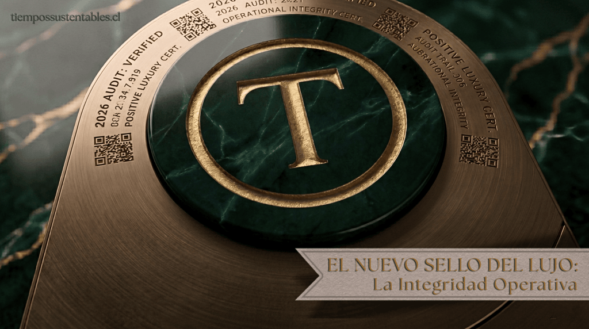

## Análisis Estratégico

- **El cambio de paradigma:** El lujo en 2026 ya no se define por la estética, sino por la **integridad operativa** y el cumplimiento legal ineludible.

- **Normativa Crítica:** Desde julio de 2026, la UE prohíbe la destrucción de ropa no vendida. En Chile, la **NCG 461** y la **NCG 519** obligan a una transparencia financiera total sobre riesgos ESG.

- **La nueva tecnología:** El **Pasaporte Digital de Productos (DPP)** será obligatorio para textiles en 2027, transformando la trazabilidad en una poderosa herramienta de fidelización.

* * *

> **ACCESO EXCLUSIVO PARA NUESTROS LECTORES**
> 
> Para profundizar en las normativas, estrategias y exigencias globales que están transformando la industria, te invitamos a revisar el documento maestro que fundamenta este análisis: **'ESG Policy Guide: What Sustainability Legislation Means for Luxury Brands' (4ª Edición, marzo 2026)**, publicado por **Positive Luxury** en colaboración con **Baker McKenzie**."
> 
> [Guía de Políticas ESG: Lo que la legislación sobre sostenibilidad significa para las marcas de lujo (Cuarta Edición, marzo 2026).](https://tiempossustentables.cl/wp-content/uploads/2026/04/1776617642938.pdf)[Descarga](https://tiempossustentables.cl/wp-content/uploads/2026/04/1776617642938.pdf)

* * *

Históricamente, el sector del lujo se definía a través de una dicotomía simple: calidad excepcional y estilo inconfundible. Sin embargo, al llegar a este 2026, esa definición ha quedado completamente obsoleta. La nueva exclusividad no se mide únicamente por la escasez o la estética, sino por la integridad de la cadena de suministro y la responsabilidad corporativa.

Lo que hace apenas unos años era una elección estratégica para "ser más sostenibles", hoy se ha transformado en un tsunami de obligaciones regulatorias globales. Este análisis estratégico, fundamentado en la 4.ª edición de la _"Guía de Políticas ESG"_ (desarrollada por Positive Luxury en colaboración con Baker McKenzie), marca la hoja de ruta para una industria donde el cumplimiento normativo es, de hecho, la nueva artesanía.

> **LEE TAMBIÉN:** Esta transformación hacia un lujo más consciente se refleja también en los espacios que habitamos. Descubre cómo las nuevas tendencias de consumo priorizan el bienestar invisible en nuestro reportaje: **[Quiet Luxury 2026 en Chile: Diseño Biofílico y Domótica Circadiana](https://tiempossustentables.cl/2026/02/05/quiet-luxury-2026-chile-biofilicos-domotica-circadiana/)**.

* * *

## La Ciencia de la Confianza: Certificaciones que Respaldan la Integridad

En un mercado saturado de promesas y cada vez más implacable con el _greenwashing_, la certificación internacional se ha convertido en el único lenguaje de la verdad. La **Butterfly Mark** de _Positive Luxury_ ejemplifica este nuevo estándar, evaluando a las marcas bajo pilares rigurosos. Para liderar en 2026, las empresas deben alinear sus operaciones con estos marcos:

- **Pilar Ambiental:** La excelencia se mide gestionando la biodiversidad (**FSC, RSPO**), la acción climática real (**SBTi, RE100**), el bienestar animal (**PETA, Leather Working Group**) y el diseño circular (**Cradle to Cradle**).

- **Pilar Social:** No existe el lujo sin ética. Esto requiere garantizar los derechos laborales (**ILO, Fair Wear Foundation**), la seguridad ocupacional (**ISO 45001**) y una trazabilidad infalible en la cadena de suministro (**Sedex**).

- **Pilar de Gobernanza:** La transparencia se audita a través de reportes exhaustivos (**GRI, SASB o B Corp**), protección de privacidad (**GDPR**) y estrictas políticas anticorrupción (**ISO 37001**).

* * *

### Radar Normativo Global: Legislación ESG Clave (2026)

| **Jurisdicción** | **Legislación o Iniciativa** | **Categoría** | **Impacto Crítico en Marcas de Lujo** | **Requisito Principal** |
| --- | --- | --- | --- | --- |
| **Unión Europea** | Reglamento de Ecodiseño (ESPR) | Ambiental | Prohíbe destruir productos no vendidos; obliga a diseñar para la durabilidad. | Pasaporte Digital de Productos (DPP) a partir de 2027. |
| **Chile** | Normas CMF NCG 461 y NCG 519 | Gobernanza | Transparencia obligatoria sobre riesgos climáticos y sociales. | Divulgación en memorias anuales bajo estándares ISSB. |
| **Brasil** | Decreto de Plásticos (12.688/2025) | Ambiental | Exige rediseñar empaques para cumplir con logística inversa. | Meta de 22% de contenido reciclado en 2026 (40% para 2040). |
| **EE. UU.** | Ley UFLPA (Federal) | Social | Alto riesgo de detención aduanera de cargamentos de algodón o textiles. | Documentación trazable que demuestre origen sin trabajo forzado. |
| **Reino Unido** | Impuesto sobre Envases de Plástico | Ambiental | Impacto directo en los márgenes de beneficio (P&L) por costos de empaque. | Tasa de GBP 223.69/tonelada para envases con <30% de reciclado. |

* * *

## Las 5 Verdades que Transformarán el Lujo

### 1\. De-riesgo del inventario: El fin de la destrucción como estrategia

Durante décadas, las casas de lujo protegieron su exclusividad destruyendo físicamente el stock sobrante para evitar descuentos. Ese modelo se acabó. A partir de julio de 2026, la Unión Europea aplicará una prohibición estricta sobre la destrucción de ropa y calzado no vendido.

Además, bajo los esquemas de Responsabilidad Ampliada del Productor (EPR), los productos difíciles de reciclar pagarán tasas más altas. Sabiendo que el 85% de los textiles termina en vertederos, pioneras como **Monica Vinader** ya operan bajo este nuevo paradigma, ofreciendo garantías de 5 años y reparaciones de por vida.

> _"El compromiso temprano con los proveedores, la debida diligencia en el abastecimiento y la integración de la reciclabilidad en el diseño serán fundamentales"_. — **Graham Stuart**, Socio de Baker McKenzie, Londres.

### 2\. El Pasaporte Digital de Productos (DPP): Trazabilidad como CRM

Para 2027, la transparencia dejará de ser marketing para convertirse en una base de datos auditable. El DPP rastreará el producto desde la semilla hasta la costura y su reciclaje final. Las marcas inteligentes no lo ven como una carga administrativa, sino como una herramienta de lealtad. Marcas como **ME+EM** ya están mapeando su arquitectura tecnológica para transformar los datos de trazabilidad en historias que fortalecen la confianza del consumidor.

### 3\. El costo invisible de la estética: Químicos y Microplásticos

La innovación en materiales hoy es supervivencia. Aproximadamente el 35% de los microplásticos oceánicos proviene de textiles. La respuesta gubernamental ha sido severa: el Reino Unido aumentó su impuesto al plástico, y estados en EE. UU. (como Maine y Nueva York) están prohibiendo activamente los PFAS ("químicos eternos") usados para impermeabilizar prendas de lujo.

### 4\. Transparencia radical: El fin de la "Caja Negra" operativa

La logística global ya no admite zonas grises. Regulaciones como la Directiva de Diligencia Debida (CSDDD) en Europa exigen que las marcas vigilen toda su cadena, mucho más allá del proveedor directo (Tier 1). Las consecuencias son drásticas: desde bloqueos aduaneros inmediatos bajo la ley UFLPA en EE. UU., hasta multas de hasta el 4% de la facturación global anual por violar regulaciones de deforestación en la UE.

### 5\. La paradoja de la IA: Eficiencia frente a huella energética

La Inteligencia Artificial es la gran aliada para analizar métricas complejas (como las emisiones de Alcance 3), pero acarrea un costo: el desarrollo de modelos de IA requiere una potencia computacional que dispara la huella de carbono de los centros de datos. Optimizar la cadena de suministro no puede hacerse a costa de socavar los propios planes de descarbonización de la empresa.

> _"El panorama de la sostenibilidad seguirá complejo en 2026. Es vital que la narrativa global de una marca sea clara y esté respaldada por datos, porque generar confianza es clave"_. — **Alyssa Auberger**, Directora Global de Sostenibilidad, Baker McKenzie.

* * *

## Conclusión: Hacia un Lujo con Propósito

El mercado está redefiniendo el valor de las cosas. La exclusividad real ya no reside en lo que una marca dice de sí misma en una brillante campaña publicitaria, sino en lo que puede demostrar empíricamente ante la ley y ante sus clientes.

¿Están las marcas listas para valorar la longevidad y la circularidad tanto como la novedad constante? La pregunta estratégica para cualquier directorio hoy en Chile y Latinoamérica es incuestionable: **¿Está su empresa preparada para mostrar toda su historia, o se arriesgará a quedar fuera de la era de la transparencia total?**
