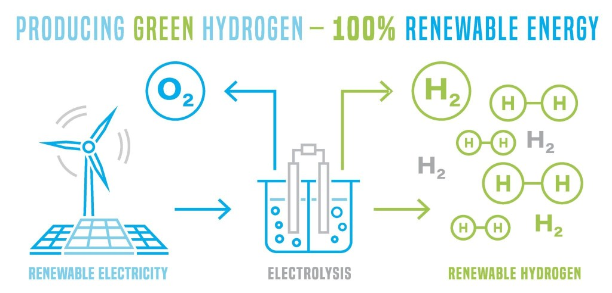

https://youtu.be/OFPmoImype0?si=ZBfjTyyLxMDiiKMn

* * *

## 🇨🇱 **Chile en la Vanguardia de un Futuro Sostenible. Un Laboratorio de Sostenibilidad para el Mundo**

Ante desafíos globales como la **crisis climática** y la **escasez de recursos**, Chile se está posicionando como un **epicentro de innovación sostenible**. El país está respondiendo a estas presiones con una potente combinación de ciencia, tecnología y nuevos modelos de negocio que buscan redefinir el desarrollo. Este especial de _Tiempos Sustentables_ explora los avances más significativos en cuatro áreas clave que están marcando la pauta: la **economía circular**, la **transición energética**, la **agricultura del futuro** y la **digitalización con propósito**, demostrando cómo Chile se convierte en un laboratorio de soluciones para el mundo.

* * *

### 1\. La Revolución de la Economía Circular: De Residuos a Recursos

#### 1.1. Suprarreciclaje (_Upcycling_) en la Industria Alimentaria

El **suprarreciclaje**, o _upcycling_, es la práctica de transformar descartes y subproductos de bajo valor en nuevos productos con una calidad y valor económico superiores. En Chile, diversas empresas están liderando esta tendencia en la industria alimentaria, convirtiendo lo que antes era un residuo en un recurso valioso (puedes revisar también ["De los Descartes Agroalimentarios a la Innovación: Economía Circular y Suprarreciclaje en la Producción de Alimentos e Ingredientes en Chile"](https://tiempossustentables.cl/2025/06/23/de-los-descartes-agroalimentarios-a-la-innovacion-economia-circular-y-suprarreciclaje-en-la-produccion-de-alimentos-e-ingredientes-en-chile/)):

- **Valoriza:** Convierte los excedentes agroalimentarios del Mercado Lo Valledor en sopas de verduras y compotas de fruta, abordando el desperdicio y contribuyendo a la seguridad alimentaria.

- **Cáscara Foods:** Recupera mensualmente entre 10.000 y 30.000 kilos de frutas y verduras descartadas para transformarlas en suplementos alimentarios.

- **Done Properly:** Utiliza descartes de setas y bioprocesos para desarrollar ingredientes innovadores, como realzadores de sabor que reducen el contenido de sodio y proteínas sucedáneas de la carne.

- **Bagán (Up Foods):** Elabora _pâtés_ vegetales _gourmet_ a partir del **bagazo de cebada**, un residuo masivo de la industria cervecera.

- **HaProBa:** Revaloriza el **orujo de uva**, un subproducto de la industria vitivinícola, para crear ingredientes ricos en fibra dietética.

- **InnovaGreen:** Procesa la **pomasa de manzana** para desarrollar FibraOx, un ingrediente funcional con fibras prebióticas y antioxidantes.

- **The Not Company:** Aplica su algoritmo de inteligencia artificial, **Giuseppe**, para desarrollar productos vegetales utilizando co-productos de la agroindustria, reduciendo así el impacto ambiental.

#### 1.2. Innovación con Impacto Social: El Caso de las Carapacheras 🦀

En la localidad de Punta Lavapié, un proyecto enmarcado en el programa ELEVATE de la FAO está transformando la realidad de las **carapacheras** (mujeres dedicadas al procesamiento de jaibas). La iniciativa convierte los caparazones de jaiba —un residuo que constituye hasta el 75% del peso del animal— en **quitina**, un biopolímero de alto valor para la industria biotecnológica. (puedes revisar también ["FAO y el Futuro de las Carapacheras en Chile: Reducción de Desechos"](https://tiempossustentables.cl/2025/08/26/fao-y-el-futuro-de-las-carapacheras-en-chile-reduccion-de-desechos/))

Este modelo de economía circular no solo reduce los desechos marinos, sino que también **empodera económicamente a las mujeres**, formaliza su trabajo y contribuye directamente a cuatro **Objetivos de Desarrollo Sostenible (ODS):** ODS 2 (Hambre Cero), ODS 5 (Igualdad de Género), ODS 12 (Producción y Consumo Responsables) y ODS 14 (Vida Submarina).

* * *

## 2\. La Doble Transición: Energía Limpia y Movilidad Sostenible

### 2.1. Electromovilidad: Chile a la Cabeza de Latinoamérica 🚌🔋

Chile se ha consolidado como un **líder regional en electromovilidad**, especialmente en el transporte público. Santiago cuenta con la **mayor flota de buses eléctricos fuera de China**. (puedes revisar también ["Cómo Chile Lidera la Electromovilidad en Latinoamérica"](https://tiempossustentables.cl/2025/05/13/como-chile-lidera-la-electromovilidad-en-latinoamerica/))

La **Estrategia Nacional de Electromovilidad** establece la ambiciosa meta de que al **2035** solo se comercialicen vehículos cero emisiones en el país. El Ministro de Transportes y Telecomunicaciones, **Juan Carlos Muñoz**, señala: _"Hoy tenemos más de 2.500 buses eléctricos en Santiago, y esperamos superar los 3.500 al final de este periodo de gobierno."_ (puedes revisar también ["Electromovilidad e Hidrógeno Verde: Sinergias para Chile"](https://tiempossustentables.cl/2025/05/16/electromovilidad-hidrogeno-verde/))

No obstante, persisten desafíos para la masificación, como los **altos costos iniciales** de los vehículos privados y una **baja densidad de puntos de carga** fuera de las principales zonas urbanas.

### 2.2. Hidrógeno Verde: La Promesa y sus Desafíos Hídricos

Chile tiene un potencial excepcional para convertirse en un líder mundial en la producción de **hidrógeno verde**, gracias a sus abundantes recursos solares y eólicos. Los proyectos en cartera ya totalizaban **25.617 millones de dólares** en inversión. (puedes revisar también ["Chile y el hidrógeno verde: oportunidades y desafíos"](https://tiempossustentables.cl/2025/05/14/chile-y-el-hidrogeno-verde-oportunidades-y-desafios/))

Sin embargo, esta promesa energética se enfrenta a un desafío crítico: la producción de hidrógeno mediante electrólisis **demanda grandes volúmenes de agua**, en un país que atraviesa una mega-sequía de más de una década. El **Dr. Marcelo Mena** advierte: _"La energía del futuro no puede construirse sobre territorios que quedan sin agua."_ Esta tensión pone de relieve la necesidad de un desarrollo cuidadoso y sostenible.

<figure>

<figcaption>

Green hydrogen production. Future ecological power plant concept. Renewable energy with lower emissions. Editable vector illustration isolated on a white background.

</figcaption>

</figure>

### 2.3. Energía Undimotriz: El Potencial Oculto del Pacífico 🌊

La **energía undimotriz** (generada a partir del movimiento de las olas) emerge como una fuente renovable, inagotable y poco explorada. Su aplicación más prometedora en el país es la **desalinización de agua de mar**. Mediante sistemas de boyas hidráulicas, el movimiento de las olas se transforma en presión mecánica que impulsa directamente un proceso de ósmosis inversa, sin conversiones eléctricas. Esta solución limpia puede beneficiar directamente a la **industria minera** y a las **comunidades costeras** que enfrentan escasez de agua potable. (puedes revisar también ["Energía Undimotriz: El Pacífico Impulsa el Futuro Sostenible de Chile"](https://tiempossustentables.cl/2025/06/17/energia-undimotriz/))

* * *

## 3\. Agricultura 4.0: Cosechando un Futuro Resiliente

### 3.1. Edición Genética: Cultivos Inteligentes para un Clima Cambiante 🧬

La **edición genética**, a través de tecnologías como **CRISPR/Cas9**, está revolucionando la agricultura chilena. Permite el desarrollo de cultivos mejorados (ej. tomates enriquecidos con vitamina D) con **mayor resistencia a la sequía** y **menor dependencia de agroquímicos**, sin introducir ADN de otras especies (diferenciándose de los OGM tradicionales).

El **Servicio Agrícola y Ganadero (SAG)** ha adoptado un enfoque regulatorio pionero, evaluando caso a caso y aprobando 52 de 57 solicitudes desde 2017 sin catalogarlas como OGM, acelerando la innovación en el sector. (puedes revisar también ["Impacto de la Edición Genética en la Agricultura Chilena"](https://tiempossustentables.cl/2025/04/18/impacto-genetico-agricultura/) y ["Las Tecnologías de Agricultura Digital Crecen Tres Veces Más Rápido Que el Promedio Ante el Desafío de la Seguridad Alimentaria Global  
"](https://tiempossustentables.cl/2025/09/24/las-tecnologias-de-agricultura/))

### 3.2. Optimizando la Cadena Alimentaria con Datos

Para combatir las pérdidas alimentarias y mejorar la sostenibilidad, la empresa chilena **UNK Latam** (monitoreo de la cadena de frío) ha formado una alianza estratégica con **The Owl Solutions** (análisis de datos avanzados). Esta colaboración integra **sensores de temperatura** con plataformas de análisis para ofrecer una **trazabilidad completa**. (puedes revisar también ["Alianza UNK Latam y The Owl: Transformación en la Cadena Alimentaria"](https://tiempossustentables.cl/2025/10/13/alianza-unk-latam-y-the-owl/))

El objetivo, según **Jaime Torres Concha**, Director General de UNK Latam, es: _"fortalecer la seguridad alimentaria y la sostenibilidad en la región. Permitirá a las empresas tomar decisiones más informadas y responsables"_ para reducir el desperdicio.

* * *

## 4\. Digitalización con Propósito: La Sostenibilidad en la Era de los Datos

### 4.1. Gestión Hídrica 4.0 en la Minería 💧⛏️

La **"gestión hídrica 4.0"** es la respuesta tecnológica de la minería chilena a la crisis del agua. Este enfoque se basa en la digitalización de procesos para monitorear, anticipar y optimizar el uso del recurso hídrico (puedes revisar también ["Gestión Hídrica 4.0: Tecnología, Resiliencia y Sostenibilidad en la Minería Chilena"](https://tiempossustentables.cl/2025/08/25/gestion-hidrica/)). Las tecnologías emergentes implementadas incluyen:

- **Sensores IoT:** Miden caudal, presión y calidad del agua en tiempo real.

- **Drones:** Realizan inspecciones aéreas para detectar fugas sin interrumpir las operaciones.

- **Sistemas GIS:** Integran datos geoespaciales para mapear el comportamiento del agua.

- **Inteligencia Artificial (IA):** Crea modelos predictivos que anticipan escenarios climáticos y operacionales.

### 4.2. La IA: Copiloto de la Sostenibilidad y la Reputación

La IA es una herramienta de doble filo. Por un lado, optimiza la sostenibilidad (ej. cadenas de suministro). Por otro, su rápida adopción presenta riesgos de gobernanza, ya que un mal uso puede magnificar errores y generar desinformación (puedes revisar también ["La IA Como Copiloto de la Reputación Corporativa y El Desarrollo Sostenible: ¿Estamos Listos?"](https://tiempossustentables.cl/2025/08/08/la-ia-como-copiloto-de-la-reputacion-corporativa-y-el-desarrollo-sostenible-estamos-listos/)).

- La adopción de IA en Latinoamérica escaló del 58% al **71%** en solo tres años.

- En Chile, solo el **18,3%** de las empresas cuenta con políticas formales para el uso de IA en sus comunicaciones.

### 4.3. La Huella Oculta: Sostenibilidad Digital 💻

Nuestras actividades digitales tienen una **huella de carbono** real y significativa, representando entre el **3% y 4% de las emisiones globales** de gases de efecto invernadero (cifra similar a la aviación).

Datos de GrowBetter Agency revelan este impacto (puedes revisar también ["Sostenibilidad digital: Guía básica para un futuro digital responsable"](https://tiempossustentables.cl/2025/04/15/guia-practica-para-la-sostenibilidad-tributaria-2025/)):

- Un sitio web promedio emite **0,8 gramos de CO₂** por cada visita.

- Una campaña de marketing que envía un millón de correos electrónicos puede generar hasta **4 toneladas de CO₂**.

Tomar conciencia de este costo abre una nueva frontera para la sostenibilidad: **descarbonizar el marketing digital** y otras operaciones en línea es una oportunidad clave para construir marcas más conscientes y responsables.

* * *

## 5\. Conclusión: Hacia un Ecosistema de Innovación Regenerativa

Las innovaciones exploradas demuestran que la tecnología y la ciencia son herramientas fundamentales, pero no un fin en sí mismas. El objetivo final es la construcción de un modelo de desarrollo que sea resiliente, justo y, sobre todo, **regenerativo**.

Se trata de pasar de un enfoque que busca minimizar el daño a uno que activamente **restaura y mejora** nuestros sistemas sociales y ecológicos. **Nicole Keller**, consultora en Economía Circular, lo resume: _"Chile tiene la oportunidad de liderar desde el sur global un modelo de desarrollo regenerativo. Pero debemos pasar del relato al rediseño."_ La verdadera vanguardia no reside solo en la tecnología, sino en su **aplicación con propósito**.

* * *

## Cuestionario Didáctico sobre Innovación y Tecnología Sustentable

* * *

## Entradas Relacionadas

* * *
