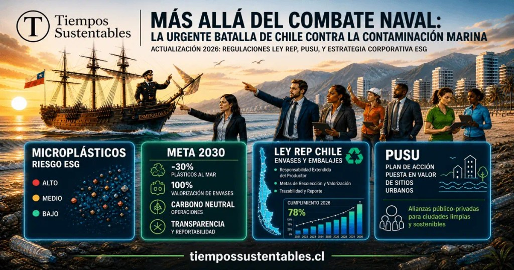

## **La contaminación marina en Chile es la acumulación de plásticos, vertidos industriales, aguas residuales y microplásticos que degradan activamente los ecosistemas costeros y la cadena alimentaria del Pacífico Sur.** 

Según datos del **Programa de las Naciones Unidas para el Medio Ambiente (PNUMA)**, Chile genera más de 1,1 millones de toneladas de residuos sólidos al año, parte de los cuales terminan en el océano, mientras la Ley REP y la Ley de Plásticos de Uso Único entraron en vigencia con fiscalización efectiva desde 2024. Las empresas que no se adapten a estas normativas enfrentan multas de hasta 10.000 UTA bajo la Ley REP, prohibiciones de comercialización y riesgo reputacional ante clientes y financistas ESG.

Este artículo explica el estado actual de la contaminación marina en Chile en 2026, cómo la Ley de Plásticos y la Ley REP cambian las obligaciones empresariales, qué estrategias ESG están adoptando las empresas más avanzadas y cuál es la ventana de acción disponible antes del próximo ciclo de fiscalización.

* * *

Cada 21 de mayo, Chile detiene su marcha para conmemorar las Glorias Navales, honrando el sacrificio en la bahía de Iquique. Sin embargo, en pleno 2026, el mar que forjó a nuestros héroes es hoy el escenario de una contienda igualmente crítica: la batalla medioambiental, regulatoria y económica.

Hace exactamente un año, publicamos en _Tiempos Sustentables_ el reportaje fundamental **[Más allá del combate naval: La urgente batalla de Iquique contra la contaminación marina](https://tiempossustentables.cl/2025/05/21/mas-alla-del-combate-naval/)**. En esa ocasión, encendimos las alarmas sobre el impacto de la macrobasura.

Hoy, el diagnóstico ya está hecho. La exigencia actual es la acción estratégica frente a un marco regulatorio implacable.

## **¿Cuál es el impacto del nuevo marco regulatorio en los océanos chilenos?**

La contaminación marina en las costas del norte grande y a lo largo de todo el territorio nacional ha dejado de ser un problema municipal para convertirse en un **riesgo de cumplimiento normativo (Compliance)** corporativo. Durante el último año, el ecosistema de negocios en Chile ha experimentado cambios estructurales:

- **Vigencia Total de la Ley de Plásticos de un Solo Uso (Febrero 2026):** La prohibición definitiva de entregar bombillas, cubiertos, revolvedores y envases de plumavit (EPS) en locales de expendio de alimentos ya es una realidad. Pese a esto, las auditorías costeras evidencian una brecha entre la ley y la cultura ciudadana, exigiendo mayor fiscalización y educación.

- **Despliegue Operativo de la Ley REP:** La recolección selectiva de la categoría "Envases y Embalajes" enfrenta su prueba de fuego. Los Sistemas de Gestión (GRANSIC) y los municipios luchan por garantizar la trazabilidad de los residuos para evitar que terminen en vertederos ilegales o en el océano.

## **De la amenaza al valor: La Economía Circular como estrategia ESG**

Para la industria que opera en Chile —especialmente en zonas costeras y ecosistemas portuarios— la acumulación de residuos industriales y las redes abandonadas (pesca fantasma) representan externalidades negativas intolerables para los mercados globales de hoy.

La verdadera integración de los **factores ESG (Ambientales, Sociales y de Gobernanza)** exige modelos de negocio basados en la **economía circular**. Invertir en infraestructura de biofiltración, modernización de plantas de selección de materiales (MRF) y tecnologías de trazabilidad digital ya no es un gasto, sino el equivalente a los "buques blindados" modernos que protegen la continuidad operativa y la reputación corporativa.

## **Preguntas Frecuentes sobre Contaminación y Normativa en Chile**

**¿Qué exige la Ley REP a las empresas en 2026?** La Ley de Responsabilidad Extendida del Productor (REP) obliga a las empresas que introducen productos prioritarios al mercado (como envases y embalajes) a organizar y financiar la gestión de los residuos derivados de estos, garantizando metas específicas de recolección y valorización.

**¿Cómo afecta la contaminación por microplásticos a la economía?** Los microplásticos no solo destruyen la biodiversidad marina, sino que ingresan a la cadena trófica, afectando directamente a la industria pesquera y acuícola, reduciendo el valor de las exportaciones chilenas y generando alarmas de salud pública a nivel internacional.

**¿Qué es el ecodiseño y por qué es vital para proteger el mar?** El ecodiseño es la concepción de productos pensando en todo su ciclo de vida. Es la estrategia corporativa más efectiva contra la contaminación marina, ya que previene la generación de residuos desde el origen, facilitando su posterior reciclaje, reutilización o compostaje.

## Un nuevo tipo de liderazgo

La salud de nuestros ecosistemas marinos requiere de un liderazgo empresarial que combine visión estratégica, empatía con el entorno y ejecución pragmática: requiere **cabeza fría** para analizar los datos y el riesgo regulatorio, **corazón activo** para entender el impacto social y medioambiental, y **manos firmes** para implementar los cambios operativos necesarios.

En este 21 de mayo, el mejor homenaje a quienes defendieron nuestra patria en el mar es garantizar que ese mismo océano siga vivo para el futuro. La verdadera gloria corporativa de hoy radica en liderar con propósito e impacto.

* * *

#### **¿Quieres profundizar en este tema?**

Descubre nuestra página pilar sobre Economía Circular, donde incluimos toda la información actualizada para la región.

[Leer la Guía Estratégica de Economía Circular en LATAM](https://tiempossustentables.cl/economia-circular-chile-latam/)
