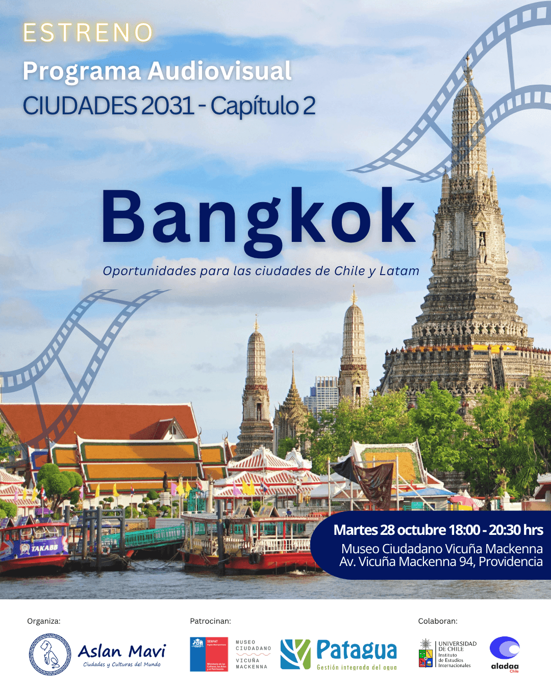
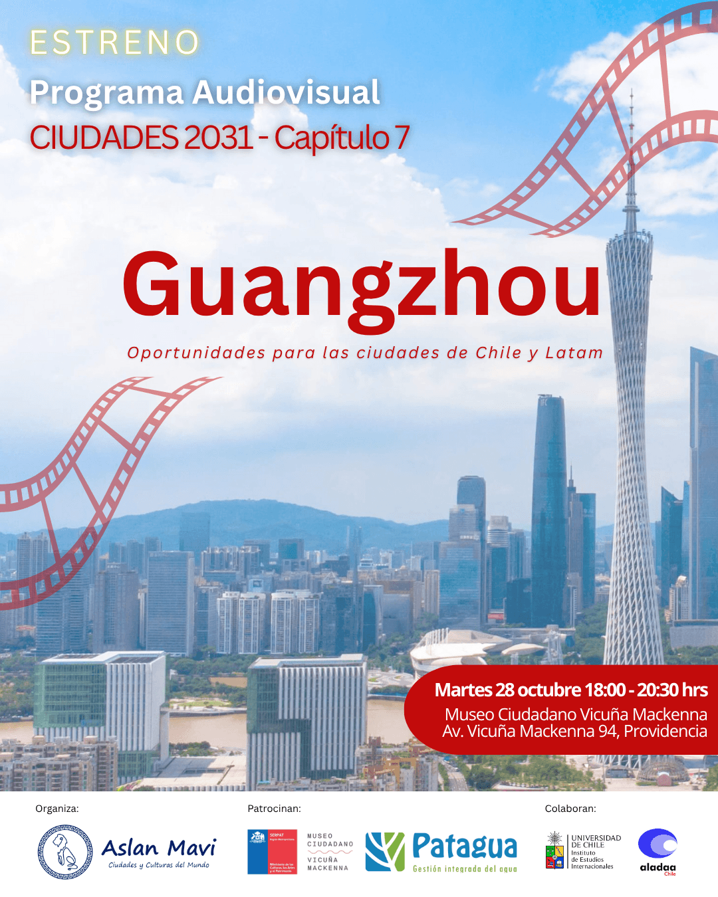

**El martes 28 de octubre se estrenan los capítulos 2 y 7 de «Ciudades 2031» en el Museo Ciudadano Vicuña Mackenna de Santiago. Este programa busca compartir buenas prácticas urbanas de Asia y Europa en América Latina. Habrá charlas, un conversatorio y oportunidades de networking para promover desarrollo sostenible e innovación urbana.**

El próximo martes 28 de octubre se llevará a cabo el estreno de los capítulos 2 y 7 del innovador programa audiovisual **"Ciudades 2031"**, producido por la consultora urbana y agencia creativa chilena ASLAN MAVI Ciudades y Culturas del Mundo. 

El evento tendrá lugar en el Auditorio del Museo Ciudadano Vicuña Mackenna (Av. Vicuña Mackenna 94, Providencia) desde las 18:00 hasta las 20:30 horas.

Este programa busca internacionalizar buenas prácticas urbanas y de desarrollo sostenible de ciudades de Europa y Asia en América Latina, destacando en esta ocasión las experiencias de Bangkok (Tailandia) y Guangzhou (China).

El evento contará con la destacada participación de representantes de la **Embajada de Filipinas en Chile**, la **Embajada de Panamá en Chile**, el **Instituto de Estudios Internacionales de la Universidad de Chile** y **Fundación CLEC**, institución que actúa como oficina regional del Ministerio de Educación de China para América Latina. 

El programa audiovisual presenta fragmentos significativos de notas culturales y entrevistas que permitirán abrir un espacio de diálogo acerca de las oportunidades y desafíos que enfrentan las ciudades de Chile y Latam para avanzar hacia un desarrollo urbano más sostenible.

<figure>

<figcaption>

**_Simón Villalobos_**

</figcaption>

</figure>

El evento incluye una charla inaugural a cargo de **Simón Villalobos**, Speaker, Planificador Urbano y director de ASLAN MAVI Ciudades y Culturas del Mundo. Además, habrá un conversatorio con expertos sectoriales, relativos a relaciones internacionales y sostenibilidad urbana, cerrando con un espacio de networking para promover la colaboración entre las personas e instituciones participantes.

ASLAN MAVI invita a los medios de comunicación y al público interesado en cooperación internacional, urbanismo, desarrollo sostenible e interculturalidad a sumarse a este evento que promueve la innovación urbana y ambiental desde una mirada global.

* * *

A continuación te invitamos a descargar la programación del evento y a participar por una de las 70 entradas gratuitas:

[Programación Estreno Ciudades 2031\_ASIA\_28 oct](https://tiempossustentables.cl/wp-content/uploads/2025/10/programacion-estreno-ciudades-2031_asia_28-oct.pdf)

**Se puede obtener una de las 70 entradas gratuita, inscribiéndose en el siguiente enlace: [https://forms.gle/fY21vMe2nTnd4Bm39](https://forms.gle/fY21vMe2nTnd4Bm39)**

**Martes 28 de octubre**

**18:00 a 20:30 horas** 

**Av. Vicuña Mackenna 94, Providencia, Santiago de Chile**

- [Avenida Vicuña Mackenna 94, Santiago, Chile](https://www.google.com/maps/search/?api=1&query=-33.441143,-70.633942)

* * *
